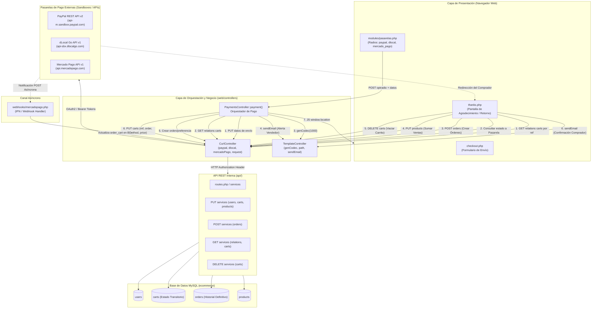
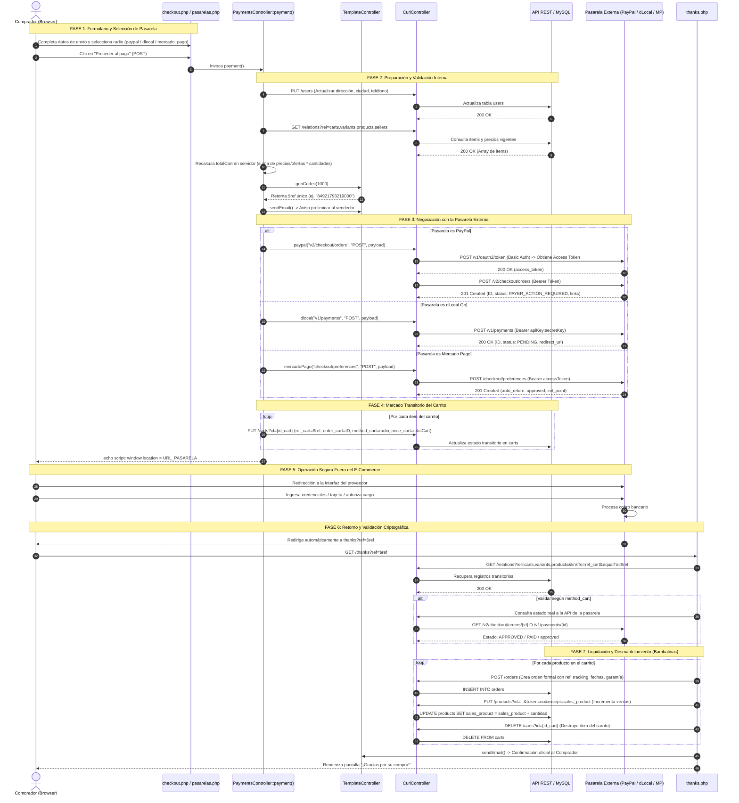
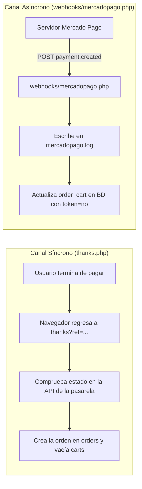

# Documentación Técnica Exhaustiva: Pasarelas de Pago y Flujos Transaccionales

> **Propósito:** Esta documentación técnica detalla con absoluta precisión la arquitectura, los componentes involucrados, los protocolos de comunicación HTTP/REST, los mecanismos de integración con pasarelas de pago externas (**PayPal**, **dLocal Go**, **Mercado Pago**), y todo el procesamiento interno (*"detrás de bambalinas"*) que la plataforma e-commerce ejecuta para transformar un carrito de compras en una orden formalmente liquidada.

---

## 1. Mapa de Componentes y su Influencia en el Pago

El sistema de pagos de este e-commerce no reside en un único script aislado; opera mediante una arquitectura distribuida en capas donde intervienen interfaces de usuario, controladores orquestadores, clientes cURL HTTP, micro-servicios REST locales, la base de datos MySQL y servidores de pasarelas internacionales.



### Matriz de Componentes del Proyecto

| Archivo / Componente | Capa | Rol e Influencia en el Pago |
|---|---|---|
| `web/views/pages/checkout/checkout.php` | Frontend / Vista | Contenedor principal del checkout. Valida que el usuario tenga sesión activa (`$_SESSION["user"]`) y que el carrito no esté vacío; si alguna falla, expulsa hacia `404`. |
| `web/views/pages/checkout/modules/datos.php` | Frontend / Formulario | Recoge y valida los datos de entrega: nombre, país (`select2` con código discado internacional), estado/departamento, ciudad, teléfono celular y dirección. |
| `web/views/pages/checkout/modules/carrito.php` | Frontend / Resumen | Itera los elementos del carrito, calcula subtotales visuales considerando ofertas (`offer_variant`), muestra fotos y datos del vendedor. |
| `web/views/pages/checkout/modules/pasarelas.php` | Frontend / Disparador | Presenta las opciones de pago mediante inputs `radio` con nombre `optradio` (`paypal`, `dlocal`, `mercado_pago`). **Instancia y ejecuta directamente** `$payment = new PaymentsController(); $payment->payment();` al recibirse el POST. |
| `web/controllers/payments.controller.php` | Controlador Web | **El cerebro orquestador del pago.** Actualiza el perfil de envío del usuario en la API interna, totaliza los ítems del carrito en el servidor, genera la referencia unívoca (`ref`), notifica al vendedor, invoca la API externa respectiva, asienta los datos de pago en `carts` y genera el script de redirección JS. |
| `web/controllers/curl.controller.php` | Adaptador HTTP | Contiene los clientes cURL que manejan las especificaciones técnicas de autenticación de cada proveedor: negociación OAuth2 para PayPal, autenticación Basic/Bearer para dLocal y Bearer AccessToken para Mercado Pago, además del método general `request()` para la API REST interna. |
| `web/controllers/template.controller.php` | Utilidades del Core | Genera la semilla criptográfica/alfanumérica de la referencia (`genCodec()`), determina la URL base absoluta (`path()`) y envía correos SMTP transaccionales con PHPMailer (`sendEmail()`). |
| `web/views/pages/thanks/thanks.php` | Controlador / Vista de Cierre | **El liquidador de la transacción.** Se activa cuando el navegador del usuario regresa de la pasarela con el parámetro `?ref=...`. Verifica el estado del pago contra la pasarela correspondiente; si está aprobado, crea las filas en `orders`, incrementa `sales_product`, destruye las filas en `carts` y envía el correo de compra confirmada. |
| `web/webhooks/mercadopago.php` | Webhook Asíncrono | Recibe notificaciones HTTP POST en segundo plano desde los servidores de Mercado Pago cuando ocurre el evento `payment.created`. Asocia asíncronamente el `payment_id` generado por Mercado Pago al carrito correspondiente. |
| `api/` (Endpoints REST) | Backend / Datos | Recibe todas las transacciones mediante `users`, `carts`, `orders`, `products` y `relations`, aplicando validación de esquemas dinámicos contra MySQL. |

---

## 2. El Flujo de Compra End-to-End (Paso a Paso)

El ciclo de vida del pago se divide en 8 etapas cronológicas:



---

## 3. Anatomía Detallada de las Pasarelas de Pago

### 3.1 Pasarela: PayPal (Checkout Orders v2 REST API)

PayPal opera bajo una arquitectura de dos pasos: primero solicita un **Bearer Access Token** dinámico vía OAuth2 y luego interactúa con el endpoint de órdenes.

#### A. Negociación y Adaptador Técnico (`CurlController::paypal`)
Ubicación: [curl.controller.php](file:///c:/xampp/htdocs/ecommerce/web/controllers/curl.controller.php#L42-L115)

```php
static public function paypal($url, $method, $fields){

    $endpoint = "https://api-m.sandbox.paypal.com/"; // TEST SANDBOX
    $clientId = "[REDACTADO_PAYPAL_CLIENT_ID]"; 
    $secretClient = "[REDACTADO_PAYPAL_SECRET]"; 

    // Paso 1: Codificación en Base64 de las credenciales ClientId:ClientSecret
    $basic = base64_encode($clientId.":".$secretClient);

    /*=============================================
    SOLICITUD DEL ACCESS TOKEN OAUTH2
    =============================================*/	
    $curl = curl_init();
    curl_setopt_array($curl, array(
      CURLOPT_URL => $endpoint."v1/oauth2/token",
      CURLOPT_RETURNTRANSFER => true,
      CURLOPT_CUSTOMREQUEST => "POST",
      CURLOPT_POSTFIELDS => 'grant_type=client_credentials',
      CURLOPT_HTTPHEADER => array(
        'Content-Type: application/x-www-form-urlencoded',
        'Authorization: Basic '.$basic,
        'Cookie: cookie_check=yes'
      ),
    ));

    $response = curl_exec($curl);
    curl_close($curl);
    $response = json_decode($response);
    $token = $response->access_token;

    /*=============================================
    LLAMADA AL ENDPOINT DE ÓRDENES
    =============================================*/	
    if(!empty($token)){
        $curl = curl_init();
        curl_setopt_array($curl, array(
          CURLOPT_URL => $endpoint.$url,
          CURLOPT_RETURNTRANSFER => true,
          CURLOPT_CUSTOMREQUEST => $method,
          CURLOPT_POSTFIELDS => $fields,
          CURLOPT_HTTPHEADER => array(
            'Content-Type: application/json',
            'Authorization: Bearer '.$token,
            'Cookie: cookie_check=yes'
          ),
        ));
        $response = curl_exec($curl);
        curl_close($curl);
        return json_decode($response);
    }
}
```

#### B. Construcción del Payload de Creación
Ubicación: [payments.controller.php](file:///c:/xampp/htdocs/ecommerce/web/controllers/payments.controller.php#L82-L109)

```php
if($_POST["optradio"] == "paypal"){

    $url = "v2/checkout/orders";
    $method = "POST";
    $fields = '{
      "intent": "CAPTURE",
      "purchase_units": [
        {
          "reference_id": "'.$ref.'",
          "amount": {
            "currency_code": "MXN",
            "value": "'.$totalCart.'"
          }
        }
      ],
      "payment_source": {
        "paypal": {
          "experience_context": {
            "payment_method_preference": "IMMEDIATE_PAYMENT_REQUIRED",
            "user_action": "PAY_NOW",
            "return_url": "'.TemplateController::path().'thanks?ref='.$ref.'",
            "cancel_url": "'.TemplateController::path().'checkout"
          }
        }
      }
    }';

    $paypal = CurlController::paypal($url,$method,$fields);
```

#### C. Lógica de Redirección y Guardado
1. **Condición de Éxito**: PayPal devuelve `status == "PAYER_ACTION_REQUIRED"`.
2. **Identificador**: El ID generado (ej: `5O190127TN364715T`) se guarda en `carts.order_cart`.
3. **URL de Salto**: PayPal devuelve una matriz `links`. La posición `links[1]->href` contiene la URL de aprobación (`rel: "payer-action"`):
   ```javascript
   window.location = "https://www.sandbox.paypal.com/checkoutnow?token=5O190127TN364715T";
   ```

#### D. Validación de Retorno en `thanks.php`
Ubicación: [thanks.php](file:///c:/xampp/htdocs/ecommerce/web/views/pages/thanks/thanks.php#L27-L38)

```php
if($carts[0]->method_cart == "paypal"){

  $url = "v2/checkout/orders/".$carts[0]->order_cart;
  $paypal = CurlController::paypal($url, "GET", array());

  if(!empty($paypal->status) && $paypal->status == "APPROVED"){
     $status = "ok";
  }
}
```

---

### 3.2 Pasarela: dLocal Go (Direct Payments API v1)

Diseñada para pagos en América Latina y mercados emergentes. Funciona mediante un modelo simplificado de API Key / Secret Key en un solo paso.

#### A. Adaptador Técnico (`CurlController::dlocal`)
Ubicación: [curl.controller.php](file:///c:/xampp/htdocs/ecommerce/web/controllers/curl.controller.php#L121-L153)

```php
static public function dlocal($url, $method, $fields){

    $endpoint = "https://api-sbx.dlocalgo.com/"; // TEST SANDBOX
    $apiKey = "[REDACTADO_DLOCAL_API_KEY]"; 
    $secretKey = "[REDACTADO_DLOCAL_SECRET]"; 

    $curl = curl_init();
    curl_setopt_array($curl, array(
      CURLOPT_URL => $endpoint.$url,
      CURLOPT_RETURNTRANSFER => true,
      CURLOPT_CUSTOMREQUEST => $method,
      CURLOPT_POSTFIELDS => $fields,
      CURLOPT_HTTPHEADER => array(
        'Content-Type: application/json',
        'Authorization: Bearer '.$apiKey.':'.$secretKey // Esquema combinado de cabecera
      ),
    ));

    $response = curl_exec($curl);
    curl_close($curl);
    return json_decode($response);
}
```

#### B. Construcción del Payload y Manejo de Errores
Ubicación: [payments.controller.php](file:///c:/xampp/htdocs/ecommerce/web/controllers/payments.controller.php#L154-L205)

```php
if($_POST["optradio"] == "dlocal"){

    $url = "v1/payments";
    $method = "POST";
    $fields = '{
        "amount": '.$totalCart.',
        "country": "MX",
        "currency" : "MXN",
        "success_url": "'.TemplateController::path().'thanks?ref='.$ref.'",
        "back_url": "'.TemplateController::path().'checkout"
    }';

    $dlocal = CurlController::dlocal($url,$method,$fields);

    if(!empty($dlocal->status) && $dlocal->status == "PENDING"){
        // Almacena $dlocal->id en carts.order_cart y redirige:
        echo '<script>window.location ="'.$dlocal->redirect_url.'"</script>';
    }else{
        // En caso de fallo o credenciales no autorizadas (código 3003 de sandbox):
        $dlocalMsg = !empty($dlocal->message) ? $dlocal->message : "Las credenciales sandbox de D-Local Go no están autorizadas (Código 3003).";
        echo '<script>
            fncMatPreloader("off");
            fncSweetAlert("error", "Error D-Local Go: '.$dlocalMsg.' Por favor selecciona PayPal o Mercado Pago para pagar.", "");
        </script>';
    }
}
```

#### C. Validación de Retorno en `thanks.php`
Ubicación: [thanks.php](file:///c:/xampp/htdocs/ecommerce/web/views/pages/thanks/thanks.php#L44-L55)

```php
if($carts[0]->method_cart == "dlocal"){

  $url = "v1/payments/".$carts[0]->order_cart;
  $dlocal = CurlController::dlocal($url, "GET", array());

  if(!empty($dlocal->status) && $dlocal->status == "PAID"){
     $status = "ok";
  }
}
```

---

### 3.3 Pasarela: Mercado Pago (Checkout Pro Preferences API)

Mercado Pago utiliza el modelo de **Preferencia de Pago**. No se envía una orden directa de cobro, sino que se genera una preferencia que prepara la pasarela y devuelve un punto de inicio (`init_point`).

#### A. Adaptador Técnico (`CurlController::mercadoPago`)
Ubicación: [curl.controller.php](file:///c:/xampp/htdocs/ecommerce/web/controllers/curl.controller.php#L159-L189)

```php
static public function mercadoPago($url, $method, $fields){

    $endpoint = "https://api.mercadopago.com/"; 
    $accessToken = "[REDACTADO_MERCADOPAGO_TOKEN]"; 

    $curl = curl_init();
    curl_setopt_array($curl, array(
      CURLOPT_URL => $endpoint.$url,
      CURLOPT_RETURNTRANSFER => true,
      CURLOPT_CUSTOMREQUEST => $method,
      CURLOPT_POSTFIELDS => $fields,
      CURLOPT_HTTPHEADER => array(
        'Content-Type: application/json',
        'Authorization: Bearer '.$accessToken
      ),
    ));

    $response = curl_exec($curl);
    curl_close($curl);
    return json_decode($response);
}
```

#### B. Creación de la Preferencia y Particularidad del `order_cart`
Ubicación: [payments.controller.php](file:///c:/xampp/htdocs/ecommerce/web/controllers/payments.controller.php#L213-L278)

```php
if($_POST["optradio"] == "mercado_pago"){

    $url = "checkout/preferences";
    $method = "POST";
    $basePath = TemplateController::path();
    // Mercado Pago rechaza URLs de retorno HTTP; el código fuerza protocolo HTTPS:
    $securePath = str_replace("http://", "https://", $basePath);

    $fields = '{
       "auto_return":"approved",
        "back_urls": {
            "success":"'.$securePath.'thanks?ref='.$ref.'",
            "pending":"'.$securePath.'thanks?ref='.$ref.'",
            "failure":"'.$securePath.'checkout"
        },
        "expires": false,
        "items": [
            {
            "title": "Pago en Ecommerce",
            "quantity": 1,
            "currency_id": "MXN",
            "unit_price": '.round($totalCart, 2).'
            }
        ],
        "notification_url":"'.$securePath.'thanks"
    }';

    $mercadoPago = CurlController::mercadoPago($url,$method,$fields);

    if(!empty($mercadoPago->auto_return) && $mercadoPago->auto_return == "approved"){

        foreach ($carts as $key => $value) {
            // ¡ATENCIÓN!: En Mercado Pago, el ID de cobro aún no existe.
            // Se asienta 'order_cart' como NULL/vacío temporalmente:
            $fields = "ref_cart=".$ref."&order_cart=".null."&method_cart=".$_POST["optradio"]."&price_cart=".$totalCart;
            CurlController::request("carts?id=".$value->id_cart."...", "PUT", $fields);
        }

        // Selección dinámica entre endpoint Sandbox y Live:
        $redirectMp = !empty($mercadoPago->sandbox_init_point) ? $mercadoPago->sandbox_init_point : $mercadoPago->init_point;

        echo '<script>window.location ="'.$redirectMp.'"</script>';
    }
}
```

#### C. Validación de Doble Vía en `thanks.php`
A diferencia de PayPal y dLocal, Mercado Pago inyecta parámetros en la query string de retorno: `?ref=...&payment_id=1312345678&status=approved&merchant_order_id=...`.

Ubicación: [thanks.php](file:///c:/xampp/htdocs/ecommerce/web/views/pages/thanks/thanks.php#L61-L116)

```php
if($carts[0]->method_cart == "mercado_pago"){

  // Caso 1: Primera vez que llega el usuario (order_cart aún está vacío en la BD)
  if($carts[0]->order_cart == ""){

    if(isset($_GET["payment_id"])){

      foreach ($carts as $key => $value) {
        // Asienta el payment_id real en la BD de carts
        $url = "carts?id=".$value->id_cart."&nameId=id_cart&token=".$_SESSION["user"]->token_user."&table=users&suffix=user";
        $fields = "order_cart=".$_GET["payment_id"];
        CurlController::request($url, "PUT", $fields);
      }

      // Consulta a Mercado Pago el estado real del cobro usando payment_id
      $url = "v1/payments/".$_GET["payment_id"];
      $mercadoPago = CurlController::mercadoPago($url, 'GET', array());

      if(!empty($mercadoPago->status) && $mercadoPago->status == "approved"){
        $status = "ok";
      }
    }

  // Caso 2: Recarga de página o webhook previo (order_cart ya contiene el ID)
  }else{

    $url = "v1/payments/".$carts[0]->order_cart;
    $mercadoPago = CurlController::mercadoPago($url, 'GET', array());

    if(!empty($mercadoPago->status) && $mercadoPago->status == "approved"){
      $status = "ok";
    }
  }
}
```

---

## 4. "Detrás de Bambalinas": Lo que el Usuario Nunca Ve

Durante todo el proceso en el que el comprador observa una simple pantalla de carga (*"procesando para pagar..."*) y luego es redirigido a una pasarela, ocurren complejas operaciones en la trastienda técnica:

```mermaid
stateDiagram-v2
    [*] --> CarritoActivo: Usuario añade productos
    CarritoActivo --> BloqueadoParaPago: Clic en 'Proceder al Pago'
    note right of BloqueadoParaPago
      1. Se actualiza dirección en 'users'
      2. Se calcula totalCart en servidor
      3. Se genera $ref (timestamp+rand)
      4. Se manda email preventivo al vendedor
    end note

    BloqueadoParaPago --> EnPasarela: Se graban ref_cart y order_cart
    note right of EnPasarela
      La tabla 'carts' pasa a funcionar
      como una memoria de espera de pago
    end note

    EnPasarela --> PagoAprobado: Retorno a thanks.php (status == ok)
    EnPasarela --> PagoCancelado: Usuario cancela o abandona en pasarela

    PagoCancelado --> CarritoActivo: Vuelve a checkout

    state PagoAprobado {
        [*] --> CrearOrdenes: POST /orders por cada item
        CrearOrdenes --> IncrementarVentas: PUT /products (sales_product + qty)
        IncrementarVentas --> DestruirCarrito: DELETE /carts por cada item
        DestruirCarrito --> NotificarCliente: TemplateController::sendEmail
    }

    PagoAprobado --> HistorialDefinitivo: Proceso completado
    HistorialDefinitivo --> [*]
```

### 1. La Tabla `carts` como Máquina de Estados Transitoria
La tabla `carts` no es simplemente una lista de deseos; funciona como un **búfer de retención transaccional**.
Cuando el usuario entra a pagar, `PaymentsController` ejecuta una mutación masiva sobre todos los registros de ese usuario en `carts`:

```sql
UPDATE carts 
SET ref_cart = '84921793219000',
    order_cart = '5O190127TN364715T',
    method_cart = 'paypal',
    price_cart = 1499.00
WHERE id_cart = 7;
```

Esto vincula de forma indestructible el carrito local con la transacción remota antes de que el usuario abandone el sitio web.

### 2. El Código de Correlación Unívoco (`$ref`)
La función `TemplateController::genCodec(1000)` genera un número pseudoaleatorio combinado con el timestamp Unix actual:
```php
$codec = rand(1000, 9999) . time(); // Ej: 58321793218900
```
Esta referencia es el **token de conciliación**: viaja a la pasarela (como `reference_id` en PayPal o como parámetro en `success_url` en dLocal y Mercado Pago), vuelve con el usuario en la query string `?ref=...`, y permite a `thanks.php` recuperar exactamente los ítems comprados mediante:
```text
GET /relations?rel=carts,variants,products&linkTo=ref_cart&equalTo=58321793218900
```

### 3. Notificación Preventiva de Intención de Pago
Antes de que la pasarela confirme un solo centavo, `PaymentsController::payment()` dispara un correo electrónico al administrador/vendedor:
```php
$subject = "Recibirá un pago de $".number_format($totalCart,2)." a través de".$_POST["optradio"];
$email = null; // TemplateController lo convierte por defecto a 'admin@ecommerce.com'
TemplateController::sendEmail($subject, $email, $title, $message, $link);
```
El vendedor se entera de que un cliente tiene la firme intención de pagar, con el número de teléfono, ciudad, dirección y referencia generada.

### 4. Transformación de Ítems: De `carts` a `orders`
En `thanks.php`, el carrito desaparece y nace el registro formal de auditoría en `orders`:
```php
$fields = array(
  "id_user_order" => $value->id_user_cart,
  "uniqid_order" => uniqid(),
  "id_product_order" => $value->id_product_cart,
  "id_variant_order" => $value->id_variant_cart,
  "quantity_order" => $value->quantity_cart,
  "price_order" => $value->price_cart,
  "ref_order" => $value->ref_cart,
  "number_order" => $value->order_cart,
  "method_order" => $value->method_cart,
  "warranty_order" => 7,             // Garantía por defecto de 7 días
  "process_order" =>  $process_order, // 0 = En preparación (físico), 2 = Entregado (digital)
  "start_date_order" => date("Y-m-d"),
  "date_created_order" => date("Y-m-d")
);
$orders = CurlController::request("orders?token=...", "POST", $fields);
```

#### Regla de Negocio Oculta (`process_order`):
- Si `$value->type_variant == "gallery"`, el producto es físico con variantes de fotos: se asigna **`process_order = 0`** (Estado: Pendiente de Envío / Almacén).
- Si no es galería (ej. video o curso digital): se asigna **`process_order = 2`** (Estado: Completado / Acceso Inmediato).

### 5. Bypass de Seguridad para Actualización de Ventas
La API REST por defecto exige token JWT del usuario o administrador para cualquier operación `PUT` o `POST`. Sin embargo, `thanks.php` necesita incrementar las ventas del producto sin requerir permisos elevados del cliente:
```php
$url = "products?id=".$value->id_product_cart."&nameId=id_product&token=no&except=sales_product";
$method = "PUT";
$fields = "sales_product=".$value->sales_product+$value->quantity_cart;
$updateProduct = CurlController::request($url,$method,$fields);
```
En la API (`api/routes/services/put.php`), el parámetro especial `token=no&except=sales_product` autoriza la modificación de la tabla sin firma JWT siempre y cuando la columna pasada en `except` exista formalmente en la base de datos.

### 6. Destrucción del Carrito y Garantía de Idempotencia Natural
Una vez insertada la orden y sumada la venta:
```php
$url = "carts?id=".$value->id_cart."&nameId=id_cart&token=".$_SESSION["user"]->token_user."&table=users&suffix=user";
$deleteCart = CurlController::request($url, "DELETE", array());
```
**¿Qué pasa si el comprador presiona F5 (Refrescar) en `thanks?ref=...`?**
El código contiene un mecanismo de seguridad pasivo:
1. Al recargar, `GET /relations...equalTo=$ref` en la tabla `carts` responde **404 (Vacío)** porque las filas acaban de ser eliminadas.
2. Al detectar que el carrito ya no existe, el bloque `else` de `thanks.php` ejecuta:
   ```php
   $url = "relations?rel=orders,variants,products&linkTo=ref_order&equalTo=".$_GET["ref"];
   $carts = CurlController::request($url,$method,$fields);
   ```
3. Recupera los datos directamente desde la tabla `orders` ya consolidada, evitando que la compra se vuelva a procesar, que se cobren comisiones duplicadas o que se descuenten ventas dobles.

---

## 5. El Webhook Asíncrono de Mercado Pago (`webhooks/mercadopago.php`)

Existe un punto de entrada adicional en el sistema para notificaciones desatendidas:

Ubicación: [mercadopago.php](file:///c:/xampp/htdocs/ecommerce/web/webhooks/mercadopago.php)

```php
if(isset($_SERVER["REQUEST_METHOD"]) && $_SERVER["REQUEST_METHOD"] == "POST"){   
    
    $webhook = file_get_contents('php://input');
    $web = json_decode($webhook);

    // Registro de auditoría crudo en disco
    file_put_contents('mercadopago.log', $webhook. PHP_EOL, FILE_APPEND);	

    if($web->action == "payment.created"){

        // Busca el carrito usando el parámetro ref enviado en el query string del webhook
        $url = "carts?linkTo=ref_cart&equalTo=".$_GET["ref"];
        $carts = CurlController::request($url,"GET",array());

        if($carts->status == 200){
            foreach ($carts->results as $key => $value) {
                // Asienta asíncronamente el ID de la pasarela sin requerir token JWT de usuario:
                $url = "carts?id=".$value->id_cart."&nameId=id_cart&token=no&except=ref_cart";
                $fields = "order_cart=".$web->data->id;
                CurlController::request($url,"PUT",$fields);
            }
        }
    }
}
```

### Comparativa: Retorno Síncrono vs. Webhook Asíncrono



| Característica | Canal Síncrono (`thanks.php`) | Canal Asíncrono (`webhooks/mercadopago.php`) |
|---|---|---|
| **Disparador** | El navegador del cliente al ser redirigido por la pasarela. | Servidor central de Mercado Pago mediante HTTP POST externo. |
| **Dependencia** | Si el cliente cierra el navegador o se queda sin batería en la pasarela, **no se ejecuta**. | Se ejecuta siempre, incluso si el cliente cerró el navegador. |
| **Autenticación** | Requiere la sesión activa `$_SESSION["user"]->token_user`. | Opera desatendido usando el bypass `token=no&except=ref_cart`. |
| **Alcance** | Liquida la orden completa: crea registros en `orders`, destruye `carts` y envía emails. | Solo vincula el `order_cart` (`$web->data->id`) al carrito transitorio. |
| **Pasarelas soportadas** | PayPal, dLocal Go, Mercado Pago. | Únicamente Mercado Pago. |

---

## 6. Hallazgos Críticos de Auditoría Financiera y Transaccional

Al auditar a bajo nivel el código de `payments.controller.php`, `thanks.php` y `mercadopago.php`, se identifican 5 comportamientos que todo arquitecto de software debe conocer:

### 1. Sobrescritura de Precios en Carritos con Múltiples Productos
En `payments.controller.php` (Línea 119):
```php
$fields = "ref_cart=".$ref."&order_cart=".$paypal->id."&method_cart=".$_POST["optradio"]."&price_cart=".$totalCart;
```
Y posteriormente en `thanks.php` (Línea 145):
```php
"price_order" => $value->price_cart,
```
**Impacto:** Si un cliente compra 3 productos distintos (Producto A por $200, Producto B por $300 y Producto C por $500; total = $1,000), el código asigna `$totalCart` ($1,000) a **cada una de las 3 filas** en `carts`. Al crearse las órdenes en `thanks.php`, se crean 3 órdenes donde cada una dice haber costado $1,000, inflando los informes contables a $3,000.  
**Solución recomendada:** Calcular `price_order = ($value->offer_variant > 0 ? $value->offer_variant : $value->price_variant) * $value->quantity_cart;`.

### 2. Aprobación vs. Captura en PayPal
En `thanks.php` (Línea 32), se valida:
```php
if(!empty($paypal->status) && $paypal->status == "APPROVED")
```
**Impacto:** En PayPal v2, una orden con `"intent": "CAPTURE"` pasa a estado `APPROVED` cuando el pagador inicia sesión y da su consentimiento, pero los fondos **no son transferidos a la cuenta del vendedor** hasta que el backend ejecuta la llamada:
```text
POST /v2/checkout/orders/{order_id}/capture
```
Si la cuenta de PayPal no tiene activada la captura automática inmediata, el e-commerce despacha el pedido (`orders`) cuando el dinero aún está en retención y no en balance.  
**Solución recomendada:** Ejecutar la captura formal y verificar `status == "COMPLETED"`.

### 3. Precedencia de Operadores en el Incremento de Ventas
En `thanks.php` (Línea 166):
```php
$fields = "sales_product=".$value->sales_product+$value->quantity_cart;
```
**Impacto:** En PHP 8+, la concatenación `.` y la suma `+` tienen precedencias que pueden provocar advertencias de tipo (*TypeError* o *Deprecated Notice*), evaluando `"sales_product=" . $value->sales_product` antes de sumar.  
**Solución recomendada:** Envolver la suma en paréntesis:
```php
$fields = "sales_product=".($value->sales_product + $value->quantity_cart);
```

### 4. Ruta Absoluta Rígida en el Webhook de Mercado Pago
En `webhooks/mercadopago.php` (Línea 8):
```php
require_once "/home/customer/www/ecommerce.com/public_html/culr.controller.php";
```
**Impacto:** La ruta apunta a un servidor específico de SiteGround (`/home/customer/...`) con un error tipográfico (`culr` en lugar de `curl`). En un entorno local (XAMPP `C:\xampp\...`) o en cualquier otro hosting, el webhook arroja un error fatal (*Fatal Error: require_once failed*) y no procesa la notificación.  
**Solución recomendada:** Utilizar rutas relativas seguras:
```php
require_once "../controllers/curl.controller.php";
```

### 5. Falta de Transacciones Atómicas (ACID)
Toda la liquidación en `thanks.php` se ejecuta mediante un bucle `foreach` que hace múltiples llamadas HTTP cURL consecutivas a la API REST. Si la conexión se interrumpe durante el segundo producto de tres:
- El producto 1 queda registrado en `orders` y borrado de `carts`.
- El producto 2 no se registra en `orders` pero se borra de `carts`.
- No existe un mecanismo de `ROLLBACK` en base de datos porque cada llamada cURL corre en una transacción MySQL independiente.

---

## 7. Resumen de Estados de una Transacción

| Pasarela | Estado de Creación (en `PaymentsController`) | Estado de Liquidación (en `thanks.php`) | Acción del Sistema |
|---|---|---|---|
| **PayPal** | `PAYER_ACTION_REQUIRED` | `APPROVED` (o `COMPLETED`) | Transfiere a `orders`, incrementa `sales_product`, borra de `carts`. |
| **dLocal Go** | `PENDING` | `PAID` | Transfiere a `orders`, incrementa `sales_product`, borra de `carts`. |
| **Mercado Pago** | `approved` (en `auto_return`) | `approved` | Guarda `payment_id`, transfiere a `orders`, incrementa `sales_product`, borra de `carts`. |

---

## 8. Conclusiones para el Equipo de Desarrollo

1. **El núcleo transaccional es confiable en su lógica de flujo**, garantizando que el usuario jamás defina el precio desde el cliente y protegiendo la navegación mediante doble verificación con las APIs oficiales.
2. **La tabla `carts` es el punto de enlace crítico**: cualquier mantenimiento en la base de datos debe preservar intactos los campos `ref_cart`, `order_cart`, `method_cart` y `price_cart`.
3. **Para ambientes de producción**, es indispensable:
   - Centralizar las credenciales de pasarela fuera del código fuente en variables de entorno.
   - Corregir el cálculo de `price_order` en carritos multilínea.
   - Reparar la ruta del webhook de Mercado Pago y añadir webhooks análogos para PayPal y dLocal Go.
   - Forzar siempre protocolo HTTPS tanto en el frontend como en las URLs de retorno (`back_urls` y `return_url`).
