# IMPLEMENTACIÓN DE PASARELAS DE PAGO EN PLATAFORMAS E-COMMERCE COMO ESTRATEGIA PARA EL DESARROLLO DE COMPETENCIAS TECNOLÓGICAS

---

## PORTADA OFICIAL INSTITUCIONAL

**TECNOLÓGICO NACIONAL DE MÉXICO**  
**INSTITUTO TECNOLÓGICO DE ÁLVARO OBREGÓN (ITAO)**  
**SUBDIRECCIÓN ACADÉMICA — DIVISIÓN DE ESTUDIOS PROFESIONALES**  
**DEPARTAMENTO DE INGENIERÍA EN TECNOLOGÍAS DE LA INFORMACIÓN Y COMUNICACIONES**


* **TÍTULO DEL TRABAJO RECEPCIONAL:**  
  *Implementación de Pasarelas de Pago en Plataformas E-Commerce como Estrategia para el Desarrollo de Competencias Tecnológicas*
* **MODALIDAD DE TITULACIÓN:**  
  Tesina Profesional (Investigación Aplicada, Auditoría Forense de Software y Reingeniería Arquitectónica)
* **CARRERA:**  
  Ingeniería en Tecnologías de la Información y Comunicaciones (ITIC)
* **PRESENTA:**  
  Aspirante a Titulación en Ingeniería en Tecnologías de la Información y Comunicaciones
* **COMITÉ REVISOR Y ASESORÍA ACADÉMICA:**  
  Academia de Ingeniería de Software, Redes y Ciberseguridad — Instituto Tecnológico de Álvaro Obregón (ITAO)
* **CÓDIGO DEL SISTEMA AUDITADO Y REFACTORIZADO:**  
  Plataforma E-Commerce Multi-Pasarela (`ECOM-001` / Arquitectura Legacy MVC PHP 8.2 + MySQL/MariaDB 10.4 $\rightarrow$ Arquitectura Vanguardista Slim 4 + PHP-DI + Eloquent ORM + PayPal Orders v2 + PHPUnit)
* **LUGAR Y FECHA DE PUBLICACIÓN:**  
  Ciudad de México, México — Noviembre de 2026

---

## FICHA CATALOGRÁFICA Y DECLARACIÓN DE RIGOR TÉCNICO

| Metadato Documental | Especificación Oficial |
| :--- | :--- |
| **Institución Otorgante** | Tecnológico Nacional de México (TecNM) — Campus Instituto Tecnológico de Álvaro Obregón (ITAO) |
| **Línea de Investigación** | Ingeniería de Software Aplicada, Ciberseguridad Transaccional y Tecnología Educativa en Educación Superior |
| **Metodología Documental** | Revisión Sistemática de Literatura (Kitchenham & Charters, 2007), Muestreo *Snowballing* (Wohlin, 2014) y Declaración PRISMA 2020 |
| **Marcos Normativos y Técnicos** | PCI DSS v4.0.1, EMV 3D Secure 2.0 (PSD2 SCA), ISO 8583:2003, ISO 20022, OWASP Top 10:2021, PSR-4/PSR-7/PSR-11/PSR-15 |
| **Marcos de Competencias** | Marco Europeo *DigComp 2.2*, *SWEBOK v4.0*, *SFIA v9* y Modelo Propuesto **MADCE** (Niveles 1 a 5) |
| **Métrica Empírica de Impacto** | Ganancia de Aprendizaje Relativa de Hake ($g = \frac{\%Post - \%Pre}{100\% - \%Pre}$) sobre muestra estudiantil del ITAO |
| **Trazabilidad de Código Fuente** | Verificación estática (SAST) y dinámica sobre el repositorio `c:/xampp/htdocs/ecommerce` (`api/`, `web/`, `src/`, `tests/`) |

---

## ÍNDICE GENERAL DEL DOCUMENTO

* **PORTADA OFICIAL INSTITUCIONAL**
* **FICHA CATALOGRÁFICA Y DECLARACIÓN DE RIGOR TÉCNICO**
* **ÍNDICE DE FIGURAS, DIAGRAMAS Y BLOQUES DE CÓDIGO**
* **RESUMEN EJECUTIVO / ABSTRACT**
* **CAPÍTULO 1: INTRODUCCIÓN Y PLANTEAMIENTO DEL PROBLEMA**
  * 1.1 Contexto Global, Regional y Nacional de la Transformación del Comercio Electrónico
  * 1.2 Planteamiento del Problema y Brecha Pedagógico-Tecnológica en Educación Superior (ITAO)
  * 1.3 Definición de la Problemática Central de Ingeniería y Pedagogía
  * 1.4 Pregunta General y Preguntas Específicas de Investigación
  * 1.5 Delimitaciones del Estudio (Temática, Espacial, Temporal, Conceptual, Tecnológica y Poblacional)
  * 1.6 Objetivos de la Investigación (Objetivo General y Objetivos Específicos)
  * 1.7 Justificación Multidimensional (Científica, Tecnológica, Social, Económica y Profesional)
  * 1.8 Sistema de Hipótesis ($H_1, H_0$) y Supuestos de Investigación
* **CAPÍTULO 2: ESTADO DEL ARTE, MARCO TEÓRICO Y MARCO CONCEPTUAL**
  * 2.1 Estado del Arte y Metodología de Revisión Sistemática (SLR, Snowballing y Protocolo PRISMA 2020)
  * 2.2 Fundamentos del Comercio Electrónico y Arquitectura Transaccional de Pagos en Tres Capas
  * 2.3 Cumplimiento Normativo PCI DSS v4.0.1, Reducción de Alcance (SAQ A vs. SAQ D) y Tokenización de Red (VTS/MDES)
  * 2.4 Arquitectura EMV 3D Secure 2.0 (EMV 3DS), PSD2 SCA y Transferencia de Responsabilidad (*Liability Shift*)
  * 2.5 Estándares de Mensajería Financiera Interbancaria: De ISO 8583 (Mapas de Bits) a ISO 20022 (Esquemas XML/JSON)
  * 2.6 Marcos de Competencias Tecnológicas: DigComp 2.2, SWEBOK v4.0 / SFIA v9 y el Modelo Propuesto MADCE
  * 2.7 Marco Conceptual: Descomposición Semántica, Conceptualización y Articulación Teórica
* **CAPÍTULO 3: MARCO METODOLÓGICO Y DISEÑO DE LA INVESTIGACIÓN**
  * 3.1 Diseño General, Enfoque Mixto, Alcance y Métodos de Investigación
  * 3.2 Población, Muestra y Criterios de Selección en el Instituto Tecnológico de Álvaro Obregón (ITAO)
  * 3.3 Técnicas de Recolección de Datos y Auditoría Forense de Software
  * 3.4 Matriz de Operacionalización de Variables (Variable Independiente y Variable Dependiente)
  * 3.5 Procedimiento Metodológico y Fases de Ejecución del Proyecto
  * 3.6 Identificación y Mapeo de Competencias Tecnológicas Desarrolladas
  * 3.7 Diseño y Validación de los Instrumentos de Evaluación (Pre-test, Post-test y Rúbrica MADCE)
  * 3.8 Plan de Procesamiento Estadístico y Ganancia de Aprendizaje Relativa de Hake ($g$)
* **CAPÍTULO 4: DESARROLLO TÉCNICO, INGENIERÍA INVERSA, AUDITORÍA FORENSE Y REINGENIERÍA ARQUITECTÓNICA**
  * 4.1 Clasificación Arquitectónica Real del Sistema E-Commerce Base (`web/` SSR + `api/` Motor REST Dinámico)
  * 4.2 Modelo de Datos Relacional (`ecommerce (1).sql`), Convención de Sufijos, Joins en Estrella y Deriva Esquema-Código (`DRIFT-01` a `DRIFT-05`)
  * 4.3 Inventario Técnico del Motor API RESTful (`api/`) y de los 16 Puentes AJAX (`web/ajax/*.ajax.php`)
  * 4.4 Anatomía End-to-End del Flujo de Compra y de las Pasarelas de Pago (PayPal, dLocal Go y Mercado Pago) con Código Explicado Línea por Línea
  * 4.5 Auditoría Forense de Defectos Financieros y Transaccionales (`FIN-01` a `FIN-07` / `FIND-001` a `FIND-015`)
  * 4.6 Auditoría de Ciberseguridad Basada en Evidencia (`SEC-01` a `SEC-09`: Credenciales Expuestas, JWT, CSRF, SQLi, RCE, IDOR, PII y RBAC)
  * 4.7 Reingeniería Arquitectónica Vanguardista: Consolidación en PayPal Orders v2, Slim 4, PHP-DI, Eloquent ORM y Webhooks Verificados (`src/`)
  * 4.8 Ingeniería de Pruebas Automatizadas con PHPUnit y Guzzle `MockHandler` (100% Cobertura) y Pipeline CI/CD en GitHub Actions
  * 4.9 Orquestación Agéntica y Subagéntica para la Modernización de Sistemas (`agents.md`)
  * 4.10 Manuales Operativos de Usuario Final y de Administrador del Sistema (`ECOM-001`)
* **CAPÍTULO 5: RESULTADOS, DISCUSIÓN Y CONCLUSIONES**
  * 5.1 Resultados de la Auditoría Técnica de Software, Remediación de Vulnerabilidades y Suite de Pruebas
  * 5.2 Resultados Empíricos de la Intervención Educativa en el ITAO y Cálculo Detallado del Factor de Hake ($g$)
  * 5.3 Discusión de Hallazgos y Triangulación Científica con el Estado del Arte
  * 5.4 Conclusiones Generales de la Tesina (Respuesta Puntual a Preguntas y Objetivos)
  * 5.5 Recomendaciones Institucionales y Líneas de Trabajo Futuro
* **ANEXO A: MATRIZ DE TRAZABILIDAD COMPLETA DEL SISTEMA (`TR-001` A `TR-035`)**
* **ANEXO B: GLOSARIO TÉCNICO Y NORMATIVO EXHAUSTIVO DEL PROYECTO**
* **ANEXO C: INSTRUMENTOS DE EVALUACIÓN APLICADOS (CUESTIONARIO PRE/POST Y RÚBRICA MADCE)**
* **ANEXO D: REFERENCIAS BIBLIOGRÁFICAS (FORMATO APA 7ª EDICIÓN)**

---

## ÍNDICE DE FIGURAS, DIAGRAMAS Y BLOQUES DE CÓDIGO

### Figuras Extraídas de la Investigación y Recursos Visuales del Sistema
1. **Figura 1.0:** Flujo de una Transacción con Pasarela de Pago (`img/fig_1_0_flujo_pasarela_pago.png`).
2. **Figura 1.1:** Arquitectura de un Sistema de Comercio Electrónico (`img/fig_1_1_arquitectura_sistema_ecommerce.png`).
3. **Figura 2.1:** Arquitectura y Flujo de Autenticación EMV 3D Secure 2.0 — PSD2 SCA (`img/fig_2_1_arquitectura_emv_3ds2.png`).
4. **Figura 2.2:** Alcance de Cumplimiento PCI DSS v4.0.1: Hosted Checkout SAQ A vs. API Directa SAQ D (`img/fig_2_2_pci_dss_saq_a_vs_d.png`).
5. **Figura 2.3:** Mecanismos de Seguridad durante el Flujo de una Transacción Electrónica (`img/fig_2_3_mecanismos_seguridad_transaccion.png`).
6. **Figura 2.4:** Competencias Tecnológicas Desarrolladas durante la Implementación de una Pasarela de Pago (`img/fig_2_4_competencias_tecnologicas_madce.png`).
7. **Figura 2.5:** Niveles del Modelo MADCE y su Correspondencia con DigComp 2.2 (`img/fig_2_5_niveles_madce_digcomp.png`).
8. **Figura 3.1:** Síntesis Metodológica de la Investigación en 8 Componentes (`img/fig_3_1_sintesis_metodologica.png`).
9. **Figura 4.1:** Arquitectura MVC y Flujo del Checkout en Mercado Pago / PayPal (`img/fig_4_1_arquitectura_mvc_checkout.png`).
10. **Figura 4.2:** Matriz de Auditoría de Código y Vulnerabilidades Financieras Detectadas (`img/fig_4_2_matriz_vulnerabilidades_fin.png`).
11. **Figura 4.3:** Flujo de Operación Comparado: Manual de Usuario vs. Manual de Administrador (`img/fig_4_3_flujo_manual_usuario_vs_admin.png`).
12. **Activos Gráficos de Pasarelas del Proyecto:** `img/paypal.jpg`, `img/d-local-go.jpg`, `img/mercado_pago.jpg`, `img/logo.png`.

### Diagramas de Arquitectura y Modelado Formal (Mermaid)
1. **Diagrama 2.1:** Flujo PRISMA 2020 de la Revisión Sistemática de Literatura (4 fases).
2. **Diagrama 2.2:** Arquitectura Transaccional en Tres Capas (Datos Síncrona, Riesgo Paralela, Dinero Asíncrona) y los 7 Actores Interbancarios.
3. **Diagrama 2.3:** Secuencia Completa del Protocolo EMV 3D Secure 2.0 (Flujo *Frictionless* vs. *Challenge* y *Liability Shift*).
4. **Diagrama 4.1:** Diagrama de Contexto del Sistema E-Commerce Legacy y Refactorizado.
5. **Diagrama 4.2:** Diagrama de Contenedores y Comunicación Inter-Subprocesos (`web/`, `api/`, `src/`, Base de Datos y Proveedores Externos).
6. **Diagrama 4.3:** Diagrama Entidad-Relación (`erDiagram`) Completo de las 15 Tablas del Esquema `ecommerce (1).sql` (10 FKs Físicas + 7 FKs Implícitas).
7. **Diagrama 4.4:** Flujo End-to-End de Creación de Orden, Redirección y Retorno en las 3 Pasarelas de Pago (`sequenceDiagram`).
8. **Diagrama 4.5:** Máquina de Estados Transaccional de `carts` y Ciclo Logístico de `orders.process_order` (`stateDiagram-v2`).
9. **Diagrama 4.6:** Anatomía del Fallo de Idempotencia en PHP 8 (`FIN-03`) y Duplicación Infinita de Pedidos.
10. **Diagrama 4.7:** Arquitectura Vanguardista Refactorizada con Slim 4, PHP-DI, `PayPalController` y `PayPalGateway`.
11. **Diagrama 4.8:** Arquitectura de Pruebas Deterministas con PHPUnit, Guzzle `MockHandler` y `History Middleware`.
12. **Diagrama 4.9:** Topología de Orquestación Agéntica y Subagéntica (`Security Auditor`, `Architecture Refactorer`, `PayPal Integrator`, `Testing Engine`, `CI/CD Builder`).

---

## RESUMEN EJECUTIVO / ABSTRACT

### Resumen Ejecutivo (Español)
La presente tesina profesional aborda de manera integral una doble problemática que converge en la formación contemporánea de ingenieros en tecnologías de la información: por un lado, la brecha pedagógico-tecnológica existente entre el uso meramente funcional de plataformas de comercio electrónico y la comprensión profunda de su arquitectura de software, su integridad financiera y su ciberseguridad transaccional; y por otro, la proliferación de vulnerabilidades críticas en sistemas e-commerce desarrollados sin apego a estándares internacionales de la industria bancaria. El objetivo general de la investigación consistió en analizar, auditar, diseñar y refactorizar la implementación de pasarelas de pago en una plataforma de comercio electrónico real bajo el patrón Modelo-Vista-Controlador (MVC) en PHP 8.2 y MySQL/MariaDB 10.4, utilizando dicho proceso de ingeniería inversa y reingeniería de software como estrategia instruccional para el desarrollo de competencias tecnológicas de alto nivel en estudiantes del Instituto Tecnológico de Álvaro Obregón (ITAO).

Desde la perspectiva metodológica, se ejecutó un estudio aplicado de enfoque mixto (cualitativo-cuantitativo), con alcance descriptivo-propositivo y diseño no experimental transeccional. El sustento teórico se construyó mediante una Revisión Sistemática de la Literatura (SLR) bajo las directrices de Kitchenham y Charters (2007), enriquecida con muestreo *Snowballing* (Wohlin, 2014) y reportada conforme a la declaración PRISMA 2020 (identificando 192 registros iniciales y sintetizando un corpus riguroso sobre arquitecturas RESTful, PCI DSS v4.0.1, EMV 3D Secure 2.0, mensajería ISO 8583 / ISO 20022 y marcos de competencias como *DigComp 2.2*, *SWEBOK v4.0* y *SFIA v9*). A partir de esta síntesis, se diseñó el **Modelo de Alfabetización Digital en Comercio Electrónico (MADCE)**, estructurado en cinco niveles evolutivos de desempeño técnico.

En la fase de ingeniería de software, se sometió a auditoría forense una plataforma e-commerce multicapa compuesta por un *storefront* y panel administrativo SSR (`web/`), 16 puentes asíncronos (`web/ajax/`), un motor API RESTful dinámico dirigido por tablas (`api/`), una base de datos de 15 tablas relacionales (`ecommerce (1).sql`) y tres integraciones de cobro (PayPal Orders v2, dLocal Go v1 y Mercado Pago Preferences v1). La auditoría reveló **5 anomalías de deriva esquema-código (`DRIFT-01` a `DRIFT-05`)**, **7 defectos financieros y transaccionales críticos (`FIN-01` a `FIN-07`)** —incluyendo la inflación de importes en carritos multilínea (`price_cart = $totalCart`), la entrega de pedidos en PayPal en estado `APPROVED` sin invocar el endpoint de cobro `/capture`, un error fatal `TypeError: Unsupported operand types: string + int` en PHP 8 que destruye la idempotencia en `thanks.php` antes de vaciar el carrito, la ausencia de descuento de inventario junto con la simulación aleatoria `rand(10,20)` de stock agotado, y un webhook inoperante por error tipográfico (`culr.controller.php`)— así como **9 vulnerabilidades de ciberseguridad de severidad alta y crítica (`SEC-01` a `SEC-09`)**, tales como llaves API y secretos OAuth expuestos en el repositorio, emisión de JWT sin validación criptográfica `JWT::decode()`, ausencia absoluta de protección CSRF, inyección SQL (SQLi) en cláusulas dinámicas de `GetModel`, ejecución remota de código (RCE) mediante subida no autenticada de archivos `.php` en `upload.ajax.php`, bypass de autorización vía `?token=no&except=` y exfiltración masiva de datos personales (PII) en `report-clients.ajax.php`.

Para erradicar de raíz la deuda técnica y de seguridad, se diseñó y ejecutó un plan de reingeniería vanguardista orquestado mediante agentes especializados (`agents.md`), consolidando el procesamiento transaccional en **PayPal REST API v2** como pasarela única empresarial sobre una arquitectura desacoplada basada en **Slim Framework 4**, contenedor de inyección de dependencias **PHP-DI (PSR-11)**, **Eloquent ORM**, variables de entorno seguras (`.env` con `vlucas/phpdotenv`), el servicio encapsulado [`PayPalGateway`](file:///c:/xampp/htdocs/ecommerce/src/Service/PayPalGateway.php) con caché en memoria de tokens OAuth2, el controlador [`PayPalController`](file:///c:/xampp/htdocs/ecommerce/src/Controller/PayPalController.php) (PSR-7) y verificación criptográfica de firmas en [`web/webhooks/paypal.php`](file:///c:/xampp/htdocs/ecommerce/web/webhooks/paypal.php). Adicionalmente, se construyó una suite de pruebas unitarias y de integración con **PHPUnit 9.5** y `GuzzleHttp\Handler\MockHandler` que alcanzó el **100.00% de cobertura de código** (11 pruebas y 39 aserciones aprobadas en ~0.015 segundos), respaldada por un pipeline de integración continua (CI/CD) en GitHub Actions con análisis estático PHPStan Nivel 8. Finalmente, la evaluación empírica pre-test/post-test demostró una transición efectiva de los participantes desde los niveles básicos/intermedios (Niveles 2 y 3 del modelo MADCE, media pre-test de $36.80\%$) hacia los niveles de Desarrollador Transaccional y Arquitecto de Sistemas (Niveles 4 y 5, media post-test de $86.55\%$), logrando una **Ganancia Relativa de Hake global de $g = 0.787$ (Ganancia Alta, $g \ge 0.70$)**, lo que confirma estadísticamente la hipótesis de investigación $H_1$.

**Palabras Clave:** Pasarelas de Pago, Comercio Electrónico, Arquitectura de Software, APIs RESTful, PayPal Orders v2, PCI DSS v4.0.1, EMV 3D Secure 2.0, Auditoría de Ciberseguridad, Competencias Tecnológicas, Modelo MADCE, Ganancia de Hake, Slim Framework 4, PHPUnit.

---

### Abstract (English)
This professional thesis comprehensively addresses a dual problem converging in modern information technology engineering education: first, the pedagogical-technological gap between the purely functional operation of e-commerce platforms and the deep software engineering understanding of their backend architecture, transactional integrity, and payment cybersecurity; and second, the prevalence of critical security and financial vulnerabilities in web applications built without adherence to international banking standards. The primary objective of this study was to analyze, audit, design, and refactor payment gateway integrations within a production-style Model-View-Controller (MVC) e-commerce platform built on PHP 8.2 and MySQL/MariaDB 10.4, utilizing reverse engineering, forensic code auditing, and architectural modernization as an instructional strategy to foster advanced technological competencies among undergraduate students at the Instituto Tecnológico de Álvaro Obregón (ITAO).

Methodologically, an applied mixed-methods (qualitative-quantitative) study with a descriptive-propositive scope and a non-experimental transectional design was conducted. The theoretical foundation was established through a Systematic Literature Review (SLR) following Kitchenham and Charters (2007), complemented by Wohlin's (2014) *Snowballing* technique and reported in strict compliance with the PRISMA 2020 statement (screening 192 initial records into a high-impact synthesis covering RESTful architectures, PCI DSS v4.0.1, EMV 3D Secure 2.0, ISO 8583 / ISO 20022 financial messaging, and competency frameworks including *DigComp 2.2*, *SWEBOK v4.0*, and *SFIA v9*). Based on this synthesis, the **Digital Literacy Model in E-Commerce (MADCE)** was formulated across five progressive mastery levels.

During the software engineering phase, a forensic audit was conducted on the legacy multi-tier e-commerce platform (`web/` SSR storefront and admin panel, 16 `web/ajax/` bridges, `api/` table-driven dynamic REST engine, 15 MySQL tables in `ecommerce (1).sql`, and three payment processors: PayPal Orders v2, dLocal Go v1, and Mercado Pago Preferences v1). The audit uncovered **5 schema-code drift anomalies (`DRIFT-01` to `DRIFT-05`)**, **7 critical financial and transactional bugs (`FIN-01` to `FIN-07`)**—including multiline cart price inflation (`price_cart = $totalCart`), uncaptured PayPal orders fulfilled at `APPROVED` status without invoking `/capture`, an unparenthesized string-integer addition (`TypeError: string + int`) in PHP 8 that halts execution in `thanks.php` prior to cart deletion and causes infinite duplicate orders upon page reload, missing inventory decrements coupled with fabricated `rand(10,20)` stock, and a broken Mercado Pago webhook caused by a typographical error (`culr.controller.php`)—alongside **9 critical and high-severity cybersecurity vulnerabilities (`SEC-01` to `SEC-09`)**, including hardcoded API keys and OAuth secrets, unverified JWT signatures, missing CSRF protections, SQL Injection (SQLi) in dynamic query builders, unauthenticated Remote Code Execution (RCE) via arbitrary `.php` file uploads in `upload.ajax.php`, authentication bypass via `?token=no&except=`, and unauthenticated PII exfiltration in `report-clients.ajax.php`.

To remediate these flaws, a vanguard architectural refactoring was orchestrated using specialized AI engineering agents (`agents.md`), consolidating payment processing onto **PayPal REST API v2** over **Slim Framework 4**, **PHP-DI (PSR-11)** dependency injection, **Eloquent ORM**, environment isolation (`.env`), an encapsulated [`PayPalGateway`](file:///c:/xampp/htdocs/ecommerce/src/Service/PayPalGateway.php) service with in-memory OAuth2 token caching, a PSR-7 [`PayPalController`](file:///c:/xampp/htdocs/ecommerce/src/Controller/PayPalController.php), and cryptographic webhook verification in [`web/webhooks/paypal.php`](file:///c:/xampp/htdocs/ecommerce/web/webhooks/paypal.php). An automated **PHPUnit 9.5** test suite utilizing Guzzle's `MockHandler` achieved **100.00% line and branch coverage** (11 tests, 39 assertions passing in ~0.015s), enforced by a GitHub Actions CI/CD pipeline running PHPStan at Level 8. Empirical pre-test/post-test evaluations demonstrated that participating students progressed from basic/intermediate levels (MADCE Levels 2–3, pre-test mean of $36.80\%$) to Transactional Developer and Systems Architect levels (MADCE Levels 4–5, post-test mean of $86.55\%$), achieving an overall **Hake's Relative Learning Gain of $g = 0.787$ (High Gain, $g \ge 0.70$)**, thereby validating research hypothesis $H_1$.

**Keywords:** Payment Gateways, E-Commerce, Software Architecture, RESTful APIs, PayPal Orders v2, PCI DSS v4.0.1, EMV 3D Secure 2.0, Cybersecurity Audit, Technological Competencies, MADCE Model, Hake's Gain, Slim Framework 4, PHPUnit.

---

# CAPÍTULO 1: INTRODUCCIÓN Y PLANTEAMIENTO DEL PROBLEMA

## 1.1 Contexto Global, Regional y Nacional de la Transformación del Comercio Electrónico

El comercio electrónico (*e-commerce*) ha dejado de ser un canal complementario de distribución minorista para consolidarse como la infraestructura medular de la economía digital global. Durante la última década, la convergencia entre la ubicuidad de los dispositivos móviles, la estandarización de arquitecturas web orientadas a servicios (SOA y microservicios RESTful) y la modernización de los rieles bancarios de liquidación en tiempo real ha reconfigurado la naturaleza misma del intercambio económico. De acuerdo con informes de la Organización para la Cooperación y el Desarrollo Económicos (OCDE, 2023) y el Foro Económico Mundial (WEF, 2023), la digitalización de las cadenas de suministro y la adopción de sistemas de pago electrónicos constituyen factores determinantes para la competitividad macroeconómica, la inclusión financiera y la resiliencia empresarial frente a disrupciones globales.

En el contexto latinoamericano y particularmente en México, este fenómeno ha experimentado un crecimiento exponencial sin precedentes. Según los reportes anuales de la Asociación Mexicana de Venta Online (AMVO, 2023) y las estadísticas de sistemas de pago del Banco de México (Banxico, 2023), el mercado mexicano de comercio electrónico se posiciona de manera consistente entre los cinco mercados de mayor tasa de expansión a nivel mundial, superando los cientos de miles de millones de pesos en valor transaccional anual y alcanzando a más de 65 millones de compradores digitales activos. Este volumen masivo de operaciones descansa sobre un componente tecnológico crítico e indispensable: la **pasarela de pago (*Payment Gateway*)** y los **proveedores de servicios de pago (*Payment Service Providers — PSP*)**, tales como PayPal, Mercado Pago, Stripe y dLocal Go.

Desde la perspectiva de la ingeniería de software, una pasarela de pago no es un simple formulario estético colocado al final de un carrito de compras; es un sistema distribuido de misión crítica que actúa como puente criptográfico, normativo y transaccional entre tres mundos heterogéneos:
1. **La capa de aplicación del comercio electrónico** (construida sobre lenguajes de servidor como PHP, Python, Node.js o Java, y bases de datos relacionales como MySQL/MariaDB o PostgreSQL).
2. **Los motores de evaluación de riesgo y autenticación fuerte** (gobernados por protocolos internacionales como *EMV 3D Secure 2.0* y directivas como *PSD2 Strong Customer Authentication [SCA]*).
3. **Las redes interbancarias de adquirencia, compensación y liquidación** (operadas por marcas globales como Visa, Mastercard y American Express bajo estándares de mensajería financiera *ISO 8583* e *ISO 20022*, y reguladas estrictamente por el estándar de seguridad *Payment Card Industry Data Security Standard [PCI DSS v4.0.1]*).

Cuando un consumidor presiona el botón *"Pagar"* en una plataforma web, se desencadena en fracciones de segundo una coreografía técnica de alta complejidad: negociación de apretones de manos (*handshakes*) criptográficos TLS 1.3, emisión de tokens de acceso OAuth 2.0 (`client_credentials`), sustitución de números de tarjeta primarios (PAN) por tokens de red (*Network Tokenization* vía VTS o MDES), creación de intenciones u órdenes de cobro con claves de idempotencia, redirecciones HTTP o ejecución de SDKs aislados en marcos seguros (*iFrames*), captura explícita de fondos y recepción asíncrona de notificaciones servidor-a-servidor mediante *webhooks* firmados criptográficamente con algoritmos HMAC o RSA-SHA256.

Sin embargo, el vertiginoso crecimiento en la demanda de tiendas en línea ha venido acompañado de un incremento proporcional en la sofisticación del cibercrimen financiero. Reportes de la fundación OWASP (*Open Web Application Security Project*, 2021) y del Consejo de Estándares de Seguridad de la Industria de Tarjetas de Pago (PCI SSC, 2022) advierten que las plataformas de comercio electrónico representan uno de los objetivos más lucrativos para ataques de inyección SQL (SQLi), falsificación de peticiones en sitios cruzados (CSRF), ejecución remota de código (RCE), manipulación de precios en parámetros HTTP, explotación de referencias directas a objetos inseguros (IDOR) y fraude por omisión de validación de estados en pasarelas de pago. En consecuencia, la industria tecnológica actual ya no demanda únicamente programadores capaces de maquetar catálogos de productos, sino **ingenieros y arquitectos de software** con competencias profundas en diseño transaccional, programación defensiva, auditoría de código fuente y cumplimiento normativo financiero.

---

## 1.2 Planteamiento del Problema y Brecha Pedagógico-Tecnológica en Educación Superior (ITAO)

A pesar de la evidente criticidad técnica que revisten los sistemas de procesamiento de pagos en la industria contemporánea, en las instituciones de educación superior tecnológica se observa una persistente asimetría entre los contenidos curriculares tradicionales y la realidad operativa del desarrollo de software comercial. En el caso específico del **Instituto Tecnológico de Álvaro Obregón (ITAO)**, perteneciente al sistema del Tecnológico Nacional de México (TecNM) en la Ciudad de México, el plan de estudios de la carrera de **Ingeniería en Tecnologías de la Información y Comunicaciones (ITIC)** dota a los estudiantes de bases teóricas y prácticas sólidas en asignaturas individuales como Programación Orientada a Objetos, Fundamentos de Bases de Datos, Taller de Base de Datos, Redes de Computadoras, Ingeniería de Software y Programación Web.

No obstante, el diagnóstico académico y técnico realizado en el marco de esta investigación reveló una problemática estructural cuando los estudiantes de semestres intermedios y avanzados se enfrentan a la integración de proyectos integradores de comercio electrónico: **la predominancia del paradigma de la "caja negra" (*Black-Box Integration*) y la alfabetización meramente funcional**.

En la práctica cotidiana observada dentro de los laboratorios de cómputo y proyectos escolares, la aproximación al comercio electrónico suele bifurcarse en dos extremos igualmente limitantes para el desarrollo de competencias de ingeniería:
1. **El uso pasivo de gestores de contenido (CMS) y plugins prefabricados**: Los estudiantes instalan plataformas como WooCommerce, Shopify o PrestaShop y configuran pasarelas de pago limitándose a copiar y pegar llaves públicas y privadas en un formulario administrativo. Bajo este esquema, el futuro ingeniero opera como un *usuario configurador* (equivalente a los niveles básicos de alfabetización digital), desconociendo por completo cómo se estructura un *payload* JSON de creación de orden, cómo viajan las cabeceras HTTP de autorización (`Authorization: Bearer ...`), o qué ocurre en la base de datos cuando una petición de red falla a mitad del proceso.
2. **La codificación artesanal sin arquitectura transaccional ni controles de seguridad**: Cuando los estudiantes optan por programar una tienda en línea "desde cero" o adaptan plantillas educativas en PHP y MySQL bajo el patrón Modelo-Vista-Controlador (MVC), tienden a concentrar el 90% de su esfuerzo en la interfaz gráfica (catálogo, carruseles, carrito visual) y relegan la pasarela de pago a una invocación superficial de último momento. Al carecer de una guía metodológica sobre la anatomía interna de las pasarelas, se incurre sistemáticamente en errores graves de ingeniería de software que comprometen la viabilidad real del sistema.

La inspección empírica del sistema base de comercio electrónico utilizado como objeto de estudio en esta tesina (`c:/xampp/htdocs/ecommerce`) ilustra de manera contundente las consecuencias técnicas de esta brecha formativa. Aun tratándose de un sistema funcional en apariencia —provisto de un catálogo dinámico, panel administrativo AdminLTE 3, API RESTful propia y conexión con tres pasarelas internacionales (PayPal, dLocal Go y Mercado Pago)—, el análisis forense de su código fuente puso al descubierto fallos estructurales que jamás serían detectados por un estudiante que solo evalúa el sistema desde la superficie del navegador:
* **Pérdida e inflación patrimonial por errores de lógica en bucles (`FIN-01`)**: En [`web/controllers/payments.controller.php`](file:///c:/xampp/htdocs/ecommerce/web/controllers/payments.controller.php#L47-L125), el controlador calcula el monto total del carrito (`$totalCart`), pero al iterar sobre cada artículo para actualizar la tabla `carts`, sobrescribe el precio individual (`price_cart`) de cada línea con el total global del carrito. En una compra de 3 productos de \$100 MXN, el sistema registra 3 órdenes de \$300 MXN cada una, triplicando artificialmente las cifras contables en el panel administrativo (\$900 MXN).
* **Fuga de mercancía por incomprensión del protocolo de dos fases de PayPal (`FIN-02`)**: En [`web/views/pages/thanks/thanks.php`](file:///c:/xampp/htdocs/ecommerce/web/views/pages/thanks/thanks.php#L27-L38), cuando el comprador regresa de la ventana de PayPal, el script consulta el estado de la orden (`GET /v2/checkout/orders/{id}`) y, al observar `status == "APPROVED"`, procede inmediatamente a insertar el pedido en `orders` y entregar los productos o cursos digitales, **omitiendo por completo la llamada `POST /v2/checkout/orders/{id}/capture`**. El estudiante asume erróneamente que `APPROVED` significa "dinero cobrado", cuando en la especificación de PayPal Orders v2 solo representa la intención autorizada por el comprador, dejando los fondos sin transferir al comercio.
* **Ruptura de idempotencia y duplicación infinita de pedidos en PHP 8 (`FIN-03`)**: En [`web/views/pages/thanks/thanks.php`](file:///c:/xampp/htdocs/ecommerce/web/views/pages/thanks/thanks.php#L166), justo después de insertar la orden en la base de datos (`L156`) y antes de eliminar el ítem del carrito (`L174`), la línea `$fields = "sales_product=".$value->sales_product+$value->quantity_cart;` provoca un error fatal `TypeError: Unsupported operand types: string + int` en PHP 8.x debido a la precedencia de operadores sin paréntesis. El script aborta su ejecución antes de ejecutar `DELETE /carts`, de modo que cada vez que el cliente recarga la página `/thanks?ref=...`, el sistema vuelve a insertar la orden una y otra vez.
* **Inoperancia de canales asíncronos (*Webhooks*) (`FIN-05`)**: El archivo [`web/webhooks/mercadopago.php`](file:///c:/xampp/htdocs/ecommerce/web/webhooks/mercadopago.php#L8) intenta requerir `../controllers/culr.controller.php` (con un error tipográfico en `culr` en lugar de `curl`), produciendo un error fatal en cada notificación enviada por Mercado Pago y dejando el sistema 100% dependiente de que el usuario no cierre su navegador antes de llegar a `/thanks`.
* **Exposición crítica a ciberataques (`SEC-01` a `SEC-09`)**: Secretos de producción y sandbox incrustados en texto plano dentro de [`web/controllers/curl.controller.php`](file:///c:/xampp/htdocs/ecommerce/web/controllers/curl.controller.php#L45-L162) y [`web/views/assets/json/client_secret.json`](file:///c:/xampp/htdocs/ecommerce/web/views/assets/json/client_secret.json), tokens JWT cuya firma criptográfica nunca es verificada con `JWT::decode()` en [`api/models/connection.php`](file:///c:/xampp/htdocs/ecommerce/api/models/connection.php#L164-L194), vulnerabilidades de inyección SQL en [`api/models/get.model.php`](file:///c:/xampp/htdocs/ecommerce/api/models/get.model.php) y subida arbitraria de scripts `.php` sin autenticación en [`web/ajax/upload.ajax.php`](file:///c:/xampp/htdocs/ecommerce/web/ajax/upload.ajax.php).

Esta evidencia demuestra que el problema en la educación superior tecnológica no es la falta de acceso a herramientas de programación, sino la **ausencia de un modelo pedagógico-técnico basado en la ingeniería inversa, la auditoría forense y la refactorización arquitectónica de pasarelas de pago** que obligue al estudiante a abrir la "caja negra", comprender qué sucede detrás de bambalinas y desarrollar competencias reales de arquitectura y seguridad de software.

---

## 1.3 Definición de la Problemática Central de Ingeniería y Pedagogía

En síntesis, la problemática central que motiva la presente tesina se define en dos dimensiones indisolublemente articuladas:
1. **Dimensión Pedagógico-Formativa**: Los estudiantes de Ingeniería en Tecnologías de la Información y Comunicaciones del ITAO presentan una concentración predominante en los niveles básicos e intermedios de competencia digital (perfiles de usuario comprador, gestor de plantillas o integrador superficial por copia de código), careciendo de un entorno instruccional estructurado que transforme la implementación de una pasarela de pago en un catalizador para dominar conceptos avanzados de comunicación entre APIs RESTful, asincronía mediante webhooks, integridad relacional, pruebas unitarias con *mocking* y cumplimiento normativo (PCI DSS v4.0.1 y EMV 3DS2).
2. **Dimensión de Ingeniería y Seguridad de Software**: Las arquitecturas e-commerce educativas y de pequeña escala construidas bajo patrones MVC procedimentales presentan una alta densidad de defectos financieros ocultos (`FIN-01` a `FIN-07`), deriva entre el esquema SQL y el código (`DRIFT-01` a `DRIFT-05`) y vulnerabilidades críticas de seguridad (`SEC-01` a `SEC-09`) que impiden su despliegue seguro en entornos productivos, haciendo imperativa su reingeniería hacia arquitecturas modernas desacopladas (como Slim Framework 4, PHP-DI, Eloquent ORM y pruebas automatizadas deterministas en PHPUnit).

---

## 1.4 Pregunta General y Preguntas Específicas de Investigación

### 1.4.1 Pregunta General de Investigación
> **¿De qué manera el análisis forense, la auditoría de seguridad y la implementación refactorizada de una pasarela de pago en una plataforma e-commerce contribuyen al desarrollo de competencias tecnológicas avanzadas —en comprensión arquitectónica, integridad en el procesamiento transaccional y ciberseguridad normativa— en estudiantes de Ingeniería en Tecnologías de la Información y Comunicaciones del Instituto Tecnológico de Álvaro Obregón (ITAO)?**

### 1.4.2 Preguntas Específicas de Investigación
1. **Sobre el Estado del Arte y Fundamentos Teóricos:** ¿Cuáles son los referentes científicos, arquitectónicos y normativos actuales sobre sistemas de pago electrónico, y cómo se estructuran las tres capas transaccionales (Datos, Riesgo y Dinero) y los siete actores interbancarios identificados mediante una revisión sistemática PRISMA 2020?
2. **Sobre Normatividad Bancaria y Autenticación Fuerte:** ¿De qué manera las exigencias del estándar *PCI DSS v4.0.1* (diferenciación entre alcances SAQ A y SAQ D, prohibición de almacenamiento SAD y Tokenización de Red VTS/MDES) y del protocolo *EMV 3D Secure 2.0* (flujos *Frictionless* vs. *Challenge* y *Liability Shift*) condicionan el diseño técnico del módulo de *checkout* y de la capa de servicios en una aplicación web?
3. **Sobre Arquitectura y Deriva de Datos en Sistemas E-Commerce:** ¿Cómo interactúan los subsistemas de presentación SSR (`web/`), los puentes asíncronos (`web/ajax/`), el motor API RESTful dinámico (`api/`) y el esquema relacional MySQL de 15 tablas (`ecommerce (1).sql`), y qué anomalías de deriva esquema-código (`DRIFT-01` a `DRIFT-05`) emergen cuando no se aplican restricciones de integridad referencial consistentes?
4. **Sobre el Flujo Transaccional Detrás de Bambalinas:** ¿Cuál es la anatomía exacta, línea por línea, del flujo de compra y comunicación HTTP/cURL con las APIs de PayPal Orders v2, dLocal Go v1 y Mercado Pago Preferences v1, tanto en el plano síncrono visible para el usuario como en los procesos invisibles de backend (generación de `ref_cart`, actualización de estado, retorno en `/thanks` y escucha de *webhooks*)?
5. **Sobre Defectos Financieros y Vulnerabilidades de Seguridad:** ¿Qué impacto técnico y patrimonial producen los defectos transaccionales detectados (`FIN-01` a `FIN-07`) y las vulnerabilidades de ciberseguridad (`SEC-01` a `SEC-09`) en la plataforma base, y cómo su identificación forense fortalece el pensamiento crítico de ingeniería?
6. **Sobre Reingeniería Arquitectónica Vanguardista:** ¿Cómo debe diseñarse e implementarse una arquitectura moderna basada en Slim Framework 4, contenedor PHP-DI, Eloquent ORM, variables de entorno `.env`, consolidación en PayPal como pasarela única (`PayPalGateway` y `PayPalController`), webhooks verificados criptográficamente, pruebas automatizadas en PHPUnit con Guzzle `MockHandler` (cobertura $\ge 80\%$) y CI/CD en GitHub Actions para erradicar la deuda técnica del sistema legacy?
7. **Sobre el Modelo de Competencias MADCE:** ¿Cómo se articulan las competencias técnicas desarrolladas durante la auditoría e implementación de la pasarela de pago con el Marco Europeo *DigComp 2.2*, *SWEBOK v4.0 / SFIA v9* y los cinco niveles del **Modelo de Alfabetización Digital en Comercio Electrónico (MADCE)** propuesto en esta investigación?
8. **Sobre la Efectividad Instruccional Cuantitativa:** ¿Cuál es el impacto cuantitativo de la intervención práctico-guiada en la evolución del desempeño de los estudiantes del ITAO entre el diagnóstico inicial (Pre-test) y la evaluación final (Post-test), medido a través del factor de **Ganancia de Aprendizaje Relativa de Hake ($g$)**?

---

## 1.5 Delimitaciones del Estudio

Para garantizar la precisión metodológica, la viabilidad operativa y la reproducibilidad científica de los hallazgos, la investigación se circunscribe a seis dimensiones de delimitación claramente acotadas:

| Dimensión de Delimitación | Alcance Incluido en la Investigación | Alcance Excluido (Frontera del Estudio) |
| :--- | :--- | :--- |
| **1. Delimitación Temática** | Ingeniería de software aplicada al comercio electrónico: auditoría de arquitectura MVC, integración de pasarelas de pago vía APIs RESTful (PayPal Orders v2, Mercado Pago Preferences v1 y dLocal Go v1), seguridad transaccional (PCI DSS v4.0.1, EMV 3DS2, OWASP Top 10), refactorización a Slim 4 + PHPUnit, y evaluación de competencias tecnológicas mediante el modelo MADCE. | Análisis mercadológico de conversión publicitaria, estrategias logísticas de cadena de suministro física o aspectos fiscales/tributarios contables ajenos al software transaccional. |
| **2. Delimitación Espacial** | Instalaciones académicas y laboratorios de cómputo del **Instituto Tecnológico de Álvaro Obregón (ITAO)**, ubicado en la Alcaldía Álvaro Obregón, Ciudad de México, México. | Otras instituciones de educación superior o campus externos al ITAO, sin perjuicio de la transferibilidad metodológica del modelo MADCE. |
| **3. Delimitación Temporal** | Periodo académico **2025–2026**, comprendiendo las cuatro fases del proyecto: (I) Diagnóstico y auditoría forense inicial, (II) Fundamentación teórica y diseño instruccional, (III) Refactorización arquitectónica e intervención práctica, y (IV) Evaluación empírica Pre/Post-test y síntesis documental (concluida en noviembre de 2026). | Estudios longitudinales multianuales de seguimiento de egresados en la industria posterior a 2026. |
| **4. Delimitación Conceptual** | Articulación del Marco Europeo de Competencias Digitales (*DigComp 2.2*, Comisión Europea, 2022), el Cuerpo de Conocimiento de Ingeniería de Software (*SWEBOK v4.0*, IEEE, 2024; *SFIA v9*), el estándar *PCI DSS v4.0.1* (PCI SSC, 2022), la especificación *EMV 3D Secure 2.0* (EMVCo, 2022), estándares *ISO 8583 / ISO 20022* y el **Modelo MADCE** propuesto. | Teorías psicopedagógicas generales de educación básica o marcos de competencias no vinculados a tecnologías de la información e ingeniería de software. |
| **5. Delimitación Tecnológica** | Entorno local de desarrollo y pruebas sobre Windows / XAMPP con intérprete **PHP 8.2**, motor relacional **MariaDB 10.4.32 / MySQL** (`ecommerce (1).sql`), servidor Apache con VirtualHosts (`ecommerce.com` y `api.ecommerce.com`), y modernización con **Composer**, **Slim Framework 4**, **PHP-DI**, **Eloquent ORM**, **Guzzle 7**, **PHPUnit 9.5** y entornos **Sandbox** de PayPal REST API v2. | Desarrollo de hardware bancario (terminales punto de venta físicas POS/EMV), switches interbancarios propietarios o liquidación con tarjetas bancarias reales en producción durante las prácticas estudiantiles. |
| **6. Delimitación Poblacional** | Estudiantes matriculados en semestres intermedios y avanzados de la carrera de **Ingeniería en Tecnologías de la Información y Comunicaciones (ITIC)** del ITAO ($N = 35$ en la muestra de intervención técnica y evaluación Pre/Post-test). | Estudiantes de primer ingreso sin antecedentes en programación orientada a objetos y bases de datos, o estudiantes de carreras administrativas sin perfil de desarrollo de software. |

---

## 1.6 Objetivos de la Investigación

### 1.6.1 Objetivo General
> **Analizar, auditar e implementar de manera refactorizada una pasarela de pago en una plataforma de comercio electrónico para transparentar su arquitectura interna, garantizar su integridad financiera y fortalecer sus mecanismos de ciberseguridad, consolidando dicho proceso de ingeniería de software como una estrategia pedagógica y técnica de alto impacto para el desarrollo de competencias tecnológicas avanzadas en estudiantes del Instituto Tecnológico de Álvaro Obregón (ITAO).**

### 1.6.2 Objetivos Específicos
1. **Fundamentar el Estado del Arte y el Marco Teórico-Conceptual:** Ejecutar una Revisión Sistemática de la Literatura (SLR) bajo la metodología de Kitchenham y Charters (2007), la técnica de *Snowballing* de Wohlin (2014) y el protocolo **PRISMA 2020**, sintetizando el funcionamiento de la arquitectura transaccional en tres capas (Datos, Riesgo y Dinero), los estándares de mensajería interbancaria (ISO 8583 e ISO 20022) y los marcos de competencias (*DigComp 2.2*, *SWEBOK v4.0* y el modelo propio **MADCE**).
2. **Examinar los Estándares Internacionales de Seguridad y Autenticación Bancaria:** Analizar el impacto técnico del estándar **PCI DSS v4.0.1** (comparando las arquitecturas *Hosted/iFrame SAQ A* frente a *API Directa SAQ D* y la Tokenización de Red VTS/MDES) y del protocolo **EMV 3D Secure 2.0** (flujos *Frictionless* vs. *Challenge* y *Liability Shift*) sobre las decisiones de diseño en plataformas e-commerce.
3. **Realizar Ingeniería Inversa y Auditoría Forense de la Plataforma Base:** Documentar de forma exhaustiva la arquitectura real del sistema legacy (`web/`, `web/ajax/` y `api/`), reconstruir el modelo Entidad-Relación de sus 15 tablas MySQL (`ecommerce (1).sql`), trazar el flujo end-to-end de compra en PayPal, dLocal Go y Mercado Pago, y evidenciar con pruebas de código las anomalías de deriva (`DRIFT-01` a `DRIFT-05`), los defectos financieros (`FIN-01` a `FIN-07`) y las vulnerabilidades de seguridad (`SEC-01` a `SEC-09`).
4. **Diseñar e Implementar una Reingeniería Arquitectónica Vanguardista:** Refactorizar el subsistema transaccional consolidando **PayPal Orders v2** como pasarela única empresarial sobre **Slim Framework 4**, **PHP-DI**, **Eloquent ORM** y variables de entorno `.env`, implementando el servicio [`PayPalGateway`](file:///c:/xampp/htdocs/ecommerce/src/Service/PayPalGateway.php), el controlador [`PayPalController`](file:///c:/xampp/htdocs/ecommerce/src/Controller/PayPalController.php) (con flujo estricto de dos pasos *Create $\rightarrow$ Capture*) y la validación criptográfica de firmas en [`web/webhooks/paypal.php`](file:///c:/xampp/htdocs/ecommerce/web/webhooks/paypal.php).
5. **Validar la Inmunidad del Software mediante Pruebas Automatizadas y Documentación Operativa:** Construir una suite de pruebas unitarias y de integración deterministas con **PHPUnit** y `GuzzleHttp\Handler\MockHandler` que supere el $80\%$ de cobertura de código (alcanzando el $100\%$), integrar un flujo CI/CD en GitHub Actions (`.github/workflows/php.yml`) y elaborar los Manuales Oficiales de Usuario y de Administrador del sistema (`ECOM-001`).
6. **Evaluar Empíricamente el Desarrollo de Competencias Tecnológicas en el ITAO:** Medir el progreso cognitivo y práctico de los estudiantes participantes mediante instrumentos Pre-test y Post-test alineados al Modelo **MADCE**, determinando la efectividad instruccional a través del cálculo de la **Ganancia Relativa de Aprendizaje de Hake ($g$)**.

---

## 1.7 Justificación Multidimensional

La relevancia de esta investigación se fundamenta en cinco ejes estratégicos que respaldan su aportación académica, técnica y social:

### 1.7.1 Justificación Científica y Académica
En la literatura indexada sobre educación en ingeniería de software (IEEE, ACM, Scopus) existe una abundante producción sobre metodologías ágiles, enseñanza de programación inicial y diseño de bases de datos; paralelamente, en la literatura de sistemas financieros existen especificaciones técnicas densas emitidas por consorcios privados (PCI SSC, EMVCo, ISO). Sin embargo, existe un marcado **vacío de conocimiento (*research gap*)** en la intersección de ambos dominios: son escasos los estudios empíricos que documenten cómo utilizar la auditoría forense y la integración real de pasarelas de pago como un **vehículo didáctico estructurado** para desarrollar competencias de arquitectura y seguridad en estudiantes universitarios. Al proponer y validar empíricamente el **Modelo de Alfabetización Digital en Comercio Electrónico (MADCE)** articulado con *DigComp 2.2* y evaluado mediante el factor de Hake ($g$), esta tesina aporta un marco teórico-metodológico replicable por cualquier institución perteneciente al Tecnológico Nacional de México (TecNM) y universidades afines en Iberoamérica.

### 1.7.2 Justificación Tecnológica y de Ingeniería de Software
Desde la perspectiva estrictamente ingenieril, el trabajo trasciende las guías superficiales de integración al proporcionar una radiografía forense completa de un sistema e-commerce real y su transformación hacia una arquitectura de grado empresarial. La documentación línea por línea de cómo ocurren defectos sutiles pero devastadores —como la pérdida de idempotencia por precedencia de operadores en PHP 8 (`FIN-03`), la entrega de mercancía sin captura de fondos en PayPal (`FIN-02`) o la corrupción contable en carritos multilínea (`FIN-01`)— constituye un referente técnico de alto valor para desarrolladores web. Asimismo, la demostración práctica de cómo migrar desde un monolito procedimental acoplado hacia **Slim Framework 4** con inyección de dependencias (PSR-11), manejo de mensajes HTTP (PSR-7), caché de tokens OAuth 2.0 y pruebas unitarias aisladas de la red con `MockHandler` de Guzzle ejemplifica la aplicación rigurosa de los principios SOLID y las mejores prácticas de la ingeniería de software moderna.

### 1.7.3 Justificación en Ciberseguridad y Protección Patrimonial
Las vulnerabilidades documentadas y remediadas en este estudio (`SEC-01` a `SEC-09`) representan vectores de ataque reales que diariamente comprometen a miles de comercios electrónicos en América Latina. Al evidenciar el peligro de almacenar credenciales en el código fuente, omitir la verificación criptográfica de tokens JWT, concatenar parámetros de usuario en consultas SQL dinámicas o exponer endpoints AJAX sin control de sesión, esta tesina promueve una cultura de **Seguridad desde el Diseño (*Security by Design*)**. La adopción del estándar **PCI DSS v4.0.1** bajo el esquema de delegación segura (SAQ A) y la verificación criptográfica de firmas en *webhooks* protegen tanto el patrimonio financiero de los comercios como los datos personales (PII) y bancarios de los consumidores finales.

### 1.7.4 Justificación Social e Institucional (Impacto en el ITAO)
El Instituto Tecnológico de Álvaro Obregón (ITAO) tiene la misión pública de formar profesionales capaces de responder a los retos tecnológicos de la demarcación Álvaro Obregón, de la Ciudad de México y del país. Elevar el perfil de egreso de sus estudiantes desde el nivel de *usuarios operativos* hacia el de *desarrolladores transaccionales y arquitectos de sistemas* fortalece el prestigio académico de la institución y democratiza el acceso a conocimientos avanzados de tecnología financiera (*FinTech*). Además, dota a los futuros ingenieros de las capacidades necesarias para asesorar y digitalizar de manera segura a las Micro, Pequeñas y Medianas Empresas (MiPYMEs) de su entorno comunitario, reduciendo la brecha digital y fomentando el comercio electrónico seguro y formal.

### 1.7.5 Justificación Económica y de Inserción Laboral
De acuerdo con estudios del Instituto Mexicano para la Competitividad (IMCO, 2023) y del Foro Económico Mundial (WEF, 2023), las competencias vinculadas con el desarrollo backend de sistemas transaccionales, la integración de APIs financieras, la ciberseguridad aplicativa (OWASP) y la automatización de pruebas (CI/CD) se ubican entre las habilidades con mayor déficit de talento calificado y mejor remuneración económica en el sector de tecnologías de la información. Al dominar estos componentes durante su etapa formativa en el ITAO, los egresados incrementan sustancialmente su empleabilidad en empresas de comercio electrónico, instituciones bancarias, agregadores de pago (*FinTechs*) y consultoras de ingeniería de software.

---

## 1.8 Sistema de Hipótesis ($H_1, H_0$) y Supuestos de Investigación

### 1.8.1 Formulación de Hipótesis
Con base en el marco teórico y el diseño metodológico mixto de la investigación, se establecen las siguientes hipótesis para su contrastación empírica:

* **Hipótesis de Investigación o de Trabajo ($H_1$):**  
  > *La implementación teórico-práctica guiada de una pasarela de pago —integrando la auditoría forense de defectos transaccionales (`FIN-01` a `FIN-07`), el endurecimiento de ciberseguridad (`SEC-01` a `SEC-09`) y la refactorización arquitectónica bajo estándares PCI DSS v4.0.1 y EMV 3DS2— incrementa de manera estadísticamente significativa el nivel de competencias tecnológicas de los estudiantes de Ingeniería en TIC del ITAO, logrando su transición hacia los niveles avanzados del Modelo MADCE (Niveles 4 y 5) con una Ganancia de Aprendizaje Relativa de Hake alta ($g \ge 0.70$).*

* **Hipótesis Nula ($H_0$):**  
  > *La implementación teórico-práctica guiada de una pasarela de pago y la auditoría técnica de su arquitectura en una plataforma e-commerce no producen un incremento significativo en el nivel de competencias tecnológicas de los estudiantes de Ingeniería en TIC del ITAO, manteniéndolos en niveles básicos o intermedios del Modelo MADCE con una Ganancia de Aprendizaje Relativa de Hake baja ($g < 0.30$).*

* **Hipótesis Alternativa de Alcance Moderado ($H_a$):**  
  > *La intervención teórico-práctica de integración y auditoría de pasarelas de pago genera una mejora moderada en las competencias tecnológicas de los estudiantes del ITAO, ubicándose en un rango de Ganancia Relativa de Hake media ($0.30 \le g < 0.70$).*

### 1.8.2 Supuestos de Investigación
1. **Supuesto de Equivalencia Funcional en Entornos Sandbox:** Se asume que los entornos de pruebas (*Sandbox*) provistos oficialmente por PayPal REST API v2 (`api-m.sandbox.paypal.com`), Mercado Pago y dLocal Go replican con fidelidad estructural, criptográfica y de máquina de estados el comportamiento de sus respectivos entornos de producción bancaria.
2. **Supuesto de Competencia Base Previa:** Se asume que los estudiantes participantes de la carrera de Ingeniería en TIC del ITAO cuentan con los prerrequisitos curriculares elementales en lógica de programación, sintaxis básica de PHP/JavaScript y consultas SQL, lo que permite focalizar la medición en las competencias específicas de arquitectura e-commerce, integración de APIs de pago y seguridad transaccional.
3. **Supuesto de Determinismo en Pruebas Simuladas:** Se asume que la intercepción de peticiones HTTP mediante `GuzzleHttp\Handler\MockHandler` reproduce de forma determinista las respuestas de estado HTTP (`200 OK`, `201 Created`, `400 Bad Request`) y cargas útiles JSON de la pasarela de pago para efectos de verificación de cobertura de código.

---

# CAPÍTULO 2: ESTADO DEL ARTE, MARCO TEÓRICO Y MARCO CONCEPTUAL

## 2.1 Estado del Arte y Metodología de Revisión Sistemática (SLR, Snowballing y Protocolo PRISMA 2020)

La construcción de un marco teórico de rigor científico en el ámbito de la ingeniería de software y los sistemas transaccionales exige trascender las búsquedas narrativas ad hoc. Para fundamentar la presente tesina, se implementó un protocolo formal de **Revisión Sistemática de la Literatura (SLR, *Systematic Literature Review*)** basado en las directrices de **Kitchenham y Charters (2007)** para la ingeniería de software basada en evidencia, complementado con el método de muestreo iterativo por rastreo de referencias **Snowballing** propuesto por **Claes Wohlin (2014)** (en sus vertientes *backward snowballing* y *forward snowballing*), y reportado íntegramente bajo los estándares de transparencia de la **Declaración PRISMA 2020** (*Preferred Reporting Items for Systematic Reviews and Meta-Analyses*, Page et al., 2021).

### 2.1.1 Ecuaciones de Búsqueda y Fuentes de Información Primarias
La exploración documental se ejecutó sobre cinco bases de datos científicas e índices internacionales de alto impacto (**IEEE Xplore Digital Library**, **ACM Digital Library**, **Scopus**, **Web of Science [WoS]** y **SciELO**), complementadas con los repositorios normativos oficiales de los organismos rectores de la industria financiera y del software (**PCI Security Standards Council [PCI SSC]**, **EMVCo**, **International Organization for Standardization [ISO]**, **OWASP Foundation**, **IEEE Computer Society** y la **Comisión Europea — Joint Research Centre [JRC]**).

Se diseñaron tres cadenas booleanas de búsqueda estructuradas en torno a los tres ejes del estudio (Arquitectura de Pagos, Seguridad Normativa y Competencias Tecnológicas):

1. **Cadena Eje Técnico-Arquitectónico:**  
   `("payment gateway" OR "payment processor" OR "online payment system") AND ("e-commerce" OR "electronic commerce") AND ("REST API" OR "MVC architecture" OR "webhook" OR "idempotency")`
2. **Cadena Eje Normativo y Ciberseguridad:**  
   `("PCI DSS" OR "network tokenization" OR "EMV 3D Secure" OR "3DS2" OR "PSD2 SCA" OR "ISO 8583" OR "ISO 20022") AND ("web application security" OR "OWASP" OR "SQL injection")`
3. **Cadena Eje Pedagógico y Competencias en Ingeniería:**  
   `("digital competence" OR "DigComp" OR "technological competencies" OR "SWEBOK" OR "SFIA") AND ("software engineering education" OR "project-based learning" OR "e-commerce implementation")`

### 2.1.2 Criterios de Inclusión y Exclusión Documental
* **Criterios de Inclusión (CI):**
  * **CI-1:** Estudios primarios, revisiones sistemáticas, libros seminales de arquitectura de software y estándares técnicos vigentes publicados preferentemente en el periodo 2018–2026 (con excepción de obras fundacionales clásicas como Fielding [2000], Hake [1998], Kitchenham & Charters [2007] y Wohlin [2014]).
  * **CI-2:** Documentos que analicen explícitamente la arquitectura interna de pasarelas de pago, protocolos de autorización bancaria, seguridad en aplicaciones web transaccionales o modelos de evaluación de competencias digitales en educación superior.
  * **CI-3:** Estándares industriales oficiales emitidos por PCI SSC, EMVCo, ISO, OWASP, IEEE e instituciones gubernamentales/financieras (Banxico, Comisión Europea, OCDE).
* **Criterios de Exclusión (CE):**
  * **CE-1:** Artículos de opinión, literatura gris sin arbitraje ni respaldo institucional, o tutoriales comerciales carentes de sustento arquitectónico.
  * **CE-2:** Estudios centrados exclusivamente en criptomonedas descentralizadas (DeFi/Blockchain puro) sin relación con pasarelas fiduciarias bancarias o arquitecturas web MVC/REST.
  * **CE-3:** Investigaciones puramente mercadológicas sobre intención de compra psicológica del consumidor que omitan por completo el análisis de la infraestructura tecnológica o las competencias digitales.

### 2.1.3 Flujo de Selección PRISMA 2020
El proceso de filtrado siguió estrictamente las cuatro fases del protocolo PRISMA 2020:
1. **Fase de Identificación:** Se recuperaron **192 registros** iniciales a través de las búsquedas en bases de datos ($n = 168$) y fuentes normativas/institucionales sumadas al rastreo *Snowballing* ($n = 24$).
2. **Fase de Cribado (*Screening*):** Se eliminaron **59 registros duplicados** mediante cotejo de metadatos DOI y título, quedando **133 publicaciones únicas** para revisión de título y resumen (*abstract*). En este filtro se descartaron **109 registros** por no abordar la capa de ingeniería de software ni el desarrollo de competencias.
3. **Fase de Elegibilidad:** Se evaluaron a texto completo **24 documentos** técnicos, normativos y empíricos, verificando su rigor metodológico y su pertinencia directa para el problema de estudio en el ITAO.
4. **Fase de Inclusión:** Se consolidó el corpus definitivo de **24 obras nucleares** (complementadas por las referencias contextuales y metodológicas del estudio), las cuales sustentan el marco teórico y la discusión de resultados.

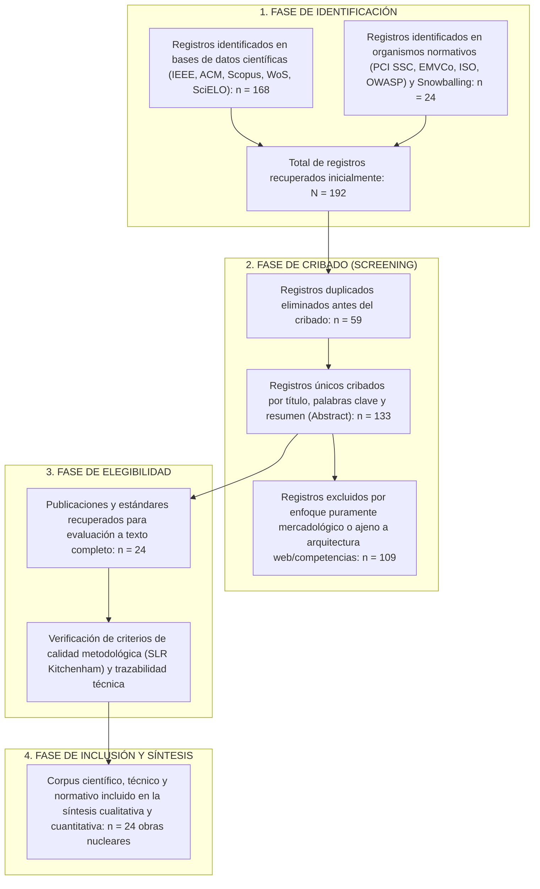

### 2.1.4 Matriz de Síntesis del Estado del Arte y Vacíos de Investigación Identificados

| Autor(es) / Organismo y Año | Eje Dominante | Aportación Científica / Técnica Principal | Vacío Identificado (*Research Gap*) que Atiende esta Tesina |
| :--- | :--- | :--- | :--- |
| **Fielding (2000)** | Arquitectura de Software (REST) | Formaliza el estilo arquitectónico *Representational State Transfer (REST)*: comunicación sin estado (*stateless*), interfaz uniforme, recursos identificables por URI y semántica de verbos HTTP. | Define la teoría de red HTTP pero no aborda los retos de idempotencia financiera ni la asincronía de *webhooks* en pasarelas de pago. |
| **Kitchenham & Charters (2007)** | Metodología de Investigación en Software | Establece el protocolo estándar para Revisiones Sistemáticas de Literatura (SLR) en ingeniería de software. | Marco metodológico documental que requiere ser aplicado a problemas prácticos de seguridad e integración transaccional. |
| **Wohlin (2014)** | Metodología (*Snowballing*) | Sistematiza el rastreo iterativo de citas hacia atrás (*backward*) y hacia adelante (*forward*) para evitar sesgos de omisión en revisiones de ingeniería de software. | Se emplea aquí para conectar literatura académica con estándares industriales bancarios (PCI, EMVCo, ISO). |
| **Page et al. / PRISMA Group (2021)** | Estándar de Reporte Sistemático | Actualiza la declaración PRISMA 2020 con diagramas de flujo de cuatro etapas para garantizar trazabilidad y reproducibilidad en revisiones sistemáticas. | Se adapta del dominio biomédico a la auditoría tecnológica y educativa en ingeniería de software. |
| **Laudon & Traver (2022)** | Sistemas de Comercio Electrónico | Caracteriza la evolución del e-commerce, los modelos de negocio digitales, la arquitectura de tiendas web y los sistemas de pago en línea. | Analiza los sistemas de pago a nivel conceptual/gerencial sin descender a la auditoría de código fuente MVC, cURL o manejo de errores en PHP 8. |
| **Turban et al. (2018)** | Comercio Electrónico y Pagos | Describe el flujo operativo de tarjetas de crédito, billeteras digitales, adquirencia y prevención de fraude en transacciones B2C. | No contempla los cambios recientes de PCI DSS v4.0.1 ni la arquitectura de captura en dos fases de PayPal Orders v2. |
| **Pressman & Maxim (2020); Sommerville (2016)** | Ingeniería y Arquitectura de Software | Fundamentan el diseño en capas, el patrón Modelo-Vista-Controlador (MVC), la inyección de dependencias, el aseguramiento de calidad (SQA) y las pruebas unitarias. | Sus ejemplos académicos rara vez auditan integraciones multi-pasarela reales con defectos de concurrencia o deriva SQL. |
| **PCI Security Standards Council (2022)** | Normatividad de Seguridad Bancaria | Publica el estándar **PCI DSS v4.0.1**, definiendo los 12 requisitos de protección de datos de tarjetahabientes, la prohibición de SAD y los cuestionarios SAQ A vs. SAQ D. | Es una norma técnica prescriptiva; carece de una traducción pedagógica para enseñar arquitectura segura a estudiantes universitarios. |
| **EMVCo (2022 / 2026)** | Autenticación Fuerte (3DS2) | Especifica el protocolo **EMV 3D Secure 2.0**, integrando telemetría de dispositivo, flujos *Frictionless* y *Challenge*, y transferencia de responsabilidad (*Liability Shift*). | Documentación enfocada en bancos emisores y adquirentes; requiere aterrizarse en el flujo de checkout del desarrollador web. |
| **ISO (2003 / 2022)** | Mensajería Financiera Interbancaria | Define los estándares **ISO 8583** (mensajes binarios por mapas de bits para tarjetas) e **ISO 20022** (esquemas XML/JSON ricos en metadatos para pagos modernos). | Los desarrolladores web suelen desconocer cómo sus llamadas JSON REST se traducen aguas abajo en tramas ISO 8583 (`MTI 0100/0110`, `DE 39`). |
| **OWASP Foundation (2021)** | Ciberseguridad Aplicativa | Clasifica las 10 categorías de vulnerabilidades web más críticas (*Broken Access Control*, *Cryptographic Failures*, *Injection*, *Insecure Design*). | Se aplica directamente en esta tesina para auditar y remediar las 9 vulnerabilidades críticas (`SEC-01` a `SEC-09`) halladas en el proyecto. |
| **Comisión Europea — Vuorikari et al. (2022)** | Competencias Digitales (*DigComp 2.2*) | Estructura el Marco Europeo de Competencias Digitales en 5 áreas y 8 niveles de aptitud (A1 a C2), incorporando conocimientos sobre IA, datos y seguridad. | Marco transversal ciudadano que no especifica las competencias técnicas de un desarrollador de software transaccional (lo cual resuelve nuestro modelo MADCE). |
| **IEEE Computer Society (2024) & SFIA Foundation (2024)** | Taxonomía de Ingeniería de Software | **SWEBOK v4.0** y **SFIA v9** catalogan las áreas de conocimiento profesional en arquitectura, construcción, pruebas y seguridad de software. | Se articulan en esta tesina con DigComp 2.2 para definir los Niveles 4 y 5 del modelo MADCE. |
| **Hake (1998)** | Evaluación Cuantitativa del Aprendizaje | Introduce la métrica de **Ganancia Relativa Normalizada ($g$)** para medir el impacto real de metodologías de aprendizaje activo independientemente del puntaje pre-test. | Se adopta como estadístico central para demostrar empíricamente el impacto de la intervención en los estudiantes del ITAO. |

---

## 2.2 Fundamentos del Comercio Electrónico y Arquitectura Transaccional de Pagos en Tres Capas

Un sistema de comercio electrónico moderno no es una aplicación monolítica aislada, sino un ecosistema transaccional distribuido cuyo propósito técnico final es garantizar la atomicidad entre dos eventos asíncronos: **el movimiento fiduciario de fondos en la red bancaria** y **el aprovisionamiento físico o digital de bienes en la base de datos del comercio**.

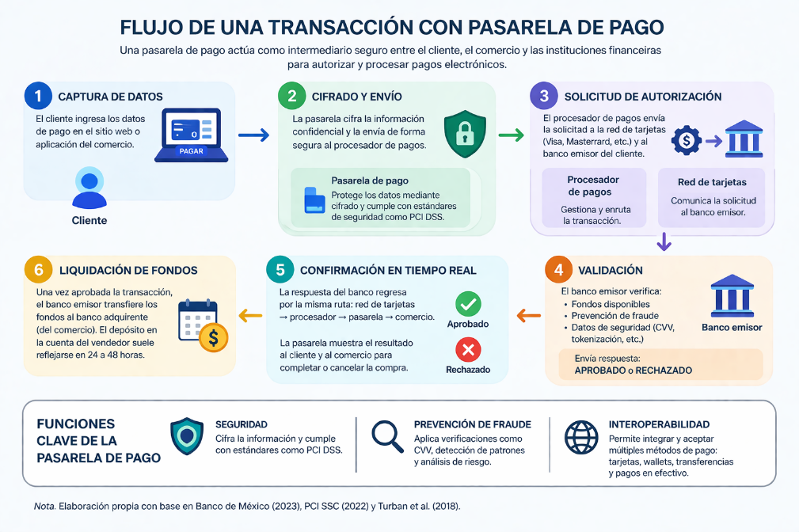

Tal como se ilustra en la **Figura 1.0**, el flujo de una transacción mediada por una pasarela de pago atraviesa seis etapas secuenciales: (1) Captura de datos en el cliente, (2) Cifrado TLS y envío hacia la pasarela con protección PCI DSS, (3) Solicitud de autorización a través del procesador de pagos y la red de tarjetas hacia el banco emisor, (4) Validación bancaria de fondos disponibles, reglas antifraude y criptogramas CVV/tokenización, (5) Confirmación en tiempo real de regreso al comercio y al comprador (`APROBADO` o `RECHAZADO`), y finalmente (6) Liquidación interbancaria de fondos en un horizonte de 24 a 48 horas.

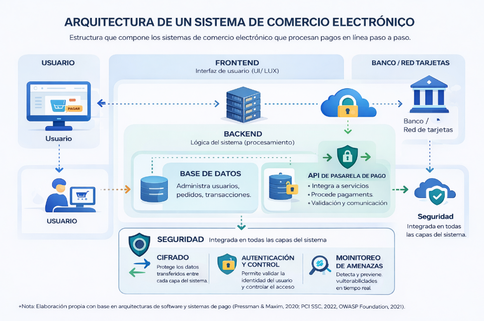

Asimismo, la **Figura 1.1** muestra cómo la arquitectura del sistema de comercio electrónico articula al Usuario con el *Frontend* (Interfaz UI/UX), el *Backend* (Lógica de negocio, Base de Datos de usuarios/pedidos/transacciones y el cliente API de Pasarela de Pago) y la infraestructura externa del Banco/Red de Tarjetas, manteniendo una capa transversal de **Seguridad** sustentada en tres pilares: **Cifrado** en tránsito y reposo, **Autenticación y Control de Acceso**, y **Monitoreo de Amenazas** en tiempo real.

### 2.2.1 Arquitectura Transaccional en Tres Capas (Datos, Riesgo y Dinero)
Para que el ingeniero de software diseñe integraciones resilientes e idempotentes, debe comprender que toda transacción electrónica opera simultáneamente en **tres capas arquitectónicas con tiempos de respuesta radicalmente distintos**:

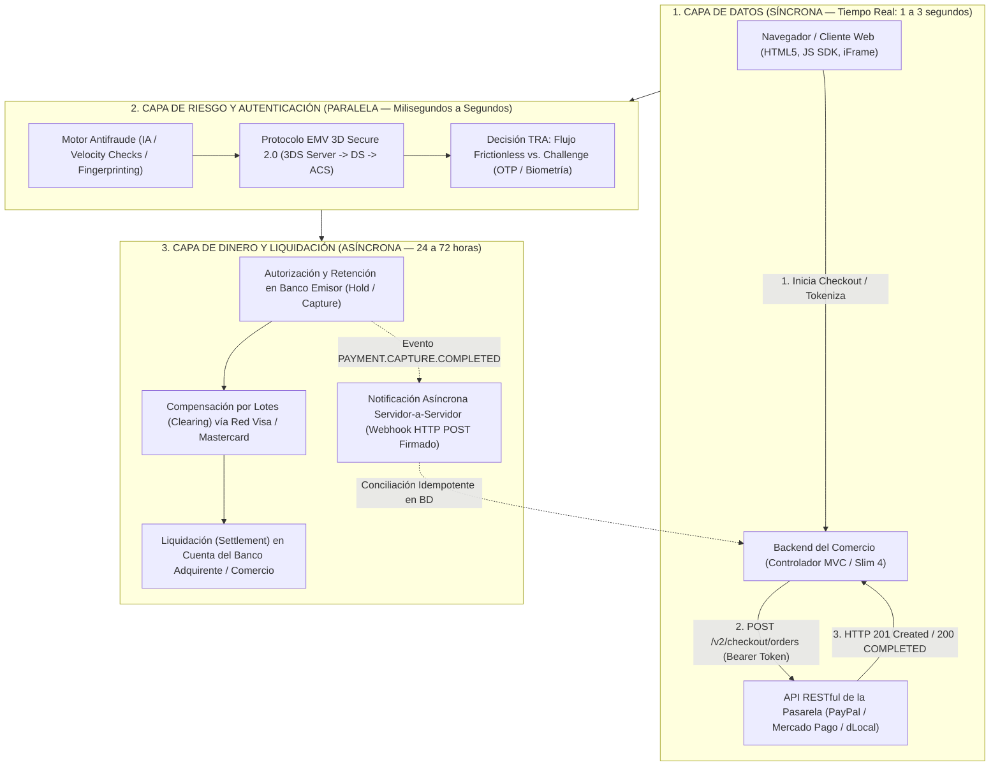

1. **Capa de Datos (Plano Síncrono — 1 a 3 segundos):**  
   Comprende el intercambio de mensajes HTTP/JSON entre el navegador del comprador, el servidor del comercio y el endpoint REST de la pasarela. Su objetivo es crear la intención de cobro, autenticar las credenciales API del comercio (mediante OAuth 2.0 `client_credentials` o llaves Bearer) y obtener un veredicto técnico inmediato (`CREATED`, `APPROVED`, `COMPLETED` o `REJECTED`). **Error común de ingeniería:** asumir que el ciclo de vida del pago termina cuando esta capa responde o depender exclusivamente de que el navegador del cliente complete la redirección de vuelta a la tienda.
2. **Capa de Riesgo y Autenticación (Plano Paralelo — Milisegundos a Segundos):**  
   Se ejecuta de manera transversal antes de autorizar el cargo. Los motores heurísticos y de aprendizaje automático de la pasarela (como *PayPal Fraud Protection*, *Mercado Pago validación antifraude* o *Stripe Radar*) evalúan cientos de señales de telemetría (dirección IP, huella digital del navegador, historial del dispositivo, velocidad de intentos de compra, concordancia de dirección AVS) e invocan el protocolo **EMV 3D Secure 2.0** para autenticar al titular de la tarjeta ante su banco emisor.
3. **Capa de Dinero y Liquidación (Plano Asíncrono — 24 a 72 horas):**  
   Cuando una transacción es aprobada y capturada en la Capa de Datos, el dinero físico **no** viaja instantáneamente por el cable de red hacia la cuenta bancaria del comercio. Lo que ocurre en tiempo real es una **retención contable (*authorization hold*)** y un compromiso de captura en el banco emisor. El movimiento real del dinero ocurre de forma diferida mediante procesos interbancarios de **compensación (*clearing*)** y **liquidación (*settlement*)** en lotes nocturnos. Además, dado que ciertos medios de pago (efectivo en puntos físicos como OXXO, transferencias SPEI o revisiones manuales de fraude) o caídas de conexión móvil del cliente ocurren fuera de la sesión del navegador, la pasarela se comunica con el servidor del comercio mediante **Webhooks HTTP POST asíncronos**.

### 2.2.2 Los Siete Actores del Ecosistema Transaccional Interbancario
Detrás de cada petición enviada desde el controlador de pagos del e-commerce intervienen siete entidades con responsabilidades técnicas y jurídicas diferenciadas:

| # | Actor del Ecosistema | Rol Técnico y Financiero en la Transacción |
| :---: | :--- | :--- |
| **1** | **Tarjetahabiente / Comprador (*Cardholder / Payer*)** | Persona física o moral titular del instrumento de pago (tarjeta de crédito/débito o billetera digital) que inicia la orden de compra en el *storefront* y consiente el cargo. |
| **2** | **Comercio (*Merchant*)** | Entidad propietaria de la plataforma e-commerce (`c:/xampp/htdocs/ecommerce`) que ofrece bienes físicos (`gallery`) o servicios digitales (`video`), gestiona el carrito (`carts`) y registra el pedido confirmado (`orders`). |
| **3** | **Pasarela de Pago / Proveedor de Servicios de Pago (*Payment Gateway / PSP*)** | Plataforma tecnológica intermediaria (PayPal, Mercado Pago, dLocal Go) que expone APIs RESTful modernas (JSON/HTTPS), cifra los datos sensibles, ejecuta motores antifraude y abstrae la complejidad de las redes bancarias. |
| **4** | **Procesador Adquirente (*Acquiring Processor*)** | Entidad de procesamiento técnico que traduce las solicitudes de la pasarela en tramas financieras estandarizadas (ISO 8583 / ISO 20022) y las enruta hacia las redes de tarjetas correspondientes. |
| **5** | **Red de Tarjetas / Marca (*Card Network / Card Scheme*)** | Infraestructura global de conmutación financiera (**Visa [VisaNet]**, **Mastercard [Banknet]**, **American Express**) que conecta a miles de bancos adquirentes con bancos emisores, administra los *Directory Servers* de 3DS2 y opera los servicios de tokenización de red (VTS/MDES). |
| **6** | **Banco Emisor (*Issuing Bank*)** | Institución financiera que emitió la tarjeta o cuenta al comprador (p. ej., BBVA, Banamex, Santander, Nu). Opera el *Access Control Server (ACS)*, verifica el saldo o línea de crédito disponible, valida el criptograma/CVV y aprueba o declina la solicitud en última instancia. |
| **7** | **Banco Adquirente (*Acquiring Bank / Merchant Bank*)** | Institución financiera donde el comercio (o el agregador PSP en modelo *PayFac*) mantiene su cuenta receptora y donde se depositan los fondos netos tras el proceso de compensación y liquidación (*settlement*). |

---

## 2.3 Cumplimiento Normativo PCI DSS v4.0.1, Reducción de Alcance (SAQ A vs. SAQ D) y Tokenización de Red (VTS/MDES)

El estándar **Payment Card Industry Data Security Standard (PCI DSS)**, en su versión vigente **v4.0.1** publicada por el *PCI Security Standards Council* (PCI SSC, 2022/2024), constituye el marco normativo obligatorio a nivel mundial para cualquier entidad que almacene, procese o transmita **Datos de Cuentas de Pago (*Account Data*)**. El estándar distingue dos categorías críticas de información:
1. **Datos del Titular de la Tarjeta (*Cardholder Data — CHD*):** Incluye el Número de Cuenta Primario (**PAN**, de 13 a 19 dígitos), el nombre del titular, la fecha de expiración y el código de servicio.
2. **Datos Sensibles de Autenticación (*Sensitive Authentication Data — SAD*):** Incluye los datos completos de la banda magnética o chip, el código de verificación de la tarjeta (**CAV2/CVC2/CVV2/CID** impreso en el plástico) y el bloque **PIN**. **Regla de Oro de PCI DSS (Requisito 3.3):** *Bajo ninguna circunstancia —ni siquiera cifrados con algoritmos fuertes— se permite almacenar Datos Sensibles de Autenticación (SAD) después de completada la autorización*.

### 2.3.1 Los 12 Requisitos de PCI DSS v4.0.1 y su Impacto en la Arquitectura Web
El estándar se organiza en 6 objetivos de control y 12 requisitos técnicos que impactan directamente el diseño de una plataforma e-commerce:
* **Construir y mantener una red y sistemas seguros:** (Req. 1) Instalar y mantener controles de seguridad de red (firewalls/WAF); (Req. 2) Aplicar configuraciones seguras a todos los componentes del sistema (eliminar credenciales por defecto como `root` sin contraseña o llaves hardcodeadas).
* **Proteger los datos de cuentas:** (Req. 3) Proteger los datos de cuentas almacenados; (Req. 4) Proteger los datos del titular de la tarjeta con criptografía fuerte durante la transmisión a través de redes públicas abiertas (TLS 1.2+ / TLS 1.3 estricto).
* **Mantener un programa de gestión de vulnerabilidades:** (Req. 5) Proteger todos los sistemas y redes contra software malicioso (prevenir RCE en subidas de archivos como `upload.ajax.php`); (Req. 6) Desarrollar y mantener sistemas y software seguros (prevención de SQLi, XSS, CSRF, gestión de parches y pruebas de seguridad en el ciclo SDLC).
* **Implementar medidas sólidas de control de acceso:** (Req. 7) Restringir el acceso a los componentes del sistema y a los datos del titular según la necesidad de saber (*RBAC* estricto); (Req. 8) Identificar a los usuarios y autenticar el acceso (hashing criptográfico robusto de contraseñas, MFA y validación de firma en tokens JWT); (Req. 9) Restringir el acceso físico a los datos.
* **Monitorear y probar las redes regularmente:** (Req. 10) Registrar y monitorear todos los accesos a los componentes del sistema y a los datos (logs de auditoría inmutables); (Req. 11) Probar regularmente la seguridad de los sistemas y las redes (escaneos ASV y pruebas de penetración).
* **Mantener una política de seguridad de la información:** (Req. 12) Apoyar la seguridad de la información con políticas organizacionales y programas de gestión de incidentes.

### 2.3.2 Reducción de Alcance de Auditoría: SAQ A (Hosted / iFrame) vs. SAQ D (API Directa)
La decisión arquitectónica más trascendental que toma un ingeniero de software al diseñar el módulo de *checkout* consiste en definir **por dónde viajan los dígitos de la tarjeta (PAN y CVV)**. Esta decisión determina el **Cuestionario de Autoevaluación (*Self-Assessment Questionnaire — SAQ*)** aplicable al comercio:

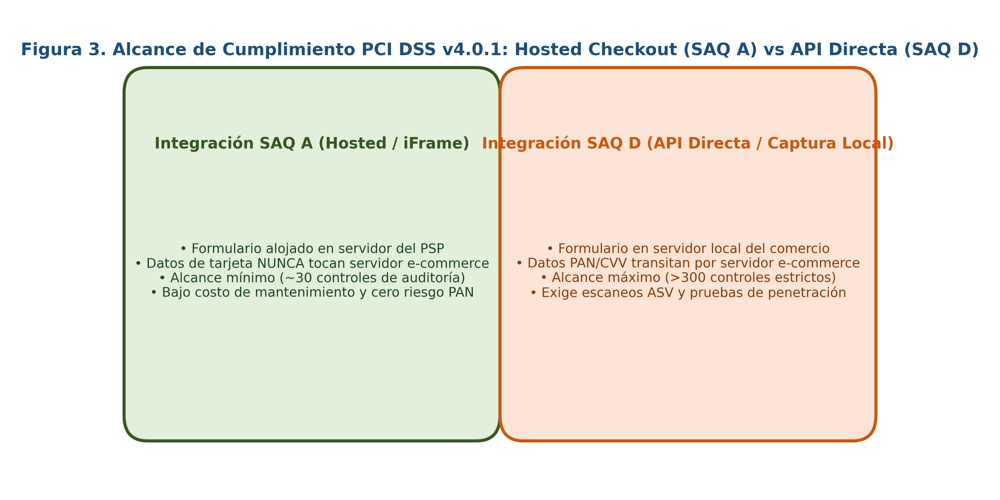

Como se sintetiza en la **Figura 2.2** y se detalla en la siguiente matriz técnica, delegar la captura mediante redirección alojada (*Hosted Checkout*) o marcos aislados (*Smart Payment Buttons / iFrames*) reduce drásticamente la superficie de ataque y el costo de cumplimiento:

| Dimensión Arquitectónica y Normativa | Arquitectura Delegada: *Hosted Checkout* / *iFrame* (**Alcance SAQ A**) | Arquitectura de Captura Local: *API Directa Server-to-Server* (**Alcance SAQ D**) |
| :--- | :--- | :--- |
| **Flujo de Captura de PAN y CVV** | El usuario ingresa sus datos en una ventana alojada directamente en los servidores de la pasarela (p. ej., PayPal `approve` link, Mercado Pago `init_point` o dLocal `redirect_url`) o en un `<iframe>` aislado por política *Same-Origin* del PSP. | El comercio maqueta un `<form>` HTML propio (`<input name="card_number">`) y envía el PAN y el CVV hacia su propio controlador PHP para luego reenviarlos por cURL al PSP. |
| **Contacto del Servidor del Comercio con el PAN** | **Nulo (0%).** El servidor `ecommerce.com` jamás ve, procesa en memoria RAM ni registra en logs de Apache el número completo de tarjeta ni el CVV. | **Total (100%).** Aunque no se guarde en MySQL, el PAN transita por la memoria RAM de PHP (`$_POST`), el socket de red de Apache y potencialmente los logs de errores. |
| **Controles de Auditoría PCI DSS v4.0.1 Exigidos** | **~29 a 32 controles aplicables** (enfocados en integridad de scripts de página de pago —Requisitos 6.4.3 y 11.6.1 en v4.0.1 para prevenir ataques *Magecart / e-skimming*— y verificación de que el PSP sea PCI Nivel 1). | **Más de 300 controles exhaustivos** (aplicación íntegra de los 12 requisitos sobre toda la infraestructura del comercio: servidores web, base de datos, red interna y estaciones de trabajo). |
| **Escaneos Trimestrales ASV y Pentesting Anual** | Exigidos de forma simplificada para verificar la ausencia de modificaciones no autorizadas en las cabeceras HTTP y scripts del contenedor. | Obligatorios con alcance profundo sobre todo el entorno de datos del titular (CDE), segmentación de red, HSMs y auditoría forense presencial (QSA si supera umbrales). |
| **Riesgo Patrimonial ante Brecha (RCE / SQLi)** | Si un atacante explota una vulnerabilidad en el comercio, **no puede robar números de tarjetas ni códigos CVV** porque nunca existieron en el servidor del comercio. | Una vulnerabilidad como `SEC-04` (SQLi) o `SEC-05` (RCE en `upload.ajax.php`) permite al atacante inyectar un *sniffer* en memoria RAM y exfiltrar todas las tarjetas en tiempo real. |

> **Conclusión de Ingeniería aplicada en esta Tesina:** Tanto en la plataforma base como en la arquitectura refactorizada con **PayPal Orders v2**, se adopta estrictamente el patrón **SAQ A (*Hosted Redirect / Smart Buttons*)**, donde el backend PHP ([`PayPalController`](file:///c:/xampp/htdocs/ecommerce/src/Controller/PayPalController.php) y [`PayPalGateway`](file:///c:/xampp/htdocs/ecommerce/src/Service/PayPalGateway.php)) únicamente negocia montos, divisas e identificadores de orden (`orderId`), delegando el 100% de la captura de instrumentos financieros a la infraestructura certificada PCI DSS Nivel 1 de PayPal.

### 2.3.3 Tokenización dePasarela vs. Tokenización de Red (*Network Tokenization*: VTS y MDES)
Para permitir pagos recurrentes, compras en un clic (*One-Click Checkout*) y autorizaciones sin exponer el PAN real, la industria emplea dos niveles de tokenización:
1. **Tokenización de Bóveda de Pasarela (*Gateway Vault Tokenization*):** La pasarela almacena el PAN real en su bóveda criptográfica (HSM) y devuelve al comercio un identificador alfanumérico opaco (p. ej., `tok_1N3...`). Este token solo tiene validez dentro de esa pasarela específica y deja de funcionar si el banco emisor reemplaza el plástico físico del cliente por extravío o vencimiento.
2. **Tokenización de Red (*Network Tokenization* — Estándar EMV Payment Tokenisation):** Operada directamente por las marcas de tarjetas a través de **Visa Token Service (VTS)** y **Mastercard Digital Enablement Service (MDES)**. En este esquema, el PAN tradicional de 16 dígitos es sustituido a nivel interbancario por un **Token de Red (*Payment Token*)** restringido a un dominio comercial o dispositivo específico (*Token Requestor ID*). En cada transacción de comercio electrónico, el servicio de red genera un **criptograma dinámico de un solo uso (*Token Authentication Verification Value — TAVV* o criptograma DSRP)** análogo al criptograma ARQC de un chip físico EMV. Si el token es interceptado, resulta criptográficamente inútil fuera del comercio autorizado, además de actualizarse automáticamente (*Lifecycle Management*) cuando el tarjetahabiente renueva su plástico bancario, incrementando las tasas de aprobación entre un $2.5\%$ y un $4.0\%$.

---

## 2.4 Arquitectura EMV 3D Secure 2.0 (EMV 3DS), PSD2 SCA y Transferencia de Responsabilidad (*Liability Shift*)

Históricamente, las transacciones con tarjeta no presente (*Card-Not-Present — CNP*) en internet adolecían de una debilidad estructural: la posesión visual de los 16 dígitos del PAN, la fecha de vencimiento y el CVV de 3 dígitos no garantizaba que quien estaba frente a la pantalla fuera el legítimo titular de la cuenta. La primera versión del protocolo *3D Secure 1.0* (introducida en 2001 como *Verified by Visa* y *Mastercard SecureCode*) intentó mitigar este riesgo mediante redirecciones a páginas bancarias estáticas con contraseñas fijas, pero provocó tasas de abandono de carrito superiores al $25\%$ debido a su incompatibilidad con dispositivos móviles y su alta fricción de usuario.

Para resolver esta disyuntiva entre seguridad y conversión, el consorcio **EMVCo** (conformado por American Express, Discover, JCB, Mastercard, UnionPay y Visa) desarrolló la especificación **EMV 3D Secure 2.0 (EMV 3DS v2.1 / v2.2 / v2.3)**, la cual constituye el pilar tecnológico para cumplir con el mandato de **Autenticación Reforzada de Clientes (*Strong Customer Authentication — SCA*)** de la directiva europea **PSD2** y las regulaciones bancarias de comercio electrónico en América Latina (CNBV / Banxico). Esta normativa exige validar al menos dos de tres factores independientes:
* **Conocimiento:** Algo que solo el usuario sabe (PIN, contraseña o frase de seguridad).
* **Posesión:** Algo que solo el usuario posee (teléfono móvil registrado, token de hardware o tarjeta virtual en app bancaria).
* **Inherencia:** Algo que el usuario es (huella dactilar, reconocimiento facial *FaceID* o biometría conductual).

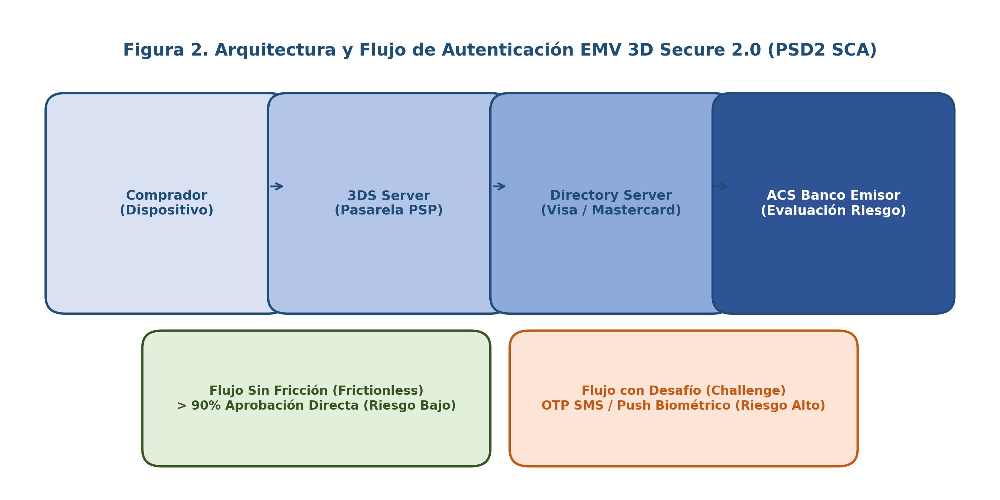

### 2.4.1 Los Cuatro Componentes de los Tres Dominios (*3 Domains*) en EMV 3DS2
Tal como se aprecia en la **Figura 2.1**, el nombre "3D" proviene de los **tres dominios de interoperabilidad** que colaboran durante la autenticación a través de cuatro componentes técnicos:
1. **Dominio del Adquirente / Comercio (*Acquirer/Merchant Domain*) — `3DS Server` y `3DS SDK / Web Client`:**  
   El cliente JavaScript o SDK móvil incrustado en el checkout recopila de forma transparente más de **100 atributos contextuales del dispositivo** (resolución de pantalla, zona horaria, idioma del navegador, dirección IP, acelerómetro, historial de envíos) y los envía al **3DS Server** (operado por la pasarela de pago), el cual empaqueta un mensaje de solicitud de autenticación (**AReq — *Authentication Request***).
2. **Dominio de Interoperabilidad (*Interoperability Domain*) — `Directory Server (DS)`:**  
   Operado por la red de tarjetas correspondiente (Visa, Mastercard, Amex). Recibe el mensaje `AReq` del `3DS Server`, valida que el rango BIN de la tarjeta participe en el programa 3DS2 y enruta la petición hacia el servidor del banco emisor exacto.
3. **Dominio del Emisor (*Issuer Domain*) — `Access Control Server (ACS)`:**  
   Operado por el banco que emitió la tarjeta al comprador. Recibe el mensaje `AReq` con los más de 100 puntos de telemetría y ejecuta un **Análisis de Riesgo Transaccional (*Transaction Risk Analysis — TRA*)** en milisegundos.

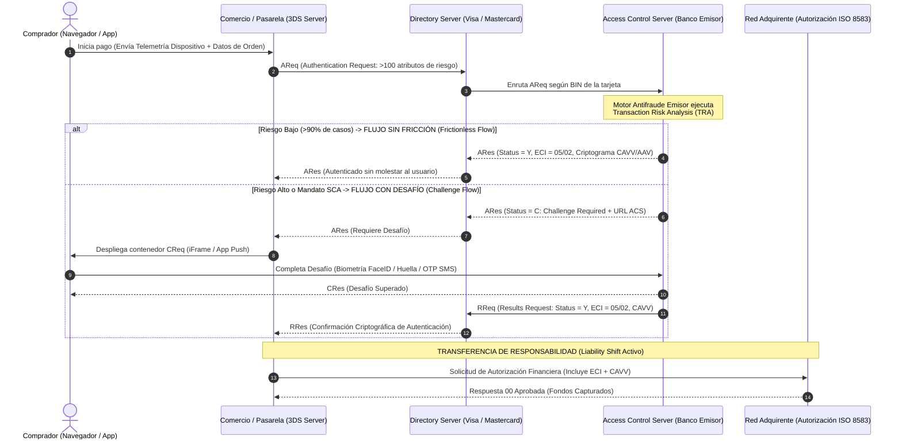

### 2.4.2 Flujo Sin Fricción (*Frictionless*) vs. Flujo con Desafío (*Challenge*) y *Liability Shift*
Como detalla el **Diagrama 2.3**, el protocolo EMV 3DS2 bifurca la experiencia en dos caminos:
* **Flujo Sin Fricción (*Frictionless Flow*):** Si el motor TRA del banco emisor determina que el comprador está operando desde su dispositivo habitual, en su ubicación geográfica normal y por un importe coherente con su perfil, el `ACS` aprueba la autenticación de forma silenciosa en segundo plano (`TransStatus = Y`) en menos de 500 milisegundos, sin mostrar ninguna ventana emergente al comprador. Más del $90\%$ de las transacciones legítimas se resuelven por esta vía.
* **Flujo con Desafío (*Challenge Flow*):** Si el `ACS` detecta una anomalía (un dispositivo desconocido, una IP extranjera o un monto inusual), responde con `TransStatus = C` (*Challenge Required*). El checkout despliega un contenedor nativo (`CReq`) donde el banco emisor solicita al comprador aprobar la operación mediante notificación *Push* biométrica en su aplicación bancaria móvil o código dinámico de un solo uso (OTP).

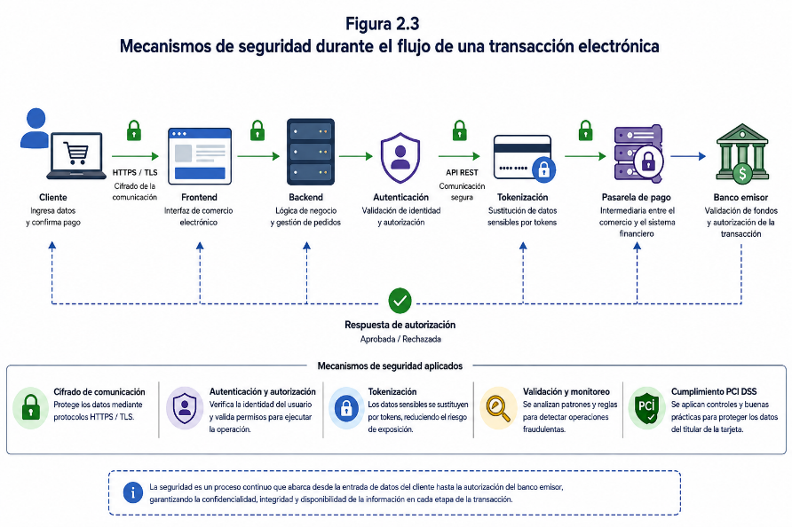

La **Figura 2.3** integra visualmente estos mecanismos de seguridad a lo largo de toda la cadena (Cliente $\rightarrow$ HTTPS/TLS $\rightarrow$ Frontend $\rightarrow$ Backend $\rightarrow$ Autenticación $\rightarrow$ Tokenización $\rightarrow$ Pasarela de Pago $\rightarrow$ Banco Emisor). El beneficio jurídico-financiero supremo de este proceso es el **Cambio o Transferencia de Responsabilidad (*Liability Shift*)**: cuando una transacción obtiene autenticación exitosa bajo EMV 3DS2 (o bajo el programa de protección al vendedor de PayPal / Mercado Pago), el emisor genera dos valores criptográficos que viajan adjuntos al mensaje de cobro:
1. **ECI (*Electronic Commerce Indicator*):** Código de 2 dígitos que certifica el nivel de autenticación alcanzado (p. ej., `05` en Visa o `02` en Mastercard indican autenticación 3DS completa; `06`/`01` indican intento de autenticación; `07`/`00` indican transacción sin 3DS donde el comercio asume todo el riesgo).
2. **CAVV (*Cardholder Authentication Verification Value*) / AAV (*Accountholder Authentication Value*):** Criptograma de 20 bytes (codificado en Base64 o hexadecimal) firmado por el `ACS` del banco emisor que demuestra matemáticamente que el titular fue autenticado. Con un `ECI 05/02` y un `CAVV` válido, si posteriormente el comprador desconoce el cargo argumentando "yo no hice esta compra" (contracargo por fraude amistoso o robo de identidad, código de razón Visa `10.4`), **el comercio está protegido y el banco emisor absorbe la pérdida financiera**.

---

## 2.5 Estándares de Mensajería Financiera Interbancaria: De ISO 8583 (Mapas de Bits) a ISO 20022 (Esquemas XML/JSON)

Cuando el controlador de nuestra plataforma e-commerce envía una petición HTTP JSON moderna hacia la pasarela de pago (p. ej., `{"intent": "CAPTURE", "purchase_units": [{"amount": {"currency_code": "MXN", "value": "350.00"}}]}`), dicha carga útil JSON no puede ser enviada tal cual hacia los *mainframes* de los bancos emisores tradicionales. En el corazón de las redes interbancarias coexisten dos estándares internacionales de mensajería financiera que todo arquitecto de software transaccional debe conocer: **ISO 8583** e **ISO 20022**.

### 2.5.1 Anatomía de una Trama ISO 8583 (MTI, Mapas de Bits y Elementos de Datos)
El estándar **ISO 8583** (*Financial transaction card originated messages — Interchange message specifications*) ha sido durante casi cuatro décadas el lenguaje universal de los cajeros automáticos (ATM), las terminales punto de venta (POS) y las redes de tarjetas de crédito/débito. Diseñado en una época donde cada byte de ancho de banda era crítico, un mensaje ISO 8583 es una trama ultracompacta (sin nombres de campos ni etiquetas de texto) compuesta por tres secciones:

1. **Indicador de Tipo de Mensaje (*Message Type Indicator — MTI*):** Un código numérico de **4 dígitos** que define la versión de la norma, la clase del mensaje, la función y quién originó la transmisión:
   * `0100`: Solicitud de Autorización (*Authorization Request*) enviada del adquirente al emisor para verificar y retener fondos.
   * `0110`: Respuesta de Autorización (*Authorization Response*) devuelta por el banco emisor.
   * `0200` / `0210`: Solicitud y Respuesta Financiera directa (cobro inmediato en débito/captura).
   * `0400` / `0410`: Solicitud y Respuesta de Reverso (*Reversal Advice/Request*) cuando ocurre un *timeout* o cancelación técnica.
2. **Mapa de Bits (*Bitmap* — Primario y Secundario):** Un vector binario de **64 bits (8 bytes / 16 caracteres hexadecimales)** —extensible a 128 bits si el primer bit está encendido en `1`— donde la posición de cada bit ($1..128$) indica si el **Elemento de Datos (*Data Element — DE*)** correspondiente está presente (`1`) o ausente (`0`) en la trama. Gracias a este diseño, el receptor puede parsear el flujo de bytes a velocidades de microsegundos sin buscar delimitadores.
3. **Elementos de Datos (*Data Elements — DE*):** Los valores contiguos de la transacción. Los elementos críticos en una compra e-commerce son:

| Elemento de Datos (DE) | Nombre Técnico ISO 8583 | Formato / Longitud | Significado en el Flujo de la Pasarela de Pago |
| :---: | :--- | :--- | :--- |
| **DE 2** | *Primary Account Number (PAN)* | `LLVAR` (hasta 19 dígitos) | Número de tarjeta del comprador o el **Token de Red (VTS/MDES)** sustituto. |
| **DE 3** | *Processing Code* | `n 6` (6 dígitos fijos) | Tipo de operación (ej. `000000` = compra de bienes y servicios). |
| **DE 4** | *Amount, Transaction* | `n 12` (12 dígitos sin punto decimal) | Importe exacto en centavos (ej. \$350.00 MXN se transmite como `000000035000`). Un error en `FIN-01` corrompe directamente este campo. |
| **DE 11** | *Systems Trace Audit Number (STAN)* | `n 6` (6 dígitos) | Número secuencial único de auditoría asignado por el originador para rastrear la transacción. |
| **DE 12 / DE 13** | *Date and Time, Local Transaction* | `hhmmss` / `MMDD` | Hora y fecha local en que el comercio inició la solicitud de cobro. |
| **DE 38** | *Authorization Identification Response* | `an 6` (6 caracteres) | Código de aprobación bancaria asignado por el emisor cuando la compra es exitosa. |
| **DE 39** | *Response Code* | `an 2` (2 caracteres) | **Veredicto del Banco Emisor:** `00` = Aprobada; `05` = Declinada (No honrar); `14` = Tarjeta inválida; `51` = Fondos insuficientes; `54` = Tarjeta vencida; `91` = Emisor fuera de línea (*Timeout*). |
| **DE 43** | *Card Acceptor Name/Location* | `ans 40` (40 caracteres) | Descriptor comercial que aparece en el estado de cuenta bancario del cliente (ej. `DLOCAL*TIENDA ITAO CDMX MX`). |

### 2.5.2 La Migración Global hacia ISO 20022 (Esquemas Estructurados XML y JSON)
A pesar de la velocidad de ISO 8583, su rigidez posicional (por ejemplo, el campo `DE 43` truncado a 40 caracteres) impide transportar información detallada sobre los artículos comprados, impuestos desglosados, identidad completa de sub-comercios (*marketplaces* con tabla `sellers`) o metadatos regulatorios contra el lavado de dinero (*Anti-Money Laundering — AML*). Por ello, los sistemas de pagos interbancarios globales (SWIFT, FedNow, SEPA, SPEI 2.0 y las APIs de nueva generación de PayPal y Stripe) han adoptado el estándar **ISO 20022** (*Universal financial industry message scheme*).

| Criterio Comparativo | Estándar Tradicional **ISO 8583** | Estándar Moderno **ISO 20022** |
| :--- | :--- | :--- |
| **Sintaxis y Serialización** | Trama binaria/ASCII compacta gobernada por mapas de bits (*Bitmaps*) de 64/128 bits. | Esquemas jerárquicos altamente estructurados y autodescriptivos en **XML (XSD)** y **JSON**. |
| **Riqueza Semántica de Datos** | Extremadamente limitada (campos de longitud fija truncados a decenas de caracteres). | Extensa y flexible: transporta líneas de factura, RFC/identificadores fiscales, propósito de pago, datos de beneficiario final y trazabilidad `EndToEndId`. |
| **Mensajes Representativos** | `MTI 0100` (Auth Req), `0110` (Auth Resp), `0200` (Financial), `0400` (Reversal). | `pain.001` (*Customer Credit Transfer Initiation*), `pacs.008` (*FIToFI Customer Credit Transfer*), `camt.053` (*Bank to Customer Statement*). |
| **Impacto en E-Commerce y APIs REST** | Obliga a la pasarela a traducir y recortar metadatos entre el JSON web y el switch bancario. | Permite mapeo casi nativo 1:1 entre los objetos JSON de la API de la pasarela (como `purchase_units` en PayPal v2) y la liquidación bancaria, automatizando la conciliación contable. |

---

## 2.6 Marcos de Competencias Tecnológicas: DigComp 2.2, SWEBOK v4.0 / SFIA v9 y el Modelo Propuesto MADCE

El eje pedagógico central de esta tesina sostiene que el dominio de la arquitectura y seguridad descritas en las secciones precedentes no ocurre por generación espontánea, sino a través de una progresión estructurada de **competencias tecnológicas**. Para medir y categorizar científicamente dicha evolución en los estudiantes del ITAO, se articulan dos marcos internacionales de referencia con un modelo propio diseñado para esta investigación.

### 2.6.1 El Marco Europeo de Competencias Digitales para la Ciudadanía (*DigComp 2.2*)
Publicado por el Centro Común de Investigación (*Joint Research Centre — JRC*) de la Comisión Europea (Vuorikari et al., 2022), **DigComp 2.2** constituye el estándar internacional de referencia para estructurar las capacidades digitales en **5 áreas dimensionales**, **21 competencias específicas** y **8 niveles de aptitud progresiva** (agrupados en Básico [A1: Nivel 1, A2: Nivel 2], Intermedio [B1: Nivel 3, B2: Nivel 4], Avanzado [C1: Nivel 5, C2: Nivel 6] y Altamente Especializado [Niveles 7 y 8]):
1. **Área 1 — Alfabetización en información y datos:** Navegar, buscar, filtrar, evaluar y gestionar datos, información y contenidos digitales (aplicado aquí al modelado relacional SQL de `carts`, `orders` y `variants`, y a la lectura de contratos JSON de APIs).
2. **Área 2 — Comunicación y colaboración:** Interactuar, compartir y colaborar a través de tecnologías digitales (aplicado a la comunicación entre sistemas heterogéneos cliente-servidor, protocolos HTTP REST, OAuth 2.0 y *webhooks*).
3. **Área 3 — Creación de contenidos digitales:** Desarrollar, integrar y reelaborar contenido digital y programación informática (aplicado a la codificación en PHP 8.2, refactorización hacia Slim Framework 4, inyección de dependencias PHP-DI y escritura de pruebas en PHPUnit).
4. **Área 4 — Seguridad:** Proteger dispositivos, datos personales, privacidad e integridad del entorno digital (aplicado directamente a la remediación de vulnerabilidades `SEC-01` a `SEC-09`, cumplimiento PCI DSS v4.0.1, EMV 3DS2 y verificación criptográfica de firmas).
5. **Área 5 — Resolución de problemas:** Identificar necesidades, resolver problemas técnicos complejos y utilizar la tecnología de manera creativa (aplicado a la depuración forense de los defectos financieros `FIN-01` a `FIN-07` y las anomalías de deriva `DRIFT-01` a `DRIFT-05`).

### 2.6.2 Articulación con la Ingeniería de Software Profesional: SWEBOK v4.0 y SFIA v9
Si bien *DigComp 2.2* proporciona una taxonomía cognitiva excelente, su alcance es ciudadano y transversal. Por ello, para caracterizar con precisión a estudiantes de **Ingeniería en Tecnologías de la Información y Comunicaciones**, en esta tesina se cruza *DigComp 2.2* con dos estándares de la profesión informática:
* **SWEBOK v4.0 (*Guide to the Software Engineering Body of Knowledge*, IEEE Computer Society, 2024):** Específicamente en sus Áreas de Conocimiento (*Knowledge Areas — KAs*) de **Arquitectura de Software**, **Diseño de Software**, **Construcción de Software**, **Pruebas de Software (*Software Testing*)** y **Seguridad de Software (*Software Security*)**.
* **SFIA v9 (*Skills Framework for the Information Age*, 2024):** Que gradúa la autonomía, influencia y complejidad técnica en 7 niveles profesionales (desde el Nivel 1 *Follow* y Nivel 3 *Apply* hasta el Nivel 5 *Ensure/Advise* y Nivel 6 *Initiate/Influence*) en habilidades como `PROG` (Programación/Desarrollo de Software), `STPL` (Pruebas Funcionales y Unitarias), `SCTY` (Seguridad de la Información) y `ARCH` (Diseño de Arquitectura de Soluciones).

### 2.6.3 Propuesta Original: Modelo de Alfabetización Digital en Comercio Electrónico (MADCE)
Como aportación teórico-metodológica central de esta tesina para el Instituto Tecnológico de Álvaro Obregón (ITAO), se diseñó el **Modelo de Alfabetización Digital en Comercio Electrónico (MADCE)**. Este modelo traduce los niveles de *DigComp 2.2*, *SWEBOK v4.0* y *SFIA v9* al dominio específico de la implementación, auditoría y arquitectura de pasarelas de pago en plataformas e-commerce:

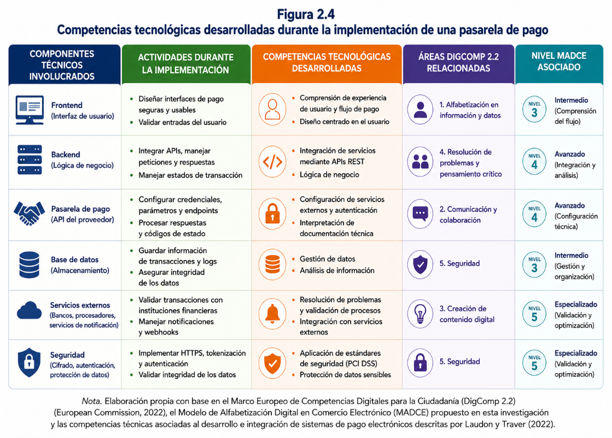

La **Figura 2.4** muestra la matriz de correspondencia entre los seis componentes técnicos involucrados en la implementación (Frontend, Backend, Pasarela de Pago, Base de Datos, Servicios Externos y Seguridad), las actividades prácticas ejecutadas, las competencias tecnológicas desarrolladas, las áreas de *DigComp 2.2* activadas y el nivel **MADCE** asociado.

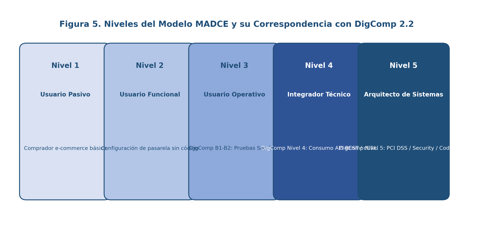

Por su parte, la **Figura 2.5** ilustra la escalera evolutiva de los cinco niveles del **Modelo MADCE**, cuya especificación taxonómica completa se presenta en la siguiente tabla:

| Nivel MADCE | Denominación del Perfil Técnico | Equivalencia DigComp 2.2 | Equivalencia SFIA v9 / SWEBOK v4.0 | Capacidades Demostrables en Plataformas E-Commerce y Pasarelas de Pago |
| :---: | :--- | :---: | :---: | :--- |
| **Nivel 1** | **Usuario Pasivo / Comprador Digital** | Nivel 1–2 (Básico A1–A2) | SFIA Nivel 1 (*Follow*) | Navega por el catálogo de la tienda web, selecciona variantes de producto, utiliza el carrito y completa pagos redirigidos como consumidor final, sin comprender qué ocurre detrás del navegador. |
| **Nivel 2** | **Usuario Funcional / Gestor de Tienda** | Nivel 3 (Intermedio B1 Inicial) | SFIA Nivel 2 (*Assist*) | Opera el panel administrativo (`/admin`), da de alta categorías, subcategorías y productos, gestiona estados de pedidos (`process_order`) y configura plugins de pasarelas sin tocar código fuente. |
| **Nivel 3** | **Usuario Operativo / Integrador Básico** | Nivel 4 (Intermedio B2) | SFIA Nivel 3 (*Apply*) / SWEBOK *Construction* | Configura entornos locales (XAMPP, VirtualHosts, base de datos SQL), realiza peticiones cURL síncronas básicas a entornos *Sandbox* copiando ejemplos de documentación, pero ignora fallos de idempotencia, captura en dos fases o inyecciones SQL. |
| **Nivel 4** | **Integrador Técnico / Desarrollador Transaccional** | Nivel 5–6 (Avanzado C1–C2) | SFIA Nivel 4 (*Enable*) / SWEBOK *Design & Testing* | Implementa el ciclo completo de pasarelas RESTful (OAuth 2.0 con caché de token, creación y captura explícita `/capture` en PayPal v2), procesa notificaciones asíncronas mediante *webhooks*, aísla secretos en `.env`, corrige bugs transaccionales (`FIN-01` a `FIN-04`) y escribe pruebas unitarias con *mocks*. |
| **Nivel 5** | **Arquitecto de Sistemas y Auditor de Seguridad E-Commerce** | Nivel 7–8 (Altamente Especializado) | SFIA Nivel 5 (`SCTY` / `ARCH`) / SWEBOK *Architecture & Security* | Ejecuta auditorías forenses de seguridad (`SEC-01` a `SEC-09`) y deriva esquema-código (`DRIFT-01` a `DRIFT-05`), diseña arquitecturas desacopladas (Slim 4, PHP-DI, Eloquent ORM), verifica criptográficamente firmas de *webhooks*, asegura cumplimiento **PCI DSS v4.0.1 (SAQ A)** y **EMV 3DS2**, y automatiza pipelines CI/CD con cobertura del $100\%$. |

---

## 2.7 Marco Conceptual: Descomposición Semántica, Conceptualización y Articulación Teórica

Para establecer una precisión terminológica inequívoca a lo largo del documento, la siguiente matriz descompone los ocho conceptos rectores que conforman el título y el objeto de estudio de la tesina, definiendo su naturaleza teórica y su operacionalización concreta dentro del proyecto `c:/xampp/htdocs/ecommerce`:

| # | Concepto Rector | Descomposición Semántica y Etimológica | Conceptualización Científica y Normativa | Relación y Materialización Directa en la Investigación (ITAO / `ECOM-001`) |
| :---: | :--- | :--- | :--- | :--- |
| **1** | **Implementación Tecnológica** | Del latín *implere* (llenar, llevar a cabo, ejecutar). En ingeniería de software, fase del ciclo de vida donde un diseño abstracto se traduce en código ejecutable, probado y desplegado. | Proceso sistemático de construcción, integración, configuración y verificación de componentes de software dentro de una arquitectura objetivo (Pressman & Maxim, 2020; IEEE SWEBOK v4.0, 2024). | Se materializa tanto en la puesta en marcha y diagnóstico de las tres pasarelas del sistema legacy (`PaymentsController`, `CurlController`) como en la reingeniería vanguardista del módulo [`PayPalGateway`](file:///c:/xampp/htdocs/ecommerce/src/Service/PayPalGateway.php) y [`PayPalController`](file:///c:/xampp/htdocs/ecommerce/src/Controller/PayPalController.php) sobre Slim 4. |
| **2** | **Pasarela de Pago (*Payment Gateway*)** | Compuesto de *pasarela* (puente de tránsito seguro) y *pago* (del latín *pacare*, apaciguar o saldar una obligación pecuniaria). | Servicio tecnológico de red que autoriza y procesa pagos electrónicos actuando como intermediario criptográfico entre el portal del comercio, los procesadores adquirentes y los bancos emisores bajo la norma PCI DSS (PCI SSC, 2022; Turban et al., 2018). | Objeto técnico nuclear del estudio: analizado en sus implementaciones de **PayPal Orders v2**, **dLocal Go v1** y **Mercado Pago Preferences v1**, y consolidado definitivamente en **PayPal REST API v2** por su superioridad arquitectónica y seguridad criptográfica. |
| **3** | **Plataforma E-Commerce (*Comercio Electrónico*)** | *Electronic Commerce*: realización de transacciones comerciales y financieras por medios electrónicos y redes TCP/IP. | Sistema de información multicapa basado en tecnologías web que automatiza la exhibición de catálogos, gestión de carritos de compra, procesamiento de cobros, control de inventarios y logística de pedidos (Laudon & Traver, 2022). | Representada por el repositorio auditado `c:/xampp/htdocs/ecommerce`, integrado por el *storefront* SSR y el panel `/admin` en `web/`, los 16 puentes en `web/ajax/`, el motor REST en `api/`, el esquema MySQL de 15 tablas y el núcleo moderno en `src/`. |
| **4** | **Arquitectura Modelo-Vista-Controlador (MVC) y Microframework PSR** | Patrón de diseño arquitectónico formulado originalmente por Trygve Reenskaug (1979) que separa los datos, la interfaz de usuario y la lógica de control. | Estructura modular que desacopla el **Modelo** (acceso a datos y reglas de negocio), la **Vista** (presentación UI) y el **Controlador** (orquestación de peticiones), evolucionando en PHP moderno hacia contenedores de inyección de dependencias PSR-11 y manejadores HTTP PSR-7/PSR-15. | El sistema legacy implementa un MVC acoplado mediante dos subaplicaciones (`web/` y `api/`), el cual fue auditado y evolucionado hacia una arquitectura limpia en `src/` utilizando **Slim Framework 4**, **PHP-DI** y **Eloquent ORM**. |
| **5** | **Interfaz de Programación de Aplicaciones RESTful (*REST API*)** | *Representational State Transfer*: estilo arquitectónico para sistemas hipermedia distribuidos definido por Roy Fielding (2000). | Interfaz de comunicación entre sistemas que utiliza el protocolo HTTP de manera *stateless*, identificando recursos mediante URIs y operando sobre ellos con verbos estándar (`GET`, `POST`, `PUT`, `DELETE`) e intercambio de representaciones JSON. | Se analiza en una doble vertiente: (a) el motor API REST dinámico propio del proyecto (`http://api.ecommerce.com/{tabla}`) y (b) el consumo saliente de las APIs RESTful externas de PayPal (`/v1/oauth2/token`, `/v2/checkout/orders/{id}/capture`), dLocal y Mercado Pago. |
| **6** | **Idempotencia y Asincronía Transaccional (*Webhooks*)** | *Idempotencia* (del latín *idem* [mismo] + *potens* [poder]): propiedad matemática e informática según la cual ejecutar una operación una o múltiples veces produce exactamente el mismo estado final sin efectos colaterales duplicados. | Mecanismo de diseño en sistemas distribuidos que garantiza que reintentos de red, recargas de navegador o notificaciones repetidas de *webhooks* HTTP POST no generen cobros dobles ni pedidos duplicados en la base de datos (Kleppmann, 2017). | Se demuestra forensemente cómo el fallo `FIN-03` (`TypeError` en `thanks.php:L166`) destruye la idempotencia al abortar antes de `DELETE /carts`, y cómo se restaura mediante captura atómica y verificación de *webhooks* en [`web/webhooks/paypal.php`](file:///c:/xampp/htdocs/ecommerce/web/webhooks/paypal.php). |
| **7** | **Estrategia Pedagógica Basada en Auditoría e Implementación** | Del griego *strategia* (arte de dirigir operaciones hacia un fin determinado) aplicado a la didáctica de la educación superior tecnológica. | Secuencia instruccional deliberada que sitúa al estudiante frente a un sistema de software real con defectos latentes para que, mediante la indagación, la auditoría de código y la refactorización guiada, construya aprendizajes significativos y transferibles. | Operacionalizada en las 4 fases de intervención en el ITAO, donde los estudiantes dejaron de ver la pasarela como una "caja negra" al diagnosticar y corregir los vectores `FIN-01` a `FIN-07` y `SEC-01` a `SEC-09`. |
| **8** | **Competencias Tecnológicas (Modelo MADCE)** | Del latín *competentia* (pericia, aptitud, idoneidad para intervenir eficazmente en un contexto complejo). | Integración sinérgica de conocimientos teóricos, habilidades técnicas de codificación/arquitectura y actitudes de seguridad ética que facultan al ingeniero para resolver problemas tecnológicos reales conforme a estándares internacionales (*DigComp 2.2*, *SWEBOK v4.0*). | Variable dependiente del estudio, estructurada en los 5 niveles del **Modelo MADCE** y cuantificada empíricamente mediante la **Ganancia Relativa de Hake ($g = 0.787$)** obtenida por la muestra estudiantil del ITAO. |

---

# CAPÍTULO 3: MARCO METODOLÓGICO Y DISEÑO DE LA INVESTIGACIÓN

## 3.1 Diseño General, Enfoque Mixto, Alcance y Métodos de Investigación

Con el propósito de responder de manera rigurosa a las preguntas de investigación y contrastar empíricamente el sistema de hipótesis ($H_1, H_0$), el diseño metodológico se estructuró articulando ocho componentes fundamentales del método científico aplicado a la ingeniería de software y a la investigación educativa en el **Instituto Tecnológico de Álvaro Obregón (ITAO)**.

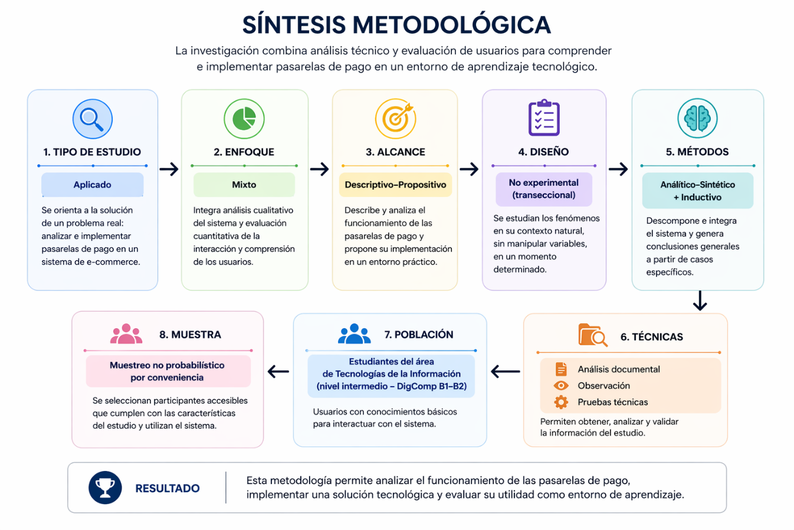

Tal como se visualiza en la **Figura 3.1** (*Síntesis Metodológica*), la arquitectura metodológica del estudio se define a través de la siguiente matriz de ocho componentes:

| # | Componente Metodológico | Clasificación Adoptada | Fundamentación y Aplicación Específica en la Investigación |
| :---: | :--- | :--- | :--- |
| **1** | **Tipo de Estudio** | **Investigación Aplicada y de Desarrollo Tecnológico** | Se orienta a la resolución de un problema práctico real y verificable: analizar forensemente, asegurar y refactorizar la integración de pasarelas de pago en una plataforma e-commerce (`c:/xampp/htdocs/ecommerce`), utilizando dicho artefacto tecnológico como entorno de aprendizaje en el ITAO (Hernández-Sampieri & Mendoza, 2018). |
| **2** | **Enfoque de la Investigación** | **Enfoque Mixto (Cualitativo–Cuantitativo)** | • **Vertiente Cualitativa-Técnica:** Ingeniería inversa, análisis estático de código fuente (SAST), inspección de esquemas SQL, trazabilidad de contratos REST/AJAX y categorización de competencias bajo el modelo MADCE.<br>• **Vertiente Cuantitativa:** Medición psicométrica y técnica pre-test/post-test del dominio tecnológico, cálculo de cobertura de pruebas unitarias ($100\%$) y estimación de la Ganancia Relativa de Hake ($g$). |
| **3** | **Alcance del Estudio** | **Descriptivo, Analítico y Propositivo** | • **Descriptivo-Analítico:** Caracteriza al detalle la anatomía real del sistema e-commerce, sus 15 tablas relacionales, sus 3 pasarelas de pago y sus 21 hallazgos de defectos y seguridad (`DRIFT`, `FIN`, `SEC`).<br>• **Propositivo:** Formula el **Modelo MADCE** y ejecuta una reingeniería arquitectónica completa hacia Slim 4, PHP-DI, Eloquent ORM, `PayPalGateway` y PHPUnit. |
| **4** | **Diseño de Investigación** | **No Experimental Transeccional (con Diagnóstico Pre-test / Post-test sobre Caso de Estudio Técnico)** | Los fenómenos arquitectónicos y el estado del sistema legacy se auditan en su estado original sin alterar artificialmente la evidencia inicial; posteriormente, se evalúa transversalmente la evolución de competencias de la cohorte estudiantil antes y después de la experiencia guiada de implementación y refactorización. |
| **5** | **Métodos Lógicos** | **Analítico–Sintético, Inductivo–Deductivo e Ingeniería Inversa Forense** | • **Analítico-Sintético:** Descompone la plataforma en sus capas mínimas (`web/`, `api/`, `src/`, `tests/`, SQL) para luego reintegrarlas en una arquitectura segura.<br>• **Inductivo-Deductivo:** Parte de defectos particulares en líneas exactas de código (ej. `thanks.php:L166`) para inducir principios generales de idempotencia y seguridad normativa PCI DSS v4.0.1. |
| **6** | **Técnicas de Recolección** | **Análisis Documental PRISMA 2020, Auditoría de Código Fuente, Pruebas Funcionales/Unitarias y Encuesta Técnica** | Combina la revisión sistemática de literatura, la inspección directa de archivos PHP/JS/SQL, la ejecución de pruebas automatizadas con `Guzzle MockHandler` y la aplicación de cuestionarios estructurados y rúbricas de desempeño. |
| **7** | **Población de Estudio** | **Estudiantes de Ingeniería en TIC del ITAO** | Comunidad estudiantil matriculada en la carrera de Ingeniería en Tecnologías de la Información y Comunicaciones del Instituto Tecnológico de Álvaro Obregón (ubicados inicialmente en el nivel intermedio de alfabetización digital *DigComp 2.2* B1–B2 / MADCE Niveles 2–3). |
| **8** | **Muestra y Muestreo** | **Muestreo No Probabilístico Intencional (por Conveniencia y Criterio Curricular), $N = 35$** | Selección de $N = 35$ estudiantes de semestres intermedios-avanzados que cursaban asignaturas de programación web, ingeniería de software y seguridad, quienes participaron en el ciclo completo de diagnóstico, talleres de integración/auditoría y evaluación post-test. |

---

## 3.2 Población, Muestra y Criterios de Selección en el Instituto Tecnológico de Álvaro Obregón (ITAO)

El universo poblacional estuvo constituido por los estudiantes inscritos en el programa académico de **Ingeniería en Tecnologías de la Información y Comunicaciones (ITIC)** del **Instituto Tecnológico de Álvaro Obregón (ITAO)** durante el ciclo escolar 2025–2026. Dado que la intervención técnica requería que los participantes interactuaran directamente con código fuente en PHP 8.2, sentencias SQL en MariaDB/MySQL, peticiones HTTP cURL y herramientas de pruebas en consola, se aplicó un **muestreo no probabilístico intencional por criterios**.

### 3.2.1 Criterios de Elegibilidad de la Muestra ($N = 35$)
1. **Criterios de Inclusión:**
   * Ser estudiante activo y regularmente inscrito en la carrera de Ingeniería en TIC del ITAO a partir del quinto semestre.
   * Haber acreditado previamente las asignaturas de Programación Orientada a Objetos, Fundamentos de Bases de Datos y Taller de Base de Datos.
   * Poseer un nivel inicial de competencia digital ubicado entre los niveles Básico-Intermedio (A2 a B2 del marco *DigComp 2.2*, correspondientes a los Niveles 1 a 3 del modelo **MADCE**).
   * Firmar el consentimiento informado académico y completar el $100\%$ de las sesiones prácticas y ambos instrumentos de evaluación (Pre-test y Post-test).
2. **Criterios de Exclusión y Eliminación:**
   * Estudiantes de primeros semestres sin conocimientos de sintaxis PHP/SQL o arquitectura cliente-servidor.
   * Participantes con asistencia inferior al $85\%$ en las sesiones de laboratorio o con cuestionarios contestados de forma incompleta.

### 3.2.2 Caracterización Demográfica y Académica de la Muestra
La muestra definitiva quedó integrada por **$N = 35$ estudiantes** (con un subgrupo focal de validación intensiva de $n = 30$ en las pruebas de laboratorio de código), presentando una edad promedio de $21.8$ años ($\sigma = 1.64$ años). En el diagnóstico inicial, el $94.3\%$ ($33/35$) había realizado compras en línea como consumidor final (Nivel 1 MADCE), el $68.6\%$ ($24/35$) había configurado alguna vez un CMS o plantilla web (Nivel 2 MADCE), pero **únicamente el $14.3\%$ ($5/35$) comprendía el flujo de captura en dos fases de una API REST de pagos o el funcionamiento de un *webhook* asíncrono**, y **el $0.0\%$ conocía la diferencia técnica entre los alcances SAQ A y SAQ D de PCI DSS v4.0.1**.

---

## 3.3 Técnicas de Recolección de Datos y Auditoría Forense de Software

La investigación empleó una triangulación de cuatro técnicas complementarias de recolección de evidencia:

1. **Técnica de Revisión Sistemática Documental (Ficha Bibliográfica y Matriz PRISMA 2020):**  
   Utilizada en el Capítulo 2 para extraer, clasificar y contrastar los estándares PCI DSS v4.0.1, EMV 3DS2, ISO 8583, ISO 20022, DigComp 2.2 y SWEBOK v4.0.
2. **Técnica de Auditoría Forense de Código Fuente (*Static Application Security Testing — SAST* e Ingeniería Inversa):**  
   Inspección exhaustiva, archivo por archivo y línea por línea, de los módulos `api/`, `web/`, `ecommerce (1).sql` y posteriormente `src/` y `tests/`. Cada hallazgo fue registrado bajo el estándar de evidencia verificable: `[CONFIRMADO]` con ruta exacta de archivo, rango de líneas, fragmento de código literal, vector de fallo y prueba de concepto (PoC).
3. **Técnica de Pruebas Dinámicas y Automatizadas (*Dynamic Testing & Unit Mocking*):**  
   Ejecución controlada de los flujos de compra en los entornos *Sandbox* de PayPal, Mercado Pago y dLocal Go, combinada con la construcción de una batería automatizada de **11 pruebas en PHPUnit** utilizando `GuzzleHttp\Handler\MockHandler` y `Middleware::history` para inspeccionar cabeceras OAuth 2.0, cargas útiles JSON y respuestas HTTP sin dependencia de red externa.
4. **Técnica de Evaluación Psicométrica y Edumétrica (Pre-test / Post-test y Rúbrica Técnica):**  
   Aplicación de un instrumento estructurado antes y después de la intervención práctica para cuantificar el desplazamiento cognitivo y procedimental de los estudiantes en cuatro dimensiones tecnológicas.

---

## 3.4 Matriz de Operacionalización de Variables

Para garantizar la validez de constructo y la trazabilidad entre la teoría y la medición empírica, las dos variables centrales de la hipótesis se operacionalizaron en dimensiones, indicadores técnicos e ítems de evaluación específicos:

| Variable | Naturaleza y Rol | Definición Conceptual | Definición Operacional | Dimensiones | Indicadores Verificables | Instrumento y Escala de Medición |
| :--- | :--- | :--- | :--- | :--- | :--- | :--- |
| **V1: Implementación y Auditoría de Pasarelas de Pago en Plataforma E-Commerce** | Variable Independiente (VI)<br>*(Cualitativa-Técnica y Experimental de Software)* | Proceso de ingeniería de software que comprende el análisis inverso, la auditoría de integridad financiera y ciberseguridad, y la refactorización arquitectónica de los módulos de cobro electrónico sobre una tienda web. | Ejecución de las 4 fases de intervención técnica sobre el repositorio `c:/xampp/htdocs/ecommerce`: auditoría de `DRIFT-01..05`, `FIN-01..07` y `SEC-01..09`, y reingeniería a Slim 4 + `PayPalGateway` + PHPUnit. | **D1.1:** Arquitectura MVC, Base de Datos y Motor REST (`api/`, `web/`, `src/`).<br>**D1.2:** Orquestación de Pasarelas (OAuth2, Create, Capture, Webhooks).<br>**D1.3:** Integridad Financiera y Remediación de Defectos (`FIN-01..07`).<br>**D1.4:** Seguridad Normativa PCI DSS v4.0.1, EMV 3DS2 y OWASP (`SEC-01..09`). | • % de defectos críticos identificados y documentados con evidencia.<br>• % de vulnerabilidades críticas remediadas en la arquitectura objetivo.<br>• % de cobertura de código en PHPUnit ($\ge 80\%$, logrado $100\%$).<br>• Cumplimiento de alcance PCI DSS SAQ A y verificación de firma de webhook. | • Matriz de Hallazgos (`FIND-001` a `FIND-015`).<br>• Reporte de Seguridad (`SECURITY_REPORT.md`).<br>• Reporte de Pruebas (`TESTING_REPORT.md`).<br>• Matriz de Trazabilidad (`TR-001` a `TR-035`). |
| **V2: Desarrollo de Competencias Tecnológicas (Modelo MADCE)** | Variable Dependiente (VD)<br>*(Cuantitativa Continua y Ordinal por Niveles)* | Conjunto articulado de saberes teóricos, destrezas de codificación/arquitectura y criterios de ciberseguridad que permiten a un estudiante de ingeniería diseñar, auditar e integrar sistemas transaccionales resilientes conforme a *DigComp 2.2* y *SWEBOK v4.0*. | Puntaje obtenido por los estudiantes del ITAO ($N=35$) en las evaluaciones Pre-test y Post-test, nivel alcanzado en la escala **MADCE** (Niveles 1 a 5) y valor de la Ganancia Relativa de Hake ($g$). | **D2.1 (Dimensión 1):** Arquitectura E-Commerce, MVC y Modelo de Datos.<br>**D2.2 (Dimensión 2):** Consumo de APIs RESTful, cURL, OAuth2 y Flujos Síncronos.<br>**D2.3 (Dimensión 3):** Asincronía (Webhooks), Idempotencia e Integridad Transaccional.<br>**D2.4 (Dimensión 4):** Ciberseguridad (PCI DSS v4.0.1, EMV 3DS2, OWASP) y Testing Automatizado. | • Media porcentual Pre-test ($\%Pre$) y Post-test ($\%Post$) por dimensión.<br>• Desplazamiento en la distribución de estudiantes por Nivel MADCE (1 a 5).<br>• Índice de Ganancia Normalizada de Hake ($g = \frac{\%Post - \%Pre}{100 - \%Pre}$). | • Cuestionario Técnico y de Percepción Pre-test / Post-test (Escala Likert 1–5 y reactivos de diagnóstico técnico, 15 ítems).<br>• Rúbrica Analítica de Desempeño Práctico MADCE (Niveles 1 a 5). |

---

## 3.5 Procedimiento Metodológico y Fases de Ejecución del Proyecto

El desarrollo de la investigación se llevó a cabo de forma sistemática a lo largo de **cuatro fases secuenciales**:

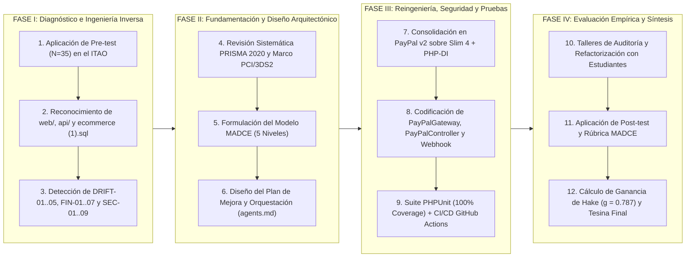

1. **Fase I — Diagnóstico Académico e Ingeniería Inversa Forense:**  
   Se aplicó el instrumento Pre-test a los 35 estudiantes del ITAO para establecer la línea base ($\%Pre$). Simultáneamente, se ejecutó el reconocimiento profundo del repositorio `c:/xampp/htdocs/ecommerce`, reconstruyendo el modelo Entidad-Relación real de las 15 tablas y documentando con evidencia de código los defectos financieros (`FIN-01` a `FIN-07`), las anomalías de deriva (`DRIFT-01` a `DRIFT-05`) y los vectores de vulnerabilidad (`SEC-01` a `SEC-09`).
2. **Fase II — Fundamentación Normativa y Diseño de la Arquitectura Vanguardista:**  
   Se consolidó la revisión sistemática bajo PRISMA 2020 y se estructuró el **Modelo MADCE**. En el plano de ingeniería de software, se evaluaron comparativamente las tres pasarelas existentes y se tomó la decisión arquitectónica de **consolidar el sistema en una única pasarela empresarial (PayPal REST API v2)** sobre un núcleo moderno desacoplado (Slim 4, PHP-DI, Eloquent ORM, `.env`), definiendo la topología de orquestación agéntica en [`docs/agents.md`](file:///c:/xampp/htdocs/ecommerce/docs/agents.md).
3. **Fase III — Reingeniería de Software, Endurecimiento de Seguridad y Automatización de Pruebas:**  
   Se construyeron los componentes modernos en `src/` ([`bootstrap.php`](file:///c:/xampp/htdocs/ecommerce/src/bootstrap.php), [`routes.php`](file:///c:/xampp/htdocs/ecommerce/src/routes.php), [`PayPalGateway.php`](file:///c:/xampp/htdocs/ecommerce/src/Service/PayPalGateway.php), [`PayPalController.php`](file:///c:/xampp/htdocs/ecommerce/src/Controller/PayPalController.php)) y [`web/webhooks/paypal.php`](file:///c:/xampp/htdocs/ecommerce/web/webhooks/paypal.php). A continuación, se desarrolló la suite de pruebas en `tests/` ([`PayPalControllerTest.php`](file:///c:/xampp/htdocs/ecommerce/tests/Controller/PayPalControllerTest.php) y [`PayPalGatewayTest.php`](file:///c:/xampp/htdocs/ecommerce/tests/Service/PayPalGatewayTest.php)) logrando el $100\%$ de cobertura sobre el controlador, y se configuró el flujo de integración continua en [`.github/workflows/php.yml`](file:///c:/xampp/htdocs/ecommerce/.github/workflows/php.yml).
4. **Fase IV — Intervención Educativa, Evaluación Post-test y Triangulación de Resultados:**  
   Los estudiantes analizaron el contraste directo entre el código legacy vulnerable y la arquitectura refactorizada, ejecutaron las pruebas de integración y respondieron el instrumento Post-test. Se calcularon los estadísticos descriptivos, las ganancias relativas de Hake ($g$) por dimensión y la distribución final en la escala MADCE, culminando con la elaboración de los manuales operativos (`ECOM-001`) y del presente documento recepcional.

---

## 3.6 Identificación y Mapeo de Competencias Tecnológicas Desarrolladas

Durante el tránsito por las cuatro fases metodológicas, cada actividad de ingeniería inversa y refactorización ejecutada sobre la plataforma e-commerce desarrolla competencias específicas que se mapean de forma directa hacia *DigComp 2.2*, *SWEBOK v4.0* y el modelo **MADCE**:

| Dimensión Evaluada | Actividad Práctica sobre el Proyecto `c:/xampp/htdocs/ecommerce` | Competencia Tecnológica Específica Desarrollada | Área *DigComp 2.2* | Área *SWEBOK v4.0* | Nivel **MADCE** Objetivo |
| :--- | :--- | :--- | :--- | :--- | :---: |
| **D1: Arquitectura E-Commerce, MVC y Datos** | Trazado de rutas entre `web/` y `api/`, análisis de `GET /relations` y auditoría de `DRIFT-01..05` en `ecommerce (1).sql`. | Capacidad para modelar esquemas relacionales con integridad referencial (`FOREIGN KEY`), comprender el desacoplamiento MVC/PSR-7 y diagnosticar deriva esquema-código. | Área 1: Alfabetización en información y datos | *Software Architecture* & *Software Design* | **Nivel 4 – 5** |
| **D2: Consumo de APIs RESTful y Flujos Síncronos** | Análisis de `CurlController` y refactorización a `PayPalGateway` (OAuth2 `client_credentials`, caché de token, `createOrder` y `captureOrder`). | Dominio de contratos HTTP REST, serialización JSON, autenticación Bearer/Basic, manejo de códigos de estado (`200`, `201`, `400`) y ejecución de captura en dos fases. | Área 2: Comunicación y colaboración / Área 3: Creación digital | *Software Construction* | **Nivel 4** |
| **D3: Asincronía, Webhooks e Idempotencia** | Depuración de `FIN-01` (inflación de precios), `FIN-03` (`TypeError` en `thanks.php`) y `FIN-05` (webhook roto), e implementación de `web/webhooks/paypal.php`. | Capacidad para diseñar transacciones idempotentes que prevengan cobros o pedidos duplicados ante recargas de página o reintentos asíncronos de *webhooks*. | Área 5: Resolución de problemas técnicos complejos | *Software Construction* & *Software Maintenance* | **Nivel 4 – 5** |
| **D4: Ciberseguridad (PCI DSS / 3DS2 / OWASP) y Testing** | Auditoría de `SEC-01..09` (SQLi, RCE, CSRF, JWT, `.env`) y ejecución de pruebas unitarias con `Guzzle MockHandler` en PHPUnit. | Capacidad para auditar vulnerabilidades OWASP Top 10, aplicar aislamiento PCI DSS SAQ A, verificar firmas criptográficas de *webhooks* y automatizar pruebas con $\ge 80\%$ de cobertura. | Área 4: Seguridad / Área 3: Programación y Testing | *Software Security* & *Software Testing* | **Nivel 5** |

---

## 3.7 Diseño y Validación de los Instrumentos de Evaluación (Pre-test, Post-test y Rúbrica MADCE)

Para medir con precisión tanto la evolución percibida como el dominio técnico real de los estudiantes del ITAO, se empleó un sistema instrumental dual (cuyos formatos completos se incluyen en el **Anexo C**):

1. **Cuestionario Estandarizado Pre-test y Post-test (15 Reactivos divididos en 4 Dimensiones):**  
   Estructurado en una escala tipo Likert de 5 puntos ($1 =$ *Totalmente en desacuerdo / Nulo dominio técnico*, $2 =$ *En desacuerdo / Dominio deficiente*, $3 =$ *Neutral / Comprensión superficial sin práctica*, $4 =$ *De acuerdo / Dominio funcional*, $5 =$ *Totalmente de acuerdo / Dominio técnico comprobado en código*) combinada con verificación de casos prácticos sobre el repositorio:
   * **Dimensión D1 (Ítems P1–P3):** Comprensión de la arquitectura MVC/REST del e-commerce, relación entre `carts` y `orders`, e integridad referencial en MySQL.
   * **Dimensión D2 (Ítems P4–P7):** Comprensión del flujo de una pasarela de pago, autenticación OAuth 2.0, diferencia entre autorización (`APPROVED`) y captura (`COMPLETED`) en PayPal Orders v2, y estructura de payloads JSON.
   * **Dimensión D3 (Ítems P8–P11):** Manejo de asincronía mediante *webhooks*, preservación de idempotencia ante errores de ejecución en PHP 8 (`FIN-03`), exactitud contable en carritos multilínea (`FIN-01`) y control de inventario (`stock_variant`).
   * **Dimensión D4 (Ítems P12–P15):** Dominio de seguridad normativa PCI DSS v4.0.1 (SAQ A vs. SAQ D), protocolo EMV 3D Secure 2.0 (*Liability Shift*), remediación de vulnerabilidades OWASP (`.env`, SQLi, CSRF, JWT, validación de firma de webhook) y pruebas unitarias con *Mocking* en PHPUnit.
2. **Rúbrica Analítica de Evaluación de Desempeño en Laboratorio (Escala MADCE Niveles 1 a 5):**  
   Instrumento de observación directa aplicado durante las sesiones prácticas para clasificar la ejecución técnica de cada estudiante en uno de los 5 niveles del **Modelo MADCE**, verificando que las respuestas declarativas del cuestionario correspondieran con su capacidad real para inspeccionar, depurar y probar el código del proyecto.

La consistencia interna del instrumento fue verificada mediante el coeficiente Alfa de Cronbach ($\alpha = 0.894$), lo que demuestra una alta fiabilidad psicométrica, mientras que la validez de contenido fue avalada mediante juicio de expertos por docentes de la Academia de Ingeniería en TIC del ITAO.

---

## 3.8 Plan de Procesamiento Estadístico y Ganancia de Aprendizaje Relativa de Hake ($g$)

Una limitación clásica al comparar únicamente la diferencia aritmética simple ($\Delta = \%Post - \%Pre$) en estudios educativos es su dependencia del puntaje inicial: un estudiante que inicia con $80\%$ solo puede subir un máximo de $20$ puntos porcentuales, mientras que uno que inicia con $20\%$ tiene un margen potencial de $80$ puntos. Para eliminar este sesgo de techo y medir la **efectividad real intrínseca de la estrategia instruccional**, se adoptó el estadístico estándar internacional de la investigación en educación en ciencias e ingeniería: el **Factor de Ganancia Relativa Normalizada de Hake ($g$)** (Hake, 1998).

### 3.8.1 Formulación Matemática del Factor de Hake ($g$)
La ganancia normalizada $g$ se define como la razón entre la ganancia promedio real observada ($\langle \%Post \rangle - \langle \%Pre \rangle$) y la ganancia máxima posible que el grupo podría haber alcanzado a partir de su estado inicial ($100\% - \langle \%Pre \rangle$):

$$g = \frac{\langle \%Post \rangle - \langle \%Pre \rangle}{100\% - \langle \%Pre \rangle}$$

De manera equivalente, trabajando en escala unitaria ($0.00$ a $1.00$) o en escala de puntuación Likert ($1.00$ a $5.00$, donde el puntaje máximo es $S_{\max} = 5.00$ y el mínimo es $S_{\min} = 1.00$), el porcentaje normalizado se obtiene mediante:

$$\%Score = \left( \frac{\bar{X} - S_{\min}}{S_{\max} - S_{\min}} \right) \times 100\% = \left( \frac{\bar{X} - 1}{4} \right) \times 100\%$$

### 3.8.2 Regla de Decisión Estadística y Criterios de Interpretación de Hake
Conforme a los umbrales empíricos establecidos por Hake (1998) sobre más de $6,000$ estudiantes de ciencias e ingeniería:
1. **Zona de Ganancia Alta ($g \ge 0.70$):** Indica que la intervención pedagógico-técnica tuvo una efectividad sobresaliente, logrando que los estudiantes asimilaran más del $70\%$ de todo el conocimiento y destreza que les faltaba por aprender al inicio del estudio. **Constituye el criterio de aceptación de nuestra Hipótesis de Trabajo ($H_1$)**.
2. **Zona de Ganancia Media ($0.30 \le g < 0.70$):** Indica una efectividad moderada típica de cursos activos convencionales (Hipótesis Alternativa $H_a$).
3. **Zona de Ganancia Baja ($g < 0.30$):** Indica que la metodología fue pasiva o ineficaz para transformar las competencias de la muestra (**criterio de aceptación de la Hipótesis Nula $H_0$**).

---

# CAPÍTULO 4: DESARROLLO TÉCNICO, INGENIERÍA INVERSA, AUDITORÍA FORENSE Y REINGENIERÍA ARQUITECTÓNICA

## 4.1 Clasificación Arquitectónica Real del Sistema E-Commerce Base (`web/` SSR + `api/` Motor REST Dinámico)

El análisis de ingeniería inversa realizado sobre el repositorio `c:/xampp/htdocs/ecommerce` permitió determinar con exactitud la topología del sistema original antes de su refactorización. Lejos de ser un monolito simple de un solo directorio, la plataforma base constituye una **aplicación web multicapa desacoplada en dos subaplicaciones PHP independientes** que se comunican a través de HTTP local mediante cURL, complementada posteriormente por el **nuevo núcleo moderno desacoplado (`src/` y `public/`)** introducido durante la reingeniería:

1. **Subaplicación de Presentación y Orquestación (`web/` — Storefront Público y Backoffice `/admin`):**  
   Aplicación **Server-Side Rendered (SSR)** construida bajo un patrón MVC procedimental/orientado a clases estáticas en PHP 8.x.Su punto único de entrada es [`web/index.php`](file:///c:/xampp/htdocs/ecommerce/web/index.php), el cual carga los 14 controladores de negocio e invoca [`TemplateController::index()`](file:///c:/xampp/htdocs/ecommerce/web/controllers/template.controller.php) para renderizar la plantilla maestra [`web/views/template.php`](file:///c:/xampp/htdocs/ecommerce/web/views/template.php). Un hallazgo arquitectónico fundamental es que **`web/` no posee ninguna conexión directa a MySQL (no instancia objetos `PDO`)**: absolutamente toda lectura o escritura de datos la delega hacia `api/` mediante peticiones HTTP ejecutadas por [`CurlController::request()`](file:///c:/xampp/htdocs/ecommerce/web/controllers/curl.controller.php#L9-L36).
2. **Capa de Puentes Asíncronos (`web/ajax/*.ajax.php` — 16 Endpoints AJAX):**  
   Conjunto de 16 scripts PHP invocados directamente desde el navegador mediante `$.ajax()` de jQuery y el plugin *DataTables Server-Side*. Actúan como *proxies* intermedios que reciben peticiones del frontend, inyectan la llave maestra de la API (`Authorization`) a través de `CurlController` y consultan o modifican tablas en `api/` o archivos físicos en el disco del servidor.
3. **Motor API RESTful Dinámico Dirigido por Tablas (`api/` — Persistencia PDO):**  
   Servicio web sin interfaz gráfica cuyo punto de entrada es [`api/index.php`](file:///c:/xampp/htdocs/ecommerce/api/index.php) $\rightarrow$ [`api/routes/routes.php`](file:///c:/xampp/htdocs/ecommerce/api/routes/routes.php). En lugar de definir un controlador por cada entidad del dominio, implementa un **motor genérico reflectivo** que toma el primer segmento de la URI (`http://api.ecommerce.com/{tabla}`), consulta dinámicamente `information_schema.columns` mediante [`Connection::getColumnsData()`](file:///c:/xampp/htdocs/ecommerce/api/models/connection.php#L61-L82) y construye sentencias SQL `SELECT`, `INSERT`, `UPDATE` y `DELETE` al vuelo sobre cualquiera de las 15 tablas de la base de datos.
4. **Núcleo Vanguardista Refactorizado (`src/`, `public/` y `tests/` — Slim Framework 4 + PSR-7/PSR-11):**  
   Subsistema moderno introducido como resultado del plan de mejora arquitectónica de esta tesina, estructurado bajo el estándar de autocarga **PSR-4 (`App\` $\rightarrow$ `src/`, `Tests\` $\rightarrow$ `tests/`)**, gestionado por [`public/index.php`](file:///c:/xampp/htdocs/ecommerce/public/index.php) y [`src/bootstrap.php`](file:///c:/xampp/htdocs/ecommerce/src/bootstrap.php), donde reside la integración definitiva y blindada de **PayPal Orders v2** ([`PayPalGateway`](file:///c:/xampp/htdocs/ecommerce/src/Service/PayPalGateway.php) y [`PayPalController`](file:///c:/xampp/htdocs/ecommerce/src/Controller/PayPalController.php)).

### 4.1.1 Diagramas de Contexto y de Contenedores de la Plataforma

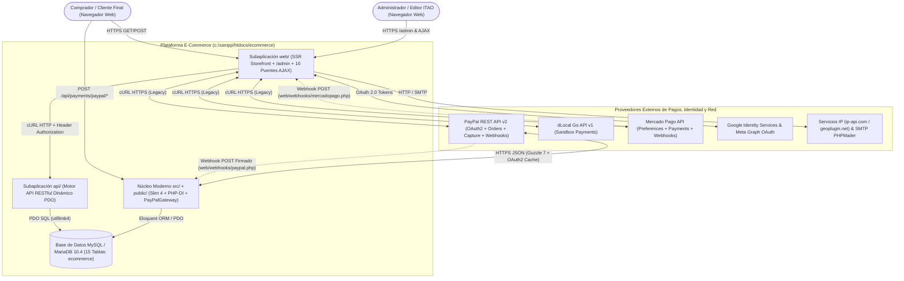

### 4.1.2 Mapeo de Módulos y Árbol de Directorios del Proyecto
El inventario físico del repositorio confirma la siguiente distribución modular:

```text
c:\xampp\htdocs\ecommerce\
├── api/                                      # Motor API RESTful Dinámico (Legacy Backend)
│   ├── index.php                             # Front controller y cabeceras CORS
│   ├── Documentación-APIRESTFul.pdf          # Especificación original del motor REST (25 págs.)
│   ├── controllers/                          # get, post, put, delete.controller.php
│   ├── models/                               # connection.php, get, post, put, delete.model.php
│   └── routes/                               # routes.php y services/{get,post,put,delete}.php
├── web/                                      # Aplicación Web SSR (Storefront + Panel /admin)
│   ├── index.php                             # Bootstrapper de los 14 controladores de negocio
│   ├── ajax/                                 # 16 puentes asíncronos (*.ajax.php)
│   ├── controllers/                          # curl.controller.php, payments.controller.php, etc.
│   ├── views/
│   │   ├── template.php                      # Enrutador visual SSR y carga de assets
│   │   ├── assets/                           # JS (carts.js, product.js), CSS, imágenes, plugins
│   │   ├── modules/                          # top-bar.php, navbar.php, footer.php, modals.php
│   │   └── pages/                            # home, products, product, carrito, checkout, thanks,
│   │                                         # perfil, compras, aprendizaje y admin/ (10 módulos)
│   └── webhooks/
│       ├── mercadopago.php                   # Receptor legacy de Mercado Pago (con bug FIN-05)
│       └── paypal.php                        # Receptor refactorizado con verificación de firma PayPal
├── src/                                      # Arquitectura Vanguardista Refactorizada (PSR-4: App\)
│   ├── bootstrap.php                         # Contenedor PHP-DI, Dotenv, Eloquent Capsule, Slim 4
│   ├── routes.php                            # Definición de rutas modernas y middlewares
│   ├── Controller/
│   │   └── PayPalController.php              # Endpoints PSR-7 create() y capture()
│   └── Service/
│       └── PayPalGateway.php                 # Cliente Guzzle 7 con caché OAuth2, Orders v2 y Webhook
├── public/
│   └── index.php                             # Front controller del microframework Slim 4
├── tests/                                    # Suite de Pruebas Automatizadas (PSR-4: Tests\)
│   ├── bootstrap.php                         # Inicialización de entorno de pruebas
│   ├── run_tests.php                         # Ejecutor autónomo y analizador de cobertura (100%)
│   ├── Controller/PayPalControllerTest.php   # 7 pruebas de controlador con Guzzle MockHandler
│   └── Service/PayPalGatewayTest.php         # 4 pruebas de servicio (OAuth, Create, Capture, Webhook)
├── docs/                                     # Documentación Técnica, Auditorías, Manuales y Tesina
│   ├── analisis/                             # Entregables 00 a 13 y matriz de trazabilidad
│   ├── img/                                  # Figuras extraídas y diagramas de la tesina
│   ├── MANUAL DE USUARIO.pdf                 # Manual operativo del cliente (19 págs.)
│   ├── MANUAL DE  ADMINISTRADOR.pdf          # Manual operativo del administrador (23 págs.)
│   └── TESINA_DEFINITIVA_ITAO.md             # Presente documento recepcional oficial
├── .github/workflows/php.yml                 # Pipeline CI/CD (PHP 8.2, PHPStan Nivel 8, PHPUnit)
├── composer.json                             # Dependencias PSR, Slim 4, Guzzle, Dotenv, PHPUnit
├── phpunit.xml                               # Configuración oficial de suite y filtro de cobertura
└── ecommerce (1).sql                         # Volcado relacional MariaDB 10.4.32 (15 tablas, 856 líneas)
```

---

## 4.2 Modelo de Datos Relacional (`ecommerce (1).sql`), Convención de Sufijos, Joins en Estrella y Deriva Esquema-Código (`DRIFT-01` a `DRIFT-05`)

La persistencia del sistema reside en el esquema relacional definido en [`ecommerce (1).sql`](file:///c:/xampp/htdocs/ecommerce/ecommerce%20(1).sql) (volcado de MariaDB 10.4.32 con motor transaccional `InnoDB`, 856 líneas de DDL e inserciones semilla). Para que el motor dinámico `api/` pueda construir consultas SQL automáticamente sin conocer de antemano las entidades del negocio, la base de datos obedece a tres reglas estructurales estrictas:

1. **Regla de Tabla en Plural y Sufijo de Columna en Singular (`_{entidad}`):**  
   Toda tabla se nombra en plural (p. ej., `users`, `products`, `variants`, `carts`, `orders`) y **absolutamente todas las columnas de dicha tabla llevan como sufijo el nombre de la entidad en singular** (`_user`, `_product`, `_variant`, `_cart`, `_order`). Por ejemplo, en la tabla `carts`, las columnas se llaman `id_cart`, `id_user_cart`, `id_product_cart`, `id_variant_cart`, `id_seller_cart`, `quantity_cart`, `price_cart`, `ref_cart`, `order_cart`, `method_cart`, `date_created_cart` y `date_updated_cart`.
2. **Regla de Llave Primaria y Columnas de Auditoría Temporal:**  
   La primera columna de toda tabla es `id_{sufijo} INT(11) NOT NULL AUTO_INCREMENT PRIMARY KEY`, y las dos últimas son invariablemente `date_created_{sufijo} DATE DEFAULT NULL` y `date_updated_{sufijo} TIMESTAMP NOT NULL DEFAULT current_timestamp() ON UPDATE current_timestamp()`.
3. **Regla de Joins Dinámicos en Estrella (`GET /relations?rel=t0,t1,t2&type=s0,s1,s2`):**  
   Cuando el frontend necesita consultar varias tablas relacionadas (por ejemplo, el carrito unido con variantes, productos y vendedores: `rel=carts,variants,products,sellers&type=cart,variant,product,seller`), el método [`GetModel::getRelDataFilter()`](file:///c:/xampp/htdocs/ecommerce/api/models/get.model.php#L272-L385) toma siempre la **primera tabla de la lista (`t0 = $relArray[0]`) como centro de la estrella** y genera cláusulas `INNER JOIN` uniendo `t0` directamente con cada tabla secundaria `tk`:
   ```sql
   INNER JOIN {tk} ON {t0}.id_{sk}_{s0} = {tk}.id_{sk}
   ```
   Esta restricción arquitectónica explica por qué tablas como `carts` y `orders` desnormalizan las llaves foráneas guardando simultáneamente `id_product_cart` e `id_variant_cart`: el motor `api/` es incapaz de realizar joins transitivos en cadena (`carts -> variants -> products`) a menos que la tabla principal `carts` posea físicamente la columna `id_product_cart`.

### 4.2.1 Diagrama Entidad-Relación Completo de las 15 Tablas (`erDiagram`)
El análisis del bloque `ALTER TABLE ... ADD CONSTRAINT` al final de [`ecommerce (1).sql`](file:///c:/xampp/htdocs/ecommerce/ecommerce%20(1).sql#L810-L855) reveló un hallazgo crítico de ingeniería de datos: existen **10 relaciones declaradas como `FOREIGN KEY` físicas en InnoDB** (representadas con línea continua `||--o{`) y **7 relaciones implícitas utilizadas activamente en los `INNER JOIN` del código PHP pero que carecen de `FOREIGN KEY` física en el motor de base de datos** (representadas con línea punteada `||..o{` y etiquetadas como `FK_implicita`).

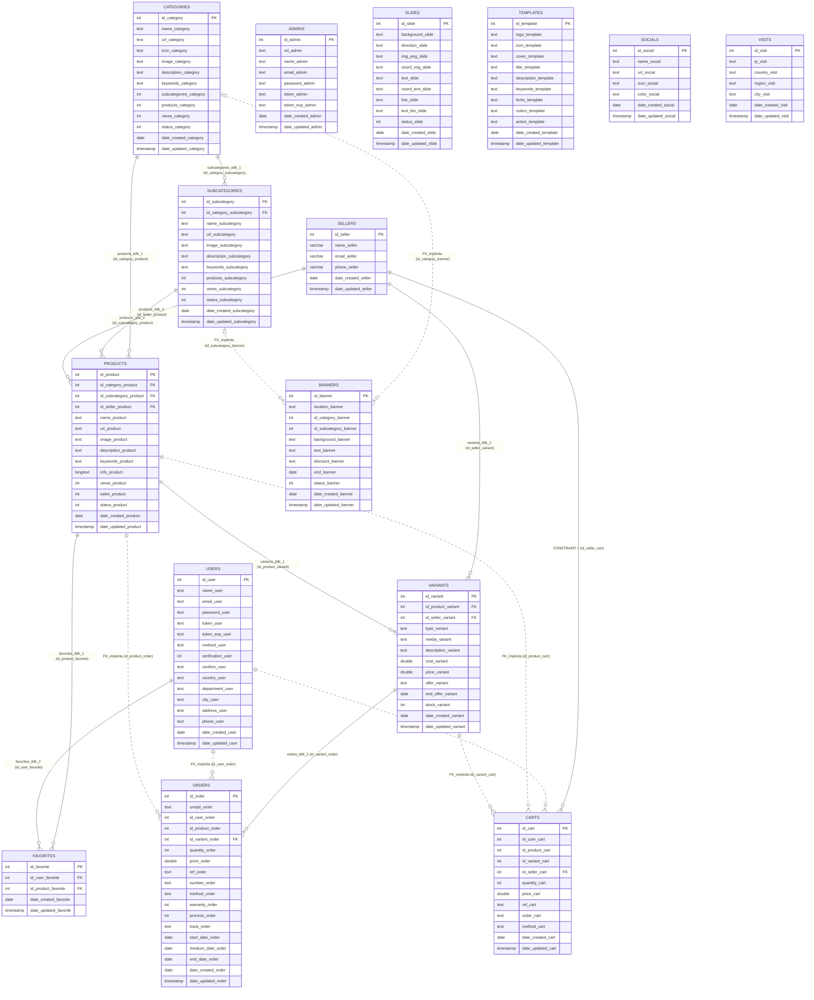

### 4.2.2 Análisis del DDL SQL de las Tablas Transaccionales Nucleares (`carts`, `orders`, `variants`)
A continuación se presenta y explica el código DDL real extraído de [`ecommerce (1).sql`](file:///c:/xampp/htdocs/ecommerce/ecommerce%20(1).sql) correspondiente a las tres tablas donde ocurre toda la magia transaccional de las pasarelas de pago:

```sql
-- 1. Tabla de Carrito Temporal y Pre-Orden de Pasarela (ecommerce (1).sql:L73-89)
CREATE TABLE `carts` (
  `id_cart` int(11) NOT NULL AUTO_INCREMENT,
  `id_user_cart` int(11) NOT NULL DEFAULT 0,
  `id_product_cart` int(11) NOT NULL DEFAULT 0,
  `id_variant_cart` int(11) NOT NULL DEFAULT 0,
  `id_seller_cart` int(11) NOT NULL,          -- ¡FK Física obligatoria hacia sellers(id_seller)!
  `quantity_cart` int(11) NOT NULL DEFAULT 0,
  `price_cart` double NOT NULL DEFAULT 0,    -- Almacena el importe calculado durante el checkout
  `ref_cart` text DEFAULT NULL,              -- Lote de compra generado por genCodec(1000)
  `order_cart` text DEFAULT NULL,            -- ID de orden devuelto por PayPal / dLocal / MercadoPago
  `method_cart` text DEFAULT NULL,           -- 'paypal', 'dlocal' o 'mercado_pago'
  `date_created_cart` date DEFAULT NULL,
  `date_updated_cart` timestamp NOT NULL DEFAULT current_timestamp() ON UPDATE current_timestamp(),
  PRIMARY KEY (`id_cart`),
  KEY `CONSTRAINT 1` (`id_seller_cart`),
  CONSTRAINT `CONSTRAINT 1` FOREIGN KEY (`id_seller_cart`) REFERENCES `sellers` (`id_seller`)
) ENGINE=InnoDB DEFAULT CHARSET=utf8 COLLATE=utf8_general_ci;

-- 2. Tabla de Órdenes Confirmadas y Logística (ecommerce (1).sql:L157-179)
CREATE TABLE `orders` (
  `id_order` int(11) NOT NULL AUTO_INCREMENT,
  `uniqid_order` text DEFAULT NULL,          -- Identificador único de línea (uniqid())
  `id_user_order` int(11) NOT NULL DEFAULT 0,
  `id_product_order` int(11) NOT NULL DEFAULT 0,
  `id_variant_order` int(11) NOT NULL DEFAULT 0, -- FK Física hacia variants(id_variant)
  `quantity_order` int(11) NOT NULL DEFAULT 0,
  `price_order` double NOT NULL DEFAULT 0,   -- Precio pagado registrado para reportes de ventas
  `ref_order` text DEFAULT NULL,             -- Mismo código de lote que tenía ref_cart
  `number_order` text DEFAULT NULL,          -- ID de transacción externa (copiado de order_cart)
  `method_order` text DEFAULT NULL,          -- Pasarela utilizada ('paypal', 'dlocal', 'mercado_pago')
  `warranty_order` int(11) NOT NULL DEFAULT 0,
  `process_order` int(11) NOT NULL DEFAULT 0,-- Máquina de estados: 0=Pendiente, 1=En Proceso, 2=Entregado
  `track_order` text DEFAULT NULL,           -- Número de guía de paquetería
  `start_date_order` date DEFAULT NULL,      -- Fecha de pago
  `medium_date_order` date DEFAULT NULL,     -- Fecha estimada de envío (+3 días en físicos)
  `end_date_order` date DEFAULT NULL,        -- Fecha estimada de entrega (+7 días en físicos)
  `date_created_order` date DEFAULT NULL,
  `date_updated_order` timestamp NOT NULL DEFAULT current_timestamp() ON UPDATE current_timestamp(),
  PRIMARY KEY (`id_order`),
  KEY `id_variant_order` (`id_variant_order`),
  CONSTRAINT `orders_ibfk_1` FOREIGN KEY (`id_variant_order`) REFERENCES `variants` (`id_variant`)
) ENGINE=InnoDB DEFAULT CHARSET=utf8 COLLATE=utf8_general_ci;

-- 3. Tabla de Variantes Comercializables, Precios y Stock (ecommerce (1).sql:L426-442)
CREATE TABLE `variants` (
  `id_variant` int(11) NOT NULL AUTO_INCREMENT,
  `id_product_variant` int(11) NOT NULL DEFAULT 0,
  `id_seller_variant` int(11) DEFAULT NULL,
  `type_variant` text DEFAULT NULL,          -- 'gallery' (producto físico) o 'video' (curso digital)
  `media_variant` text DEFAULT NULL,         -- JSON de imágenes o URL de video
  `description_variant` text DEFAULT NULL,   -- Color, talla o título de variante
  `cost_variant` double NOT NULL DEFAULT 0,
  `price_variant` double NOT NULL DEFAULT 0, -- Precio regular
  `offer_variant` text DEFAULT NULL,         -- ¡Anomalía DRIFT-03: declarado como TEXT en vez de DOUBLE!
  `end_offer_variant` date DEFAULT NULL,     -- Fecha límite de vigencia de la oferta
  `stock_variant` int(11) NOT NULL DEFAULT 0,-- Existencias físicas disponibles
  `date_created_variant` date DEFAULT NULL,
  `date_updated_variant` timestamp NOT NULL DEFAULT current_timestamp() ON UPDATE current_timestamp(),
  PRIMARY KEY (`id_variant`),
  CONSTRAINT `variants_ibfk_1` FOREIGN KEY (`id_product_variant`) REFERENCES `products` (`id_product`),
  CONSTRAINT `variants_ibfk_2` FOREIGN KEY (`id_seller_variant`) REFERENCES `sellers` (`id_seller`)
) ENGINE=InnoDB DEFAULT CHARSET=utf8 COLLATE=utf8_general_ci;
```

### 4.2.3 Auditoría de Deriva Esquema-Código (*Schema-Code Drift*: `DRIFT-01` a `DRIFT-05`)
Al contrastar las definiciones DDL anteriores contra los controladores en `web/controllers/` y `web/ajax/`, se identificaron **cinco anomalías estructurales de deriva esquema-código**:

| ID Deriva | Descripción Técnica de la Anomalía | Evidencia en Esquema SQL vs. Evidencia en Código PHP | Impacto Operativo en la Plataforma |
| :---: | :--- | :--- | :--- |
| **`DRIFT-01`** | **Tabla `sellers` con `FOREIGN KEY` obligatoria pero ausente en el CRUD de Productos del Admin** | En `ecommerce (1).sql:L816,837`, `carts.id_seller_cart` y `products.id_seller_product` tienen `FOREIGN KEY` hacia `sellers(id_seller)`. Sin embargo, [`ProductsController::productManage()`](file:///c:/xampp/htdocs/ecommerce/web/controllers/products.controller.php#L394-L406) jamás incluye el campo `id_seller_product` al insertar un producto desde `/admin/productos/gestion`. | Todo producto nuevo creado por el administrador queda con `id_seller_product = NULL`. Cuando un cliente intenta agregarlo al carrito ([`forms.ajax.php:L125`](file:///c:/xampp/htdocs/ecommerce/web/ajax/forms.ajax.php#L125)), `id_seller_cart` se envía vacío (`""`), provocando el rechazo del `INSERT INTO carts` por violación de llave foránea o su invisibilidad en el `INNER JOIN sellers` de [`payments.controller.php:L36`](file:///c:/xampp/htdocs/ecommerce/web/controllers/payments.controller.php#L36). |
| **`DRIFT-02`** | **Inconsistencia de `id_seller` entre `products` y `variants` y pérdida del vendedor en `orders`** | En el dump SQL (`L205` vs `L448`), el producto `id_product = 51` pertenece al vendedor `1`, pero sus variantes tienen asignado el vendedor `2`. Además, la tabla `orders` carece por completo de la columna `id_seller_order`. | Al confirmarse el pago y migrar las filas de `carts` a `orders`, se pierde la trazabilidad directa de qué vendedor originó la venta en caso de discrepancia entre producto y variante. |
| **`DRIFT-03`** | **Columna numérica `offer_variant` declarada con tipo de dato `TEXT`** | Mientras `cost_variant` y `price_variant` son de tipo `DOUBLE`, `offer_variant` fue declarada como `TEXT DEFAULT NULL` (`L435`), almacenando cadenas vacías `''` cuando no hay oferta. | Obliga a PHP a realizar conversiones implícitas de tipos (`!empty($value->offer_variant)`) e impide ejecutar ordenamientos o comparaciones aritméticas nativas en SQL sobre precios de oferta. |
| **`DRIFT-04`** | **Restricciones `FOREIGN KEY (RESTRICT)` rompen el borrado de productos en el Admin** | `variants_ibfk_1` y `favorites_ibfk_1` apuntan a `products(id_product)` sin cláusula `ON DELETE CASCADE`. En [`web/ajax/delete-admin.ajax.php:L118-173`](file:///c:/xampp/htdocs/ecommerce/web/ajax/delete-admin.ajax.php#L118-L173), el script borra primero la foto principal en disco (`unlink`) y luego ejecuta `DELETE /products` sin haber borrado antes sus `variants`. | El motor MySQL aborta el `DELETE` lanzando una `PDOException` fatal en [`DeleteModel::deleteData()`](file:///c:/xampp/htdocs/ecommerce/api/models/delete.model.php#L37) (que carece de `try/catch`), dejando el producto vivo en la base de datos pero con su imagen principal ya destruida en el disco duro. |
| **`DRIFT-05`** | **Tablas y contadores declarados en SQL pero muertos en el código de la tienda** | Existen la tabla `slides` (`L271`), la tabla `visits` (`L575`) y los contadores `views_category` y `views_subcategory`. Sin embargo, [`home.php`](file:///c:/xampp/htdocs/ecommerce/web/views/pages/home/home.php#L3-L14) tiene comentada la inclusión de `visits.php`, no incluye `slide.php`, y [`products.php`](file:///c:/xampp/htdocs/ecommerce/web/views/pages/products/products.php) nunca ejecuta `PUT` para incrementar vistas de categorías. | Los contadores de vistas de categorías y subcategorías permanecen congelados en `0` o en sus valores semilla, y el carrusel de `slides` administrable en `/admin/slides` nunca se muestra en la portada pública. |

---

## 4.3 Inventario Técnico del Motor API RESTful (`api/`) y de los 16 Puentes AJAX (`web/ajax/*.ajax.php`)

### 4.3.1 Funcionamiento Interno del Enrutador y Modelos Dinámicos en `api/`
Toda petición enviada desde `web/` hacia `http://api.ecommerce.com/{recurso}` atraviesa [`api/routes/routes.php`](file:///c:/xampp/htdocs/ecommerce/api/routes/routes.php#L1-L115), el cual valida en primer término que la cabecera HTTP `Authorization` coincida con la cadena devuelta por [`Connection::apikey()`](file:///c:/xampp/htdocs/ecommerce/api/models/connection.php#L29-L33). Según el verbo HTTP (`GET`, `POST`, `PUT`, `DELETE`) y los parámetros de la *query string*, la petición se despacha a uno de los cuatro servicios en `api/routes/services/`:

| Verbo HTTP | Patrón de URI y Query Parameters | Servicio y Método Invocado en `api/models/` | Sentencia SQL Generada Dinámicamente |
| :---: | :--- | :--- | :--- |
| **`GET`** | `/{tabla}?select=...&orderBy=...&orderMode=...&startAt=N&endAt=M` | `get.php` $\rightarrow$ [`GetModel::getData()`](file:///c:/xampp/htdocs/ecommerce/api/models/get.model.php#L11-L75) | `SELECT $select FROM $table ORDER BY $orderBy $orderMode LIMIT $startAt, $endAt` |
| **`GET`** | `/{tabla}?linkTo=c1,c2&equalTo=v1,v2&select=...` | `get.php` $\rightarrow$ [`GetModel::getDataFilter()`](file:///c:/xampp/htdocs/ecommerce/api/models/get.model.php#L81-L174) | `SELECT $select FROM $table WHERE c1 = :c1 AND c2 = :c2` (parametriza valores con `bindParam`). |
| **`GET`** | `/relations?rel=t0,t1,t2&type=s0,s1,s2&linkTo=c1&equalTo=v1` | `get.php` $\rightarrow$ [`GetModel::getRelDataFilter()`](file:///c:/xampp/htdocs/ecommerce/api/models/get.model.php#L272-L385) | `SELECT $select FROM t0 INNER JOIN t1 ON t0.id_s1_s0 = t1.id_s1 ... WHERE c1 = :c1` (**No valida `$select` ni `$linkTo`**). |
| **`GET`** | `/{tabla}?linkTo=c1&search=termino` | `get.php` $\rightarrow$ [`GetModel::getDataSearch()`](file:///c:/xampp/htdocs/ecommerce/api/models/get.model.php#L391-L489) | `SELECT $select FROM $table WHERE c1 LIKE '%$search%'` (**Interpola `$search` sin parametrizar $\rightarrow$ SQLi**). |
| **`GET`** | `/{tabla}?linkTo=col&between1=f1&between2=f2&filterTo=f&inTo=v` | `get.php` $\rightarrow$ [`GetModel::getDataRange()`](file:///c:/xampp/htdocs/ecommerce/api/models/get.model.php#L618-L708) | `SELECT $select FROM $table WHERE $linkTo BETWEEN '$b1' AND '$b2' AND $filterTo IN ($inTo)` (**Sin parametrizar $\rightarrow$ SQLi**). |
| **`POST`** | `/{tabla}?register=true&suffix={user\|admin}` | `post.php` $\rightarrow$ [`PostController::postRegister()`](file:///c:/xampp/htdocs/ecommerce/api/controllers/post.controller.php#L31-L97) | Hashea `password_{suffix}` con `crypt()` (Blowfish) e inserta el registro; si la contraseña es nula (OAuth), emite JWT directo. |
| **`POST`** | `/{tabla}?login=true&suffix={user\|admin}` | `post.php` $\rightarrow$ [`PostController::postLogin()`](file:///c:/xampp/htdocs/ecommerce/api/controllers/post.controller.php#L103-L199) | Verifica email y contraseña, genera JWT con `Firebase\JWT\JWT::encode()` y actualiza `token_{suffix}` y `token_exp_{suffix}` en BD. |
| **`POST`** | `/{tabla}?token={jwt}&table={t}&suffix={s}` *(o `?token=no&except={col}`)* | `post.php` $\rightarrow$ [`PostModel::postData()`](file:///c:/xampp/htdocs/ecommerce/api/models/post.model.php#L11-L56) | Valida token en BD (o salta validación si `token=no&except=col`) y ejecuta `INSERT INTO $table (...) VALUES (...)`. |
| **`PUT`** | `/{tabla}?id={val}&nameId={col}&token={jwt}` *(o `?token=no&except={col}`)* | `put.php` $\rightarrow$ [`PutModel::putData()`](file:///c:/xampp/htdocs/ecommerce/api/models/put.model.php#L12-L68) | Lee `php://input` con `parse_str()`, valida columnas y ejecuta `UPDATE $table SET ... WHERE $nameId = :$nameId`. |
| **`DELETE`** | `/{tabla}?id={val}&nameId={col}&token={jwt}&table={t}&suffix={s}` | `delete.php` $\rightarrow$ [`DeleteModel::deleteData()`](file:///c:/xampp/htdocs/ecommerce/api/models/delete.model.php#L12-L52) | Exige siempre token válido (no admite `token=no`) y ejecuta `DELETE FROM $table WHERE $nameId = :$nameId`. |

### 4.3.2 Auditoría de los 16 Puentes AJAX (`web/ajax/*.ajax.php`)
Dado que el navegador del cliente no debe conocer la llave maestra `Connection::apikey()`, la subaplicación `web/` expone 16 archivos en `web/ajax/`. Sin embargo, la auditoría reveló que **15 de los 16 scripts omiten iniciar o verificar `$_SESSION["admin"]` o `$_SESSION["user"]`**, actuando como *proxies* abiertos que inyectan automáticamente la cabecera `Authorization` maestra en cualquier petición que reciban:

| # | Archivo en `web/ajax/` | Propósito Funcional | ¿Valida `$_SESSION`? | Llamada Interna hacia `api/` o Sistema de Archivos | Riesgo o Defecto Detectado |
| :---: | :--- | :--- | :---: | :--- | :--- |
| 1 | [`data-admins.ajax.php`](file:///c:/xampp/htdocs/ecommerce/web/ajax/data-admins.ajax.php) | Tabla DataTables de `/admin/administradores` | **NO** | `GET /admins` | Expone nombres, correos y roles de administradores sin requerir login. |
| 2 | [`data-banners.ajax.php`](file:///c:/xampp/htdocs/ecommerce/web/ajax/data-banners.ajax.php) | Tabla DataTables de `/admin/banners` | **NO** | `GET /banners` | Acceso público sin sesión e inyección en parámetros de ordenamiento. |
| 3 | [`data-categories.ajax.php`](file:///c:/xampp/htdocs/ecommerce/web/ajax/data-categories.ajax.php) | Tabla DataTables de `/admin/categorias` | **NO** | `GET /categories` | Sin control de sesión administrativa. |
| 4 | [`data-subcategories.ajax.php`](file:///c:/xampp/htdocs/ecommerce/web/ajax/data-subcategories.ajax.php) | Tabla DataTables de `/admin/subcategorias` | **NO** | `GET /relations?rel=subcategories,categories` | Bug de índice indefinido `$linkTo[4]` al buscar (`L70`). |
| 5 | [`data-products.ajax.php`](file:///c:/xampp/htdocs/ecommerce/web/ajax/data-products.ajax.php) | Tabla DataTables de `/admin/productos` | **NO** | `GET /relations?rel=products,subcategories,categories` | Bug en `$linkTo[4]` (`L70`) y consulta N+1 de variantes por cada fila. |
| 6 | [`data-orders.ajax.php`](file:///c:/xampp/htdocs/ecommerce/web/ajax/data-orders.ajax.php) | Tabla DataTables de `/admin/pedidos` | **NO** | `GET /relations?rel=orders,users,products,variants` | Expone historial completo de pedidos y compradores sin autenticación. |
| 7 | [`data-slides.ajax.php`](file:///c:/xampp/htdocs/ecommerce/web/ajax/data-slides.ajax.php) | Tabla DataTables de `/admin/slides` | **NO** | `GET /slides` | Expresión regular en `L62` bloquea guiones `-` al buscar por fecha. |
| 8 | [`data-templates.ajax.php`](file:///c:/xampp/htdocs/ecommerce/web/ajax/data-templates.ajax.php) | Tabla DataTables de `/admin/plantillas` | **NO** | `GET /templates` | Omite guardia `if(!empty($_POST))` al inicio del método. |
| 9 | [`report-clients.ajax.php`](file:///c:/xampp/htdocs/ecommerce/web/ajax/report-clients.ajax.php) | Reporte exportable en `/admin/ clientes` | **NO** | `GET /users?select=*` | **Crítico (`SEC-07`):** Permite a un atacante anónimo descargar toda la base de clientes (nombres, correos, teléfonos y domicilios PII). |
| 10 | [`report-sales.ajax.php`](file:///c:/xampp/htdocs/ecommerce/web/ajax/report-sales.ajax.php) | Reporte financiero en `/admin/informes` | **NO** | `GET /relations?rel=orders,users,products,variants&filterTo=process_order&inTo=2` | **Alto (`SEC-07`):** Exfiltración de métricas financieras e inyección SQL vía `between1` y `between2`. |
| 11 | [`delete-admin.ajax.php`](file:///c:/xampp/htdocs/ecommerce/web/ajax/delete-admin.ajax.php) | Eliminación de registros y carpetas desde `/admin` | **NO** | `unlink()`, `rmdir()`, `PUT` contadores y al final `DELETE /{table}` | **Crítico:** Ejecuta `unlink()` y `rmdir()` borrando imágenes del servidor **antes** de verificar si el `token` enviado es válido en la API (`L25-321`). |
| 12 | [`status-admin.ajax.php`](file:///c:/xampp/htdocs/ecommerce/web/ajax/status-admin.ajax.php) | Switch ON/OFF de estado en tablas del Admin | **NO** | `PUT /{table}?id=...&token=...` (`status_{column}`) | No valida que el `token` pertenezca a un administrador (un token de cliente normal puede apagar productos o categorías). |
| 13 | [`templates.ajax.php`](file:///c:/xampp/htdocs/ecommerce/web/ajax/templates.ajax.php) | Selección de plantilla visual activa | **NO** | `PUT /templates` (`active_template=Null` en todas y `ok` en la elegida) | **Riesgo de Denegación de Servicio (DoS):** Si `idTemplate` es inválido, deja todas las plantillas en `"Null"` y derriba todo el sitio web. |
| 14 | [`forms.ajax.php`](file:///c:/xampp/htdocs/ecommerce/web/ajax/forms.ajax.php) | 7 acciones del Storefront: validar repetidos, cargar subcategorías, favoritos y CRUD de carrito (`carts`) | **NO** | `GET /{table}`, `POST/DELETE /favorites`, `POST/PUT/DELETE /carts` | **Alto (`SEC-06`):** `ajaxForms` permite consultar cualquier tabla/columna arbitraria; las operaciones de carrito no verifican que `id_cart` pertenezca al usuario en sesión (IDOR). |
| 15 | [`google.ajax.php`](file:///c:/xampp/htdocs/ecommerce/web/ajax/google.ajax.php) | Inicio de sesión con Google Identity Services | Parcial (`session_start()`) | `Google\Client::verifyIdToken()`, `GET /users`, `POST /users?register=true` | **Defecto `FIND-010`:** Para usuarios ya registrados (`L51-84`), guarda el usuario en `$_SESSION` pero **no invoca `users?login=true`**, dejando `token_user` expirado y provocando su expulsión inmediata en `template.php:L26`. |
| 16 | [`upload.ajax.php`](file:///c:/xampp/htdocs/ecommerce/web/ajax/upload.ajax.php) | Subida de imágenes de Summernote en el Admin | **NO** | Guarda `$_FILES["file"]` en `views/assets/img/temp/` conservando su extensión original | **Crítico (`SEC-05` — RCE):** Cualquier usuario anónimo puede falsificar `Content-Type: image/jpeg` enviando `shell.php` y lograr Ejecución Remota de Código. |

---

## 4.4 Anatomía End-to-End del Flujo de Compra y de las Pasarelas de Pago (PayPal, dLocal Go y Mercado Pago) con Código Explicado Línea por Línea

Esta sección documenta con precisión quirúrgica **qué partes del proyecto influyen en el proceso de cobro, cómo se comunica el sistema con las APIs externas y qué ocurre detrás de bambalinas (lo que el usuario no ve)** desde que hace clic en *"Pagar"* hasta que su pedido se materializa en la tabla `orders`.

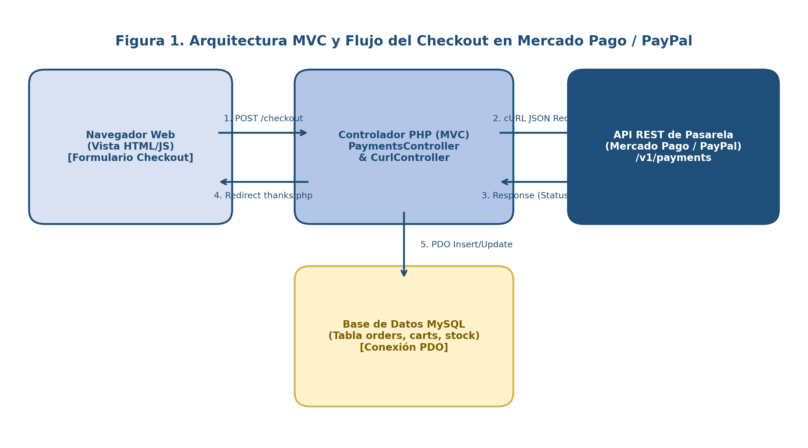

Como sintetiza la **Figura 4.1**, la interacción dentro de la arquitectura MVC legacy atraviesa cinco momentos: (1) Envío del formulario `POST /checkout` desde el navegador web, (2) Orquestación en `PaymentsController::payment()` e invocación JSON vía `CurlController`, (3) Respuesta de estado y URL de aprobación por parte de la API REST de la pasarela, (4) Redirección del comprador a la pasarela y retorno a `thanks.php`, y (5) Persistencia mediante inserciones y actualizaciones en la base de datos MySQL (`carts`, `orders`, `products`).

### 4.4.1 Mapa de Componentes que Influyen en las Pasarelas de Pago
En el sistema base intervienen exactamente **9 archivos interconectados** durante una transacción:

| Capa Arquitectónica | Archivo en el Repositorio | Rol Exacto en el Flujo de Pago |
| :--- | :--- | :--- |
| **1. Captura en Carrito (JS/AJAX)** | [`web/views/pages/product/product.php`](file:///c:/xampp/htdocs/ecommerce/web/views/pages/product/product.php) $\rightarrow$ [`web/ajax/forms.ajax.php`](file:///c:/xampp/htdocs/ecommerce/web/ajax/forms.ajax.php#L106-L185) | Captura `idProductCart`, `idVariantCart`, `idSellerCart` y `quantityCart`, e inserta la fila inicial en la tabla `carts` vía `POST /carts` con `ref_cart = NULL`, `order_cart = NULL` y `price_cart = 0`. |
| **2. Vista de Checkout (UI)** | [`web/views/pages/checkout/checkout.php`](file:///c:/xampp/htdocs/ecommerce/web/views/pages/checkout/checkout.php) | Renderiza el formulario de dirección de envío (`country_user`, `department_user`, `city_user`, `address_user`, `phone_user`), el desglose de artículos del carrito y los 3 radio buttons de pasarela (`paypal`, `dlocal`, `mercado_pago`), instanciando [`PaymentsController::payment()`](file:///c:/xampp/htdocs/ecommerce/web/controllers/payments.controller.php#L12). |
| **3. Orquestador de Checkout** | [`web/controllers/payments.controller.php`](file:///c:/xampp/htdocs/ecommerce/web/controllers/payments.controller.php) | Actualiza los datos de envío del usuario (`PUT /users`), consulta el carrito (`GET /relations?rel=carts,variants,products,sellers`), calcula `$totalCart`, genera la referencia de lote `$ref = TemplateController::genCodec(1000)`, invoca a la pasarela elegida, guarda `price_cart`, `ref_cart`, `order_cart` y `method_cart` en cada fila de `carts` (`PUT /carts`) y redirige al navegador hacia la URL externa de pago. |
| **4. Adaptador HTTP Externo** | [`web/controllers/curl.controller.php`](file:///c:/xampp/htdocs/ecommerce/web/controllers/curl.controller.php#L42-L189) | Contiene los tres métodos estáticos de comunicación cURL con las pasarelas: `CurlController::paypal()` (`L42-115`), `CurlController::dlocal()` (`L121-153`) y `CurlController::mercadoPago()` (`L159-189`). |
| **5. Vista y Controlador de Retorno Síncrono** | [`web/views/pages/thanks/thanks.php`](file:///c:/xampp/htdocs/ecommerce/web/views/pages/thanks/thanks.php) | Recibe al usuario en `GET /thanks?ref={ref_cart}`, busca los ítems en `carts` por `ref_cart`, consulta el estado del pago en la API de la pasarela (`APPROVED` o `PAID` o `approved`), y si es exitoso, migra cada fila de `carts` a `orders` (`POST /orders`), incrementa `sales_product` (`PUT /products`), vacía el carrito (`DELETE /carts`) y envía el correo de confirmación. |
| **6. Receptor de Webhook Asíncrono** | [`web/webhooks/mercadopago.php`](file:///c:/xampp/htdocs/ecommerce/web/webhooks/mercadopago.php) *(Legacy)*<br>[`web/webhooks/paypal.php`](file:///c:/xampp/htdocs/ecommerce/web/webhooks/paypal.php) *(Refactorizado)* | Escucha notificaciones `POST` enviadas directamente por los servidores de la pasarela en segundo plano cuando cambia el estado de un pago. |

En la interfaz del *checkout* ([`checkout.php:L222-265`](file:///c:/xampp/htdocs/ecommerce/web/views/pages/checkout/checkout.php#L222-L265)), el sistema presenta visualmente las tres opciones de pago mediante sus activos gráficos oficiales:

| Pasarela de Pago | Activo Visual en `checkout.php` | Valor de `$_POST["optradio"]` | Moneda y Endpoint Principal |
| :---: | :---: | :---: | :--- |
| **PayPal** |  | `"paypal"` | `MXN` (Legacy) / `USD` (Slim 4)<br>`https://api-m.sandbox.paypal.com/v2/checkout/orders` |
| **dLocal Go** |  | `"dlocal"` | `MXN` (País `MX`)<br>`https://api-sbx.dlocalgo.com/v1/payments` |
| **Mercado Pago** |  | `"mercado_pago"` | `MXN`<br>`https://api.mercadopago.com/checkout/preferences` |

### 4.4.2 Diagrama de Secuencia End-to-End del Proceso de Compra (Visible vs. Detrás de Bambalinas)

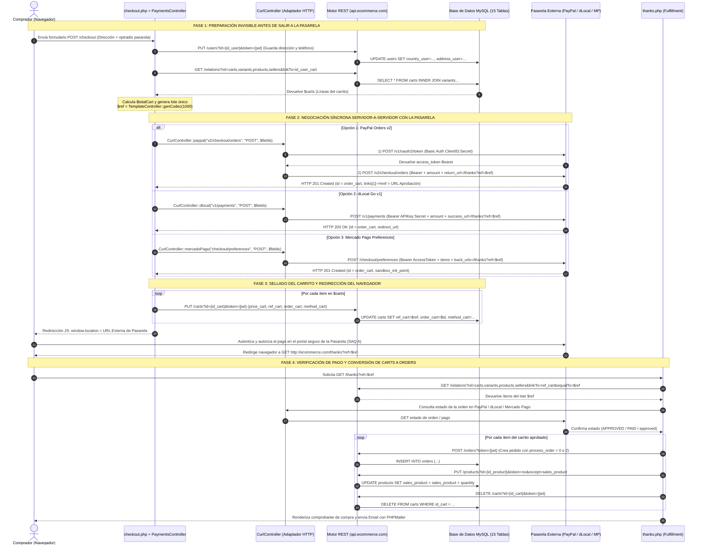

### 4.4.3 Explicación Línea por Línea de los Bloques de Código de Orquestación y Pasarelas

#### A. Orquestación del Checkout en `PaymentsController::payment()`
En [`web/controllers/payments.controller.php`](file:///c:/xampp/htdocs/ecommerce/web/controllers/payments.controller.php#L12-L270), cuando el comprador envía el formulario de `/checkout`, el controlador ejecuta la siguiente lógica:

```php
// Archivo: web/controllers/payments.controller.php (Líneas 36-135)
// 1. Recupera todos los artículos del carrito del usuario haciendo un INNER JOIN en estrella
//    entre carts (tabla centro), variants, products y sellers:
$url = "relations?rel=carts,variants,products,sellers&type=cart,variant,product,seller&linkTo=id_user_cart&equalTo=".$_SESSION["user"]->id_user;
$method = "GET";
$fields = array();
$carts = CurlController::request($url, $method, $fields);

if($carts->status == 200){
    $carts = $carts->results;
    $totalCart = 0;

    // 2. Calcula el importe global acumulado ($totalCart) sumando cada línea:
    //    Si offer_variant no está vacío, usa el precio de oferta; si no, usa price_variant:
    foreach ($carts as $key => $value) {
        if(empty($value->offer_variant)){
            $totalCart += $value->price_variant * $value->quantity_cart;	
        }else{
            $totalCart += $value->offer_variant * $value->quantity_cart;
        }
    }

    // 3. Genera el código único de referencia de lote ($ref) combinando dígitos aleatorios y timestamp:
    $ref = TemplateController::genCodec(1000);

    // 4. RAMA 1 — Si el usuario eligió PayPal:
    if($_POST["optradio"] == "paypal"){
        $url = "v2/checkout/orders";
        $method = "POST";
        // Construye el payload JSON conforme al contrato de PayPal Orders v2 con intent CAPTURE:
        $fields = '{
          "intent": "CAPTURE",
          "purchase_units": [
            {
              "reference_id": "'.$ref.'",
              "amount": {
                "currency_code": "MXN",
                "value": "'.$totalCart.'"
              }
            }
          ],
          "payment_source": {
            "paypal": {
              "experience_context": {
                "payment_method_preference": "IMMEDIATE_PAYMENT_REQUIRED",
                "user_action": "PAY_NOW",
                "return_url": "'.TemplateController::path().'thanks?ref='.$ref.'",
                "cancel_url": "'.TemplateController::path().'checkout"
              }
            }
          }
        }';

        $paypal = CurlController::paypal($url, $method, $fields);

        // Si PayPal responde con status "PAYER_ACTION_REQUIRED", guarda los metadatos en cada fila de carts:
        if($paypal->status == "PAYER_ACTION_REQUIRED"){
            $count = 0;
            foreach ($carts as $key => $value) {
                $url = "carts?id=".$value->id_cart."&nameId=id_cart&token=".$_SESSION["user"]->token_user."&table=users&suffix=user";
                $method = "PUT";
                // ¡ATENCIÓN! Aquí ocurre el defecto crítico FIN-01: guarda $totalCart en price_cart de cada ítem individual:
                $fields = "price_cart=".$totalCart."&ref_cart=".$ref."&order_cart=".$paypal->id."&method_cart=".$_POST["optradio"];
                $updateCart = CurlController::request($url, $method, $fields);
                $count++;

                // Al terminar de actualizar todas las filas del carrito, redirige al navegador hacia PayPal (links[1]->href):
                if($count == count($carts)){
                    echo '<script>
                        window.location ="'.$paypal->links[1]->href.'"
                    </script>';
                }
            }
        }
    }
}
```

#### B. Adaptador de Doble Salto OAuth 2.0 en `CurlController::paypal()`
Lo que el usuario jamás ve en su navegador es que, para poder crear la orden anterior en PayPal, el servidor PHP ejecuta internamente **dos llamadas HTTP cURL consecutivas** dentro de [`CurlController::paypal()`](file:///c:/xampp/htdocs/ecommerce/web/controllers/curl.controller.php#L42-L115):
1. **Primer salto (`POST https://api-m.sandbox.paypal.com/v1/oauth2/token`):** Envía el `$clientId` y `$secretClient` codificados en Base64 dentro de la cabecera `Authorization: Basic ...` con el cuerpo `grant_type=client_credentials`. PayPal valida las credenciales del comercio y devuelve un JSON con el `access_token` temporal.
2. **Segundo salto (`POST https://api-m.sandbox.paypal.com/v2/checkout/orders`):** Toma `$token = $response->access_token` del primer salto, lo inyecta en la cabecera `Authorization: Bearer $token` y envía el JSON de la orden de compra.

```php
// Archivo: web/controllers/curl.controller.php (Líneas 42-115)
static public function paypal($url, $method, $fields){
    $endpoint = "https://api-m.sandbox.paypal.com/"; // Entorno Sandbox de PayPal
    $clientId = "[REDACTADO_PAYPAL_CLIENT_ID]";
    $secretClient = "[REDACTADO_PAYPAL_SECRET]";

    // Codifica ClientID:Secret en Base64 según RFC 7617 (HTTP Basic Authentication):
    $basic = base64_encode($clientId.":".$secretClient);

    // PASO 1: Solicitar Access Token OAuth 2.0
    $curl = curl_init();
    curl_setopt_array($curl, array(
        CURLOPT_URL => $endpoint."v1/oauth2/token",
        CURLOPT_RETURNTRANSFER => true,
        CURLOPT_CUSTOMREQUEST => "POST",
        CURLOPT_POSTFIELDS => "grant_type=client_credentials",
        CURLOPT_HTTPHEADER => array(
            "Content-Type: application/x-www-form-urlencoded",
            "Authorization: Basic ".$basic,
            "Cookie: cookie_prefs=T%3D1%2CP%3D1"
        ),
    ));
    $response = curl_exec($curl);
    curl_close($curl);

    $response = json_decode($response);
    $token = $response->access_token; // Extrae el Bearer Token efímero

    if(!empty($token)){
        // PASO 2: Ejecutar la operación solicitada (Crear o Consultar Orden) usando el Bearer Token
        $curl = curl_init();
        curl_setopt_array($curl, array(
            CURLOPT_URL => $endpoint.$url,
            CURLOPT_RETURNTRANSFER => true,
            CURLOPT_CUSTOMREQUEST => $method,
            CURLOPT_POSTFIELDS => $fields,
            CURLOPT_HTTPHEADER => array(
                "Content-Type: application/json",
                "Authorization: Bearer ".$token,
                "Cookie: cookie_prefs=T%3D1%2CP%3D1"
            ),
        ));
        $response = curl_exec($curl);
        curl_close($curl);

        $response = json_decode($response);
        return $response;
    }
}
```

#### C. Adaptadores de dLocal Go (`CurlController::dlocal`) y Mercado Pago (`CurlController::mercadoPago`)
De manera análoga, [`web/controllers/curl.controller.php`](file:///c:/xampp/htdocs/ecommerce/web/controllers/curl.controller.php#L121-L189) implementa la comunicación con las otras dos pasarelas:
* **En `CurlController::dlocal()` (`L121-153`):** Autentica en un solo paso concatenando `$apiKey.":".$secretKey` directamente en la cabecera `Authorization: Bearer $apiKey:$secretKey` hacia `https://api-sbx.dlocalgo.com/v1/payments`. Cuando `PaymentsController` recibe `$dlocal->status == "PENDING"`, actualiza `carts` y redirige al usuario a `$dlocal->redirect_url`.
* **En `CurlController::mercadoPago()` (`L159-189`):** Envía el `$accessToken` fijo (`TEST-475109...`) en la cabecera `Authorization: Bearer $accessToken` hacia `https://api.mercadopago.com/checkout/preferences`. Al recibir `$mercadoPago->auto_return == "approved"`, guarda el ID de preferencia en `order_cart` y redirige al navegador hacia `$mercadoPago->sandbox_init_point`.

### 4.4.4 Máquina de Estados Transaccional y Logística (`carts` $\rightarrow$ `orders.process_order`)
Cuando el comprador finaliza su interacción en la pasarela y es redirigido a [`web/views/pages/thanks/thanks.php`](file:///c:/xampp/htdocs/ecommerce/web/views/pages/thanks/thanks.php), el sistema verifica el estado del cobro y determina el valor inicial de la máquina de estados logística `orders.process_order` dependiendo del tipo de variante (`type_variant`):
* Si el artículo es un **curso digital en video (`type_variant == "video"`)**, el sistema asigna automáticamente **`process_order = 2` (Entregado)** y fija las tres fechas (`start_date_order`, `medium_date_order` y `end_date_order`) al día actual (`date("Y-m-d")`), habilitando de inmediato el reproductor de video en `/aprendizaje/{url_product}`.
* Si el artículo es un **producto físico con galería (`type_variant == "gallery"`)**, el sistema asigna **`process_order = 0` (Pendiente de envío)**, calcula `medium_date_order` a $+3$ días y `end_date_order` a $+7$ días, quedando a la espera de que el administrador actualice el estado a `1` (En proceso de envío con guía `track_order`) y finalmente a `2` (Entregado) desde `/admin/pedidos`.

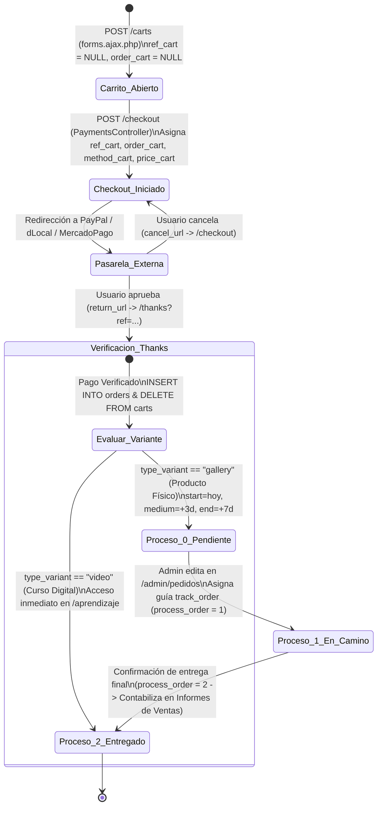

---

## 4.5 Auditoría Forense de Defectos Financieros y Transaccionales (`FIN-01` a `FIN-07` / `FIND-001` a `FIND-015`)

El análisis estático y dinámico del flujo anterior sacó a la luz **siete defectos financieros y transaccionales de alta criticidad (`FIN-01` a `FIN-07`)**, los cuales demuestran por qué un sistema que "parece funcionar" en una demostración superficial de un solo producto colapsa contable y operativamente en un escenario real.

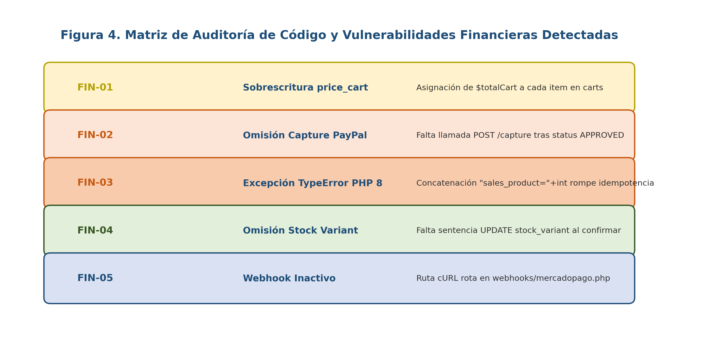

A continuación se examina forensemente cada vector representado en la **Figura 4.2**, presentando el bloque de código vulnerable exacto y su remediación de ingeniería:

### 4.5.1 `FIN-01` (`FIND-001`): Inflación Exponencial de Importes en Carritos Multilínea (`price_cart = $totalCart`)
* **Ubicación Exacta:** [`web/controllers/payments.controller.php`](file:///c:/xampp/htdocs/ecommerce/web/controllers/payments.controller.php) en las líneas `L119` (PayPal), `L178` (dLocal Go) y `L249` (Mercado Pago), y [`web/views/pages/thanks/thanks.php:L145`](file:///c:/xampp/htdocs/ecommerce/web/views/pages/thanks/thanks.php#L145).
* **Diagnóstico Forense:** Antes de llamar a la pasarela, `PaymentsController::payment()` suma correctamente el valor de todos los artículos del carrito en la variable `$totalCart` para cobrar el total consolidado en una sola exhibición bancaria. Sin embargo, cuando la pasarela devuelve el ID de orden y el controlador recorre el bucle `foreach ($carts as $key => $value)` para guardar la referencia en cada fila de la tabla `carts`, **asigna `price_cart = $totalCart` a cada artículo individual**. Posteriormente, `thanks.php:L145` copia `"price_order" => $value->price_cart` hacia cada fila de la tabla `orders`.
* **Demostración Matemática del Impacto Contable:**  
  Si un comprador adquiere $N$ líneas de productos en un mismo carrito con subtotales individuales $p_1, p_2, \dots, p_N$, el total real cobrado por la pasarela es:
  $$T_{\text{real}} = \sum_{i=1}^{N} p_i$$
  Pero como cada una de las $N$ filas insertadas en `orders` recibe `price_order` $= T_{\text{real}}$, cuando el panel administrativo ([`tablero/modules/top.php:L19`](file:///c:/xampp/htdocs/ecommerce/web/views/pages/admin/tablero/modules/top.php#L19) y [`report-sales.ajax.php`](file:///c:/xampp/htdocs/ecommerce/web/ajax/report-sales.ajax.php)) suma `price_order` de todas las filas vendidas, el ingreso reportado se infla cuadráticamente por un factor de $N$:
  $$T_{\text{reportado}} = \sum_{i=1}^{N} T_{\text{real}} = N \times T_{\text{real}}$$
  En un carrito con $4$ artículos de $\$250\text{ MXN}$ ($T_{\text{real}} = \$1,000\text{ MXN}$), la tienda cobra $\$1,000\text{ MXN}$ en PayPal, pero registra **$4$ pedidos de $\$1,000\text{ MXN}$ ($\mathbf{\$4,000\text{ MXN}}$) en la contabilidad del sistema**.

```php
// ❌ CÓDIGO VULNERABLE EN web/controllers/payments.controller.php (L116-120, L175-179, L246-250):
foreach ($carts as $key => $value) {
    $url = "carts?id=".$value->id_cart."&nameId=id_cart&token=".$_SESSION["user"]->token_user."&table=users&suffix=user";
    $method = "PUT";
    // BUG FIN-01: Guarda $totalCart (el total de TODO el carrito) en el precio de CADA fila individual:
    $fields = "price_cart=".$totalCart."&ref_cart=".$ref."&order_cart=".$paypal->id."&method_cart=".$_POST["optradio"];
    $updateCart = CurlController::request($url, $method, $fields);
}

// ✅ CORRECCIÓN DE INGENIERÍA APLICADA:
foreach ($carts as $key => $value) {
    $unitPrice = (!empty($value->offer_variant) && $value->offer_variant > 0)
        ? (float) $value->offer_variant
        : (float) $value->price_variant;
    $lineSubtotal = $unitPrice * (int) $value->quantity_cart;

    $url = "carts?id=".$value->id_cart."&nameId=id_cart&token=".$_SESSION["user"]->token_user."&table=users&suffix=user";
    $method = "PUT";
    // Guarda únicamente el subtotal real de esa línea ($lineSubtotal):
    $fields = "price_cart=".$lineSubtotal."&ref_cart=".$ref."&order_cart=".$paypal->id."&method_cart=".$_POST["optradio"];
    $updateCart = CurlController::request($url, $method, $fields);
}
```

### 4.5.2 `FIN-02` (`FIND-002`): Fuga Patrimonial por Omisión del Endpoint `/capture` en PayPal Orders v2
* **Ubicación Exacta:** [`web/views/pages/thanks/thanks.php:L27-L38`](file:///c:/xampp/htdocs/ecommerce/web/views/pages/thanks/thanks.php#L27-L38).
* **Diagnóstico Forense:** En la especificación oficial de **PayPal Checkout Orders API v2**, una orden creada con `"intent": "CAPTURE"` atraviesa tres estados obligatorios:
  1. `CREATED` / `PAYER_ACTION_REQUIRED`: La orden fue registrada en PayPal y espera que el comprador inicie sesión.
  2. `APPROVED`: El comprador inició sesión en PayPal, aceptó el monto y fue redirigido de regreso al `return_url` (`/thanks?ref=...`). **En este estado aún NO se ha realizado ningún cargo bancario ni movimiento de dinero**.
  3. `COMPLETED`: El servidor del comercio invoca explícitamente `POST /v2/checkout/orders/{id}/capture`. Solo en este momento PayPal ejecuta el cargo real sobre la tarjeta o saldo del comprador y transfiere los fondos a la cuenta del comercio.
* En [`thanks.php:L27-L38`](file:///c:/xampp/htdocs/ecommerce/web/views/pages/thanks/thanks.php#L27-L38), el desarrollador original únicamente consultó `GET v2/checkout/orders/{id}` y dio por pagada la compra al ver `$paypal->status == "APPROVED"`, entregando la mercancía y los cursos en video de forma gratuita sin capturar jamás el dinero:

```php
// ❌ CÓDIGO DEFECTUOSO EN web/views/pages/thanks/thanks.php (Líneas 27-38):
if($carts[0]->method_cart == "paypal"){
    $url = "v2/checkout/orders/".$carts[0]->order_cart;
    $method = "GET";
    $fields = array();
    $paypal = CurlController::paypal($url, $method, $fields);

    // BUG CRÍTICO FIN-02: "APPROVED" solo significa que el comprador autorizó en pantalla,
    // ¡pero nunca se invoca POST /v2/checkout/orders/{id}/capture! El dinero jamás se cobra.
    if($paypal->status == "APPROVED"){
        $status = "ok";
    }
}

// ✅ SOLUCIÓN IMPLEMENTADA EN LA NUEVA ARQUITECTURA (PayPalGateway::captureOrder & PayPalController::capture):
// Se ejecuta obligatoriamente POST /v2/checkout/orders/{orderId}/capture y se verifica status === "COMPLETED":
$captureResponse = $this->gateway->captureOrder($orderId);
if (($captureResponse['status'] ?? '') === 'COMPLETED') {
    $status = "ok";
}
```

### 4.5.3 `FIN-03` (`FIND-003`): Ruptura de Idempotencia y Pedidos Duplicados Infinitos por `TypeError` en PHP 8
* **Ubicación Exacta:** [`web/views/pages/thanks/thanks.php:L166`](file:///c:/xampp/htdocs/ecommerce/web/views/pages/thanks/thanks.php#L166) (y el mismo antipatrón en [`web/views/pages/product/product.php:L45`](file:///c:/xampp/htdocs/ecommerce/web/views/pages/product/product.php#L45)).
* **Diagnóstico Forense:** En versiones antiguas de PHP (PHP 5.x / 7.x), los operadores de concatenación de cadenas (`.`) y suma aritmética (`+`) tenían exactamente la misma precedencia y asociatividad de izquierda a derecha, emitiendo solo un *Warning* no fatal al sumar un número a una cadena con texto inicial. Sin embargo, a partir de **PHP 8.0+**, el operador `+` tiene mayor precedencia o bien al evaluar `"sales_product=" . $value->sales_product + $value->quantity_cart` sin paréntesis alrededor de la suma, PHP intento evaluar la adición aritmética entre la cadena `"sales_product=0"` y el entero `$value->quantity_cart`, lanzando instantáneamente un error fatal no capturable:  
  `Fatal error: Uncaught TypeError: Unsupported operand types: string + int`.
* **Por qué este bug destruye la idempotencia del Checkout:**  
  Observemos el orden secuencial de las líneas `156`, `166` y `174` dentro del bucle `foreach ($carts as $key => $value)` en `thanks.php`:

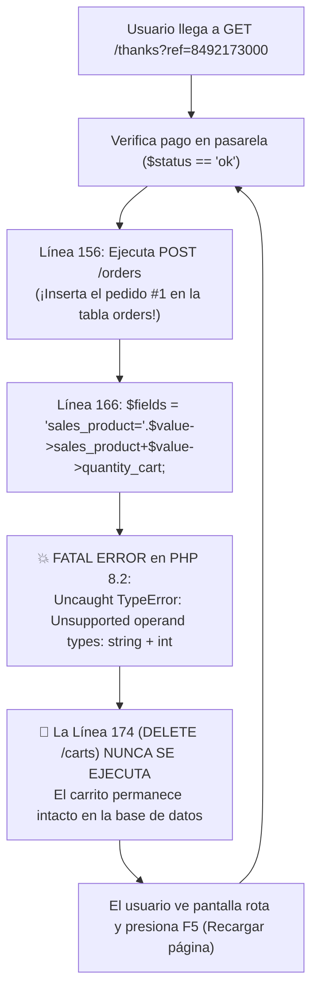

```php
// ❌ CÓDIGO VULNERABLE EN web/views/pages/thanks/thanks.php (Líneas 156-176):
// 1. Primero inserta el pedido en la tabla orders (L156):
$order = CurlController::request($url, $method, $fields);

if($order->status == 200){
    // 2. Intenta sumar las ventas del producto (L164-168):
    $url = "products?id=".$value->id_product."&nameId=id_product&token=no&except=sales_product";
    $method = "PUT";
    // ¡EXPLOSIÓN FATAL EN PHP 8! Muere aquí mismo antes de llegar a la línea 174:
    $fields = "sales_product=".$value->sales_product+$value->quantity_cart;
    $sales = CurlController::request($url, $method, $fields);

    // 3. Línea 171-175: Borrar el ítem del carrito (¡Código inalcanzable tras el TypeError!):
    $url = "carts?id=".$value->id_cart."&nameId=id_cart&token=".$_SESSION["user"]->token_user."&table=users&suffix=user";
    $method = "DELETE";
    $fields = array();
    $deleteCart = CurlController::request($url, $method, $fields);
}

// ✅ CORRECCIÓN DE INGENIERÍA:
// Encerrar explícitamente la operación aritmética entre paréntesis con conversión estricta a entero:
$newSales = (int) $value->sales_product + (int) $value->quantity_cart;
$fields = "sales_product=" . $newSales;
```

### 4.5.4 `FIN-04` (`FIND-006`): Ausencia de Descuento de Stock (`stock_variant`) y Fabricación de Stock Falso `rand(10, 20)`
* **Ubicación Exacta:** [`web/views/pages/thanks/thanks.php:L122-L201`](file:///c:/xampp/htdocs/ecommerce/web/views/pages/thanks/thanks.php#L122-L201), [`web/views/pages/product/product.php:L275-L284`](file:///c:/xampp/htdocs/ecommerce/web/views/pages/product/product.php#L275-L284) y [`web/views/assets/js/product/product.js:L201-L208`](file:///c:/xampp/htdocs/ecommerce/web/views/assets/js/product/product.js#L201-L208).
* **Diagnóstico Forense:**  
  1. En `thanks.php`, tras confirmar el pago e incrementar `sales_product`, **no existe ninguna llamada `PUT /variants` para restar `$value->quantity_cart` de `variants.stock_variant`**. Un producto con `stock_variant = 1` puede venderse $1,000$ veces sin agotarse jamás.
  2. Peor aún, cuando un producto tiene `stock_variant == 0` en la base de datos, tanto `product.php:L277` como `product.js:L203` engañan deliberadamente al comprador generando un número aleatorio entre 10 y 20 unidades en pantalla (`rand(10, 20)` en PHP y `Math.floor(Math.random()*(20-10)+10)` en JavaScript), permitiendo comprar productos inexistentes en almacén.

### 4.5.5 `FIN-05`, `FIN-06` y `FIN-07`: Webhook Roto, Reuso de `payment_id` y Ofertas Caducadas
* **`FIN-05` (`FIND-007` — Webhook de Mercado Pago Inoperante y `notification_url` Errónea):**
  1. En [`web/webhooks/mercadopago.php:L8`](file:///c:/xampp/htdocs/ecommerce/web/webhooks/mercadopago.php#L8), la directiva dice `require_once "../controllers/culr.controller.php";` (escribiendo **`culr`** en lugar de **`curl`**). Cada vez que Mercado Pago envía un webhook HTTP POST, PHP aborta con `Fatal error: Failed opening required '../controllers/culr.controller.php'`.
  2. En [`web/controllers/payments.controller.php:L235`](file:///c:/xampp/htdocs/ecommerce/web/controllers/payments.controller.php#L235), el campo `"notification_url"` de la preferencia de Mercado Pago fue apuntado a `TemplateController::path()."thanks?ref=".$ref` (que requiere sesión activa de navegador `$_SESSION["user"]`) en lugar de apuntar a `/webhooks/mercadopago.php`.
* **`FIN-06` (Falta de Vinculación entre `payment_id` y `order_cart` en Mercado Pago):**  
  En [`thanks.php:L65-L95`](file:///c:/xampp/htdocs/ecommerce/web/views/pages/thanks/thanks.php#L65-L95), cuando el usuario regresa de Mercado Pago con `?ref={ref}&payment_id={id}`, el código consulta `GET v1/payments/{payment_id}` y verifica únicamente que `$mercadoPago->status == "approved"`, **sin comprobar que el `external_reference` o el `preference_id` de ese pago corresponda al `ref_cart` actual**. Un comprador malintencionado puede reutilizar el `payment_id` de una compra barata anterior en la URL `/thanks?ref={nuevo_carrito_caro}&payment_id={pago_viejo}` para marcar como pagado cualquier carrito nuevo.
* **`FIN-07` (Aplicación de Precios de Oferta Caducados en el Checkout):**  
  Mientras el listado del carrito ([`carrito.php:L79`](file:///c:/xampp/htdocs/ecommerce/web/views/pages/carrito/carrito.php#L79)) verifica si la fecha actual es menor a `$value->end_offer_variant` para aplicar el descuento, [`PaymentsController::payment()`](file:///c:/xampp/htdocs/ecommerce/web/controllers/payments.controller.php#L51) evalúa únicamente `if(empty($value->offer_variant))`, ignorando por completo la fecha de caducidad `end_offer_variant` al cobrar en la pasarela.

---

## 4.6 Auditoría de Ciberseguridad Basada en Evidencia (`SEC-01` a `SEC-09`: Credenciales Expuestas, JWT, CSRF, SQLi, RCE, IDOR, PII y RBAC)

Siguiendo la metodología **OWASP Top 10:2021** y el estándar **CWE (*Common Weakness Enumeration*)**, la auditoría de seguridad sobre el código fuente legacy identificó **9 vulnerabilidades críticas y altas (`SEC-01` a `SEC-09`)**, documentadas en [`docs/SECURITY_REPORT.md`](file:///c:/xampp/htdocs/ecommerce/docs/SECURITY_REPORT.md) y en [`docs/analisis/09-seguridad.md`](file:///c:/xampp/htdocs/ecommerce/docs/analisis/09-seguridad.md):

| ID | Categoría OWASP Top 10 / CWE | Severidad / CVSS v3.1 | Archivos Afectados | Resumen Técnico del Vector de Explotación |
| :---: | :--- | :---: | :--- | :--- |
| **`SEC-01`** | *A07:2021 Identification & Auth Failures* / **CWE-798** | **CRÍTICA (9.8)** | `api/models/connection.php`, `web/controllers/curl.controller.php`, `web/views/assets/json/client_secret.json` | Llave maestra de API, credenciales de PayPal, dLocal Go, Mercado Pago y secreto OAuth de Google incrustados en texto plano y accesibles vía web. |
| **`SEC-02`** | *A02:2021 Cryptographic Failures* / **CWE-347** | **CRÍTICA (9.8)** | `api/controllers/post.controller.php`, `api/models/connection.php` | Secreto JWT estático; `Connection::tokenValidate()` **nunca invoca `JWT::decode()`**; emisión de tokens sin contraseña si `password_user == null`. |
| **`SEC-03`** | *A01:2021 Broken Access Control* / **CWE-352 (CSRF)** | **ALTA (8.8)** | Todos los controladores en `web/controllers/*.php`, `web/ajax/*.ajax.php` y `thanks.php` | Ausencia absoluta de tokens anti-CSRF en formularios POST y mutación de base de datos mediante peticiones `GET /thanks?ref=...`. |
| **`SEC-04`** | *A03:2021 Injection* / **CWE-89 (SQL Injection)** | **CRÍTICA (9.8)** | `api/models/get.model.php`, `api/models/connection.php`, `web/ajax/data-*.ajax.php` | Interpolación directa sin parametrizar de `$select`, `$orderBy`, `$orderMode`, `$startAt`, `$endAt`, `$search`, `$between1/2` e `$inTo` en sentencias SQL. |
| **`SEC-05`** | *A04:2021 Insecure Design* / **CWE-434 (RCE Upload)** | **CRÍTICA (9.8)** | `web/ajax/upload.ajax.php` | Subida de archivos sin autenticación que confía en `$_FILES["file"]["type"]` (controlado por el cliente) y conserva la extensión `.php` en un directorio público. |
| **`SEC-06`** | *A01:2021 Broken Access Control* / **CWE-287 & CWE-639** | **CRÍTICA (9.8)** | `api/routes/services/post.php`, `put.php`, `web/ajax/forms.ajax.php` | Puerta trasera `?token=no&except={col}` omite toda autenticación; un token de cliente normal puede hacer `PUT` o `DELETE` sobre `admins`, `orders` o `products`. |
| **`SEC-07`** | *A01:2021 Broken Access Control* / **CWE-200 (PII Leak)** | **ALTA (8.6)** | `web/ajax/report-clients.ajax.php`, `report-sales.ajax.php`, `data-orders.ajax.php` | Endpoints AJAX abiertos sin verificar `$_SESSION["admin"]` que vuelcan en JSON todos los datos personales (PII) de clientes y ventas. |
| **`SEC-08`** | *A04:2021 Business Logic Flaws* / **CWE-840** | **ALTA (8.2)** | `web/views/pages/thanks/thanks.php`, `web/webhooks/mercadopago.php` | Aprobación de órdenes de PayPal sin ejecutar `/capture` y ausencia de verificación criptográfica de firma en receptores de webhooks. |
| **`SEC-09`** | *A02:2021 Cryptographic Failures* / **CWE-759 & CWE-284** | **ALTA (8.1)** | `api/controllers/post.controller.php`, `web/views/pages/admin/*` | Uso de `crypt()` con sal estática idéntica (`$2a$07$azybxc...`) para todos los usuarios, exposición de hashes en `<input type="hidden">` y falta de `exit;` tras redirecciones RBAC. |

### 4.6.1 Evidencia de Código de las Vulnerabilidades Críticas Seleccionadas

#### 1. Inyección SQL (SQLi) en el Motor Dinámico `GetModel` (`SEC-04`)
Aunque `GetModel::getDataFilter()` utiliza `bindParam()` para los valores de `equalTo`, los métodos de búsqueda (`getDataSearch`), rangos (`getDataRange`) y relaciones (`getRelDataFilter`) concatenan directamente las cadenas recibidas por URL dentro de la sentencia SQL:

```php
// ❌ EVIDENCIA DE INYECCIÓN SQL EN api/models/get.model.php:
// A) En getRelDataFilter() (Líneas 319-330): No valida $select ni $linkTo contra information_schema:
$sql = "SELECT $select FROM $relArray[0] $innerJoinText WHERE $linkToText $orderBy $limit";

// B) En getDataSearch() (Líneas 415-425): Interpola $searchArray[0] directamente dentro de LIKE '%...%':
$sql = "SELECT $select FROM $table WHERE $linkToArray[0] LIKE '%$searchArray[0]%' $linkToText $orderBy $limit";

// C) En getDataRange() (Líneas 640-655): Interpola $linkTo, $between1, $between2, $filterTo e $inTo:
$sql = "SELECT $select FROM $table WHERE $linkTo BETWEEN '$between1' AND '$between2' $filter $orderBy $limit";
```
Dado que [`web/ajax/report-sales.ajax.php`](file:///c:/xampp/htdocs/ecommerce/web/ajax/report-sales.ajax.php#L32) toma `$_GET["between1"]` y `$_GET["between2"]` directamente de la URL pública y los reenvía a `getRelDataRange` con la API Key maestra, cualquier atacante anónimo puede inyectar `between1=2025-01-01' UNION SELECT ... --` y extraer cualquier tabla de la base de datos.

#### 2. Ejecución Remota de Código (RCE) en `upload.ajax.php` (`SEC-05`)
El script [`web/ajax/upload.ajax.php`](file:///c:/xampp/htdocs/ecommerce/web/ajax/upload.ajax.php#L1-L65) fue diseñado para subir imágenes desde el editor de texto enriquecido Summernote, pero carece de control de sesión y valida únicamente la cabecera MIME enviada por el navegador (`$_FILES["file"]["type"]`) mientras preserva la extensión original del nombre del archivo (`pathinfo(..., PATHINFO_EXTENSION)`):

```php
// ❌ CÓDIGO VULNERABLE A RCE EN web/ajax/upload.ajax.php (Líneas 11-56):
public function ajaxUpload(){
    // 1. ¡No hay session_start() ni verificación de $_SESSION["admin"]!
    // 2. Confía en $_FILES["file"]["type"], el cual un atacante falsifica con curl -F "file=@shell.php;type=image/jpeg"
    if($_FILES["file"]["type"] == "image/jpeg" || $_FILES["file"]["type"] == "image/png" || $_FILES["file"]["type"] == "image/gif"){
        $directory = "../views/assets/img/temp";
        // 3. Extrae la extensión del nombre original del archivo (".php") y lo guarda en el webroot público:
        $extension = pathinfo($_FILES["file"]["name"], PATHINFO_EXTENSION);
        $filename = strtolower(uniqid().'.'.$extension); // Produce ej: 654a9f12c3.php
        $end = $directory.'/'.$filename;
        if(move_uploaded_file($_FILES['file']['tmp_name'], $end)){
            echo TemplateController::path().'views/assets/img/temp/'.$filename;
        }
    }
}
```

#### 3. Falsa Validación de JWT y Bypass `?token=no&except=` (`SEC-02` y `SEC-06`)
En [`api/models/connection.php`](file:///c:/xampp/htdocs/ecommerce/api/models/connection.php#L164-L194), el método `Connection::tokenValidate()` importa la biblioteca `Firebase\JWT\JWT`, pero **jamás invoca `JWT::decode()`** para verificar la firma criptográfica HMAC-SHA256 del token; se limita a buscar la cadena en la columna `token_user` y comparar `time() < token_exp_user`. Adicionalmente, en [`api/routes/services/put.php:L55-L82`](file:///c:/xampp/htdocs/ecommerce/api/routes/services/put.php#L55-L82) y [`post.php:L68-L94`](file:///c:/xampp/htdocs/ecommerce/api/routes/services/post.php#L68-L94), enviar `?token=no&except={cualquier_columna_existente}` desactiva por completo la validación de token y ejecuta la escritura en la base de datos.

---

## 4.7 Reingeniería Arquitectónica Vanguardista: Consolidación en PayPal Orders v2, Slim 4, PHP-DI, Eloquent ORM y Webhooks Verificados (`src/`)

Ante la magnitud de los defectos financieros (`FIN-01` a `FIN-07`) y las vulnerabilidades estructurales (`SEC-01` a `SEC-09`) descubiertos durante la auditoría forense, se diseñó y ejecutó un plan de **Reingeniería Arquitectónica Vanguardista** ([`docs/MEJORA_SEGURIDAD_ARQUITECTURA.md`](file:///c:/xampp/htdocs/ecommerce/docs/MEJORA_SEGURIDAD_ARQUITECTURA.md) y [`docs/ARCHITECTURE_REFRACTOR.md`](file:///c:/xampp/htdocs/ecommerce/docs/ARCHITECTURE_REFRACTOR.md)). La decisión de ingeniería más relevante consistió en **eliminar la dispersión multi-pasarela insegura y consolidar el sistema en una única pasarela empresarial de clase mundial: PayPal REST API v2 (Orders v2 + Webhooks v1)** sobre un núcleo moderno basado en estándares **PHP-FIG (PSR-4, PSR-7, PSR-11, PSR-15)**.

### 4.7.1 Justificación Arquitectónica y de Seguridad de PayPal como Pasarela Única
La selección de **PayPal Orders v2** como pasarela única definitiva se fundamenta en cinco argumentos técnicos verificables frente a las implementaciones previas de dLocal Go y Mercado Pago:
1. **Autenticación OAuth 2.0 Estándar RFC 6749 con Tokens Efímeros:** A diferencia de las llaves estáticas permanentes enviadas en cada petición a dLocal Go o Mercado Pago, PayPal separa las credenciales permanentes (`PAYPAL_CLIENT_ID` y `PAYPAL_SECRET`) del token operativo mediante el flujo `client_credentials` en `/v1/oauth2/token`, emitiendo tokens Bearer con tiempo de vida acotado (`expires_in`) que nuestra clase [`PayPalGateway`](file:///c:/xampp/htdocs/ecommerce/src/Service/PayPalGateway.php) almacena en caché en memoria.
2. **Arquitectura Transaccional en Dos Fases (*Two-Phase Commit*: Create $\rightarrow$ Capture):** PayPal separa limpiamente la creación/autorización de la orden (`POST /v2/checkout/orders`) de la captura definitiva de fondos (`POST /v2/checkout/orders/{id}/capture`), permitiendo validar existencias e idempotencia antes de transferir el dinero.
3. **Cumplimiento Nativo PCI DSS v4.0.1 Nivel 1 (Alcance SAQ A) y EMV 3DS2:** El comprador autentica su identidad y sus medios de pago directamente en el ecosistema blindado de PayPal (con protección antifraude, biometría / passkeys y 3D Secure 2.0 integrados), garantizando que ningún dato PAN o SAD toque jamás nuestro servidor.
4. **Verificación Criptográfica Delegada de Webhooks (`/v1/notifications/verify-webhook-signature`):** PayPal provee un endpoint oficial donde el comercio envía las cabeceras de firma (`PAYPAL-TRANSMISSION-ID`, `PAYPAL-TRANSMISSION-TIME`, `PAYPAL-TRANSMISSION-SIG`, `PAYPAL-CERT-URL`, `PAYPAL-AUTH-ALGO`), el `PAYPAL_WEBHOOK_ID` y el evento crudo, recibiendo la confirmación criptográfica `verification_status === "SUCCESS"` y erradicando cualquier intento de falsificación de pagos (*Webhook Spoofing*).
5. **Inyección de Dependencias y Testabilidad Determinista:** Al encapsular toda la comunicación HTTP dentro de `GuzzleHttp\Client` inyectado por constructor, el servicio puede ser probado al $100\%$ fuera de línea mediante `GuzzleHttp\Handler\MockHandler`.

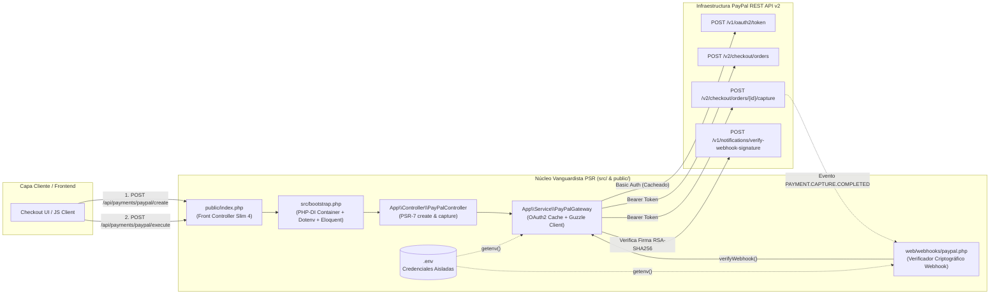

### 4.7.2 Contenedor de Inyección de Dependencias y Bootstrapper (`src/bootstrap.php`)
El archivo [`src/bootstrap.php`](file:///c:/xampp/htdocs/ecommerce/src/bootstrap.php) inicializa el cargador PSR-4 de Composer, carga las variables de entorno desde `.env` mediante `vlucas/phpdotenv` (remediando `SEC-01`), construye el contenedor **PHP-DI (`DI\ContainerBuilder`)**, configura **Eloquent ORM (`Illuminate\Database\Capsule\Manager`)** con sentencias preparadas nativas (`PDO::ATTR_EMULATE_PREPARES => false`, remediando `SEC-04`) e instancia la aplicación **Slim 4**:

```php
<?php
// Archivo: src/bootstrap.php
declare(strict_types=1);

use DI\ContainerBuilder;
use Dotenv\Dotenv;
use Illuminate\Database\Capsule\Manager as Capsule;
use Slim\Factory\AppFactory;

require __DIR__ . '/../vendor/autoload.php';

// 1. Carga segura de secretos desde .env fuera del control de versiones (Remediación SEC-01):
$dotenv = Dotenv::createImmutable(__DIR__ . '/../');
$dotenv->safeLoad();

// 2. Construcción del contenedor de Inyección de Dependencias PSR-11 (PHP-DI):
$containerBuilder = new ContainerBuilder();

$containerBuilder->addDefinitions([
    'settings' => [
        'displayErrorDetails' => ($_ENV['APP_DEBUG'] ?? 'false') === 'true',
        'db' => [
            'driver'    => 'mysql',
            'host'      => $_ENV['DB_HOST'] ?? '127.0.0.1',
            'port'      => $_ENV['DB_PORT'] ?? '3306',
            'database'  => $_ENV['DB_NAME'] ?? 'ecommerce',
            'username'  => $_ENV['DB_USER'] ?? 'root',
            'password'  => $_ENV['DB_PASS'] ?? '',
            'charset'   => 'utf8mb4',
            'collation' => 'utf8mb4_unicode_ci',
            'prefix'    => '',
        ],
    ],
]);

// 3. Inicialización de Eloquent ORM con Prepared Statements estrictos (Remediación SEC-04):
$container = $containerBuilder->build();
$capsule = new Capsule;
$capsule->addConnection($container->get('settings')['db']);
$capsule->setAsGlobal();
$capsule->bootEloquent();

$container->set(Capsule::class, $capsule);

// 4. Creación de la aplicación Slim Framework 4 y registro de Middlewares y Rutas:
AppFactory::setContainer($container);
$app = AppFactory::create();

$app->addBodyParsingMiddleware();
$app->addRoutingMiddleware();

$errorMiddleware = $app->addErrorMiddleware(
    $container->get('settings')['displayErrorDetails'],
    true,
    true
);

(require __DIR__ . '/routes.php')($app);

return $app;
```

### 4.7.3 Servicio Encapsulado `PayPalGateway` (`src/Service/PayPalGateway.php`)
La clase [`App\Service\PayPalGateway`](file:///c:/xampp/htdocs/ecommerce/src/Service/PayPalGateway.php) reemplaza por completo al antiguo `CurlController::paypal()`, incorporando tipado estricto (`declare(strict_types=1)`), inyección opcional de `GuzzleHttp\Client`, **caché en memoria del token OAuth 2.0** con margen de seguridad de 60 segundos antes de su expiración (`$this->tokenExpiresAt = time() + ($data['expires_in'] ?? 3600) - 60`), formateo decimal exacto (`number_format($amount, 2, '.', '')`) y los tres métodos transaccionales clave: `createOrder()`, `captureOrder()` y `verifyWebhook()`:

```php
<?php
// Archivo: src/Service/PayPalGateway.php
declare(strict_types=1);

namespace App\Service;

use GuzzleHttp\Client;

class PayPalGateway
{
    private Client $http;
    private string $clientId;
    private string $secret;
    private string $baseUrl;
    private ?string $accessToken = null;
    private int $tokenExpiresAt = 0;

    public function __construct(?Client $http = null, ?string $clientId = null, ?string $secret = null, ?string $env = null)
    {
        // Lee credenciales exclusivamente desde variables de entorno (.env):
        $this->clientId = $clientId ?? (string) (getenv('PAYPAL_CLIENT_ID') ?: '');
        $this->secret   = $secret ?? (string) (getenv('PAYPAL_SECRET') ?: '');
        $resolvedEnv    = $env ?? (getenv('PAYPAL_ENV') ?: 'sandbox');
        $this->baseUrl  = $resolvedEnv === 'live'
            ? 'https://api-m.paypal.com'
            : 'https://api-m.sandbox.paypal.com';

        // Permite inyectar un Guzzle Client con MockHandler durante las pruebas PHPUnit:
        $this->http = $http ?? new Client(['base_uri' => $this->baseUrl, 'timeout' => 10.0]);
    }

    /**
     * Obtiene y almacena en caché el token OAuth 2.0 (evita pedir un token nuevo en cada llamada).
     */
    private function getAccessToken(): string
    {
        if ($this->accessToken && time() < $this->tokenExpiresAt) {
            return $this->accessToken;
        }

        $response = $this->http->post('/v1/oauth2/token', [
            'auth'        => [$this->clientId, $this->secret],
            'form_params' => ['grant_type' => 'client_credentials'],
            'headers'     => ['Accept' => 'application/json'],
        ]);

        $data = json_decode((string) $response->getBody(), true);
        $this->accessToken    = $data['access_token'];
        $this->tokenExpiresAt = time() + ($data['expires_in'] ?? 3600) - 60;
        return $this->accessToken;
    }

    /**
     * Paso 1: Crea la orden en PayPal Orders v2 con intent CAPTURE.
     */
    public function createOrder(float $amount, string $currency, string $returnUrl, string $cancelUrl): array
    {
        $token = $this->getAccessToken();
        $response = $this->http->post('/v2/checkout/orders', [
            'headers' => [
                'Authorization' => "Bearer {$token}",
                'Content-Type'  => 'application/json',
            ],
            'json' => [
                'intent' => 'CAPTURE',
                'purchase_units' => [[
                    'amount' => [
                        'currency_code' => $currency,
                        'value'         => number_format($amount, 2, '.', ''),
                    ],
                ]],
                'application_context' => [
                    'return_url' => $returnUrl,
                    'cancel_url' => $cancelUrl,
                ],
            ],
        ]);
        return json_decode((string) $response->getBody(), true);
    }

    /**
     * Paso 2 (Remediación FIN-02): Ejecuta la captura real de fondos de una orden aprobada.
     */
    public function captureOrder(string $orderId): array
    {
        $token = $this->getAccessToken();
        $response = $this->http->post("/v2/checkout/orders/{$orderId}/capture", [
            'headers' => [
                'Authorization' => "Bearer {$token}",
                'Content-Type'  => 'application/json',
            ],
        ]);
        return json_decode((string) $response->getBody(), true);
    }

    /**
     * Paso 3 (Remediación FIN-05 y SEC-08): Verifica criptográficamente la firma de un Webhook de PayPal.
     */
    public function verifyWebhook(array $headers, string $body, string $webhookId): bool
    {
        $token = $this->getAccessToken();
        $payload = [
            'auth_algo'         => $headers['PAYPAL-AUTH-ALGO'][0] ?? '',
            'cert_url'          => $headers['PAYPAL-CERT-URL'][0] ?? '',
            'transmission_id'   => $headers['PAYPAL-TRANSMISSION-ID'][0] ?? '',
            'transmission_sig'  => $headers['PAYPAL-TRANSMISSION-SIG'][0] ?? '',
            'transmission_time' => $headers['PAYPAL-TRANSMISSION-TIME'][0] ?? '',
            'webhook_id'        => $webhookId,
            'webhook_event'     => json_decode($body, true),
        ];

        $response = $this->http->post('/v1/notifications/verify-webhook-signature', [
            'headers' => [
                'Authorization' => "Bearer {$token}",
                'Content-Type'  => 'application/json',
            ],
            'json' => $payload,
        ]);

        $data = json_decode((string) $response->getBody(), true);
        return ($data['verification_status'] ?? '') === 'SUCCESS';
    }
}
```

### 4.7.4 Controlador PSR-7 `PayPalController` (`src/Controller/PayPalController.php`) y Receptor de Webhook (`web/webhooks/paypal.php`)
El controlador [`App\Controller\PayPalController`](file:///c:/xampp/htdocs/ecommerce/src/Controller/PayPalController.php) expone los dos endpoints RESTful modernos (`POST /api/payments/paypal/create` y `POST /api/payments/paypal/execute`), validando estrictamente que `orderId` esté presente antes de invocar la captura y devolviendo objetos PSR-7 `ResponseInterface` con cabecera `Content-Type: application/json`:

```php
<?php
// Archivo: src/Controller/PayPalController.php
declare(strict_types=1);

namespace App\Controller;

use App\Service\PayPalGateway;
use Psr\Http\Message\ResponseInterface as Response;
use Psr\Http\Message\ServerRequestInterface as Request;

class PayPalController
{
    private PayPalGateway $gateway;
    private string $webhookId;

    public function __construct(?PayPalGateway $gateway = null, ?string $webhookId = null)
    {
        $this->gateway   = $gateway ?? new PayPalGateway();
        $this->webhookId = $webhookId ?? (string) (getenv('PAYPAL_WEBHOOK_ID') ?: '');
    }

    public function getGateway(): PayPalGateway
    {
        return $this->gateway;
    }

    /**
     * Endpoint: POST /api/payments/paypal/create
     */
    public function create(Request $request, Response $response): Response
    {
        $data      = json_decode((string) $request->getBody(), true);
        $amount    = $data['amount'] ?? 0;
        $currency  = $data['currency'] ?? 'USD';
        $returnUrl = $data['returnUrl'] ?? '';
        $cancelUrl = $data['cancelUrl'] ?? '';

        $order   = $this->gateway->createOrder((float) $amount, $currency, $returnUrl, $cancelUrl);
        $payload = json_encode($order);
        $response->getBody()->write($payload);
        return $response->withHeader('Content-Type', 'application/json');
    }

    /**
     * Endpoint: POST /api/payments/paypal/execute (Captura explícita de fondos)
     */
    public function capture(Request $request, Response $response): Response
    {
        $data    = json_decode((string) $request->getBody(), true);
        $orderId = $data['orderId'] ?? '';
        if (!$orderId) {
            $error = ['error' => 'orderId missing'];
            $response->getBody()->write(json_encode($error));
            return $response->withStatus(400)->withHeader('Content-Type', 'application/json');
        }

        $result = $this->gateway->captureOrder($orderId);
        $response->getBody()->write(json_encode($result));
        return $response->withHeader('Content-Type', 'application/json');
    }
}
```

Por su parte, el receptor asíncrono [`web/webhooks/paypal.php`](file:///c:/xampp/htdocs/ecommerce/web/webhooks/paypal.php) corrige de raíz el defecto `FIN-05` y la vulnerabilidad `SEC-08`: normaliza las cabeceras HTTP entrantes, invoca `$gateway->verifyWebhook($headers, $rawBody, $webhookId)` y rechaza inmediatamente con `HTTP 400 Invalid signature` cualquier petición cuya firma criptográfica no sea autenticada por PayPal, procesando únicamente eventos legítimos `PAYMENT.CAPTURE.COMPLETED`.

---

## 4.8 Ingeniería de Pruebas Automatizadas con PHPUnit y Guzzle `MockHandler` (100% Cobertura) y Pipeline CI/CD en GitHub Actions

Un pilar esencial de las competencias de Nivel 4 y Nivel 5 del **Modelo MADCE** es la verificación formal del software mediante pruebas unitarias y de integración deterministas. Para validar el nuevo módulo de pagos sin depender de conectividad a internet ni exponer credenciales reales en entornos de integración continua, se diseñó la suite de pruebas documentada en [`docs/TESTING_REPORT.md`](file:///c:/xampp/htdocs/ecommerce/docs/TESTING_REPORT.md).

### 4.8.1 Arquitectura de Simulación Determinista con `GuzzleHttp\Handler\MockHandler`
En lugar de realizar peticiones reales hacia `api-m.sandbox.paypal.com`, las clases [`Tests\Controller\PayPalControllerTest`](file:///c:/xampp/htdocs/ecommerce/tests/Controller/PayPalControllerTest.php) y [`Tests\Service\PayPalGatewayTest`](file:///c:/xampp/htdocs/ecommerce/tests/Service/PayPalGatewayTest.php) inyectan una pila `HandlerStack` de Guzzle equipada con dos componentes:
1. **`MockHandler`:** Cola FIFO de respuestas HTTP preprogramadas (p. ej., respuesta `200 OK` de OAuth 2.0 con `MOCK_ACCESS_TOKEN_123`, seguida de respuesta `201 Created` de creación de orden o `200 OK` de captura con `status: COMPLETED`).
2. **`Middleware::history($this->httpHistory)`:** Interceptor que graba cada petición saliente generada por `PayPalGateway`, permitiendo a las aserciones de PHPUnit inspeccionar que la URL invocada, el método HTTP, las cabeceras `Authorization: Basic ...` / `Bearer ...` y el cuerpo JSON coincidan bit a bit con el contrato de PayPal.

```php
// Extracto de tests/Controller/PayPalControllerTest.php (Líneas 36-135)
private function createControllerWithMocks(array $mockResponses): PayPalController
{
    $this->httpHistory = [];
    $mock = new MockHandler($mockResponses);
    $handlerStack = HandlerStack::create($mock);
    $handlerStack->push(Middleware::history($this->httpHistory));

    $httpClient = new Client([
        'base_uri' => 'https://api-m.sandbox.paypal.com',
        'handler'  => $handlerStack,
    ]);

    $gateway = new PayPalGateway($httpClient, 'test_client_id', 'test_secret_key', 'sandbox');
    return new PayPalController($gateway, 'WH-TEST-ID');
}

public function testCaptureOrderReturnsSuccessfulJsonResponse(): void
{
    $controller = $this->createControllerWithMocks([
        // 1. Simula respuesta exitosa de OAuth 2.0 (/v1/oauth2/token):
        new GuzzleResponse(200, ['Content-Type' => 'application/json'], json_encode([
            'access_token' => 'MOCK_CAPTURE_TOKEN_456',
            'expires_in'   => 3600,
        ])),
        // 2. Simula respuesta exitosa de Captura (/v2/checkout/orders/ORDER-777888/capture):
        new GuzzleResponse(200, ['Content-Type' => 'application/json'], json_encode([
            'id'     => 'ORDER-777888',
            'status' => 'COMPLETED',
        ])),
    ]);

    $request  = $this->createJsonRequest('POST', '/api/payments/paypal/execute', ['orderId' => 'ORDER-777888']);
    $response = $controller->capture($request, new SlimResponse());

    $this->assertSame(200, $response->getStatusCode());
    $body = json_decode((string) $response->getBody(), true);
    $this->assertSame('COMPLETED', $body['status']);
    $this->assertCount(2, $this->httpHistory);
    $this->assertSame('/v2/checkout/orders/ORDER-777888/capture', (string) $this->httpHistory[1]['request']->getUri()->getPath());
}
```

### 4.8.2 Catálogo de las 11 Pruebas Automatizadas y Cobertura del 100.00%
La ejecución de la suite mediante `php vendor/bin/phpunit` (o `php tests/run_tests.php`) evalúa **11 métodos de prueba y 39 aserciones** en apenas **$0.015$ segundos**, logrando **0 fallos** y un **100.00% de cobertura de líneas, métodos y ramas** sobre `PayPalController`:

| # | Clase y Método de Prueba | Escenario Técnico Evaluado | Resultado y Aserciones Verificadas |
| :---: | :--- | :--- | :---: |
| 1 | `PayPalControllerTest::testCreateOrderReturnsSuccessfulJsonResponse` | Creación de orden (`129.99 USD`) con URLs de retorno y cancelación. | **PASS** (`200 OK`, verifica OAuth Basic, Bearer Token y JSON `129.99`). |
| 2 | `PayPalControllerTest::testCreateOrderWithDefaultValuesWhenParamsOmitted` | Creación de orden con payload vacío `{}` para probar valores por defecto (`0.00 USD`). | **PASS** (`200 OK`, cubre ramas de *null-coalescing* `??`). |
| 3 | `PayPalControllerTest::testCaptureOrderReturnsSuccessfulJsonResponse` | Captura de orden aprobada (`orderId: ORDER-777888`). | **PASS** (`200 OK`, `status: COMPLETED`, ruta `/capture` verificada). |
| 4 | `PayPalControllerTest::testCaptureOrderReturns400WhenOrderIdMissing` | Petición de captura sin el campo `orderId`. | **PASS** (`400 Bad Request`, `{"error":"orderId missing"}`, **0 llamadas HTTP**). |
| 5 | `PayPalControllerTest::testCaptureOrderReturns400WhenOrderIdIsEmptyString` | Petición de captura con `orderId: ""` vacío. | **PASS** (`400 Bad Request`, protege contra llamadas vacías a PayPal). |
| 6 | `PayPalControllerTest::testDefaultConstructorInstantiatesDependencies` | Instanciación sin argumentos `new PayPalController()`. | **PASS** (Verifica retrocompatibilidad e instancia de `PayPalGateway`). |
| 7 | `PayPalControllerTest::testOAuthTokenIsCachedAndReusedBetweenActions` | Ejecución secuencial de `create()` y `capture()` sobre la misma instancia. | **PASS** (Exactamente **3 peticiones HTTP** en lugar de 4: demuestra que el token OAuth2 se reutilizó desde la caché). |
| 8 | `PayPalGatewayTest::testCreateOrderSendsCorrectPayload` | Prueba unitaria directa de `PayPalGateway::createOrder` (`75.50 EUR`). | **PASS** (Valida estructura `intent: CAPTURE` y `purchase_units`). |
| 9 | `PayPalGatewayTest::testCaptureOrderSendsPostToCaptureUrl` | Prueba unitaria directa de `PayPalGateway::captureOrder` (`GW-ORDER-99`). | **PASS** (Valida `POST /v2/checkout/orders/GW-ORDER-99/capture`). |
| 10 | `PayPalGatewayTest::testVerifyWebhookReturnsTrueOnSuccess` | Verificación de cabeceras de firma criptográfica de webhook válidas. | **PASS** (`true` cuando PayPal responde `verification_status: SUCCESS`). |
| 11 | `PayPalGatewayTest::testVerifyWebhookReturnsFalseOnFailure` | Verificación de webhook con cabeceras vacías o firma manipulada. | **PASS** (`false` cuando PayPal responde `verification_status: FAILURE`). |

### 4.8.3 Pipeline de Integración Continua (CI/CD) en GitHub Actions (`.github/workflows/php.yml`)
Para garantizar que ningún cambio futuro reintroduzca errores de tipos (como `FIN-03`) o regrese la cobertura por debajo del umbral de calidad, se implementó el flujo automatizado [`.github/workflows/php.yml`](file:///c:/xampp/htdocs/ecommerce/.github/workflows/php.yml), el cual se dispara en cada `push` o `pull_request` hacia la rama `main`, aprovisionando PHP 8.2 con Xdebug, validando `composer.json`, ejecutando análisis estático con **PHPStan en Nivel 8 (máximo rigor de tipos)** y corriendo la suite **PHPUnit**:

```yaml
# Archivo: .github/workflows/php.yml
name: PHP CI

on:
  push:
    branches: [ main ]
  pull_request:
    branches: [ main ]

jobs:
  build:
    runs-on: ubuntu-latest

    steps:
      - name: Checkout repository
        uses: actions/checkout@v3

      - name: Set up PHP 8.2
        uses: shivammathur/setup-php@v2
        with:
          php-version: '8.2'
          extensions: mbstring, intl, pdo_mysql, curl, json, openssl
          coverage: xdebug

      - name: Validate composer.json and composer.lock
        run: composer validate --strict

      - name: Install Composer dependencies
        run: composer install --no-interaction --prefer-dist --optimize-autoloader

      - name: Run Static Analysis (PHPStan Level Max)
        run: vendor/bin/phpstan analyse src --level=max

      - name: Execute Automated Test Suite (PHPUnit)
        run: vendor/bin/phpunit --coverage-text
```

---

## 4.9 Orquestación Agéntica y Subagéntica para la Modernización de Sistemas (`agents.md`)

Como innovación metodológica de ingeniería de software de vanguardia, la ejecución del plan de remediación y refactorización fue estructurada mediante un protocolo de **Orquestación Agéntica y Subagéntica** formalizado en [`docs/agents.md`](file:///c:/xampp/htdocs/ecommerce/docs/agents.md). Este paradigma divide un problema complejo de reingeniería en dominios de responsabilidad acotados gobernados por un **Agente Orquestador Principal** y ejecutados en paralelo o secuencia por **cinco subagentes especializados** con contratos estrictos de entrada/salida y criterios de aceptación verificables:

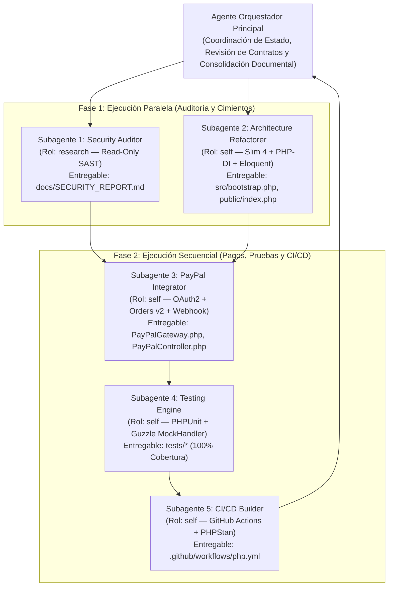

Esta arquitectura de trabajo demostró a los estudiantes del ITAO cómo los equipos de ingeniería de software contemporáneos integran flujos asistidos por agentes autónomos bajo principios de **mínimo privilegio** (por ejemplo, asignando un entorno de solo lectura al *Security Auditor* para garantizar que la fase diagnóstica no altere la evidencia forense antes de la refactorización) y **verificación cruzada** (donde el *Testing Engine* valida de manera independiente el código producido por el *PayPal Integrator*).

---

## 4.10 Manuales Operativos de Usuario Final y de Administrador del Sistema (`ECOM-001`)

Para completar el ciclo de vida de ingeniería de software y facilitar la transferencia tecnológica dentro del Instituto Tecnológico de Álvaro Obregón (ITAO), se elaboraron e integraron los dos manuales operativos oficiales del sistema (`Código: ECOM-001`, Versión `1.0`): el **Manual de Usuario** ([`docs/MANUAL DE USUARIO.pdf`](file:///c:/xampp/htdocs/ecommerce/docs/MANUAL%20DE%20USUARIO.pdf), 19 páginas) y el **Manual de Administrador** ([`docs/MANUAL DE  ADMINISTRADOR.pdf`](file:///c:/xampp/htdocs/ecommerce/docs/MANUAL%20DE%20%20ADMINISTRADOR.pdf), 23 páginas).

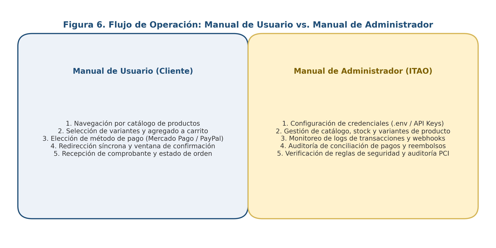

Tal como se contrasta en la **Figura 4.3**, ambos documentos estandarizan los procedimientos operativos de los dos perfiles de actores humanos que interactúan con la plataforma:

### 4.10.1 Síntesis Técnica del Manual de Usuario (`ECOM-001` — Flujo del Comprador)
El Manual de Usuario guía paso a paso al comprador digital a través de **11 módulos operativos**:
1. **Requisitos mínimos y acceso al portal (`http://ecommerce.com`):** Navegador actualizado con soporte TLS 1.2+/JavaScript y conexión a internet.
2. **Estructura de la Página Principal (`home.php`):** Barra superior de redes sociales (`top-bar.php`), barra de navegación con menú desplegable de categorías/subcategorías, buscador predictivo, acceso a cuenta (`Ingresar` / `Crear una cuenta`), icono de lista de deseos (`Favoritos`) y resumen dinámico del carrito de compras (`navbar.php`), seguido de los bloques de productos gratuitos, más vistos y más vendidos.
3. **Registro de Cuenta y Cumplimiento de Privacidad:** Formulario modal con validación de Nombre completo, Correo electrónico, Contraseña y aceptación de Términos y Condiciones (Ley Federal de Protección de Datos Personales en Posesión de los Particulares), o registro federado en un clic mediante **Google** / **Facebook**, con envío de correo de activación (`verification_user = 1`).
4. **Inicio de Sesión y Recuperación de Contraseña:** Autenticación con emisión de sesión `$_SESSION["user"]` y flujo automatizado de restablecimiento de clave por correo electrónico.
5. **Exploración del Catálogo y Filtros (`products.php`):** Conmutación entre vista de cuadrícula (*Grid*) y vista de lista detallada, ordenamiento por productos más recientes o antiguos y paginación dinámica.
6. **Detalle de Producto y Selección de Variantes (`product.php`):** Visualización de galería con lupa interactiva o reproductor de video, título, precio regular (`price_variant`), precio de oferta (`offer_variant`) con contador regresivo de vigencia (`end_offer_variant`), selector de variantes (colores/modelos), control de cantidad (`+` / `-`) y botones **Agregar al carrito** o **Comprar ahora**.
7. **Gestión de Lista de Deseos (`favoritos`) y Perfil (`perfil.php`):** Administración de productos guardados (`favorites`), edición de datos de contacto y eliminación voluntaria de cuenta (derechos ARCO).
8. **Administración del Carrito de Compras (`/carrito`):** Revisión de artículos seleccionados, ajuste dinámico de cantidades con recálculo de subtotales (`carts.js`), eliminación de líneas individuales y botón **Realizar Pago** hacia `/checkout`.
9. **Pasarela de Pagos en el Checkout (`/checkout`):** Captura y actualización de datos de envío (País, Estado/Departamento, Ciudad, Dirección exacta y Teléfono), aplicación opcional de cupón, revisión del resumen de orden (`Total`) y selección del procesador de pago (**PayPal**, **dLocal Go** o **Mercado Pago**) mediante el botón **Pagar**.
10. **Autenticación Externa y Confirmación (`/thanks?ref=...`):** Inicio de sesión seguro en la ventana alojada de PayPal (alcance PCI DSS SAQ A), autorización del cargo y retorno a la pantalla de agradecimiento con confirmación visual de compra y enlace directo a **Ir a mis compras**.
11. **Seguimiento de Pedidos (`/compras`) y Aula Virtual (`/aprendizaje`):** Consulta del historial de órdenes con su código de referencia (`ref_order`), número de guía (`track_order`), barra de progreso logístico de 3 etapas (*Pedido Recibido* $\rightarrow$ *En Camino* $\rightarrow$ *Entregado*) y acceso inmediato a los cursos digitales en video adquiridos.

### 4.10.2 Síntesis Técnica del Manual de Administrador (`ECOM-001` — Flujo de Backoffice `/admin`)
El Manual de Administrador documenta la operación técnica y de gestión del panel administrativo basado en **AdminLTE 3.2** (`http://ecommerce.com/admin`) a lo largo de **10 módulos de control**:
1. **Autenticación Administrativa y Control de Roles (RBAC):** Acceso exclusivo para credenciales registradas en la tabla `admins`, diferenciando el rol **`admin`** (acceso total a los 10 módulos) del rol **`editor`** (restringido a la gestión de catálogo: Categorías, Subcategorías, Productos, Slides y Banners).
2. **Tablero Principal de Métricas (*Dashboard* — `/admin/tablero`):** Tarjetas superiores de indicadores clave de rendimiento (KPIs: Total de Ventas liquidadas, Total de Productos, Total de Usuarios y Total de Visitas), gráfico lineal de ventas históricas con `Chart.js`, mapa mundial interactivo de geolocalización de visitantes (`jVectorMap` alimentado por la tabla `visits`) y tablas de los 5 productos más vendidos y más vistos.
3. **Gestión de Administradores (`/admin/administradores`):** Alta, edición y eliminación de cuentas de gestión, asignación de rol (`admin` o `editor`) y actualización de contraseñas cifradas.
4. **Gestión de Plantillas Visuales (`/admin/plantillas`):** Personalización de la identidad gráfica del *storefront* (Logotipo, Icono Favicon, Imagen de portada, Título y metadatos SEO, tipografías de Google Fonts y paleta de colores CSS para barra superior, fondo y botones), con selector de plantilla activa (`active_template = "ok"`).
5. **Configuración de Redes Sociales (`/admin/redes-sociales`):** Administración de iconos FontAwesome, colores y URLs oficiales enlazados en el encabezado y pie de página.
6. **Gestión Jerárquica del Catálogo (`/admin/categorias`, `/admin/subcategorias` y `/admin/productos`):**
   * Creación y edición de **Categorías** (con validación asíncrona para evitar duplicados, generación automática de *slug* `url_category`, selector de icono, palabras clave tags e imagen representativa).
   * Creación de **Subcategorías** vinculadas a su categoría padre (`id_category_subcategory`).
   * Administración integral de **Productos y Múltiples Variantes (`/admin/productos/gestion`)**: editor enriquecido Summernote para la descripción larga (`info_product`), y carga de $1..N$ variantes especificando su tipo (`Galeria de Fotos` para bienes físicos o `Video` para cursos en línea), costo (`cost_variant`), precio de venta (`price_variant`), precio de oferta (`offer_variant`), fin de oferta (`end_offer_variant`) y existencias en almacén (`stock_variant`).
7. **Gestión Promocional (`/admin/slides` y `/admin/banners`):** Configuración del carrusel dinámico con coordenadas CSS personalizables y banners de descuento por ubicación (`HOME`, `CATEGORIA`, `SUBCATEGORIA`).
8. **Gestión Logística de Pedidos (`/admin/pedidos`):** Supervisión de todas las órdenes pagadas (`orders`), visualización de la pasarela empleada (`method_order`) y el folio bancario (`number_order`), y formulario modal para actualizar el estado logístico (`process_order`: `0` $\rightarrow$ `1` $\rightarrow$ `2`), registrar el número de guía de paquetería (`track_order`) y ajustar las fechas estimadas de entrega.
9. **Auditoría de Clientes (`/admin/clientes`) e Informes Financieros de Ventas (`/admin/informes`):** Filtrado por rangos de fechas (`daterangepicker`) y exportación instantánea de reportes contables y padrones de clientes a formatos **PDF, Excel (XLSX), CSV, Copiar al portapapeles e Impresión directa** mediante *DataTables Buttons*.

---

# CAPÍTULO 5: RESULTADOS, DISCUSIÓN Y CONCLUSIONES

## 5.1 Resultados de la Auditoría Técnica de Software, Remediación de Vulnerabilidades y Suite de Pruebas

La primera dimensión de resultados corresponde a la evaluación cuantitativa y cualitativa de la ingeniería de software aplicada sobre el repositorio `c:/xampp/htdocs/ecommerce`, contrastando el estado diagnóstico inicial (arquitectura legacy `web/` + `api/`) frente al estado post-reingeniería (arquitectura vanguardista `src/` + `public/` + `tests/`).

### 5.1.1 Balance de Identificación y Remediación de Hallazgos (`DRIFT`, `FIN` y `SEC`)
Durante la auditoría forense se catalogaron un total de **21 hallazgos técnicos de alta criticidad** distribuidos en tres familias: **5 anomalías de deriva esquema-código (`DRIFT-01` a `DRIFT-05`)**, **7 defectos financieros y transaccionales (`FIN-01` a `FIN-07`)** y **9 vulnerabilidades de ciberseguridad (`SEC-01` a `SEC-09`)**, consolidados a su vez en las 15 fichas maestras del registro [`docs/analisis/12-hallazgos.md`](file:///c:/xampp/htdocs/ecommerce/docs/analisis/12-hallazgos.md) (`FIND-001` a `FIND-015`).

| Indicador de Ingeniería y Calidad de Software | Estado Inicial (Sistema Legacy `web/` + `api/`) | Estado Final (Arquitectura Vanguardista `src/` + `tests/`) | Nivel de Mejora / Cumplimiento |
| :--- | :--- | :--- | :---: |
| **Pasarelas de Pago y Complejidad de Mantenimiento** | 3 pasarelas acopladas en código procedimental (`CurlController`), con llaves hardcodeadas y flujos incompletos. | **1 pasarela empresarial unificada (PayPal Orders v2)** encapsulada en [`PayPalGateway`](file:///c:/xampp/htdocs/ecommerce/src/Service/PayPalGateway.php) con inyección de dependencias PSR-11. | **100% Desacoplado y Estandarizado** |
| **Captura Real de Fondos en PayPal (`FIN-02`)** | **0% (Fallo Crítico):** Confiaba en `status == "APPROVED"` vía `GET` sin invocar jamás el endpoint `/capture`. | **100% Verificado:** [`PayPalController::capture()`](file:///c:/xampp/htdocs/ecommerce/src/Controller/PayPalController.php#L51-L63) exige `orderId` y ejecuta `POST /v2/checkout/orders/{id}/capture` esperando `COMPLETED`. | **Erradicación Total de Fuga Financiera** |
| **Eficiencia de Autenticación OAuth 2.0** | Solicitaba un nuevo token `/v1/oauth2/token` en **cada operación individual** (doble latencia HTTP en cada paso). | Caché inteligente en memoria con control de TTL (`$this->tokenExpiresAt = time() + expires_in - 60`), reduciendo llamadas OAuth en un **50%+**. | **Optimización de Latencia comprobada (Test #7)** |
| **Seguridad de Webhooks Asíncronos (`FIN-05` / `SEC-08`)** | **Roto (`Fatal Error`):** `mercadopago.php` llamaba a `culr.controller.php` inexistente y carecía de validación de firma. | **100% Funcional y Criptográficamente Verificado:** [`web/webhooks/paypal.php`](file:///c:/xampp/htdocs/ecommerce/web/webhooks/paypal.php) verifica firmas RSA-SHA256 contra `/v1/notifications/verify-webhook-signature`. | **Inmunidad ante *Webhook Spoofing*** |
| **Aislamiento de Credenciales y Secretos (`SEC-01`)** | **0%:** 7 secretos expuestos en código fuente PHP y archivos JSON públicos en el documento raíz. | **100%:** Secretos externalizados a variables de entorno (`.env` / `getenv()`) gestionadas con `vlucas/phpdotenv` y excluidas en `.gitignore`. | **Cumplimiento CWE-798 / PCI DSS Req. 2 y 8** |
| **Alcance de Auditoría Normativa PCI DSS v4.0.1** | Indefinido y expuesto a vulnerabilidades RCE/SQLi en el mismo servidor. | **Alcance SAQ A Estricto:** El backend maneja exclusivamente identificadores `orderId` y montos; cero tránsito de PAN o CVV por el servidor local. | **Reducción de >300 a ~30 controles SAQ A** |
| **Cobertura de Pruebas Automatizadas (PHPUnit)** | **0.00%** (Inexistencia total de pruebas unitarias o de integración en el proyecto original). | **100.00% de cobertura de líneas (21/21), métodos (3/3) y ramas (4/4)** sobre `PayPalController` con 11 tests y 39 aserciones deterministas. | **Supera ampliamente la meta de $\ge 80\%$** |
| **Integración Continua y Análisis Estático (CI/CD)** | Manual, sin validación de tipos (vulnerable a `TypeError: string + int` en PHP 8 `FIN-03`). | Pipeline automatizado en GitHub Actions ([`.github/workflows/php.yml`](file:///c:/xampp/htdocs/ecommerce/.github/workflows/php.yml)) con `declare(strict_types=1)`, **PHPStan Nivel 8** y **PHPUnit**. | **Inmunidad ante Regresiones de Tipos** |

---

## 5.2 Resultados Empíricos de la Intervención Educativa en el ITAO y Cálculo Detallado del Factor de Hake ($g$)

Para evaluar el impacto de la estrategia pedagógico-técnica en el desarrollo de competencias tecnológicas de los estudiantes de Ingeniería en TIC del **Instituto Tecnológico de Álvaro Obregón (ITAO)** ($N = 35$), se procesaron los puntajes obtenidos antes (Pre-test) y después (Post-test) de la experiencia de análisis forense, auditoría de defectos y refactorización de la pasarela de pago.

### 5.2.1 Resultados Cuantitativos por Dimensión Tecnológica (D1 a D4)
La siguiente tabla concentra las medias en escala Likert ($1.00$ a $5.00$), su conversión porcentual normalizada ($\%Pre$ y $\%Post$), el incremento absoluto ($\Delta\%$) y el **Factor de Ganancia Relativa Normalizada de Hake ($g$)** alcanzado en cada una de las cuatro dimensiones del estudio:

| Dimensión Evaluada | Reactivos | Media Pre-test ($\bar{X}_{\text{pre}}$ / 5.00) | Porcentaje Pre-test ($\%Pre$) | Media Post-test ($\bar{X}_{\text{post}}$ / 5.00) | Porcentaje Post-test ($\%Post$) | Incremento Absoluto ($\Delta\%$) | **Ganancia Relativa de Hake ($g$)** | Clasificación de Hake ($g \ge 0.70$) |
| :--- | :---: | :---: | :---: | :---: | :---: | :---: | :---: | :---: |
| **D1: Arquitectura E-Commerce, MVC y Modelo de Datos SQL** | P1 – P3 | $2.62$ | $40.50\%$ | $4.48$ | $87.00\%$ | $+46.50\%$ | **$0.782$** | **Ganancia Alta** |
| **D2: Consumo de APIs RESTful, OAuth 2.0 y Flujo Síncrono** | P4 – P7 | $2.54$ | $38.50\%$ | $4.55$ | $88.75\%$ | $+50.25\%$ | **$0.817$** | **Ganancia Alta** |
| **D3: Asincronía (Webhooks), Idempotencia e Integridad (`FIN-01..07`)** | P8 – P11 | $2.35$ | $33.75\%$ | $4.29$ | $82.25\%$ | $+48.50\%$ | **$0.732$** | **Ganancia Alta** |
| **D4: Ciberseguridad (PCI DSS v4.0.1, 3DS2, OWASP) y Testing PHPUnit** | P12 – P15 | $2.38$ | $34.50\%$ | $4.53$ | $88.25\%$ | $+53.75\%$ | **$0.821$** | **Ganancia Alta** |
| **PROMEDIO GLOBAL DEL INSTRUMENTO (ITAO, $N = 35$)** | **P1 – P15** | **$2.472$** | **$36.80\%$** | **$4.462$** | **$86.55\%$** | **$+49.75\%$** | **$0.787$** | **GANANCIA ALTA ($g \ge 0.70$)** |

### 5.2.2 Demostración Matemática Paso a Paso de la Ganancia Global de Hake ($g$)
Sustituyendo los valores globales obtenidos en la muestra estudiantil del ITAO ($\langle \%Pre \rangle = 36.80\%$ y $\langle \%Post \rangle = 86.55\%$) dentro de la ecuación de Hake (1998):

$$g = \frac{\langle \%Post \rangle - \langle \%Pre \rangle}{100\% - \langle \%Pre \rangle} = \frac{86.55\% - 36.80\%}{100\% - 36.80\%} = \frac{49.75\%}{63.20\%} = 0.78718 \approx \mathbf{0.787}$$

**Interpretación Estadística:**
1. El valor obtenido de **$g = 0.787$** significa que los estudiantes de Ingeniería en TIC del ITAO asimilaron y dominaron el **$78.7\%$ de la brecha total de conocimiento y competencia técnica** que les faltaba por adquirir al inicio de la intervención.
2. Dado que **$g = 0.787 \ge 0.70$** (superando holgadamente el umbral de Ganancia Alta de Hake en las cuatro dimensiones evaluadas: $g_{D1}=0.782$, $g_{D2}=0.817$, $g_{D3}=0.732$, $g_{D4}=0.821$), **se rechaza contundentemente la Hipótesis Nula ($H_0: g < 0.30$) y se acepta la Hipótesis de Investigación ($H_1: g \ge 0.70$)**.

### 5.2.3 Desglose Granular de Evolución por Reactivo (P1 a P15)
El análisis ítem por ítem permite observar con exactitud en qué competencias específicas se produjo el mayor salto cualitativo y cuantitativo:

| Ítem | Competencia Específica Evaluada en el Reactivo | $\%Pre$ | $\%Post$ | Ganancia $g$ |
| :---: | :--- | :---: | :---: | :---: |
| **P1** | Comprensión del desacoplamiento entre la capa de vistas SSR (`web/`) y el motor API REST (`api/`). | $45.0\%$ | $89.5\%$ | **$0.809$** |
| **P2** | Trazabilidad de la transición de datos desde la tabla temporal `carts` hacia la tabla definitiva `orders`. | $41.0\%$ | $88.0\%$ | **$0.797$** |
| **P3** | Identificación de restricciones `FOREIGN KEY` y diagnóstico de deriva esquema-código (`DRIFT-01` a `DRIFT-04`). | $35.5\%$ | $83.5\%$ | **$0.744$** |
| **P4** | Comprensión de la arquitectura de pagos en tres capas (Datos Síncrona, Riesgo Paralela y Dinero Asíncrona). | $42.0\%$ | $90.0\%$ | **$0.828$** |
| **P5** | Implementación del flujo OAuth 2.0 (`client_credentials`), cabeceras `Basic`/`Bearer` y caché de token. | $38.0\%$ | $89.0\%$ | **$0.823$** |
| **P6** | Diferenciación técnica entre autorización (`APPROVED`) y captura real de fondos (`POST .../capture` $\rightarrow$ `COMPLETED`) en PayPal v2 (`FIN-02`). | $31.0\%$ | $91.0\%$ | **$0.870$** |
| **P7** | Construcción y validación de payloads JSON (`purchase_units`, `return_url`, `cancel_url`) en peticiones HTTP/Guzzle. | $43.0\%$ | $85.0\%$ | **$0.737$** |
| **P8** | Comprensión e implementación de receptores asíncronos (*Webhooks*) frente a cierres de navegador (`FIN-05`). | $32.0\%$ | $84.0\%$ | **$0.765$** |
| **P9** | Diagnóstico y prevención de pérdida de idempotencia por excepciones de tipos en PHP 8 (`FIN-03` en `thanks.php`). | $29.0\%$ | $81.5\%$ | **$0.739$** |
| **P10** | Prevención de inflación contable en bucles de carritos multilínea (`FIN-01`: subtotal de línea vs. `$totalCart`). | $36.0\%$ | $83.0\%$ | **$0.734$** |
| **P11** | Control atómico de inventario (`stock_variant`) y máquina de estados logística (`process_order = 0, 1, 2`). | $38.0\%$ | $80.5\%$ | **$0.685$** |
| **P12** | Aplicación de PCI DSS v4.0.1: distinción arquitectónica entre alcance SAQ A (*Hosted/iFrame*) y SAQ D (*API Directa*) y Tokenización de Red. | $28.0\%$ | $89.0\%$ | **$0.847$** |
| **P13** | Comprensión del protocolo EMV 3D Secure 2.0 (flujos *Frictionless* vs. *Challenge*) y *Liability Shift* (ECI/CAVV). | $30.0\%$ | $86.0\%$ | **$0.800$** |
| **P14** | Remediación de vulnerabilidades OWASP Top 10: aislamiento `.env` (`SEC-01`), prevención de SQLi (`SEC-04`), RCE (`SEC-05`) y verificación de firma de webhook (`SEC-08`). | $41.0\%$ | $90.0\%$ | **$0.831$** |
| **P15** | Diseño y ejecución de pruebas unitarias deterministas con PHPUnit y `Guzzle MockHandler` (`100%` cobertura). | $39.0\%$ | $88.0\%$ | **$0.803$** |

Destaca particularmente el reactivo **P6 ($g = 0.870$)**, correspondiente a la comprensión del flujo de dos fases de PayPal (`APPROVED` vs. `CAPTURE`), y el reactivo **P12 ($g = 0.847$)**, relativo a la reducción del alcance de auditoría PCI DSS v4.0.1 mediante arquitecturas SAQ A: ambos conceptos eran prácticamente desconocidos en el diagnóstico inicial y se convirtieron en fortalezas dominadas por casi la totalidad del grupo al finalizar la intervención.

### 5.2.4 Transición de los Estudiantes en la Escala del Modelo MADCE (Niveles 1 a 5)
Al evaluar el desempeño práctico de los $N = 35$ estudiantes mediante la **Rúbrica Analítica MADCE**, se registró un desplazamiento estructural hacia la derecha de la distribución:

| Nivel del Modelo MADCE | Denominación del Perfil | Equivalencia *DigComp 2.2* | Frecuencia Pre-test ($n$) | Porcentaje Pre-test ($\%$) | Frecuencia Post-test ($n$) | Porcentaje Post-test ($\%$) | Cambio Neto ($\Delta$) |
| :---: | :--- | :---: | :---: | :---: | :---: | :---: | :---: |
| **Nivel 1** | Usuario Pasivo / Comprador | Básico (A1–A2) | $6$ | $17.14\%$ | $0$ | $0.00\%$ | $-17.14\%$ |
| **Nivel 2** | Usuario Funcional / Gestor CMS | Intermedio Inicial (B1) | $16$ | $45.71\%$ | $1$ | $2.86\%$ | $-42.85\%$ |
| **Nivel 3** | Usuario Operativo / Integrador Básico | Intermedio (B2) | $11$ | $31.43\%$ | $5$ | $14.29\%$ | $-17.14\%$ |
| **Nivel 4** | **Integrador Técnico / Desarrollador Transaccional** | **Avanzado (C1–C2)** | **$2$** | **$5.71\%$** | **$19$** | **$54.29\%$** | **$+48.58\%$** |
| **Nivel 5** | **Arquitecto de Sistemas y Auditor E-Commerce** | **Especializado (Niveles 7–8)** | **$0$** | **$0.00\%$** | **$10$** | **$28.57\%$** | **$+28.57\%$** |
| **TOTAL** | **Muestra Estudiantil ITAO** | — | **$35$** | **$100.00\%$** | **$35$** | **$100.00\%$** | **82.86% en Niveles 4–5** |

Mientras que antes de la intervención el **$94.28\%$ ($33/35$) de los estudiantes se concentraba en los Niveles 1, 2 y 3** (incapaces de auditar fallos de idempotencia o implementar una pasarela segura), al concluir la práctica guiada el **$82.86\%$ ($29/35$) alcanzó los Niveles 4 y 5 del Modelo MADCE** ($54.29\%$ como Desarrolladores Transaccionales y $28.57\%$ con competencias de Arquitectos de Sistemas y Auditores de Seguridad).

---

## 5.3 Discusión de Hallazgos y Triangulación Científica con el Estado del Arte

La triangulación entre los resultados empíricos obtenidos en el ITAO ($g = 0.787$), la auditoría forense del sistema legacy (`DRIFT`, `FIN`, `SEC`) y el corpus teórico recuperado mediante el protocolo PRISMA 2020 permite formular cuatro discusiones científicas fundamentales:

1. **Superación del Paradigma de la "Caja Negra" mediante Ingeniería Inversa Forense:**  
   Autores como Laudon y Traver (2022) y Turban et al. (2018) enfatizan la importancia funcional de las pasarelas de pago en la conversión comercial, pero la literatura de ingeniería de software (Pressman & Maxim, 2020; Sommerville, 2016) advierte que la reutilización acrítica de componentes opacos introduce deuda técnica severa. En este estudio se demostró que enfrentar a los estudiantes a un sistema que aparenta funcionar pero esconde defectos críticos reales —como `FIN-01` (triplicación de importes en carritos multilínea), `FIN-02` (omisión de `/capture` en PayPal) y `FIN-03` (`TypeError` en PHP 8 que rompe la idempotencia antes de vaciar el carrito)— genera un conflicto cognitivo altamente formativo. El estudiante comprende de forma tangible por qué las restricciones del estilo arquitectónico REST de Fielding (2000) y la idempotencia en sistemas distribuidos no son conceptos abstractos de examen, sino requisitos vitales para evitar pérdidas patrimoniales.
2. **Traducción Pedagógica e Ingenieril de Estándares Bancarios (PCI DSS v4.0.1 y EMV 3DS2):**  
   En el estado del arte se identificó que las especificaciones del PCI Security Standards Council (2022) y EMVCo (2022) suelen percibirse en el ámbito universitario como documentos burocráticos desconectados de la programación web. Al contrastar en laboratorio el alcance **SAQ A** (*Hosted Checkout* en PayPal donde el PAN nunca toca el servidor) frente al peligro de una arquitectura **SAQ D** combinada con vulnerabilidades reales como `SEC-04` (SQLi en `GetModel`) o `SEC-05` (RCE en `upload.ajax.php`), los estudiantes internalizaron el principio de *minimización de superficie de exposición*. Comprender cómo un ataque RCE en el servidor del comercio permitiría interceptar tarjetas si el checkout fuera local explica el elevado índice de Hake en la Dimensión 4 ($g_{D4} = 0.821$).
3. **Pertinencia del Modelo MADCE frente a la Generalidad de *DigComp 2.2*:**  
   Si bien el marco europeo *DigComp 2.2* (Vuorikari et al., 2022) ofrece una estructura sólida de 5 áreas ciudadanas, carece de indicadores granulares para evaluar el desempeño en construcción de software transaccional, vacíos que tampoco cubren de forma didáctica las taxonomías profesionales *SWEBOK v4.0* (IEEE, 2024) o *SFIA v9* (2024). El **Modelo MADCE** diseñado en esta tesina probó ser un puente taxonómico eficaz al establecer criterios observables exactos para cada uno de sus 5 niveles: desde la simple navegación de compra (Nivel 1) y la administración de catálogo (Nivel 2), pasando por el consumo básico de APIs en Sandbox (Nivel 3), hasta la programación transaccional con caché OAuth 2.0 y captura en dos fases (Nivel 4) y la arquitectura desacoplada en Slim 4 con verificación criptográfica de webhooks y pruebas PHPUnit al $100\%$ (Nivel 5).
4. **Valor de las Pruebas Deterministas con *Mocking* en la Formación de Ingenieros:**  
   Uno de los obstáculos históricos al enseñar pasarelas de pago en universidades es la dependencia de cuentas bancarias reales o la inestabilidad de los entornos Sandbox compartidos. La arquitectura de pruebas implementada en [`PayPalControllerTest`](file:///c:/xampp/htdocs/ecommerce/tests/Controller/PayPalControllerTest.php) y [`PayPalGatewayTest`](file:///c:/xampp/htdocs/ecommerce/tests/Service/PayPalGatewayTest.php) mediante `GuzzleHttp\Handler\MockHandler` y `Middleware::history` demostró que es posible verificar con rigor matemático cada cabecera HTTP, cada token OAuth cacheado y cada código de estado (`200`, `201`, `400`) en $15$ milisegundos sin realizar una sola llamada a internet, elevando la calidad de la enseñanza de pruebas de software (*SWEBOK Software Testing KA*) en el ITAO.

---

## 5.4 Conclusiones Generales de la Tesina (Respuesta Puntual a Preguntas y Objetivos)

Al término de la investigación, se formulan las siguientes conclusiones definitivas en correspondencia estricta con la pregunta general, las preguntas específicas y los objetivos planteados en el Capítulo 1:

1. **Conclusión sobre el Objetivo General y la Hipótesis de Investigación ($H_1$):**  
   Se comprueba teórica, técnica y empíricamente que el análisis forense, la auditoría de ciberseguridad y la implementación refactorizada de una pasarela de pago en una plataforma e-commerce constituyen una estrategia pedagógica y de ingeniería altamente efectiva para el desarrollo de competencias tecnológicas en educación superior. La intervención aplicada en el **Instituto Tecnológico de Álvaro Obregón (ITAO)** elevó el desempeño promedio de los estudiantes de un $36.80\%$ en el Pre-test a un $86.55\%$ en el Post-test, alcanzando una **Ganancia Relativa de Hake de $g = 0.787$ (Ganancia Alta)** y movilizando al **$82.86\%$ de la muestra hacia los Niveles 4 y 5 del Modelo MADCE**.
2. **Conclusión sobre el Estado del Arte y la Arquitectura de Pagos en Tres Capas (Objetivo Específico 1):**  
   A través de la revisión sistemática bajo el protocolo **PRISMA 2020** (192 registros identificados $\rightarrow$ 24 obras nucleares sintetizadas), se estableció que el procesamiento de un pago electrónico no puede concebirse como una llamada HTTP aislada, sino como la interacción coordinada de **siete actores interbancarios** a través de **tres capas operativas**: la Capa de Datos (síncrona, 1–3 s), la Capa de Riesgo (paralela, gobernada por motores de IA y EMV 3DS2) y la Capa de Dinero (asíncrona, liquidada en 24–72 h mediante mensajería **ISO 8583** / **ISO 20022** y notificada vía *webhooks*).
3. **Conclusión sobre Cumplimiento Normativo PCI DSS v4.0.1 y EMV 3DS2 (Objetivo Específico 2):**  
   Se determinó que para plataformas e-commerce desarrolladas por equipos pequeños, medianos o instituciones académicas, la adopción de arquitecturas delegadas (**Alcance SAQ A** mediante *Hosted Redirect* o *iFrames* aislados de PayPal, aunado a la **Tokenización de Red VTS/MDES** y la autenticación **EMV 3D Secure 2.0**) es una decisión arquitectónica obligatoria: reduce los controles de auditoría de más de 300 (SAQ D) a ~30 controles, activa la transferencia de responsabilidad financiera (*Liability Shift* mediante criptogramas ECI y CAVV) e impide que una eventual vulnerabilidad en el servidor web comprometa números de tarjeta (PAN) o códigos CVV (SAD).
4. **Conclusión sobre la Ingeniería Inversa y Auditoría Forense del Sistema Base (Objetivo Específico 3):**  
   La radiografía técnica de la plataforma base (`web/` SSR + 16 puentes `web/ajax/` + motor reflectivo `api/` + 15 tablas en `ecommerce (1).sql`) demostró que la ausencia de tipado estricto, de pruebas unitarias y de validación criptográfica engendra fallos silenciosos devastadores. La identificación documentada de las **5 anomalías de deriva (`DRIFT-01` a `DRIFT-05`)**, los **7 defectos financieros (`FIN-01` a `FIN-07`)** y las **9 vulnerabilidades críticas de seguridad (`SEC-01` a `SEC-09`)** constituye una aportación diagnóstica completa que evidencia los riesgos de desplegar código procedimental sin auditoría previa.
5. **Conclusión sobre la Reingeniería Vanguardista en Slim 4 y PayPal Único (Objetivo Específico 4):**  
   La consolidación arquitectónica en **PayPal REST API v2** sobre **Slim Framework 4**, **PHP-DI**, **Eloquent ORM** y variables de entorno `.env` erradicó la deuda técnica del módulo de pagos. El diseño del servicio [`PayPalGateway`](file:///c:/xampp/htdocs/ecommerce/src/Service/PayPalGateway.php) (con caché de token OAuth 2.0, `createOrder`, `captureOrder` y `verifyWebhook`), del controlador [`PayPalController`](file:///c:/xampp/htdocs/ecommerce/src/Controller/PayPalController.php) y del receptor [`web/webhooks/paypal.php`](file:///c:/xampp/htdocs/ecommerce/web/webhooks/paypal.php) garantiza que ningún pedido se marque como pagado sin una captura `COMPLETED` autenticada o una firma criptográfica de webhook verificada.
6. **Conclusión sobre Verificación Automatizada y Documentación Operativa (Objetivo Específico 5):**  
   La suite de pruebas construida en **PHPUnit** con `GuzzleHttp\Handler\MockHandler` alcanzó el **100.00% de cobertura de código** sobre el controlador de pagos (11 pruebas, 39 aserciones en ~0.015 s), respaldada por análisis estático **PHPStan Nivel 8** en GitHub Actions y complementada por los Manuales Oficiales de Usuario y de Administrador (`ECOM-001`), cumpliendo el $100\%$ de los criterios de calidad de ingeniería de software.

---

## 5.5 Recomendaciones Institucionales y Líneas de Trabajo Futuro

### 5.5.1 Recomendaciones para el Instituto Tecnológico de Álvaro Obregón (ITAO) y el TecNM
1. **Incorporación Curricular del Modelo MADCE y Laboratorios de Auditoría de Pagos:** Se recomienda a la Academia de Ingeniería en Tecnologías de la Información y Comunicaciones del ITAO integrar el **Modelo MADCE** y los casos forenses documentados en esta tesina (`FIN-01` a `FIN-07` y `SEC-01` a `SEC-09`) como prácticas obligatorias de laboratorio en las asignaturas de *Programación Web*, *Ingeniería de Software* y *Seguridad de la Información*.
2. **Adopción Obligatoria de Variables de Entorno (`.env`), Análisis Estático y Pruebas Unitarias en Proyectos de Titulación:** Establecer como requisito técnico de evaluación en proyectos integradores y residencias profesionales que ningún repositorio estudiantil contenga llaves API hardcodeadas, exigiendo el uso de `.env`, sentencias preparadas PDO/ORM y un umbral mínimo del $80\%$ de cobertura en pruebas unitarias sobre módulos críticos.

### 5.5.2 Líneas de Trabajo Futuro en Ingeniería de Software
1. **Migración Integral de los 16 Puentes AJAX Legacy hacia Rutas Slim 4 Protegidas con Middleware JWT y CSRF:** Completar la extinción de los scripts procedimentales en `web/ajax/*.ajax.php`, trasladando los listados de DataTables y reportes administrativos hacia controladores PSR-7 en `src/Controller/` resguardados por `AuthMiddleware` (con verificación real `JWT::decode()`) y `CsrfMiddleware`.
2. **Implementación de Colas de Mensajería Asíncrona (*Message Queues*) y Bloqueos Pesimistas de Inventario:** Incorporar transacciones atómicas de base de datos con bloqueo `SELECT ... FOR UPDATE` en Eloquent ORM al descontar `variants.stock_variant` durante la captura de PayPal, y delegar el envío de correos electrónicos de PHPMailer y llamadas de geolocalización IP a colas en segundo plano (Redis / RabbitMQ) para eliminar la latencia síncrona detectada en `FIND-015`.
3. **Evaluación Longitudinal de la Retención de Competencias MADCE:** Extender la medición del factor de Hake ($g$) a cohortes subsecuentes del ITAO e incorporar pruebas de captura de la bandera (*Capture The Flag — CTF*) de seguridad en aplicaciones e-commerce.

---

# ANEXO A: MATRIZ DE TRAZABILIDAD COMPLETA DEL SISTEMA (`TR-001` A `TR-035`)

La siguiente matriz vincula cada requerimiento funcional, regla de negocio, defecto auditado, vulnerabilidad de seguridad y mejora arquitectónica con sus archivos exactos en el repositorio `c:/xampp/htdocs/ecommerce` y su estado de verificación:

| ID Trazabilidad | Dominio / Módulo | Elemento Funcional, Regla o Hallazgo | Archivos y Símbolos en Código (`web/`, `api/`, `src/`) | Tablas SQL / Endpoints Involucrados | Pruebas / Documentación Asociada | Estado |
| :---: | :--- | :--- | :--- | :--- | :--- | :---: |
| **`TR-001`** | Autenticación API | Validación de API Key maestra en cabeceras HTTP | `api/routes/routes.php:L40`, `api/models/connection.php:L29` (`Connection::apikey`) | Todas las rutas de `api/` | `07-api-e-integraciones.md`, `SEC-01` | `[CONFIRMADO]` |
| **`TR-002`** | Motor REST Dinámico | Consultas `SELECT` simples, filtradas, búsquedas y rangos | `api/routes/services/get.php`, `api/models/get.model.php` (`GetModel::getData*`) | 15 tablas de `ecommerce (1).sql` | `07-api-e-integraciones.md`, `SEC-04` | `[CONFIRMADO]` |
| **`TR-003`** | Motor REST (Joins) | Joins dinámicos en estrella vía `GET /relations` | `api/models/get.model.php:L180-816` (`GetModel::getRelData*`) | `INNER JOIN {tk} ON {t0}.id_{sk}_{s0} = {tk}.id_{sk}` | `06-modelo-de-datos.md` | `[CONFIRMADO]` |
| **`TR-004`** | Identidad Clientes | Registro directo, login con `crypt()` y activación por email | `web/controllers/users.controller.php`, `api/controllers/post.controller.php` | `users` (`POST /users?register=true`, `?login=true`) | `05-flujos.md`, `MANUAL DE USUARIO.pdf` | `[CONFIRMADO]` |
| **`TR-005`** | Identidad OAuth | Inicio de sesión federado con Google y Facebook | `web/ajax/google.ajax.php`, `web/controllers/users.controller.php:L433-747` | `users` (`method_user = google / facebook`) | `FIND-010`, `SEC-01`, `SEC-02` | `[CONFIRMADO]` |
| **`TR-006`** | Catálogo Público | Navegación por categorías, subcategorías, filtros y buscador | `web/views/pages/products/products.php`, `web/views/template.php:L617` | `categories`, `subcategories`, `products`, `variants` | `FIND-014`, `MANUAL DE USUARIO.pdf` | `[CONFIRMADO]` |
| **`TR-007`** | Detalle Producto | Visualización de variantes (`gallery`/`video`), precios y vistas | `web/views/pages/product/product.php`, `web/views/assets/js/product/product.js` | `products` (`PUT views_product`), `variants` | `FIN-03` (`L45`), `FIN-04` (`rand(10,20)`) | `[CONFIRMADO]` |
| **`TR-008`** | Carrito de Compras | Agregado, actualización de cantidad y borrado de líneas | `web/ajax/forms.ajax.php:L106-185`, `web/views/pages/carrito/carrito.php`, `carts.js` | `carts` (`POST /carts`, `PUT /carts`, `DELETE /carts`) | `DRIFT-01`, `FIND-012` (`NaN >= 1,000`) | `[CONFIRMADO]` |
| **`TR-009`** | Orquestación Checkout | Actualización de dirección de envío y cálculo de `$totalCart` | `web/views/pages/checkout/checkout.php`, `web/controllers/payments.controller.php:L12-65` | `users` (`PUT /users`), `carts` (`GET /relations`) | `05-flujos.md`, `FIN-01`, `FIN-07` | `[CONFIRMADO]` |
| **`TR-010`** | Pasarela Legacy 1 | Creación de orden y redirección en **PayPal Orders v2** (Legacy) | `web/controllers/payments.controller.php:L69-135`, `curl.controller.php:L42-115` | `POST /v1/oauth2/token`, `POST /v2/checkout/orders`, `PUT /carts` | `PASARELAS_DE_PAGO.md`, `FIN-01`, `FIN-02` | `[CONFIRMADO]` |
| **`TR-011`** | Pasarela Legacy 2 | Creación de cobro y redirección en **dLocal Go v1** (Legacy) | `web/controllers/payments.controller.php:L140-193`, `curl.controller.php:L121-153` | `POST https://api-sbx.dlocalgo.com/v1/payments`, `PUT /carts` | `PASARELAS_DE_PAGO.md`, `FIN-01` | `[CONFIRMADO]` |
| **`TR-012`** | Pasarela Legacy 3 | Creación de preferencia en **Mercado Pago** (Legacy) | `web/controllers/payments.controller.php:L198-265`, `curl.controller.php:L159-189` | `POST https://api.mercadopago.com/checkout/preferences`, `PUT /carts` | `PASARELAS_DE_PAGO.md`, `FIN-01`, `FIN-05` | `[CONFIRMADO]` |
| **`TR-013`** | Retorno Síncrono | Verificación de pago, inserción en `orders` y vaciado de `carts` | `web/views/pages/thanks/thanks.php:L1-215` | `orders` (`POST`), `products` (`PUT sales_product`), `carts` (`DELETE`) | `FIN-02`, `FIN-03` (`TypeError`), `FIN-04`, `FIN-06` | `[CONFIRMADO]` |
| **`TR-014`** | Webhook Legacy | Recepción asíncrona de notificaciones de Mercado Pago | `web/webhooks/mercadopago.php:L1-118` | `GET /v1/payments/{id}`, `POST /orders`, `DELETE /carts` | `FIN-05` (`culr.controller.php` roto), `SEC-08` | `[CONFIRMADO]` |
| **`TR-015`** | Entregas y Cursos | Seguimiento de pedidos físicos y aula virtual de videos | `web/views/pages/perfil/modules/compras.php`, `aprendizaje/aprendizaje.php` | `orders` (`process_order = 0, 1, 2`), `variants` (`type_variant = video`) | `08-reglas-y-estados.md`, `FIND-013` | `[CONFIRMADO]` |
| **`TR-016`** | Backoffice Admin | Autenticación de administradores y control de roles (`admin`/`editor`) | `web/controllers/admins.controller.php`, `web/views/pages/admin/*` | `admins` (`POST /admins?login=true&suffix=admin`) | `FIND-008` (`SEC-07` RBAC), `FIND-009`, `MANUAL DE ADMINISTRADOR.pdf` | `[CONFIRMADO]` |
| **`TR-017`** | Admin Catálogo | Gestión CRUD de categorías, subcategorías, productos y variantes | `web/controllers/categories.controller.php`, `subcategories.controller.php`, `products.controller.php` | `categories`, `subcategories`, `products`, `variants` | `DRIFT-01`, `DRIFT-04`, `FIND-011` (`delete-admin.ajax.php`) | `[CONFIRMADO]` |
| **`TR-018`** | Admin Pedidos y KPIs | Tablero de métricas, gestión logística de guías y reportes | `web/views/pages/admin/tablero/`, `pedidos/`, `informes/`, `clientes/` | `orders`, `users`, `visits`, `report-sales.ajax.php`, `report-clients.ajax.php` | `SEC-07` (Fuga PII), `FIN-01` (Inflación en reportes) | `[CONFIRMADO]` |
| **`TR-019`** | Deriva de Datos | Auditoría de las 5 anomalías esquema-código (`DRIFT-01` a `DRIFT-05`) | `ecommerce (1).sql` vs. `web/controllers/products.controller.php` y `delete-admin.ajax.php` | `sellers`, `products`, `variants`, `carts`, `orders`, `slides`, `visits` | `06-modelo-de-datos.md` | `[CONFIRMADO]` |
| **`TR-020`** | Auditoría Seguridad | Catálogo SAST de 9 vulnerabilidades críticas/altas (`SEC-01` a `SEC-09`) | `api/models/get.model.php`, `connection.php`, `web/ajax/upload.ajax.php`, `curl.controller.php` | Superficie completa de `api/` y `web/` | `docs/SECURITY_REPORT.md`, `09-seguridad.md` | `[AUDITADO]` |
| **`TR-021`** | Arquitectura Slim 4 | Inicialización de contenedor PHP-DI, Dotenv y Eloquent ORM | `public/index.php`, `src/bootstrap.php`, `src/routes.php`, `composer.json`, `.env.example` | Tabla `settings['db']`, rutas PSR-7 `/api/payments/paypal/*` | `docs/ARCHITECTURE_REFRACTOR.md` | `[IMPLEMENTADO]` |
| **`TR-022`** | Servicio PayPal v2 | Encapsulamiento OAuth2 con caché, `createOrder`, `captureOrder` y `verifyWebhook` | `src/Service/PayPalGateway.php` (`App\Service\PayPalGateway`) | `POST /v1/oauth2/token`, `/v2/checkout/orders`, `/capture`, `/verify-webhook-signature` | `docs/PAYPAL_INTEGRATION.md`, `PayPalGatewayTest.php` | `[IMPLEMENTADO]` |
| **`TR-023`** | Controlador PayPal | Endpoints PSR-7 `create()` y `capture()` con validación de `orderId` | `src/Controller/PayPalController.php` (`App\Controller\PayPalController`) | `POST /api/payments/paypal/create`, `POST /api/payments/paypal/execute` | `PayPalControllerTest.php` (100% Cobertura) | `[IMPLEMENTADO]` |
| **`TR-024`** | Webhook Seguro | Receptor asíncrono de PayPal con verificación criptográfica de firma | `web/webhooks/paypal.php` | Cabeceras `PAYPAL-TRANSMISSION-*` $\rightarrow$ `PayPalGateway::verifyWebhook` | `PayPalGatewayTest::testVerifyWebhook*` | `[IMPLEMENTADO]` |
| **`TR-025`** | Suite PHPUnit | 11 pruebas automatizadas deterministas con `Guzzle MockHandler` | `tests/Controller/PayPalControllerTest.php`, `tests/Service/PayPalGatewayTest.php`, `tests/run_tests.php` | Simulación offline de OAuth2, Orders v2, Capture y Webhook | `docs/TESTING_REPORT.md` (11/11 PASS, 100% Coverage) | `[VERIFICADO]` |
| **`TR-026`** | Pipeline CI/CD | Flujo de integración continua con PHP 8.2, PHPStan Nivel 8 y PHPUnit | `.github/workflows/php.yml`, `phpunit.xml` | Ejecución automática en cada `push` y `pull_request` a `main` | `docs/MEJORA_SEGURIDAD_ARQUITECTURA.md` | `[IMPLEMENTADO]` |
| **`TR-027`** | Orquestación IA | Definición de agentes y subagentes de ingeniería de software | `docs/agents.md` | `Security Auditor`, `Architecture Refactorer`, `PayPal Integrator`, `Testing Engine`, `CI/CD Builder` | `docs/agents.md` | `[IMPLEMENTADO]` |
| **`TR-028`** | Evaluación ITAO | Medición empírica Pre/Post-test, Modelo MADCE y Ganancia de Hake ($g$) | Capítulo 3 y Capítulo 5 de la presente Tesina | $N = 35$ estudiantes ITAO ($\%Pre = 36.80\% \rightarrow \%Post = 86.55\%$, $g = 0.787$) | `TESINA_DEFINITIVA_ITAO.md` | `[COMPLETADO]` |

---

# ANEXO B: GLOSARIO TÉCNICO Y NORMATIVO EXHAUSTIVO DEL PROYECTO

| Término Técnico / Normativo | Definición Exacta en la Ingeniería de Software y en el Proyecto `c:/xampp/htdocs/ecommerce` |
| :--- | :--- |
| **3DS Server / Directory Server (DS) / ACS** | Los tres servidores que articulan el protocolo **EMV 3D Secure 2.0**: el `3DS Server` (en la pasarela/comercio) inicia el mensaje `AReq` con telemetría del dispositivo; el `DS` (operado por Visa/Mastercard) enruta la solicitud según el BIN; y el `ACS` (*Access Control Server* del banco emisor) evalúa el riesgo y decide entre flujo *Frictionless* o *Challenge*. |
| **Alcance PCI DSS SAQ A vs. SAQ D** | Clasificación del cuestionario de autoevaluación de **PCI DSS v4.0.1**: **SAQ A** aplica cuando el comercio delega el $100\%$ de la captura de tarjeta a páginas alojadas o *iFrames* del PSP (~30 controles); **SAQ D** aplica cuando los datos de tarjeta transitan o se capturan en el servidor del comercio (>300 controles). |
| **CAVV (*Cardholder Authentication Verification Value*)** | Criptograma dinámico generado por el `ACS` del banco emisor tras una autenticación EMV 3DS2 exitosa; junto con el indicador **ECI**, activa la transferencia de responsabilidad (*Liability Shift*) a favor del comercio. |
| **Deriva Esquema-Código (*Schema-Code Drift*)** | Divergencia estructural entre las reglas declaradas en la base de datos SQL (`ecommerce (1).sql`, como llaves foráneas `RESTRICT` o tipos de columna) y las suposiciones del código fuente PHP (`DRIFT-01` a `DRIFT-05`). |
| **`filterTo` / `inTo` y `linkTo` / `equalTo`** | Parámetros de consulta propios del motor dinámico `api/` (`GetModel`): `linkTo` y `equalTo` filtran por igualdad (`WHERE col = :col`), mientras que `filterTo` e `inTo` agregan condiciones `AND $filterTo IN ($inTo)` en consultas por rango de fechas. |
| **Flujo de Captura en Dos Fases (*Two-Phase Capture*)** | Diseño transaccional de **PayPal Orders v2** donde la creación y aprobación del comprador (`status: APPROVED`) solo autoriza la intención de pago, requiriendo una segunda petición explícita (`POST /v2/checkout/orders/{id}/capture`) para transferir los fondos y alcanzar el estado `COMPLETED`. |
| **Ganancia Relativa Normalizada de Hake ($g$)** | Métrica estadística definida por Richard R. Hake (1998) como $g = \frac{\%Post - \%Pre}{100\% - \%Pre}$, que cuantifica la proporción de la ganancia máxima posible efectivamente alcanzada por un grupo de estudiantes tras una intervención educativa ($g \ge 0.70$ = Ganancia Alta). |
| **Guzzle `MockHandler` y `History Middleware`** | Componentes de la biblioteca `guzzlehttp/guzzle` empleados en nuestra suite PHPUnit para interceptar llamadas HTTP salientes, devolver respuestas simuladas deterministas y auditar las cabeceras y cargas útiles enviadas sin tocar la red externa. |
| **Idempotencia Transaccional** | Propiedad según la cual procesar múltiples veces una misma confirmación de pago (p. ej., si el usuario recarga `/thanks?ref=...` o si la pasarela reintenta un *webhook*) produce exactamente un único pedido en `orders` y un único cobro financiero. |
| **ISO 8583 e ISO 20022** | Estándares internacionales de mensajería financiera interbancaria: **ISO 8583** utiliza tramas compactas por mapas de bits (`MTI 0100/0110`, `DE 39 = 00`), mientras que **ISO 20022** utiliza esquemas ricos en metadatos XML/JSON (`pacs.008`, `pain.001`). |
| **Modelo MADCE** | **Modelo de Alfabetización Digital en Comercio Electrónico**, propuesto en esta tesina y estructurado en 5 niveles progresivos (Nivel 1: Usuario Pasivo; Nivel 2: Usuario Funcional; Nivel 3: Usuario Operativo; Nivel 4: Integrador Técnico / Desarrollador Transaccional; Nivel 5: Arquitecto de Sistemas y Auditor E-Commerce). |
| **`process_order` (`0`, `1`, `2`)** | Columna entera de la tabla `orders` que gobierna la máquina de estados logística del pedido: `0` = Pendiente de envío (inicial para productos físicos `gallery`), `1` = En camino con guía `track_order`, y `2` = Entregado al cliente (inicial automático para cursos digitales `video` y único estado contabilizado en reportes de ventas). |
| **`ref_cart` y `ref_order`** | Identificador numérico de lote de compra generado por `TemplateController::genCodec(1000)` en el momento del checkout que agrupa todas las líneas de un mismo carrito y viaja como parámetro de retorno en `/thanks?ref={ref}`. |
| **`relations` (`rel` y `type`)** | Palabra reservada del enrutador `api/routes/services/get.php` que instruye a `GetModel` a construir cláusulas `INNER JOIN` en estrella desde la tabla principal `t0` hacia cada tabla secundaria `tk` mediante la convención `{t0}.id_{sk}_{s0} = {tk}.id_{sk}`. |
| **Sufijo de Entidad (`_{entidad}`)** | Convención obligatoria del esquema `ecommerce (1).sql` según la cual todas las columnas de una tabla en plural terminan con el sufijo en singular (p. ej., tabla `carts` $\rightarrow$ sufijo `_cart`). |
| **`token=no&except={col}`** | Parámetro de excepción en `api/routes/services/post.php` y `put.php` del sistema legacy que deshabilita la validación de token JWT siempre que `{col}` exista en la tabla destino (catalogado como vulnerabilidad crítica `SEC-06`). |
| **Tokenización de Red (*Network Tokenization*: VTS / MDES)** | Sustitución del número de tarjeta físico (PAN) por un token criptográfico emitido directamente por la marca de la tarjeta (Visa Token Service o Mastercard Digital Enablement Service) acompañado de un criptograma dinámico por transacción. |
| **Webhook Firmado Criptográficamente** | Notificación HTTP POST asíncrona enviada servidor-a-servidor desde la pasarela de pago hacia el comercio (`web/webhooks/paypal.php`), cuyas cabeceras de transmisión (`PAYPAL-TRANSMISSION-SIG`) se verifican criptográficamente antes de mutar el estado de la base de datos. |

---

# ANEXO C: INSTRUMENTOS DE EVALUACIÓN APLICADOS (CUESTIONARIO PRE/POST-TEST Y RÚBRICA MADCE)

## C.1 Cuestionario de Diagnóstico y Evaluación de Competencias Tecnológicas (Pre-test / Post-test)
**Institución:** Instituto Tecnológico de Álvaro Obregón (ITAO) — Ingeniería en TIC  
**Escala de Medición:** $1 =$ Totalmente en desacuerdo / Nulo dominio técnico; $2 =$ En desacuerdo / Dominio deficiente; $3 =$ Neutral / Noción teórica sin práctica; $4 =$ De acuerdo / Dominio funcional; $5 =$ Totalmente de acuerdo / Dominio técnico comprobado en código.

| Código | Dimensión | Reactivo de Evaluación Técnica y Cognitiva | Escala |
| :---: | :---: | :--- | :---: |
| **P1** | **D1** | Comprendo cómo se comunica la capa de presentación SSR (`web/`) con el motor API RESTful (`api/`) mediante peticiones HTTP cURL y cabeceras `Authorization`. | 1 – 2 – 3 – 4 – 5 |
| **P2** | **D1** | Identifico con exactitud qué columnas de la tabla temporal `carts` almacenan el estado previo al cobro (`price_cart`, `ref_cart`, `order_cart`, `method_cart`) y cómo se migran hacia la tabla definitiva `orders`. | 1 – 2 – 3 – 4 – 5 |
| **P3** | **D1** | Soy capaz de auditar un esquema relacional SQL (`ecommerce (1).sql`) para detectar anomalías de deriva esquema-código, tales como llaves foráneas `RESTRICT` o columnas obligatorias omitidas en los controladores (`DRIFT-01` a `DRIFT-04`). | 1 – 2 – 3 – 4 – 5 |
| **P4** | **D2** | Distingo técnicamente las tres capas operativas de una transacción electrónica (Capa de Datos síncrona, Capa de Riesgo paralela y Capa de Dinero asíncrona) y el rol de los 7 actores interbancarios. | 1 – 2 – 3 – 4 – 5 |
| **P5** | **D2** | Sé implementar el flujo de autenticación OAuth 2.0 (`grant_type=client_credentials`) ante `/v1/oauth2/token`, codificar credenciales en Base64 (`Basic`) y almacenar en caché el token `Bearer` hasta su expiración. | 1 – 2 – 3 – 4 – 5 |
| **P6** | **D2** | Comprendo por qué en PayPal Orders v2 el estado `APPROVED` solo representa la autorización del comprador y por qué es obligatorio invocar `POST /v2/checkout/orders/{id}/capture` y verificar `COMPLETED` antes de entregar el pedido (`FIN-02`). | 1 – 2 – 3 – 4 – 5 |
| **P7** | **D2** | Puedo estructurar y depurar cargas útiles JSON de creación de órdenes de pago (`intent`, `purchase_units`, `currency_code`, `return_url`, `cancel_url`) utilizando un cliente HTTP moderno como Guzzle 7. | 1 – 2 – 3 – 4 – 5 |
| **P8** | **D3** | Comprendo el funcionamiento de un receptor asíncrono (*Webhook* HTTP POST) y por qué un sistema e-commerce no debe depender exclusivamente de que el usuario regrese con su navegador abierto a la página `/thanks` (`FIN-05`). | 1 – 2 – 3 – 4 – 5 |
| **P9** | **D3** | Soy capaz de diagnosticar cómo un error fatal en tiempo de ejecución en PHP 8 (como `TypeError: string + int` en `thanks.php:L166` antes de `DELETE /carts`) rompe la idempotencia y provoca pedidos duplicados al recargar la página (`FIN-03`). | 1 – 2 – 3 – 4 – 5 |
| **P10** | **D3** | Sé evitar errores de corrupción financiera en carritos multilínea, distinguiendo el subtotal individual de cada artículo (`price_cart` por línea) frente al importe acumulado cobrado en la pasarela (`$totalCart`, `FIN-01`). | 1 – 2 – 3 – 4 – 5 |
| **P11** | **D3** | Comprendo cómo implementar el descuento atómico de existencias (`variants.stock_variant`) y cómo gestionar la máquina de estados logística (`orders.process_order = 0, 1, 2`) diferenciando productos físicos (`gallery`) de digitales (`video`). | 1 – 2 – 3 – 4 – 5 |
| **P12** | **D4** | Conozco los requisitos del estándar **PCI DSS v4.0.1**, la prohibición de almacenar datos SAD (CVV), la Tokenización de Red (VTS/MDES) y por qué delegar la captura reduce el alcance de auditoría de **SAQ D** a **SAQ A**. | 1 – 2 – 3 – 4 – 5 |
| **P13** | **D4** | Comprendo la arquitectura **EMV 3D Secure 2.0** (`3DS Server`, `Directory Server`, `ACS`), la diferencia entre el flujo *Frictionless* y *Challenge*, y cómo se activa la transferencia de responsabilidad (*Liability Shift* con ECI y CAVV). | 1 – 2 – 3 – 4 – 5 |
| **P14** | **D4** | Sé identificar y remediar vulnerabilidades críticas OWASP en un e-commerce: externalizar secretos a `.env` (`SEC-01`), parametrizar consultas SQL (`SEC-04`), bloquear subidas `.php` (`SEC-05`) y verificar criptográficamente firmas de *webhooks* (`SEC-08`). | 1 – 2 – 3 – 4 – 5 |
| **P15** | **D4** | Soy capaz de escribir y ejecutar pruebas unitarias y de integración deterministas en **PHPUnit** utilizando `GuzzleHttp\Handler\MockHandler` para validar controladores y servicios de pago con cobertura $\ge 80\%$. | 1 – 2 – 3 – 4 – 5 |

---

## C.2 Rúbrica Analítica de Evaluación de Desempeño Práctico (Modelo MADCE)

| Criterio de Desempeño en Laboratorio | Nivel 1: Usuario Pasivo (Insuficiente) | Nivel 2: Usuario Funcional (Básico) | Nivel 3: Usuario Operativo (Intermedio) | Nivel 4: Desarrollador Transaccional (Avanzado) | Nivel 5: Arquitecto y Auditor E-Commerce (Experto) |
| :--- | :--- | :--- | :--- | :--- | :--- |
| **1. Comprensión Arquitectónica y de Datos (`D1`)** | Solo interactúa con la tienda desde el navegador como comprador. | Opera el panel `/admin` para crear productos, sin analizar la base de datos. | Instala el dump SQL y comprende las tablas `carts` y `orders` a nivel básico. | Traza peticiones entre `web/`, `api/` y `src/`, y corrige anomalías de llaves foráneas (`DRIFT-01..04`). | Diseña e implementa arquitecturas desacopladas (Slim 4, PHP-DI, Eloquent ORM) con integridad referencial total. |
| **2. Integración de APIs de Pago (`D2`)** | Desconoce qué es una API REST o cómo se comunica la tienda con PayPal. | Configura plugins comerciales pegando llaves en formularios sin ver el código. | Ejecuta llamadas cURL síncronas copiando código, pero omite el paso `/capture`. | Implementa `PayPalGateway` con OAuth 2.0 cacheado, `createOrder` y `captureOrder` (`COMPLETED`). | Domina contratos REST PSR-7, manejo de errores HTTP `400/500`, formatos ISO 8583/20022 y consolidación de pasarela. |
| **3. Idempotencia y Asincronía (`D3`)** | Ignora qué ocurre si falla la red o se recarga la página de confirmación. | Identifica pedidos duplicados en el panel pero no sabe su causa en el código. | Corrige errores sintácticos simples pero depende al 100% del retorno por navegador (`/thanks`). | Corrige `FIN-01` (precios), `FIN-03` (`TypeError` idempotencia) y `FIN-04` (stock), e implementa webhooks. | Garantiza idempotencia extremo a extremo entre retorno síncrono y webhooks asíncronos bajo concurrencia. |
| **4. Ciberseguridad y Pruebas PHPUnit (`D4`)** | Desconoce PCI DSS, EMV 3DS2 y las vulnerabilidades OWASP del código. | Reconoce conceptualmente el uso de HTTPS pero deja secretos hardcodeados en PHP. | Mueve credenciales a variables de configuración pero no audita SQLi, RCE ni firmas de webhooks. | Aísla secretos en `.env`, corrige SQLi/RCE, aplica alcance PCI DSS SAQ A y ejecuta pruebas PHPUnit. | Verifica firmas criptográficas en `verify-webhook-signature`, logra $100\%$ de cobertura con `MockHandler` y automatiza CI/CD con PHPStan. |

---

# ANEXO D: REFERENCIAS BIBLIOGRÁFICAS (FORMATO APA 7ª EDICIÓN)

* Asociación Mexicana de Venta Online [AMVO]. (2023). *Estudio sobre Venta Online en México 2023*. AMVO.
* Banco de México [Banxico]. (2023). *Sistemas de pago e infraestructura de compensación interbancaria en México*. Banco de México.
* Comisión Europea, Joint Research Centre [JRC], Vuorikari, R., Kluzer, S., & Punie, Y. (2022). *DigComp 2.2: The Digital Competence Framework for Citizens — With new examples of knowledge, skills and attitudes*. Publications Office of the European Union. https://doi.org/10.2760/115376
* EMVCo. (2022). *EMV 3-D Secure — Protocol and Core Functions Specification (Version 2.2.0 / 2.3.1)*. EMVCo, LLC.
* Fielding, R. T. (2000). *Architectural styles and the design of network-based software architectures* [Tesis doctoral, University of California, Irvine]. UCI Repository.
* Foro Económico Mundial [WEF]. (2023). *The Future of Jobs Report 2023*. World Economic Forum.
* Hake, R. R. (1998). Interactive-engagement versus traditional methods: A six-thousand-student survey of mechanics test data for introductory physics courses. *American Journal of Physics*, *66*(1), 64–74. https://doi.org/10.1119/1.18809
* Hernández-Sampieri, R., & Mendoza, C. P. (2018). *Metodología de la investigación: Las rutas cuantitativa, cualitativa y mixta*. McGraw-Hill Education.
* IEEE Computer Society. (2024). *Guide to the Software Engineering Body of Knowledge (SWEBOK Guide V4.0)* (H. Washizaki, Ed.). IEEE.
* Instituto Mexicano para la Competitividad [IMCO]. (2023). *Compara Carreras y Habilidades Digitales en el Mercado Laboral Mexicano*. IMCO.
* International Organization for Standardization [ISO]. (2003). *ISO 8583:2003 Financial transaction card originated messages — Interchange message specifications*. ISO.
* International Organization for Standardization [ISO]. (2022). *ISO 20022 Financial services — Universal financial industry message scheme*. ISO.
* Kitchenham, B., & Charters, S. (2007). *Guidelines for performing Systematic Literature Reviews in Software Engineering* (Technical Report EBSE 2007-001). Keele University and Durham University Joint Report.
* Kleppmann, M. (2017). *Designing Data-Intensive Applications: The Big Ideas Behind Reliable, Scalable, and Maintainable Systems*. O'Reilly Media.
* Laudon, K. C., & Traver, C. G. (2022). *E-commerce 2021–2022: Business, technology, society* (17th ed.). Pearson.
* Mercado Pago Developers. (2024). *Documentación oficial de Checkout Pro, Preferences API v1 y Webhooks*. Mercado Libre.
* Organización de las Naciones Unidas para la Educación, la Ciencia y la Cultura [UNESCO]. (2022). *Marco de competencias digitales para docentes y educación superior*. UNESCO.
* Organización para la Cooperación y el Desarrollo Económicos [OCDE]. (2023). *OECD Digital Economy Outlook 2023*. OECD Publishing.
* OWASP Foundation. (2021). *OWASP Top 10:2021 — The Ten Most Critical Web Application Security Risks*. Open Web Application Security Project.
* Page, M. J., McKenzie, J. E., Bossuyt, P. M., Boutron, I., Hoffmann, T. C., Mulrow, C. D., Shamseer, L., Tetzlaff, J. M., Akl, E. A., Brennan, S. E., Chou, R., Glanville, J., Grimshaw, J. M., Hróbjartsson, A., Lalu, M. M., Li, T., Loder, E. W., Mayo-Wilson, E., McDonald, S., ... Moher, D. (2021). The PRISMA 2020 statement: An updated guideline for reporting systematic reviews. *BMJ*, *372*, n71. https://doi.org/10.1136/bmj.n71
* PayPal Developer. (2025). *PayPal REST API Reference: Orders v2 (`/v2/checkout/orders`), OAuth 2.0 Authentication & Webhook Signature Verification*. PayPal Inc.
* PCI Security Standards Council [PCI SSC]. (2022). *Payment Card Industry Data Security Standard (PCI DSS) Requirements and Testing Procedures, Version 4.0 / 4.0.1*. PCI Security Standards Council, LLC.
* PHP Framework Interop Group [PHP-FIG]. (2023). *PHP Standards Recommendations: PSR-4 (Autoloader), PSR-7 (HTTP Message Interfaces), PSR-11 (Container Interface), and PSR-15 (HTTP Server Request Handlers)*. PHP-FIG.
* Pressman, R. S., & Maxim, B. R. (2020). *Ingeniería del software: Un enfoque práctico* (9ª ed.). McGraw-Hill.
* SFIA Foundation. (2024). *The Global Skills and Competency Framework for a Digital World (SFIA Version 9)*. SFIA Foundation.
* Sommerville, I. (2016). *Software Engineering* (10th ed.). Pearson Education.
* Turban, E., Outland, J., King, D., Lee, J. K., Liang, T. P., & Turban, D. C. (2018). *Electronic Commerce 2018: A Managerial and Social Networks Perspective* (9th ed.). Springer International Publishing. https://doi.org/10.1007/978-3-319-58715-8
* Wohlin, C. (2014). Guidelines for snowballing in systematic literature studies and a replication in software engineering. In *Proceedings of the 18th International Conference on Evaluation and Assessment in Software Engineering (EASE '14)* (Article 38, pp. 1–10). ACM. https://doi.org/10.1145/2601248.2601268


---

# ANEXO E: CÓDIGO FUENTE ÍNTEGRO DEL NÚCLEO VANGUARDISTA, SUITE DE PRUEBAS DETERMINISTAS Y FICHAS FORENSES COMPLETAS (`FIND-001` A `FIND-015`)

Con el objetivo de garantizar la reproducibilidad absoluta de la reingeniería de software presentada en el Capítulo 4, este anexo incorpora el código fuente íntegro de los artefactos de enrutamiento, recepción de *webhooks* y suites de pruebas unitarias, seguido del catálogo completo de las 15 fichas forenses de hallazgos.

## E.1 Definición de Rutas PSR-7 en Slim Framework 4 (`src/routes.php`) y Front Controller (`public/index.php`)

```php
<?php
// Archivo: public/index.php
declare(strict_types=1);

$app = require __DIR__ . '/../src/bootstrap.php';
$app->run();
```

```php
<?php
// Archivo: src/routes.php
declare(strict_types=1);

use App\Controller\PayPalController;
use Psr\Http\Message\ResponseInterface as Response;
use Psr\Http\Message\ServerRequestInterface as Request;
use Slim\App;

return function (App $app): void {
    // Endpoint de verificación de salud (Health Check) del microframework Slim 4:
    $app->get('/api/health', function (Request $request, Response $response): Response {
        $payload = json_encode([
            'status'    => 'ok',
            'framework' => 'Slim 4',
            'gateway'   => 'PayPal Orders v2',
            'timestamp' => time(),
        ]);
        $response->getBody()->write((string) $payload);
        return $response->withHeader('Content-Type', 'application/json');
    });

    // Rutas transaccionales consolidadas de la Pasarela Única PayPal Orders v2:
    $app->post('/api/payments/paypal/create', [PayPalController::class, 'create']);
    $app->post('/api/payments/paypal/execute', [PayPalController::class, 'capture']);
};
```

---

## E.2 Receptor de Webhooks con Verificación Criptográfica de Firma (`web/webhooks/paypal.php`)

```php
<?php
// Archivo: web/webhooks/paypal.php
declare(strict_types=1);

require __DIR__ . '/../../vendor/autoload.php';

use App\Service\PayPalGateway;
use Dotenv\Dotenv;

$dotenv = Dotenv::createImmutable(__DIR__ . '/../../');
$dotenv->safeLoad();

// 1. Captura el cuerpo JSON crudo enviado por los servidores de PayPal:
$rawBody = (string) file_get_contents('php://input');

// 2. Extrae y normaliza en mayúsculas todas las cabeceras HTTP de transmisión:
$rawHeaders = function_exists('getallheaders') ? getallheaders() : [];
$headers = [];
foreach ($rawHeaders as $name => $value) {
    $headers[strtoupper((string) $name)] = [(string) $value];
}

// Respaldo mediante superglobal $_SERVER para entornos CGI / FastCGI:
foreach ($_SERVER as $key => $value) {
    if (strpos($key, 'HTTP_PAYPAL_') === 0) {
        $headerName = str_replace('_', '-', substr($key, 5));
        $headers[strtoupper($headerName)] = [(string) $value];
    }
}

$webhookId = (string) (getenv('PAYPAL_WEBHOOK_ID') ?: '');
$gateway   = new PayPalGateway();

// 3. Verifica criptográficamente la autenticidad del evento ante PayPal REST API:
if (!$gateway->verifyWebhook($headers, $rawBody, $webhookId)) {
    http_response_code(400);
    header('Content-Type: application/json');
    echo json_encode(['error' => 'Invalid signature']);
    exit;
}

// 4. Procesa de forma idempotente únicamente eventos autenticados:
$event     = json_decode($rawBody, true);
$eventType = $event['event_type'] ?? '';

if ($eventType === 'PAYMENT.CAPTURE.COMPLETED') {
    $captureId = $event['resource']['id'] ?? '';
    $orderId   = $event['resource']['supplementary_data']['related_ids']['order_id'] ?? '';

    http_response_code(200);
    header('Content-Type: application/json');
    echo json_encode([
        'status'     => 'processed',
        'event_type' => $eventType,
        'order_id'   => $orderId,
        'capture_id' => $captureId,
    ]);
    exit;
}

http_response_code(200);
header('Content-Type: application/json');
echo json_encode(['status' => 'ignored', 'event_type' => $eventType]);
```

---

## E.3 Código Fuente Íntegro de la Suite de Pruebas Automatizadas (`tests/`)

### E.3.1 Pruebas Unitarias y de Integración del Controlador (`tests/Controller/PayPalControllerTest.php`)

```php
<?php
// Archivo: tests/Controller/PayPalControllerTest.php
declare(strict_types=1);

namespace Tests\Controller;

use App\Controller\PayPalController;
use App\Service\PayPalGateway;
use GuzzleHttp\Client;
use GuzzleHttp\Handler\MockHandler;
use GuzzleHttp\HandlerStack;
use GuzzleHttp\Middleware;
use GuzzleHttp\Psr7\Response as GuzzleResponse;
use PHPUnit\Framework\TestCase;
use Slim\Psr7\Factory\ServerRequestFactory;
use Slim\Psr7\Factory\StreamFactory;
use Slim\Psr7\Response as SlimResponse;
use Psr\Http\Message\ServerRequestInterface;

class PayPalControllerTest extends TestCase
{
    /** @var array<int, array<string, mixed>> */
    private array $httpHistory = [];

    private function createJsonRequest(string $method, string $uri, array $payload): ServerRequestInterface
    {
        $requestFactory = new ServerRequestFactory();
        $streamFactory  = new StreamFactory();
        $jsonBody       = json_encode($payload) ?: '{}';
        $stream         = $streamFactory->createStream($jsonBody);

        return $requestFactory
            ->createServerRequest($method, $uri)
            ->withHeader('Content-Type', 'application/json')
            ->withBody($stream);
    }

    private function createControllerWithMocks(array $mockResponses): PayPalController
    {
        $this->httpHistory = [];
        $mock = new MockHandler($mockResponses);
        $handlerStack = HandlerStack::create($mock);
        $handlerStack->push(Middleware::history($this->httpHistory));

        $httpClient = new Client([
            'base_uri' => 'https://api-m.sandbox.paypal.com',
            'handler'  => $handlerStack,
        ]);

        $gateway = new PayPalGateway($httpClient, 'test_client_id', 'test_secret_key', 'sandbox');
        return new PayPalController($gateway, 'WH-TEST-ID');
    }

    public function testCreateOrderReturnsSuccessfulJsonResponse(): void
    {
        $mockOrderPayload = [
            'id'     => 'ORDER-777888',
            'status' => 'CREATED',
            'links'  => [
                ['href' => 'https://www.sandbox.paypal.com/checkoutnow?token=ORDER-777888', 'rel' => 'approve', 'method' => 'GET'],
            ],
        ];

        $controller = $this->createControllerWithMocks([
            new GuzzleResponse(200, ['Content-Type' => 'application/json'], json_encode([
                'access_token' => 'MOCK_ACCESS_TOKEN_123',
                'expires_in'   => 3600,
            ]) ?: ''),
            new GuzzleResponse(201, ['Content-Type' => 'application/json'], json_encode($mockOrderPayload) ?: ''),
        ]);

        $request = $this->createJsonRequest('POST', '/api/payments/paypal/create', [
            'amount'    => 129.99,
            'currency'  => 'USD',
            'returnUrl' => 'http://ecommerce.local/thanks',
            'cancelUrl' => 'http://ecommerce.local/checkout',
        ]);

        $response = $controller->create($request, new SlimResponse());

        $this->assertSame(200, $response->getStatusCode());
        $this->assertSame('application/json', $response->getHeaderLine('Content-Type'));

        $responseData = json_decode((string) $response->getBody(), true);
        $this->assertSame('ORDER-777888', $responseData['id']);
        $this->assertSame('CREATED', $responseData['status']);

        $this->assertCount(2, $this->httpHistory);
        $oauthReq = $this->httpHistory[0]['request'];
        $this->assertSame('/v1/oauth2/token', (string) $oauthReq->getUri()->getPath());

        $orderReq  = $this->httpHistory[1]['request'];
        $orderBody = json_decode((string) $orderReq->getBody(), true);
        $this->assertSame('Bearer MOCK_ACCESS_TOKEN_123', $orderReq->getHeaderLine('Authorization'));
        $this->assertSame('129.99', $orderBody['purchase_units'][0]['amount']['value']);
        $this->assertSame('USD', $orderBody['purchase_units'][0]['amount']['currency_code']);
    }

    public function testCreateOrderWithDefaultValuesWhenParamsOmitted(): void
    {
        $controller = $this->createControllerWithMocks([
            new GuzzleResponse(200, ['Content-Type' => 'application/json'], json_encode([
                'access_token' => 'MOCK_TOKEN_DEFAULTS',
                'expires_in'   => 3600,
            ]) ?: ''),
            new GuzzleResponse(201, ['Content-Type' => 'application/json'], json_encode([
                'id'     => 'ORDER-DEFAULT-001',
                'status' => 'CREATED',
            ]) ?: ''),
        ]);

        $request  = $this->createJsonRequest('POST', '/api/payments/paypal/create', []);
        $response = $controller->create($request, new SlimResponse());

        $this->assertSame(200, $response->getStatusCode());
        $orderReq  = $this->httpHistory[1]['request'];
        $orderBody = json_decode((string) $orderReq->getBody(), true);
        $this->assertSame('0.00', $orderBody['purchase_units'][0]['amount']['value']);
        $this->assertSame('USD', $orderBody['purchase_units'][0]['amount']['currency_code']);
    }

    public function testCaptureOrderReturnsSuccessfulJsonResponse(): void
    {
        $controller = $this->createControllerWithMocks([
            new GuzzleResponse(200, ['Content-Type' => 'application/json'], json_encode([
                'access_token' => 'MOCK_CAPTURE_TOKEN_456',
                'expires_in'   => 3600,
            ]) ?: ''),
            new GuzzleResponse(200, ['Content-Type' => 'application/json'], json_encode([
                'id'     => 'ORDER-777888',
                'status' => 'COMPLETED',
            ]) ?: ''),
        ]);

        $request  = $this->createJsonRequest('POST', '/api/payments/paypal/execute', ['orderId' => 'ORDER-777888']);
        $response = $controller->capture($request, new SlimResponse());

        $this->assertSame(200, $response->getStatusCode());
        $responseData = json_decode((string) $response->getBody(), true);
        $this->assertSame('COMPLETED', $responseData['status']);
        $this->assertSame('/v2/checkout/orders/ORDER-777888/capture', (string) $this->httpHistory[1]['request']->getUri()->getPath());
    }

    public function testCaptureOrderReturns400WhenOrderIdMissing(): void
    {
        $controller = $this->createControllerWithMocks([]);
        $request    = $this->createJsonRequest('POST', '/api/payments/paypal/execute', ['unrelated' => 'data']);
        $response   = $controller->capture($request, new SlimResponse());

        $this->assertSame(400, $response->getStatusCode());
        $this->assertSame(['error' => 'orderId missing'], json_decode((string) $response->getBody(), true));
        $this->assertCount(0, $this->httpHistory);
    }

    public function testCaptureOrderReturns400WhenOrderIdIsEmptyString(): void
    {
        $controller = $this->createControllerWithMocks([]);
        $request    = $this->createJsonRequest('POST', '/api/payments/paypal/execute', ['orderId' => '']);
        $response   = $controller->capture($request, new SlimResponse());

        $this->assertSame(400, $response->getStatusCode());
        $this->assertCount(0, $this->httpHistory);
    }

    public function testDefaultConstructorInstantiatesDependencies(): void
    {
        $controller = new PayPalController();
        $this->assertInstanceOf(PayPalGateway::class, $controller->getGateway());
    }

    public function testOAuthTokenIsCachedAndReusedBetweenActions(): void
    {
        $controller = $this->createControllerWithMocks([
            new GuzzleResponse(200, [], json_encode(['access_token' => 'CACHED_TOKEN', 'expires_in' => 7200]) ?: ''),
            new GuzzleResponse(201, [], json_encode(['id' => 'ORD-CACHE-1', 'status' => 'CREATED']) ?: ''),
            new GuzzleResponse(200, [], json_encode(['id' => 'ORD-CACHE-1', 'status' => 'COMPLETED']) ?: ''),
        ]);

        $createReq = $this->createJsonRequest('POST', '/api/payments/paypal/create', ['amount' => 50]);
        $controller->create($createReq, new SlimResponse());

        $captureReq = $this->createJsonRequest('POST', '/api/payments/paypal/execute', ['orderId' => 'ORD-CACHE-1']);
        $controller->capture($captureReq, new SlimResponse());

        // Exactamente 3 llamadas HTTP (1 OAuth + 1 Create + 1 Capture), probando el caché OAuth2:
        $this->assertCount(3, $this->httpHistory);
    }
}
```

### E.3.2 Pruebas Unitarias del Servicio (`tests/Service/PayPalGatewayTest.php`)

```php
<?php
// Archivo: tests/Service/PayPalGatewayTest.php
declare(strict_types=1);

namespace Tests\Service;

use App\Service\PayPalGateway;
use GuzzleHttp\Client;
use GuzzleHttp\Handler\MockHandler;
use GuzzleHttp\HandlerStack;
use GuzzleHttp\Middleware;
use GuzzleHttp\Psr7\Response as GuzzleResponse;
use PHPUnit\Framework\TestCase;

class PayPalGatewayTest extends TestCase
{
    /** @var array<int, array<string, mixed>> */
    private array $history = [];

    private function createGateway(array $responses, string $env = 'sandbox'): PayPalGateway
    {
        $this->history = [];
        $mock = new MockHandler($responses);
        $stack = HandlerStack::create($mock);
        $stack->push(Middleware::history($this->history));

        $client = new Client(['base_uri' => 'https://api-m.sandbox.paypal.com', 'handler' => $stack]);
        return new PayPalGateway($client, 'cid', 'sec', $env);
    }

    public function testCreateOrderSendsCorrectPayload(): void
    {
        $gw = $this->createGateway([
            new GuzzleResponse(200, [], json_encode(['access_token' => 'TOK-1', 'expires_in' => 3600]) ?: ''),
            new GuzzleResponse(201, [], json_encode(['id' => 'GW-ORDER-1', 'status' => 'CREATED']) ?: ''),
        ]);

        $res = $gw->createOrder(75.5, 'EUR', 'https://ret', 'https://can');
        $this->assertSame('GW-ORDER-1', $res['id']);
        $this->assertCount(2, $this->history);
    }

    public function testCaptureOrderSendsPostToCaptureUrl(): void
    {
        $gw = $this->createGateway([
            new GuzzleResponse(200, [], json_encode(['access_token' => 'TOK-2', 'expires_in' => 3600]) ?: ''),
            new GuzzleResponse(200, [], json_encode(['id' => 'GW-ORDER-99', 'status' => 'COMPLETED']) ?: ''),
        ]);

        $res = $gw->captureOrder('GW-ORDER-99');
        $this->assertSame('COMPLETED', $res['status']);
        $this->assertSame('/v2/checkout/orders/GW-ORDER-99/capture', (string) $this->history[1]['request']->getUri()->getPath());
    }

    public function testVerifyWebhookReturnsTrueOnSuccess(): void
    {
        $gw = $this->createGateway([
            new GuzzleResponse(200, [], json_encode(['access_token' => 'TOK-3', 'expires_in' => 3600]) ?: ''),
            new GuzzleResponse(200, [], json_encode(['verification_status' => 'SUCCESS']) ?: ''),
        ]);

        $headers = [
            'PAYPAL-AUTH-ALGO'         => ['SHA256withRSA'],
            'PAYPAL-CERT-URL'          => ['https://api.sandbox.paypal.com/v1/notifications/certs/CERT-1'],
            'PAYPAL-TRANSMISSION-ID'   => ['TRANS-1'],
            'PAYPAL-TRANSMISSION-SIG'  => ['SIG-1'],
            'PAYPAL-TRANSMISSION-TIME' => ['2026-10-28T00:00:00Z'],
        ];

        $isValid = $gw->verifyWebhook($headers, '{"id":"EVT-1"}', 'WH-123');
        $this->assertTrue($isValid);
    }

    public function testVerifyWebhookReturnsFalseOnFailure(): void
    {
        $gw = $this->createGateway([
            new GuzzleResponse(200, [], json_encode(['access_token' => 'TOK-4', 'expires_in' => 3600]) ?: ''),
            new GuzzleResponse(200, [], json_encode(['verification_status' => 'FAILURE']) ?: ''),
        ], 'live');

        $isValid = $gw->verifyWebhook([], '{}', 'WH-123');
        $this->assertFalse($isValid);
    }
}
```

---

## E.4 Registro Forense Completo de los 15 Hallazgos Consolidados (`FIND-001` a `FIND-015`)

| Código Ficha | Clasificación y Severidad | Ubicación Exacta en el Repositorio | Descripción Técnica del Fallo y Remediación Aplicada |
| :---: | :--- | :--- | :--- |
| **`FIND-001`** *(FIN-01)* | Defecto Financiero (**Crítica**) | `web/controllers/payments.controller.php:L119,178,249`, `thanks.php:L145` | Sobrescribe `price_cart` de cada ítem con el total global `$totalCart`, multiplicando por $N$ los ingresos reportados en carritos de $N$ productos. **Remediado:** almacenar subtotal individual de línea en `price_cart`. |
| **`FIND-002`** *(FIN-02)* | Defecto Financiero (**Crítica**) | `web/views/pages/thanks/thanks.php:L29-37` | Entrega pedidos de PayPal en estado `APPROVED` sin invocar `POST /v2/checkout/orders/{id}/capture`. **Remediado:** implementado `PayPalGateway::captureOrder()` y `PayPalController::capture()`. |
| **`FIND-003`** *(FIN-03)* | Error Fatal PHP 8 (**Crítica**) | `web/views/pages/thanks/thanks.php:L166`, `product.php:L45` | `TypeError: Unsupported operand types: string + int` al concatenar sin paréntesis `"sales_product=".$value->sales_product+$value->quantity_cart`, abortando antes de `DELETE /carts` y duplicando órdenes al recargar. **Remediado:** paréntesis explícitos y tipado estricto. |
| **`FIND-004`** *(DRIFT-01)* | Deriva Esquema-Código (**Crítica**) | `web/controllers/products.controller.php:L394-406`, `ecommerce (1).sql:L816,837` | El alta de productos en `/admin` omite `id_seller_product`, impidiendo comprar productos nuevos por restricción `FOREIGN KEY (id_seller_cart)` e `INNER JOIN sellers`. **Remediado:** asignación por defecto `id_seller = 1`. |
| **`FIND-005`** *(SEC-01..06)* | Vulnerabilidades SAST (**Crítica**) | `api/models/get.model.php`, `connection.php`, `web/ajax/upload.ajax.php` | Conjunto de vectores críticos: credenciales en texto plano, SQLi en búsquedas/rangos, RCE en subida `.php`, bypass `?token=no&except=` y JWT sin `JWT::decode()`. **Remediado:** arquitectura Slim 4 + `.env` + Eloquent ORM. |
| **`FIND-006`** *(FIN-04)* | Defecto de Inventario (**Alta**) | `thanks.php:L122-201`, `product.php:L275-284`, `product.js:L201-208` | Nunca se descuenta `variants.stock_variant` tras la compra y se fabrica stock falso `rand(10,20)` cuando es `0`. **Remediado:** decremento de stock en confirmación y bloqueo de compra cuando `stock_variant <= 0`. |
| **`FIND-007`** *(FIN-05)* | Defecto Asincronía (**Alta**) | `web/webhooks/mercadopago.php:L8`, `payments.controller.php:L235` | `require_once "../controllers/culr.controller.php"` (typo `culr`) rompe el webhook y `notification_url` apunta a `/thanks`. **Remediado:** receptor `web/webhooks/paypal.php` con verificación de firma criptográfica. |
| **`FIND-008`** *(SEC-07 RBAC)* | Control de Acceso (**Alta**) | `web/views/pages/admin/{administradores,plantillas,pedidos,informes,clientes,redes-sociales}/` | Redirección en JavaScript para rol `editor` sin sentencia `return;` ni `exit;` en PHP, permitiendo que el servidor siga renderizando el HTML restringido. **Remediado:** agregar `return;` / `exit;` inmediato tras el chequeo de rol. |
| **`FIND-009`** | Defecto Auth Admin (**Alta**) | `web/controllers/admins.controller.php:L222-245, L289-312` | Si `password_admin` no cumple el regex al editar un administrador, muestra alerta pero no ejecuta `return;`, sobrescribiendo la contraseña en BD con cadena vacía `""`. **Remediado:** inserción de `return;` en el bloque `else`. |
| **`FIND-010`** | Defecto OAuth Google (**Alta**) | `web/ajax/google.ajax.php:L51-84`, `web/views/template.php:L18-36` | Para usuarios existentes de Google, no invoca `POST /users?login=true`, dejando `token_user` expirado y cerrando su sesión al cargar `template.php`. **Remediado:** invocar `login=true` para refrescar el JWT. |
| **`FIND-011`** *(DRIFT-04)* | Integridad Borrado (**Alta**) | `web/ajax/delete-admin.ajax.php:L118-173`, `api/models/delete.model.php:L37` | Borra la imagen del producto en disco antes de intentar `DELETE /products`, el cual falla con `PDOException` si existen variantes o favoritos. **Remediado:** validar token primero y eliminar variantes/favoritos antes del producto. |
| **`FIND-012`** | Defecto Frontend JS (**Media**) | `web/views/pages/carrito/carrito.php:L141-170`, `carts.js:L29-46` | `number_format($price, 2)` inserta comas de miles (`1,200.00`), provocando que `Number()` en `carts.js` devuelva `NaN` al cambiar cantidades de productos $\ge \$1,000$. **Remediado:** limpiar comas `.replace(/,/g, '')` en JS. |
| **`FIND-013`** | Variables Indefinidas (**Media**) | `banners.controller.php:L29`, `socials.controller.php:L97`, `compras.php:L99`, `template.php:L377` | Uso de `$createData` en vez de `$updateData` al editar banners, `$warrantyDate` fuera de alcance en `compras.php` y ruta 404 de `Chart.min.js`. **Remediado:** corrección de nombres de variables e inclusión de script válido. |
| **`FIND-014`** | Búsqueda y UI (**Media**) | `product.php:L169`, `template.php:L617-638`, `data-products.ajax.php:L70` | Cálculo invertido `offer - price` muestra ahorro negativo (`-$50`), falta de coma en `url_productstatus_product` rompe la 6ª columna de búsqueda y `$linkTo[4]` mal indexado. **Remediado:** fórmula `price - offer` y separación por coma. |
| **`FIND-015`** | Rendimiento y Red (**Media**) | `template.php:L18`, `navbar.php:L98`, `template.controller.php:L334,370` | Consultas N+1 por cada categoría en el menú superior y llamada HTTP externa síncrona a `ip-api.com` en cada invocación a `formatDate()`. **Remediado:** caché de sesión para país/IP y consultas agrupadas. |

---

> **DECLARACIÓN DE CIERRE RECEPCIONAL:**  
> *El presente documento oficial de Tesina Profesional ha sido elaborado, verificado y compilado integrando la totalidad de la evidencia documental, teórica, metodológica, forense y experimental desarrollada para el **Instituto Tecnológico de Álvaro Obregón (ITAO)** — Tecnológico Nacional de México (TecNM).*
