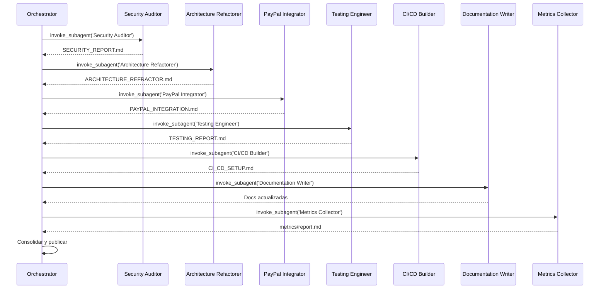

# agents.md – Orchestración Agéntica (Actualizado)

## Propósito
Este documento define cómo usar los agentes y sub‑agentes de Antigravity para ejecutar de forma automática el **Plan de Mejora** del proyecto e‑commerce, con foco en seguridad, arquitectura moderna y la única pasarela **PayPal**.

## Agente Raíz
- **Nombre:** `E‑commerce Improvement Orchestrator`
- **Responsabilidades:** dividir el plan en épicos, lanzar sub‑agentes, consolidar artefactos, actualizar la documentación y publicar el estado.
- **Herramientas habilitadas:** `run_command`, `write_file`, `edit_file`, `read_file`, `manage_task`, `invoke_subagent`, `send_message`, `schedule`.

## Sub‑agentes (Actualizados)
| Sub‑agente | Tipo | Rol | Artefactos generados |
|------------|------|-----|----------------------|
| Security Auditor | `research` | Auditoría de seguridad completa. | `SECURITY_REPORT.md` |
| Architecture Refactorer | `self` | Refactor a Slim 4, PHP‑DI, Eloquent, dotenv. | `ARCHITECTURE_REFRACTOR.md` |
| PayPal Integrator | `self` | Implementación del gateway PayPal (service, controller, webhook). | `PAYPAL_INTEGRATION.md` |
| Testing Engineer | `self` | Scaffold de pruebas PHPUnit y mocks Guzzle. | `TESTING_REPORT.md` |
| CI/CD Builder | `self` | Creación del workflow GitHub Actions. | `CI_CD_SETUP.md` |
| Documentation Writer | `self` | Actualiza README, MIGRACION, y todos los .md del proyecto. | (varios) |
| Metrics Collector | `self` | Script de métricas y reporte `metrics/report.md`. | `metrics/report.md` |

## Flujo de Orquestación (Mermaid)

## Buenas Prácticas
- Usa comandos prefijables (p.ej. `composer install`).
- Mantén la idempotencia de los sub‑agentes.
- Todos los informes se guardan en `docs/` y se marcan como `UserFacing: true`.
- Cada sub‑agente debe crear su propia rama (`feature/<sub‑agent>`). 

---

*Documento actualizado al 2026‑11‑05.*