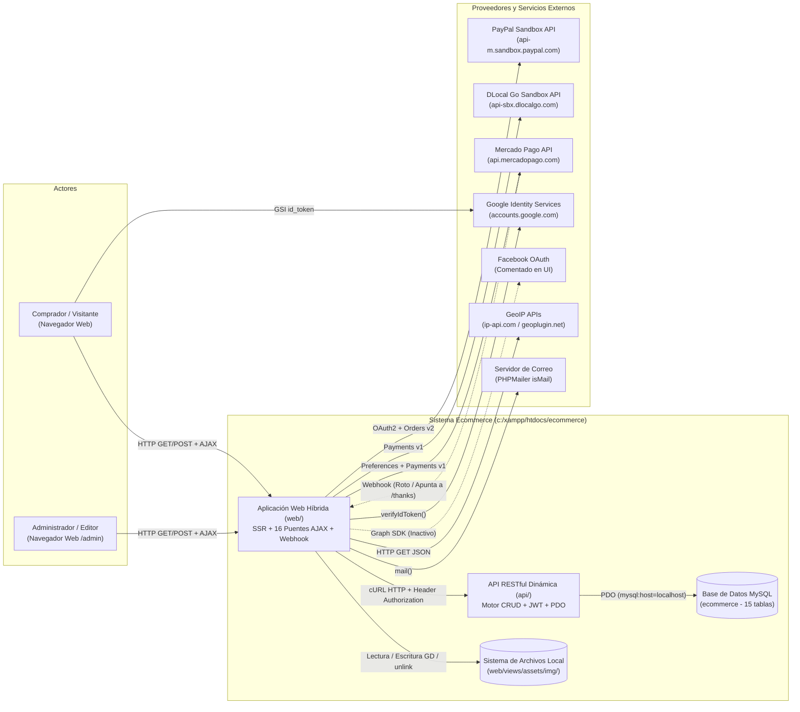
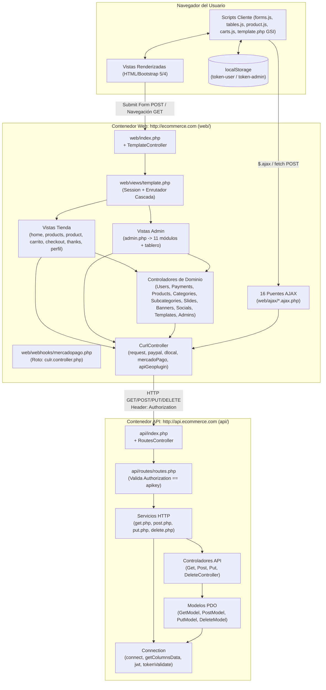

# 03 — Arquitectura Observada

> **Estado:** `[CONFIRMADO]` mediante trazabilidad estática completa de procesos, enrutadores, controladores y adaptadores HTTP.

---

## 1. Clasificación Arquitectónica Real

El sistema implementa una **Arquitectura Cliente-Servidor Desacoplada por HTTP Local pero Lógicamente Acoplada a Esquema**, compuesta por dos aplicaciones PHP independientes dentro del mismo repositorio:

1. **Aplicación Web Híbrida (`web/`)**:
   - Actúa simultáneamente como **Storefront SSR**, **Panel Administrativo SSR (`/admin`)**, **Capa de lógica de negocio** y **Puente AJAX (`web/ajax/`)**.
   - **No tiene conexión directa a MySQL**. Todo acceso a datos pasa por peticiones HTTP cURL hacia `http://api.ecommerce.com/` usando `CurlController::request()`.
   - La lógica de negocio (cálculo de totales de carrito, actualización manual de contadores de productos por categoría/subcategoría, orquestación de pagos, creación de órdenes y borrado de archivos físicos) reside íntegramente en `web/` (repartida entre controladores, vistas como `thanks.php` y scripts en `web/ajax/`).
2. **Motor API RESTful Dinámico Basado en Tablas (`api/`)**:
   - Es un pasamanos CRUD genérico sobre PDO (`GetModel`, `PostModel`, `PutModel`, `DeleteModel`) que traduce el primer segmento de la URL (`/{tabla}` o `/relations`) y los parámetros query (`linkTo`, `equalTo`, `rel`, `type`, `select`, `orderBy`, `startAt`, `endAt`, `between1`, `between2`, `search`) directamente en sentencias SQL contra MySQL, apoyándose en `information_schema.columns` y convenciones estrictas de sufijos (`_{entidad}`).

---

## 2. Diagrama de Contexto del Sistema

---

## 3. Diagrama de Contenedores y Procesos Internos

---

## 4. Análisis de Fronteras y Límites entre Módulos (Sección 4.3 y 5.5)

1. **Ausencia de Frontera de Dominio en `api/` (`[CONFIRMADO]`)**:
   - `api/` no conoce reglas de negocio del e-commerce (no sabe qué es un carrito, un descuento ni un pedido). Solo conoce nombres de tablas, sufijos de columnas y tokens en tablas de autenticación (`users`, `admins`).
2. **Descentralización de Escrituras en `web/` (`[CONFIRMADO]`)**:
   - Las mutaciones de base de datos no están encapsuladas en una capa de servicios:
     - Se ejecutan en **Controladores** (`PaymentsController`, `ProductsController`, etc.) al procesar `$_POST`.
     - Se ejecutan directamente en **Vistas durante peticiones `GET`**: `template.php:L18-22` actualiza `date_updated_user` en cada carga de página; `template.php:L492-496` verifica correos con `token=no`; `product.php:L43-47` incrementa `views_product` con `token=no`; `thanks.php:L74-177` actualiza `carts`, inserta en `orders`, actualiza `products` y elimina `carts`.
     - Se ejecutan en **Puentes AJAX (`web/ajax/`)**: `delete-admin.ajax.php`, `status-admin.ajax.php`, `templates.ajax.php`, `forms.ajax.php`, `google.ajax.php`.
3. **Doble Estado de Autenticación (`$_SESSION` vs `localStorage`) (`[CONFIRMADO]`)**:
   - Al iniciar sesión en PHP (`UsersController::login` o `AdminsController::login`), el servidor guarda el objeto usuario/admin en `$_SESSION["user"]` o `$_SESSION["admin"]` y simultáneamente inyecta un `<script>` que guarda `token_user` o `token_admin` en `localStorage`.
   - Las vistas SSR leen `$_SESSION`, mientras que las llamadas AJAX desde JS (`forms.js`, `tables.js`, `product.js`, `carts.js`) leen el token desde `localStorage` y lo envían por `$_POST["token"]` a `web/ajax/*.ajax.php`.
   - Al cerrar sesión en `web/views/pages/salir/salir.php`, solo se ejecuta `session_destroy()` sin limpiar `localStorage`.
4. **Mantenimiento Manual de Contadores Desnormalizados (`[CONFIRMADO]`)**:
   - Las columnas `categories.subcategories_category`, `categories.products_category` y `subcategories.products_subcategory` se incrementan y decrementan manualmente mediante peticiones `GET` seguidas de `PUT` desde `SubcategoriesController`, `ProductsController` y `delete-admin.ajax.php`, sin transacciones ni bloqueos.

