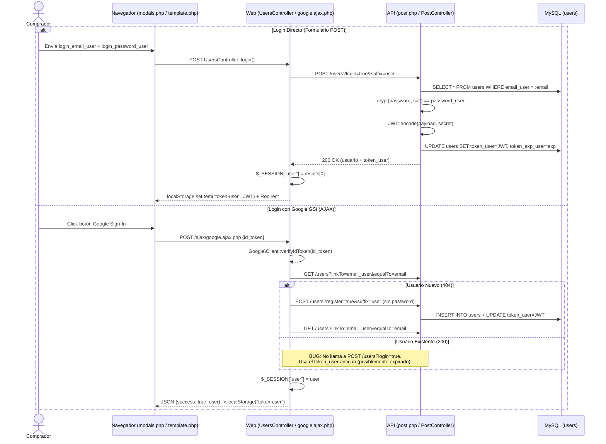
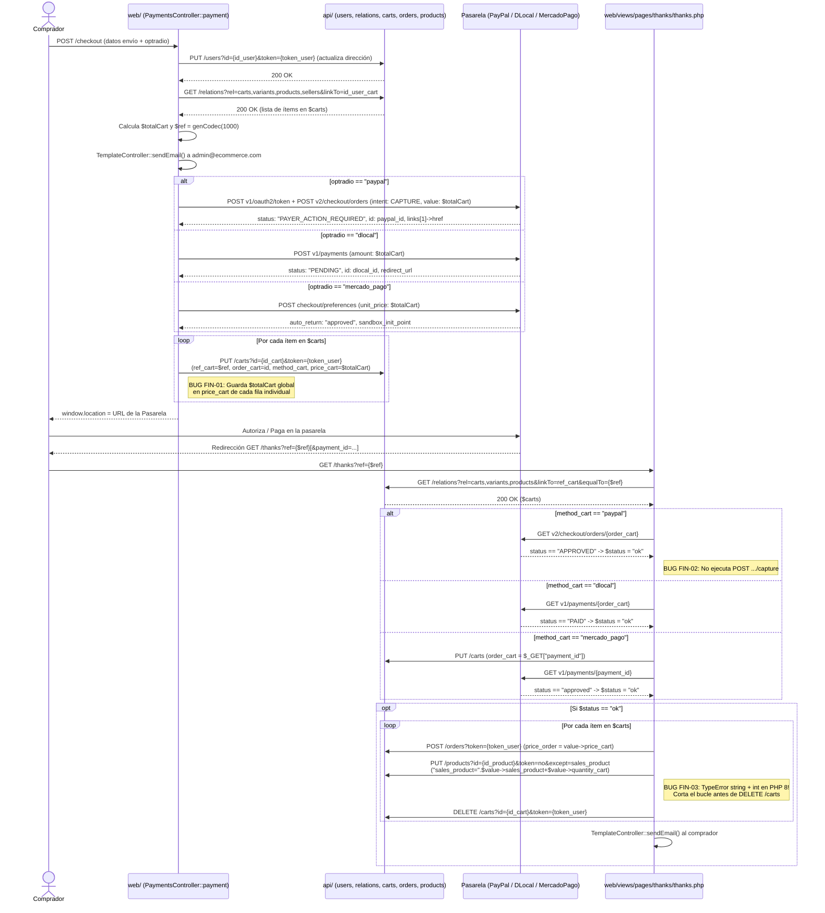

# 05 — Flujos Funcionales de Extremo a Extremo y Auditoría Financiera

> **Estado:** `[CONFIRMADO]` mediante trazabilidad de código desde eventos DOM/formularios hasta mutaciones SQL y pasarelas externas.

---

## 1. Mapa de Estado de los Flujos Investigados

| ID Flujo | Nombre del Flujo | Estado de Implementación | Archivos Principales | Observaciones Clave |
|---|---|---|---|---|
| **FL-01** | Navegación de Catálogo, Búsqueda y Detalle de Producto | `[CONFIRMADO]` (Con bugs en PHP 8 y ahorro negativo) | `template.php`, `products.php`, `product.php`, `product.js` | La vista `product.php:L45` lanza `TypeError` en PHP 8 al sumar `1` a `"views_product=".views_product`. Cuando `stock_variant == 0`, simula stock falso (`rand(10,20)`). |
| **FL-02** | Registro, Verificación, Login Directo, Reset y Login Social (Google) | `[CONFIRMADO]` (Parcial en Google/FB) | `users.controller.php`, `modals.php`, `google.ajax.php`, `post.controller.php` | El registro directo y login funcionan. El login con Google (`google.ajax.php`) no invoca `?login=true`, dejando `token_user` nulo o expirado. Facebook está comentado en la UI. |
| **FL-03** | Gestión de Carrito de Compras (`carts`) | `[CONFIRMADO]` | `product.js`, `carts.js`, `forms.ajax.php`, `carrito.php`, `navbar.php` | Requiere que el producto tenga un `id_seller_product` válido en `sellers` debido al `INNER JOIN sellers` y la FK `carts.1`. En precios `>= 1,000`, `carts.js` calcula `NaN` por la coma de `number_format`. |
| **FL-04** | Checkout e Inicio de Pago (PayPal, DLocal, MercadoPago) | `[CONFIRMADO]` | `checkout.php`, `payments.controller.php`, `curl.controller.php` | Sobrescribe `price_cart` en cada fila del carrito con el total global `$totalCart` (`FIN-01`) y envía email al vendedor antes de cobrar. |
| **FL-05** | Confirmación de Pago y Creación de Pedido (`/thanks` vs Webhook) | `[CONFIRMADO]` (Con defectos críticos) | `thanks.php`, `webhooks/mercadopago.php` | Depende de una petición `GET /thanks?ref=...` con sesión activa; PayPal no ejecuta `capture`; no descuenta `stock_variant`; `sales_product` falla en PHP 8; el webhook `mercadopago.php` está roto e inactivo. |
| **FL-06** | Gestión Administrativa de Catálogo, Pedidos y Reportes | `[CONFIRMADO]` | `admin.php`, `products.controller.php`, `payments.controller.php`, `web/ajax/*` | El bloqueo de rol `editor` carece de `return;` en las vistas restringidas. |

---

## 2. Trazabilidad Detallada de los Flujos Principales

### 2.1 FL-02: Autenticación de Clientes (Directa vs. Google GSI)

---

### 2.2 FL-04 y FL-05: Checkout, Pasarelas de Pago y Confirmación en `/thanks`

- **Estado del análisis:** `[CONFIRMADO]`
- **Archivos y símbolos:** `web/views/pages/checkout/checkout.php`, `web/controllers/payments.controller.php` (`PaymentsController::payment`), `web/controllers/curl.controller.php` (`paypal`, `dlocal`, `mercadoPago`), `web/views/pages/thanks/thanks.php`.

#### Diagrama de Secuencia Confirmado (Checkout → Pasarela → `/thanks`)

---

## 3. Auditoría de Integridad Financiera, Idempotencia y Concurrencia (Sección 6.1)

| Dimensión Auditada | Comportamiento Real en el Código | Evidencia Exacta | Estado y Riesgo |
|---|---|---|---|
| **1. Fuente de verdad del precio** | El servidor (`PaymentsController::payment`) consulta los precios desde la base de datos (`variants.price_variant` u `offer_variant`) y los multiplica por `quantity_cart`. No confía en precios enviados por POST desde el navegador en el checkout. Sin embargo, **no verifica la fecha de expiración de la oferta (`end_offer_variant`)**, aplicando ofertas vencidas indefinidamente. | `web/controllers/payments.controller.php:L49-61` | `[CONFIRMADO]` `[RIESGO]` (`FIN-07`) |
| **2. Semántica de importes persistidos (`price_cart` y `price_order`)** | **Defecto financiero grave (`FIN-01`):** Al actualizar cada fila del carrito antes de redirigir a la pasarela, se asigna `price_cart = $totalCart` (el total global de todo el carrito) en lugar del subtotal o precio unitario de ese ítem. Luego `thanks.php:L145` copia `price_order => $value->price_cart` en cada fila de `orders`. Si un cliente compra 3 productos de \$100 (total \$300), se crean 3 filas en `orders` cada una con `price_order = 300`, registrando \$900 de ventas en el dashboard y reportes. | `web/controllers/payments.controller.php:L119,178,249`, `web/views/pages/thanks/thanks.php:L145`, `web/views/pages/admin/tablero/modules/top.php:L19` | `[CONFIRMADO]` `[RIESGO]` (`FIN-01`) |
| **3. Captura real de fondos en PayPal** | **Defecto financiero grave (`FIN-02`):** `PaymentsController` crea la orden de PayPal con `"intent": "CAPTURE"`. Al regresar a `thanks.php:L29-36`, el código solo consulta `GET v2/checkout/orders/{id}` y comprueba `$paypal->status == "APPROVED"`, sin invocar nunca `POST v2/checkout/orders/{id}/capture`. El pedido se da por pagado y se entrega sin haber capturado el dinero en PayPal. | `web/controllers/payments.controller.php:L87`, `web/views/pages/thanks/thanks.php:L29-36` | `[CONFIRMADO]` `[RIESGO]` (`FIN-02`) |
| **4. Confirmación: Retorno `GET /thanks` vs. Webhook** | La creación de órdenes ocurre **exclusivamente** cuando el navegador del cliente carga `GET /thanks?ref=...` con su cookie de sesión activa (`$_SESSION["user"]->token_user`). El archivo `web/webhooks/mercadopago.php` nunca es invocado (`notification_url` apunta a `/thanks` en `payments.controller.php:L235`), tiene un `require_once` roto (`culr.controller.php` en `mercadopago.php:L8`) y ni siquiera contiene código para crear `orders`. Si el comprador paga y cierra la pestaña antes de volver a `/thanks`, pierde su compra. | `web/controllers/payments.controller.php:L235`, `web/views/pages/thanks/thanks.php:L137`, `web/webhooks/mercadopago.php:L8-56` | `[CONFIRMADO]` `[RIESGO]` (`FIN-05`, `FIN-09`) |
| **5. Idempotencia y fallo intermedio en PHP 8** | El único mecanismo para evitar duplicar órdenes al recargar `/thanks?ref=...` es que la línea `DELETE /carts` (`thanks.php:L174`) elimine el carrito tras crear la orden. Sin embargo, en la línea anterior (`L166`), la expresión `"sales_product=".$value->sales_product+$value->quantity_cart` lanza `Fatal error: Uncaught TypeError: Unsupported operand types: string + int` en PHP 8+, abortando la ejecución **después** de `POST /orders` (`L156`) y **antes** de `DELETE /carts` (`L174`). Cada recarga de `/thanks?ref=...` crea una orden duplicada adicional. | `web/views/pages/thanks/thanks.php:L156,166,174` | `[CONFIRMADO]` `[RIESGO]` (`FIN-03`) |
| **6. Descuento de inventario (`stock_variant`)** | **Nunca se descuenta el stock (`FIN-04`).** Ni `PaymentsController::payment()` ni `thanks.php` ejecutan un `PUT /variants` para restar `quantity_cart` de `stock_variant`. Además, cuando `stock_variant == 0`, `product.php:L275-284` muestra unidades falsas aleatorias (`rand(10,20)`) y permite seguir comprando. | `web/views/pages/thanks/thanks.php:L122-201`, `web/views/pages/product/product.php:L271-291` | `[CONFIRMADO]` `[RIESGO]` (`FIN-04`) |
| **7. Reutilización de `payment_id` en MercadoPago** | En `thanks.php:L63-92`, cuando `order_cart == ""`, el script toma cualquier `$_GET["payment_id"]` de la URL y verifica únicamente que en MercadoPago ese pago tenga `status == "approved"`, sin comprobar que el `external_reference` o el monto coincidan con `$ref` o `$totalCart`. | `web/views/pages/thanks/thanks.php:L63-92` | `[CONFIRMADO]` `[RIESGO]` (`FIN-06`) |

