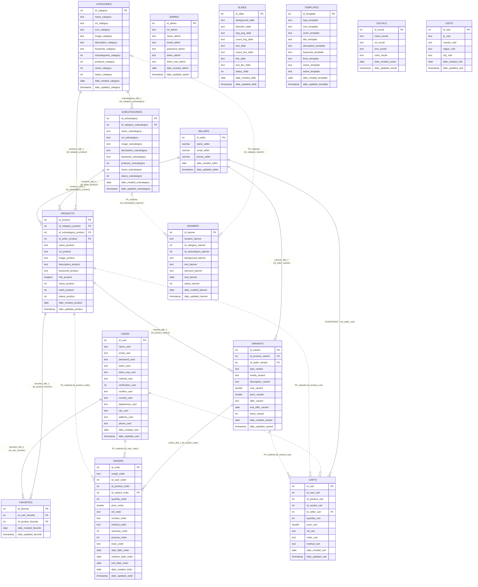

# 06 — Modelo de Datos y Auditoría de Deriva Esquema-Código

> **Fuente primaria:** `c:\xampp\htdocs\ecommerce\ecommerce (1).sql` (MariaDB 10.4.32, 856 líneas) contrastado contra `api/models/` y `web/`.  
> **Estado:** `[CONFIRMADO]`.

---

## 1. Convenciones Estructurales y Relacionales del Esquema

El motor `api/` exige una convención estricta de nombres documentada en `api/Documentación-APIRESTFul.pdf` (págs. 4–7) e implementada en `api/models/get.model.php`:

1. **Regla Tabla Plural / Sufijo Singular (`[CONFIRMADO]`)**:
   - Toda tabla tiene nombre en plural (`{entidades}`) y absolutamente todas sus columnas terminan con el sufijo en singular (`_{entidad}`).
2. **Columnas de Auditoría Estándar (`[CONFIRMADO]`)**:
   - Primera columna: `id_{sufijo} int(11) NOT NULL AUTO_INCREMENT` (`PRIMARY KEY`).
   - Últimas dos columnas: `date_created_{sufijo} date DEFAULT NULL` y `date_updated_{sufijo} timestamp NOT NULL DEFAULT current_timestamp() ON UPDATE current_timestamp()`.
3. **Regla de Joins Dinámicos en Estrella (`relations?rel=...&type=...`) (`[CONFIRMADO]`)**:
   - Cuando se invoca `GET /relations?rel=t0,t1,t2&type=s0,s1,s2`, `GetModel` (`get.model.php:L206,319,542,757`) construye cláusulas `INNER JOIN` uniendo **siempre la tabla principal `t0` (`$relArray[0]`)** con cada tabla secundaria `tk`:
     ```sql
     INNER JOIN {tk} ON {t0}.id_{sk}_{s0} = {tk}.id_{sk}
     ```
   - Esto significa que la tabla principal `t0` debe poseer explícitamente una columna llamada `id_{sk}_{s0}` por cada tabla incluida en `rel`. No soporta joins transitivos en cadena (`A -> B -> C`) a menos que `A` tenga directamente la columna `id_c_a`.

---

## 2. Diagrama Entidad-Relación (`erDiagram`)

> [!NOTE]
> Se distinguen las **10 relaciones con `FOREIGN KEY` física en InnoDB** (líneas continuas `||--o{`) de las **7 relaciones implícitas usadas por el código sin `FOREIGN KEY` física en el motor** (etiquetadas como `FK_implicita`).



---

## 3. Inventario Completo de las 15 Tablas (`ecommerce (1).sql`)

| # | Tabla | Sufijo | PK | Filas en Dump | FKs Físicas (`RESTRICT`) | FKs Implícitas (Solo en Código) | Propósito Observado |
|---|---|---|---|---|---|---|---|
| 1 | `admins` | `_admin` | `id_admin` | 2 (`id` 1, 3) | Ninguna | Ninguna | Usuarios del panel `/admin` con roles `admin` o `editor`. |
| 2 | `banners` | `_banner` | `id_banner` | 1 (`id` 10) | Ninguna | `id_category_banner`, `id_subcategory_banner` (usan `0` cuando `location_banner='HOME'`) | Banners promocionales de portada, categoría o subcategoría. |
| 3 | `carts` | `_cart` | `id_cart` | 0 | `id_seller_cart` -> `sellers.id_seller` (`L816`) | `id_user_cart`, `id_product_cart`, `id_variant_cart` | Líneas temporales del carrito de compra y estado previo al pago (`ref_cart`, `order_cart`, `method_cart`, `price_cart`). |
| 4 | `categories` | `_category` | `id_category` | 2 (`id` 8, 9) | Ninguna | Ninguna | Categorías principales del catálogo con contadores desnormalizados. |
| 5 | `favorites` | `_favorite` | `id_favorite` | 1 (`id` 22) | `id_product_favorite` -> `products`, `id_user_favorite` -> `users` (`L821-823`) | Ninguna | Lista de deseos por cliente. |
| 6 | `orders` | `_order` | `id_order` | 0 | `id_variant_order` -> `variants.id_variant` (`L829`) | `id_user_order`, `id_product_order` | Líneas de pedidos confirmados, estado logístico (`process_order`), guía (`track_order`) y fechas de entrega. |
| 7 | `products` | `_product` | `id_product` | 35 (`id` 51..85) | `id_category_product`, `id_subcategory_product`, `id_seller_product` (`L834-837`) | Ninguna | Cabecera de productos, SEO, texto enriquecido (`info_product`), vistas y ventas. |
| 8 | `sellers` | `_seller` | `id_seller` | 2 (`id` 1, 2) | Ninguna | Ninguna | Vendedores asociados a productos, variantes y carritos (agregada en `utf8mb4`). |
| 9 | `slides` | `_slide` | `id_slide` | 4 (`id` 1, 2, 4, 5) | Ninguna | Ninguna | Carrusel promocional con coordenadas CSS y textos JSON (`text_slide`). |
| 10 | `socials` | `_social` | `id_social` | 4 (`id` 1..4) | Ninguna | Ninguna | Enlaces e iconos de redes sociales en barra superior y pie de página. |
| 11 | `subcategories` | `_subcategory` | `id_subcategory` | 10 (`id` 18..27) | `id_category_subcategory` -> `categories.id_category` (`L843`) | Ninguna | Subcategorías de segundo nivel con contador `products_subcategory`. |
| 12 | `templates` | `_template` | `id_template` | 2 (`id` 1, 2) | Ninguna | Ninguna | Plantillas visuales del sitio (colores JSON, fuentes Google Fonts, logos). La activa tiene `active_template='ok'`. |
| 13 | `users` | `_user` | `id_user` | 1 (`id` 8) | Ninguna | Ninguna | Clientes de la tienda, credenciales, token JWT, método de registro y dirección de envío. |
| 14 | `variants` | `_variant` | `id_variant` | 121 (`id` 88..211) | `id_product_variant` -> `products`, `id_seller_variant` -> `sellers` (`L848-850`) | Ninguna | Variantes comercializables (`gallery` o `video`), precios, ofertas y stock. |
| 15 | `visits` | `_visit` | `id_visit` | 19 (`id` 1..19) | Ninguna | Ninguna | Registro de visitas geolocalizadas por IP, país, región y ciudad. |

---

## 4. Auditoría de Deriva Esquema-Código (Schema-Code Drift) e Integridad

| ID | Anomalía de Deriva / Integridad | Evidencia en Esquema (`ecommerce (1).sql`) | Evidencia en Código (`web/` y `api/`) | Impacto Real en el Sistema | Estado |
|---|---|---|---|---|---|
| **DRIFT-01** | **Tabla `sellers` con FK obligatoria en `carts`/`products`/`variants` pero huérfana en el Admin CRUD** | `carts.id_seller_cart`, `products.id_seller_product` y `variants.id_seller_variant` tienen `FOREIGN KEY` hacia `sellers(id_seller)` (`L816, 837, 850`). | `ProductsController::productManage()` (`web/controllers/products.controller.php:L394-406, 503-516`) **nunca envía `id_seller_product` ni `id_seller_variant`** al crear productos. Al agregar ese producto nuevo al carrito (`forms.ajax.php:L125`), `id_seller_cart` llega vacío (`""`), provocando que el `INSERT INTO carts` falle por restricción de llave foránea o que el `INNER JOIN sellers` (`navbar.php:L32`, `payments.controller.php:L36`) oculte el carrito. | Cualquier producto nuevo creado desde `/admin/productos/gestion` no puede comprarse a menos que se asigne `id_seller_product` manualmente en la BD. | `[CONFIRMADO]` `[RIESGO]` |
| **DRIFT-02** | **Inconsistencia de `id_seller` entre `products` y `variants` en los datos semilla** | En `ecommerce (1).sql:L205`, el producto `id_product=51` tiene `id_seller_product=1`, pero sus variantes (`L448-455`) tienen `id_seller_variant=2`. Además `orders` no tiene columna `id_seller_order`. | `product.php:L342` toma `idSeller` de `$product->id_seller_product` para guardarlo en `carts.id_seller_cart`, ignorando `variants.id_seller_variant`. | Inconsistencia en la atribución de vendedor y pérdida del vendedor al pasar de `carts` a `orders`. | `[CONFIRMADO]` |
| **DRIFT-03** | **Columna `offer_variant` declarada como `text` en lugar de `double`** | `variants.cost_variant` y `price_variant` son `double`, pero `offer_variant` es `text DEFAULT NULL` (`L435`) y contiene cadenas vacías `''` en el dump. | En PHP (`payments.controller.php:L51`, `navbar.php:L197`), se evalúa `empty($value->offer_variant)` o comparaciones numéricas implícitas sobre `text`. | Impide ordenar o filtrar numéricamente por precio de oferta en SQL. | `[CONFIRMADO]` |
| **DRIFT-04** | **Restricciones `FOREIGN KEY` impiden borrar productos con variantes o favoritos desde el Admin** | `variants_ibfk_1`, `favorites_ibfk_1` y `orders_ibfk_1` están definidas sin `ON DELETE CASCADE` (`RESTRICT` por defecto, `L821-850`). | `web/ajax/delete-admin.ajax.php:L118-173` borra la imagen principal del producto e invoca `DELETE products?id=...` sin borrar primero sus `variants` ni sus `favorites`. Además `DeleteModel::deleteData` (`api/models/delete.model.php:L37`) no tiene `try/catch`. | Intentar eliminar desde `/admin/productos` cualquier producto que tenga variantes lanza una `PDOException` fatal en la API después de haber borrado ya la imagen principal del producto en disco. | `[CONFIRMADO]` `[RIESGO]` |
| **DRIFT-05** | **Columnas y tablas declaradas en SQL pero inactivas en el flujo de la tienda** | `categories.views_category` (`L114`), `subcategories.views_subcategory` (`L337`), `banners.id_category_banner`/`id_subcategory_banner` (`L59-60`), `slides` (`L271`) y `visits` (`L575`). | `products.php` nunca incrementa `views_category` ni `views_subcategory`. `products/modules/banner.php:L5` consulta siempre `location_banner=HOME`. `home.php:L3-14` tiene comentado `visits.php` y no incluye `slide.php`. | Los contadores de vistas de categorías/subcategorías permanecen en `0`; los slides y el registro de nuevas visitas no se ejecutan en la portada actual. | `[CONFIRMADO]` |

---

## 5. Campos Sensibles y Ciclo de Vida de los Datos

| Tabla.Columna | Naturaleza del dato | Protección observada | Riesgos detectados | Evidencia |
|---|---|---|---|---|
| `users.password_user`, `admins.password_admin` | Credenciales de acceso | Hash Blowfish `$2a$07$` con sal estática compartida (`crypt`). `PostController::fncResponse` oculta el campo en login/registro, pero **`GetController` lo devuelve en claro** si se consulta `GET /users` o `GET /admins`. | Sal fija permite precomputación y cualquier consulta `GET` con la API key expone los hashes. | `api/controllers/post.controller.php:L35,215`, `api/controllers/get.controller.php` |
| `users.token_user`, `admins.token_admin` | Tokens portadores (JWT) | Validez de 24h (`token_exp_*`). Se almacenan en texto plano en la BD y en `localStorage` del navegador. | Expuestos en consultas `GET /users` y `GET /admins`; susceptibles a robo por XSS al vivir en `localStorage`. | `api/models/connection.php:L141-194`, `web/views/assets/js/` |
| `users.address_user`, `phone_user`, `email_user` | Datos personales (PII) | Sin cifrado en reposo. | Expuestos sin autenticación a través del puente `/ajax/report-clients.ajax.php`. | `web/ajax/report-clients.ajax.php:L32-170` |

